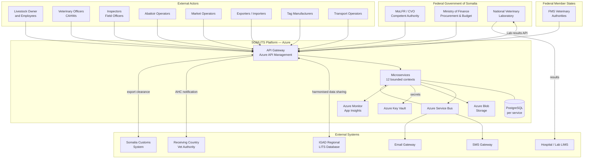
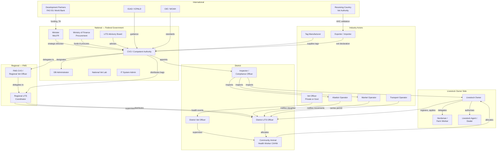
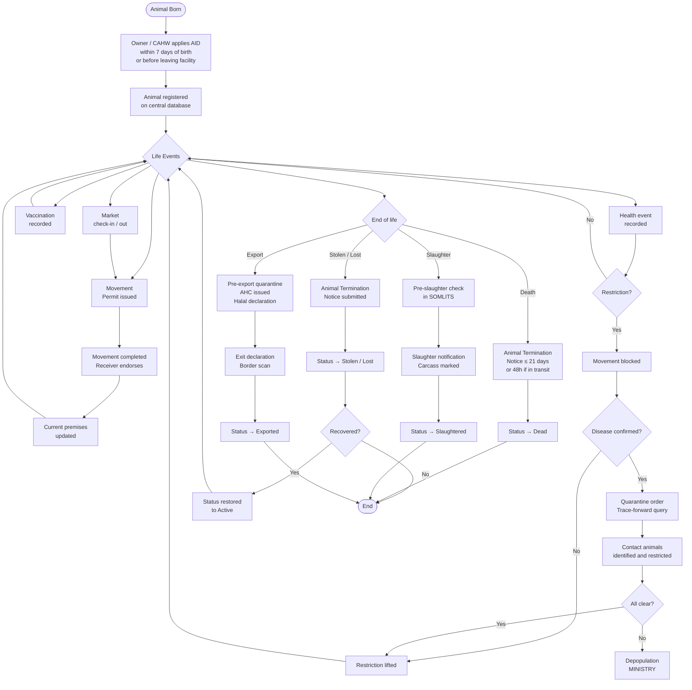

# SOMLITS — Domain Discovery Document

**Project:** Somalia Livestock Identification and Traceability System (SOMLITS)
**Implementing Body:** Ministry of Livestock, Forestry and Range (MoLFR), Federal Government of Somalia, through the Ministry of Finance
**Version:** 0.2 — Expanded Draft for Review
**Date:** 2026-07-18
**Status:** Awaiting Ministry Approval

---

## Classification Key

| Code | Meaning |
|---|---|
| **[IGAD]** | Requirement explicitly stated in the IGAD Model Legal Framework for LITS (2016), with article reference |
| **[SOMLITS]** | Proposed SOMLITS business rule not in the IGAD text |
| **[MINISTRY]** | Requires formal confirmation from the Somalia Ministry or CVO before implementation |

---

## 1. Executive Summary

SOMLITS is the national livestock identification and traceability platform of the Federal Government of Somalia. It is implemented by MoLFR through MoF procurement and is grounded in the IGAD Model Legal Framework for Livestock Identification and Traceability System (2016).

Somalia's livestock sector is the backbone of the national economy, contributing approximately 40% of GDP and 60% of export earnings. The sector is dominated by pastoral and agropastoral systems involving cattle, camels, sheep, and goats. Export markets — primarily the Gulf states — require formal animal identification, health certification, and increasingly Halal-compliant traceability. SOMLITS addresses all of these requirements.

**Primary objectives:**
1. Modernise livestock management through digital identification and registration
2. Enhance disease surveillance and enable rapid outbreak response
3. Improve compliance with international trade, health, and religious (Halal) standards
4. Protect livestock owners through proof of ownership
5. Support Somalia's obligations under the IGAD LITS regional framework

**Approach:** Modular, phased rollout. One module, one phase at a time. Every phase requires explicit approval before the next begins. No code is written without approved documentation.

---

## 2. Somalia Context

### 2.1 Governance Structure

Somalia operates under a federal system. SOMLITS must function across multiple layers of government:

| Level | Body | LITS Role |
|---|---|---|
| Federal | Ministry of Livestock, Forestry and Range (MoLFR) | Policy, regulation, national LITS authority |
| Federal | Ministry of Finance (MoF) | Procurement, budget, financial management of SOMLITS |
| Federal | Chief Veterinary Officer (CVO) | Designated Competent Authority under IGAD Art. 6 |
| Federal | National Veterinary Laboratory | Lab analysis, pathogen confirmation |
| Federal Member State | FMS Veterinary Authority / FMS CVO | Regional LITS implementation within each FMS |
| Region | Regional Veterinary Officer / Regional LITS Coordinator | Tag distribution, regional reporting, regional permits |
| District | District Veterinary Officer / District LITS Officer | Owner registration, premises registration, movement permits |
| Community | Community Animal Health Worker (CAHW) | Vaccination, tagging, death reporting, field data capture |

**Federal Member States (FMS)** recognised under the Provisional Federal Constitution: Jubaland State, South West State, Hirshabelle State, Galmudug State, Puntland State. **Somaliland** (northwest Somalia) administers itself as a self-declared independent state and requires a separate participation agreement. [MINISTRY]

### 2.2 Pastoral and Agropastoral Economy

Somalia has one of the highest ratios of livestock per capita in Africa. The majority of livestock are kept in transhumant or nomadic pastoral systems, in which owners regularly move their herds across large distances in search of water and pasture. Key implications for SOMLITS:

- Permanent premises registration may not suit all pastoralists; seasonal grazing areas need to be accommodated [MINISTRY]
- Mobile phone penetration is growing but connectivity in rural areas is unreliable [SOMLITS]
- Literacy levels vary; the system must support low-literacy users through voice, image, and simple code entry [SOMLITS]
- Community Animal Health Workers (CAHWs) are often the only livestock health professionals accessible in remote areas [SOMLITS]

### 2.3 Security and Access

Active conflict in parts of southern and central Somalia means some areas are inaccessible to government officials. SOMLITS must:

- Support offline-first data entry in areas without connectivity [SOMLITS]
- Avoid requiring owners in insecure areas to travel long distances to register [SOMLITS]
- Accept that full national coverage may not be achievable at launch; a phased geographic approach is required [MINISTRY]

### 2.4 Traditional Practices

Livestock ownership and identification in Somalia are governed by a combination of formal law and customary practice (Xeer). Key traditional practices:

| Practice | Description | SOMLITS Approach |
|---|---|---|
| Clan markings (astaamo) | Each clan or sub-clan marks animals with distinctive cuts, brands, or rope markings | Record as supplementary identifier; not a replacement for formal AID [SOMLITS] |
| Hot iron branding | Common for camels; burns a clan or owner mark onto skin | May be formally recognised by Minister alongside ear tags [MINISTRY / IGAD Art. 27(2)] |
| Ear notching | Small cuts in ear pattern used to identify ownership | Record as supplementary mark [SOMLITS] |
| Xeer ownership records | Clan elders maintain oral or written ownership records | SOMLITS does not replace Xeer but should be designed to complement it [SOMLITS] |

---

## 3. System Context Diagram



---

## 4. Stakeholders

### 4.1 Stakeholder Map



### 4.2 National Responsibilities

| Actor | Responsibilities | Class |
|---|---|---|
| Minister (MoLFR) | Approves AID types; approves national coding scheme; approves fees; approves AHC templates; reviews annual LITS reports; makes regulations | IGAD Art. 5 |
| Ministry of Finance | Budget allocation; procurement; financial reporting on SOMLITS project | SOMLITS |
| CVO / Competent Authority | National LITS registration agency; issues movement permits; database custodian; appoints inspectors; annual returns to Minister; cooperates with IGAD | IGAD Art. 6–7 |
| DB Administrator | Records all notifications within 10 days; manages database access; charges approved fees | IGAD Art. 14(7) |
| National Veterinary Laboratory | Analyses samples from disease investigations; reports results to SOMLITS within agreed SLA; maintains accreditation | SOMLITS |
| LITS Advisory Board | Advises on implementation, technology, cross-border matters; annual report to Minister | IGAD Art. 8–9 |
| IT System Administrator | Manages Azure infrastructure, deployments, system accounts; no access to LITS data without DB Admin grant | SOMLITS |

### 4.3 Regional and FMS Responsibilities

| Actor | Responsibilities | Class |
|---|---|---|
| FMS CVO / Regional Veterinary Officer | Regional LITS coordination within FMS; regional veterinary health events; regional movement permit oversight; regional inspection | SOMLITS / IGAD Art. 7(b) |
| Regional LITS Coordinator | Receives tag bags from national store; distributes to districts; records all custody events; regional reporting to national CVO | SOMLITS |
| Regional LITS Advisory Committee | Advises regional authority; adapts national LITS policy to regional context | MINISTRY |

### 4.4 District Responsibilities

| Actor | Responsibilities | Class |
|---|---|---|
| District Veterinary Officer | Records health events; conducts vaccination campaigns; issues health restrictions; authorises quarantine orders at district level | IGAD Art. 7 / SOMLITS |
| District LITS Officer | Registers owners and premises; receives and processes movement permit notifications and endorsements; receives termination notices; distributes tag bags to CAHWs and owners | IGAD Art. 12, 23 |
| LITS Inspector / Compliance Officer | Enters and inspects facilities; issues certificates of compliance; issues return permits for untagged animals; takes samples | IGAD Art. 39–41 |
| Community Animal Health Worker (CAHW) | Tags animals at birth; records vaccinations; assists with death reporting; distributes tags in remote areas; uploads offline data | SOMLITS |

### 4.5 Livestock Owner Responsibilities

| Responsibility | Class |
|---|---|
| Register personal identity and owner category on the central database | IGAD Art. 10(3)(a) |
| Register all animals born under their charge within 7 days | IGAD Art. 30(3) |
| Register all facilities where animals are kept | IGAD Art. 10(3)(d) |
| Submit annual stock count return within 30 days of year-end | IGAD Art. 18(4) |
| Apply for movement permits before moving animals | IGAD Art. 21(1) |
| Notify the Authority of animal death, theft, stray, or slaughter | IGAD Art. 24 |
| Safeguard unused tag devices; report loss immediately | IGAD Art. 37 |
| Make exit declaration when exporting animals | IGAD Art. 13 |
| Grant and revoke delegated access for employees and agents | SOMLITS |
| Provide accurate, up-to-date LITS information | IGAD Art. 11 |

### 4.6 Owner Employee and Delegate Responsibilities

| Responsibility | Class |
|---|---|
| Act within the scope of delegation granted by the owner | IGAD Art. 21(4)(d) |
| Tag animals at birth on the owner's behalf | SOMLITS |
| Accompany animals during movement and carry the movement permit | IGAD Art. 21(5) |
| Record health observations and report to the District Veterinary Officer | SOMLITS |
| Notify LITS officer of deaths or strays from the field | IGAD Art. 24 |
| Cannot further delegate their authority | SOMLITS |

### 4.7 Veterinary Authority Responsibilities

| Actor | Responsibilities | Class |
|---|---|
| CVO | Designation as Competent Authority; strategic veterinary policy; AHC signatory authority | IGAD Art. 6 |
| Veterinary Officer (Government) | Records health events; imposes and lifts health restrictions; issues and lifts quarantine orders; signs AHCs; conducts pre-export quarantine inspection | IGAD Art. 2, 21(4)(c) |
| Veterinary Officer (Private) | Records health events; refers disease suspicions to government officer; issues vaccination certificates under authority of government vet | MINISTRY |
| CAHW | Vaccinations; field health observations; assists with tagging; reports disease suspicions to District Vet Officer | SOMLITS |

---

## 5. Domain Areas

### 5.1 Premises Types

All locations where livestock are kept or livestock activities are conducted must be registered as LITS facilities. Somalia's pastoral context requires a broader set of premises types than a sedentary agricultural system.

| Premises Type | Description | Class |
|---|---|---|
| Permanent Farm | Sedentary holding of livestock (commercial or private) | IGAD Art. 2 |
| Pastoral Seasonal Grazing Area | A defined area used by a herder during a specific season; may overlap with other herders' areas | MINISTRY |
| Communal Watering Point | A well, borehole, or water source where multiple herders converge | MINISTRY |
| Transit Holding Yard | Temporary holding en route between origin and destination | IGAD Art. 13 |
| Livestock Market | Registered periodic or permanent market (animal gathering) | IGAD Art. 23(5) |
| Local Abattoir | Abattoir licensed for domestic consumption | IGAD Art. 25 |
| Export Abattoir | Abattoir certified for export to specific markets; higher hygiene and traceability standards | IGAD Art. 25(4) |
| Quarantine Station | Dedicated facility for pre-export or disease-control quarantine | IGAD Art. 21(7)(c) |
| Border Inspection Post | Point of entry/exit for international animal movement | IGAD Art. 17, 33 |
| Export Holding Facility | Pre-export assembly point adjacent to port or airport | IGAD Art. 13, 33 |
| Community Animal Health Post | CAHW base; may serve as tag distribution point | SOMLITS |
| Veterinary Clinic / Dip Tank | Location where veterinary treatments and dipping occur | SOMLITS |

**Registration requirements for all premises:**
- Name, GPS coordinates, premises type, premises code (assigned on approval) [SOMLITS]
- Owner of record, contact details [IGAD Art. 10(3)(d)]
- Status lifecycle: Pending → Active → Suspended → Closed [SOMLITS]
- Certificate of LITS Registered Facility issued on approval [IGAD Art. 2]
- Annual renewal with inspection [MINISTRY]

---

### 5.2 Identification Methods

| Method | Description | Applicability | Class |
|---|---|---|---|
| Visual tamperproof ear tag | Two-part plastic tag bearing indelible unique ID number; primary SOMLITS AID | All species | IGAD Art. 28 |
| Bar-coded tamperproof ear tag | Visual tag with additional machine-readable barcode | All species (optional upgrade) | IGAD First Schedule |
| RFID tamperproof ear tag | Electronic tag readable by scanner; enables automated data capture | All species (phased introduction) | IGAD First Schedule |
| RFID bolus | Swallowed RFID transponder for ruminants; tamper-resistant | Cattle, camels | IGAD First Schedule |
| Subcutaneous RFID microchip | Implanted chip; permanent and tamper-proof | Cattle, high-value animals | IGAD First Schedule |
| Hot iron brand | Permanent skin mark; traditional and widely used in Somalia for camels | All large ruminants | IGAD Art. 27(2) / MINISTRY |
| Traditional clan marking | Ear notch, rope mark, or brand indicating clan/owner; culturally significant | All species | SOMLITS (supplementary) |

**Species-specific requirements:**

| Species | Primary Tag | Secondary Tag | Timing | Class |
|---|---|---|---|---|
| Cattle | Left ear | Right ear | Within 7 days of birth or before leaving facility | IGAD Art. 30(2)(3) |
| Sheep | One ear (left ear proposed) | Optional | Within 7 days of birth or before leaving facility | IGAD Art. 31 |
| Goats | One ear (left ear proposed) | Optional | Within 7 days of birth or before leaving facility | IGAD Art. 31 |
| Camels | [To be confirmed] | [To be confirmed] | [To be confirmed] | MINISTRY |
| Imported animals | AID within 14 days of entry | — | Registered in DB within 7 days of tagging | IGAD Art. 17 |

**National identification coding scheme:** Requires Minister's determination by Gazette notice. [MINISTRY — see Open Question D-004]

---

### 5.3 Tag Custody and Distribution

Every AID moves through a documented custody chain from manufacturer to the animal. No tag may be applied without having a recorded chain of custody.

**Custody chain:**

```
Tag Manufacturer
      ↓ [notify Authority within 48h of supply — IGAD Art. 29(2)]
National Store (LITS Authority)
      ↓ [custody event recorded]
Regional LITS Coordinator
      ↓ [custody event recorded]
District LITS Officer
      ↓ [custody event recorded]
CAHW / Field Officer  ←→  Owner
      ↓ [custody event recorded]
Animal (tag activated on application)
```

**Tag bag rules [SOMLITS]:**
- Tags assembled in bags of 25 sequential tag numbers
- Each bag bears a unique bag serial number
- Bags are sealed; partial bags created only when tags are allocated from the bag to owners
- A lost bag triggers compromise of all 25 tag numbers; the owner must notify the nearest LITS officer immediately
- Lost bag numbers are flagged in SOMLITS; any subsequent animal registration using a flagged number raises an alert

**Manufacturer obligations [IGAD Art. 29]:**
- Must obtain Authority approval before supplying any tags
- Tags must bear numbers allocated by the Authority (not chosen by manufacturer)
- Must notify Authority within 48 hours of supply: tag codes, recipient name/address/contact, date, quantity
- Tags cannot be re-used or transferred to a different owner without Authority approval

**Owner obligations for unused tags [IGAD Art. 37]:**
- Keep unused tags secure against theft
- Report any loss immediately to the nearest LITS officer

---

### 5.4 Animal Registration

| Requirement | Class |
|---|---|
| Every animal born must be tagged and registered within 7 days of birth, or before leaving the facility of birth, whichever is sooner | IGAD Art. 30(3), 31(2) |
| Registration submitted electronically (via app or web) or on a prescribed paper form with later upload | IGAD Art. 16(2), Art. 14(4)(b) |
| Animal is assigned a UUID as the internal system key; the tag code is the business-facing identifier | SOMLITS |
| Animal UUID never changes, even after tag replacement | SOMLITS |
| Registration data must include: species, breed, sex, approximate date of birth, colour/markings, dam ID (if known), sire ID (if known), current owner UUID, current premises UUID, primary tag code, secondary tag code (where applicable) | IGAD Art. 14(5) / SOMLITS |
| Traditional clan marks recorded as supplementary fields | SOMLITS |
| Animals registered in bulk (herd batch) if not individually identified; batch records linked to premises and owner | IGAD Art. 26(3)(b) / SOMLITS |
| No animal may leave a registered facility more than 12 months after the Act commences without confirmed registration in the DB | IGAD Art. 16(3) |
| Annual stock count return submitted to central DB within 30 days of calendar year-end | IGAD Art. 18(4) |
| Imported animal: tagged within 14 days of entry; registered in DB within 7 days of tagging; entered into imported animal register within 7 days of arrival at destination facility | IGAD Art. 17, Art. 20 |

---

### 5.5 Ownership History

| Requirement | Class |
|---|---|
| Every change of ownership is recorded as a permanent, immutable event in SOMLITS | SOMLITS |
| Ownership transfer event records: previous owner UUID, new owner UUID, date of transfer, reason, associated movement permit (if applicable) | SOMLITS |
| Ownership transfer reasons: Sale, Gift, Inheritance, Court Order, Confiscation, Restitution | SOMLITS |
| Both previous and new owner must confirm the transfer in SOMLITS before it is finalised (dual-endorsement) | SOMLITS |
| After transfer, all LITS obligations (tagging, movement permits, registration) fall to the new owner | IGAD Art. 10(3) |
| An animal cannot be transferred while its status is Dead, Slaughtered, or Exported | SOMLITS |
| Ownership records retained for the lifetime of the animal plus the minimum data retention period | IGAD Art. 14(6) / MINISTRY |
| System exposes ownership history to inspectors, the Authority, and the animal's current owner | IGAD Art. 15 |

---

### 5.6 Animal Movement

| Requirement | Class |
|---|---|
| No animal may be moved from a facility without a movement permit and an approved AID attached | IGAD Art. 21(1) |
| Movement permit issued by Authority or authorised officer; may be issued electronically | IGAD Art. 21(2), Art. 22 |
| Pre-conditions for permit issuance (all must pass): origin Active; destination Active (or export destination); no movement restrictions; animal health clear; agent authorised if not owner; previous permits accounted for | IGAD Art. 21(4) |
| Movement permit accompanies animals during movement; receiver endorses at destination | IGAD Art. 21(5), Art. 23(3) |
| Confirmed movement updates animal's current premises in the Animal Registry | SOMLITS |
| Unused permits returned within 7 days of expiry | IGAD Art. 23(6) |
| Animal cannot receive a new movement permit once status is Dead, Slaughtered, or Exported | SOMLITS |
| Walking permit required for grazing outside registered facility boundary; person in charge carries copy at all times | IGAD Art. 21(10) |
| Emergency veterinary movement exempt from permit but must be retrospectively notified | IGAD Art. 21(13) |
| Seasonal pastoral migration (transhumance) movement permit rules | MINISTRY |
| Cross-border movement permit harmonisation with Ethiopia, Kenya, Djibouti | IGAD Art. 43–44 / MINISTRY |
| Movement permit validity period | MINISTRY (proposed: 14 days domestic, 30 days export) |

---

### 5.7 Vaccination and Health Events

**Health event types:**

| Event Type | Description | Recorder | Class |
|---|---|---|---|
| Vaccination | Single animal or batch; linked to a vaccination campaign | Vet Officer / CAHW | IGAD Art. 14(5)(b) |
| Clinical examination | Physical examination by vet officer; findings recorded | Vet Officer | SOMLITS |
| Disease diagnosis | Confirmed disease episode; triggers health restriction | Vet Officer | IGAD Art. 21(4)(c) |
| Treatment / medication | Drug administered; withholding period recorded | Vet Officer / CAHW | SOMLITS |
| Lab sample taken | Sample collected for laboratory analysis | Vet Officer / Inspector | SOMLITS |
| Lab result received | Positive or negative result linked to sample event | Lab / DB Admin | SOMLITS |
| Health restriction imposed | Movement blocked at animal or premises level | Vet Officer | IGAD Art. 21(4)(c) |
| Health restriction lifted | Restriction removed after clearance | Vet Officer | IGAD Art. 21(4)(c) |
| On-farm death | Death not at abattoir; ANT submitted within 21 days | Owner / CAHW | IGAD Art. 24(1) |
| Death in transit | Death during transport; ANT submitted within 48 hours | Transport Operator | IGAD Art. 24(3) |

**Vaccination campaign [SOMLITS]:**
- Named campaign: campaign name, vaccine type, vaccine batch number, manufacturer, expiry date, target species, target region, planned date range
- Each animal vaccination linked to campaign, vaccinator (CAHW/vet officer), date, dose
- Campaign completion report generated for Ministry review
- Vaccination certificates generated per animal or per premises for market and export purposes
- A vaccination event does NOT create a movement record

**Key rule:** Health events and animal movements are separate domain records. A vaccination or treatment at a premises does not constitute a movement of the animal. [SOMLITS]

---

### 5.8 Disease Investigation

Disease investigation is triggered by a confirmed or suspected notifiable disease event.

```mermaid
flowchart TD
    A([Disease Suspicion\nor Unusual Mortality]) --> B[Owner / CAHW\nreports to District Vet Officer]
    B --> C[District Vet Officer\nvisits premises]
    C --> D[Clinical examination\nrecorded in SOMLITS]
    D --> E[Health restriction\nimposed on premises\nmovement blocked]
    E --> F[Samples collected\nand sent to lab\nchain of custody recorded]
    F --> G{Lab result}
    G -- Negative --> H[Health restriction lifted\nOwner notified\n[SOMLITS]]
    G -- Positive notifiable disease --> I[Quarantine order\nraised by Vet Officer]
    I --> J[Trace-forward query:\nall contact animals identified]
    J --> K[Movement restrictions\nextended to contact premises]
    K --> L[Contact animals tested\nand monitored]
    L --> M{All animals\nclear?}
    M -- No --> N[Extend quarantine\nDepopulation if required\n[MINISTRY]]
    M -- Yes --> O[Quarantine order lifted\nOwner notified\nInternational notification if OIE-listed]
    O --> P([Investigation closed])
    H --> P
```

**Notifiable diseases of priority concern for Somalia:**

| Disease | Species | Relevance | Class |
|---|---|---|---|
| Foot and Mouth Disease (FMD) | Cattle, camels, sheep, goats | Major export barrier for Gulf markets | IGAD Art. 14(5)(d) |
| Peste des Petits Ruminants (PPR) | Sheep, goats | Endemic; major small ruminant killer | IGAD Art. 14(5)(d) |
| Contagious Bovine Pleuropneumonia (CBPP) | Cattle | OIE-listed; trade barrier | IGAD Art. 14(5)(d) |
| Camel Pox | Camels | Economically significant; export risk | SOMLITS |
| Rift Valley Fever (RVF) | All ruminants; zoonotic | Zoonotic; seasonal outbreaks | IGAD Art. 14(5)(d) |
| Lumpy Skin Disease (LSD) | Cattle | OIE-listed; increasing spread | SOMLITS |
| Anthrax | All species; zoonotic | Sporadic outbreaks | IGAD Art. 14(5)(d) |
| Brucellosis | Cattle, camels; zoonotic | Public health concern | IGAD Art. 14(5)(d) |
| Trypanosomiasis | Cattle | Tsetse fly zones of south Somalia | SOMLITS |

**OIE disease reporting:** Positive results for OIE-listed diseases trigger automatic notification to the CVO for international reporting. [IGAD Art. 43 / SOMLITS]

---

### 5.9 Laboratories

| Requirement | Class |
|---|---|
| Authority accredits laboratories authorised to analyse LITS samples | IGAD Art. 7(v) |
| National Veterinary Laboratory (Mogadishu) is the primary accredited lab | SOMLITS |
| Regional labs accredited where they meet Authority standards | SOMLITS |
| International reference labs used for exotic or OIE-listed disease confirmation | SOMLITS |
| Every lab sample has a chain of custody: sample ID, collected by, date/time, animal/herd, premises, condition of sample, lab received by, date received | SOMLITS |
| Lab result recorded in SOMLITS: lab name, sample ID, test type, result (positive/negative/inconclusive), report date, pathogen identified (if positive) | SOMLITS |
| Lab result linked to originating health event and animal record | SOMLITS |
| Positive OIE-listed disease result triggers: automatic health restriction; quarantine order workflow; notification to CVO for international reporting | SOMLITS |
| Lab accreditation body and list of accredited labs | MINISTRY |
| Lab results SLA (target turnaround time) | MINISTRY |
| SOMLITS interface with National Veterinary Laboratory LIMS | SOMLITS (API design phase) |

---

### 5.10 Markets

| Requirement | Class |
|---|---|
| Livestock markets (animal gatherings) are registered as LITS facilities of type MarketGathering | IGAD Art. 2, Art. 23(5) |
| Market operator is a registered stakeholder | IGAD Art. 2 |
| Market operator notifies the Authority of animal arrivals and departures electronically by the second working day after the event | IGAD Art. 23(5) |
| An animal arriving at a market without an approved AID: market operator issues a return permit to facility of origin, or detains the animal | IGAD Art. 21(14) |
| Animals that fail health checks at the market may be detained pending Authority decision | IGAD Art. 21(4)(c), Art. 41 |
| Market session is a dated event; each session produces an arrival manifest and a departure manifest | SOMLITS |
| Market operator scans or enters tag codes at check-in and check-out | SOMLITS |
| Unconfirmed arrivals (animals present at market without incoming movement permit) are flagged for inspector review | SOMLITS |
| Somalia-specific: many informal rural markets (xaafadaha suuqa xoolaha) are not currently registered | SOMLITS — outreach and registration campaign required |
| Formal market types: permanent urban market, periodic rural market, export assembly market, port holding market | SOMLITS |
| Market registration requires: market name, GPS location, market type, market days and times, operator details, premises code | SOMLITS |

---

### 5.11 Quarantine

| Requirement | Class |
|---|---|
| Movement permit conditions may require quarantine before or after movement | IGAD Art. 21(7)(c) |
| Movement through an area suspected of infection is prohibited | IGAD Art. 21(12)(a) |
| Inspector may detain animals where the Act is being contravened | IGAD Art. 41 |
| Quarantine order attributes: order ID, issuing officer UUID, reason, scope (animal list / premises list / geographic zone), date raised, expected duration, status | SOMLITS |
| Quarantine scope types: individual animal, named premises list, GPS radius in kilometres, administrative boundary (district/region) | SOMLITS |
| Geographic quarantine zone definition mechanism | MINISTRY |
| While a quarantine order is active: no movement permits issued from or to premises within scope | SOMLITS |
| Quarantine lifted by an authorised veterinary officer; lifting recorded as an event in SOMLITS | SOMLITS |
| Quarantine lifting conditions: lab clearance OR specified period elapsed without further disease signs | SOMLITS |
| Quarantine orders visible to: Authority, inspectors, affected premises owners, district officers | SOMLITS |
| Pre-export quarantine: period and conditions required by receiving country | MINISTRY |

---

### 5.12 Live-Animal Export

Somalia's primary export markets are the Gulf Cooperation Council countries, Egypt, Libya, and Djibouti. Export is a critical revenue source and Halal compliance is a non-negotiable requirement for Gulf markets.

| Requirement | Class |
|---|---|
| Owner must make an exit declaration at the transitional (export holding) facility | IGAD Art. 13(1)(b) |
| Export permit conditions include certification of health status, origin, and identity of each animal | IGAD Art. 21(7)(d) |
| AHC issued per consignment by an authorised veterinary officer | IGAD Art. 2 |
| Animal status set to Exported on departure confirmation at the border; no further live-animal movement permit may be issued | SOMLITS |
| Border inspection post records every animal's exit by tag scan and batch manifest | SOMLITS |
| Export notification sent to receiving country veterinary authority where a bilateral agreement exists | IGAD Art. 43(1) |
| **Halal certification:** Export consignment to Gulf markets must include documentation of Halal eligibility — animal is not dead, not blind, not lame, not diseased, and will be slaughtered by Islamic method | SOMLITS |
| Pre-export quarantine period and conditions vary by destination market | MINISTRY |
| Approved export markets and their specific species, age, weight, health, and vaccination requirements | MINISTRY |
| AHC template format for Somalia — must meet OIE standards and bilateral requirements with each receiving country | MINISTRY |
| Export consignment includes: species, count, tag codes for individually identified animals, origin premises, owner, vaccination records, quarantine records, AHC serial number, Halal eligibility declaration | SOMLITS |
| Rejected consignment: animals returned to origin premises; movement recorded; owner and LITS officer notified | SOMLITS |

---

### 5.13 Abattoirs and Slaughter

| Requirement | Class |
|---|---|
| Abattoir must be registered as a LITS facility | IGAD Art. 2 |
| Abattoir operator checks central database before slaughter: health status, origin, movement history, and eligibility | IGAD Art. 25(3) |
| Abattoir operator notifies the nearest LITS officer of every animal slaughtered | IGAD Art. 25(1) |
| Slaughter notification includes: movement permit, animal movement notice, slaughter information form with date, species, count, individual tag codes (for individually identified animals) | IGAD Art. 25(2) |
| Export abattoirs must notify electronically in Authority-approved format | IGAD Art. 25(4) |
| AID removed at slaughter — the only authorised removal without replacement | IGAD Art. 36(2)(c) |
| Carcass or meat marked or labelled to enable trace-back to the live animal or batch | IGAD Art. 38 |
| Slaughter records retained minimum 3 years | IGAD Art. 25(5) |
| Animal status set to Slaughtered; no further movement permit may be issued | SOMLITS |
| **Halal slaughter compliance:** Abattoir operator confirms Islamic slaughter method (Zabiha) was used; this is recorded in the slaughter event and referenced in any subsequent meat certification | SOMLITS |
| Ante-mortem inspection record linked to slaughter event | SOMLITS |
| Post-mortem (carcass) inspection record linked to slaughter event | SOMLITS |
| Emergency / field slaughter: authority to order and process | MINISTRY |

**Abattoir types and requirements:**

| Type | Certification Required | Electronic Notification | Halal Certification | Class |
|---|---|---|---|---|
| Local/municipal abattoir | LITS registration | Optional | Optional | IGAD Art. 25 |
| Export abattoir | LITS registration + export certification | Mandatory | Mandatory for Gulf markets | IGAD Art. 25(4) / SOMLITS |
| Emergency / disease-control slaughter | Authority order | Retrospective | Not applicable | MINISTRY |

---

### 5.14 Death, Loss, Theft and Confiscation

| Event | Notification Obligation | Deadline | Form | Status | Class |
|---|---|---|---|---|---|
| On-farm death | Owner or person in charge notifies nearest LITS officer | Within 21 days of becoming aware | Animal Termination Notice | → Dead | IGAD Art. 24(1) |
| Death in transit | Transport operator notifies nearest LITS officer | Within 48 hours | Animal Termination Notice | → Dead | IGAD Art. 24(3) |
| Death at abattoir before slaughter | Abattoir operator notifies nearest LITS officer | Within 48 hours | Animal Termination Notice | → Dead | IGAD Art. 24(2) |
| Theft | Owner notifies nearest LITS officer | As soon as practicable | Animal Termination Notice | → Stolen | IGAD Art. 24(1) / SOMLITS |
| Stray / lost | Owner notifies nearest LITS officer | Within 21 days | Animal Termination Notice | → Lost | IGAD Art. 24(1) |
| Confiscation by court or authority order | Authority records the confiscation as an ownership transfer event | At time of confiscation | Confiscation Order record | Active; ownership transferred | SOMLITS |

**Additional rules:**
- Copy of Animal Termination Notice retained by the notifier for at least 3 years [IGAD Art. 24(4)]
- Stolen animal tag numbers flagged in SOMLITS; subsequent registration attempts with those numbers raise an alert [SOMLITS]
- A lost animal that is subsequently recovered can be re-registered with status restored to Active under the current owner [SOMLITS]
- Confiscated animal records: previous owner retained in history; new owner (state/lien holder) recorded; reason = Confiscation [SOMLITS]
- Confiscation legal authority and process | MINISTRY
- Animals confiscated and subsequently returned (wrongful confiscation) must have their ownership restored | SOMLITS

---

### 5.15 Trace-back and Trace-forward

| Requirement | Class |
|---|---|
| System provides the full history of an animal from birth to current location or final status | IGAD Art. 3(f), Art. 14(5)(i) |
| Any potential purchaser of an animal can trace that animal's history | IGAD Art. 14(5)(i) |
| System supports rapid disease outbreak response through trace-forward | IGAD Art. 14(5)(f) |
| Traceability data is immutable; no record may be physically deleted; status transitions used instead | SOMLITS |

**Trace-back query:** Given a tag code or animal UUID, return:
- Birth event (species, date, dam ID if known, premises of birth, registering officer)
- Complete ownership history (owner, dates, transfer reason)
- Complete premises history (all premises, entry and exit dates)
- All health events (vaccination, diagnosis, treatment, lab results)
- All movement events (origin, destination, permit reference, date confirmed)
- Tag replacement history (original numbers and replacement numbers)
- Final status event (dead, slaughtered, exported, lost, stolen)

**Trace-forward query:** Given an animal, premises, health event, or time window, return:
- All animals present at the same premises during a specified period (contact animals)
- All animals that moved from that premises during a specified period (at-risk animals)
- Recursively, all downstream premises those animals moved to (configurable depth)

**Time window for trace-forward:** Configurable per disease (e.g., 21 days for FMD, 14 days for PPR). [SOMLITS / MINISTRY for specific periods]

**Access control for trace queries:**

| Query Type | Accessible By | Class |
|---|---|---|
| Trace-back (own animals) | Owner and delegates | IGAD Art. 15 |
| Trace-back (any animal, limited view) | Registered purchaser / market operator | IGAD Art. 14(5)(i) |
| Trace-back (full history) | Inspectors, Veterinary Officers, Authority | IGAD Art. 15 |
| Trace-forward | Veterinary Officers, Authority, Inspectors only | IGAD Art. 15 / SOMLITS |
| Regional data sharing | IGAD / ICPALD regional database (bilateral agreement) | IGAD Art. 43–44 / MINISTRY |

---

### 5.16 Animal Health Certification

Animal Health Certificates (AHCs) are issued for export consignments and must meet the requirements of both the sending country (Somalia) and the receiving country's import conditions.

| Requirement | Class |
|---|---|
| AHC issued per consignment by an authorised veterinary officer | IGAD Art. 2 |
| AHC serial number unique; issued in SOMLITS and traceable | SOMLITS |
| AHC is linked to the export consignment record, movement permit, and exit declaration | SOMLITS |
| AHC revocable if conditions change before loading (e.g., animal falls ill) | SOMLITS |
| AHC validity period | MINISTRY |

**Standard AHC content:**

| Section | Content | Class |
|---|---|---|
| Header | AHC serial number, issuing country (Somalia), issuing authority (CVO/MoLFR), issue date, validity date | SOMLITS |
| Consignment | Species, count, individually identified animals (tag codes), total weight | IGAD Art. 2 |
| Origin | Country of origin, region, premises of origin, premises code | IGAD Art. 28(2)(b) |
| Health declaration | Animals examined and found clinically healthy; disease-free area declaration; OIE status of Somalia | IGAD Art. 21(7)(d) |
| Vaccination | Vaccine type, batch, date administered per species per disease | IGAD Art. 14(5)(b) |
| Quarantine | Pre-export quarantine period and station (where required) | IGAD Art. 21(7)(c) |
| **Halal eligibility** | Declaration that animals meet Halal eligibility criteria for Islamic slaughter: no blind, lame, or diseased animals | SOMLITS |
| Receiving country section | Country-specific fields required by receiving country import regulations | MINISTRY per market |
| Signatures | Issuing veterinary officer name, registration number, signature, stamp | IGAD Art. 2 |

**AHC template format and authority to issue:** Requires Ministry determination per export market. [MINISTRY — see Open Question D-010, D-011]

---

### 5.17 Notifications

| Trigger Event | Recipient(s) | Channel | Class |
|---|---|---|---|
| Owner registration approved or rejected | Owner | SMS, in-app | SOMLITS |
| Animal registration confirmed | Owner | SMS, in-app | SOMLITS |
| Movement permit issued | Owner / applicant | SMS, in-app | SOMLITS |
| Movement permit confirmed at destination | Owner, origin officer | SMS, in-app | SOMLITS |
| Movement permit rejected | Owner / applicant | SMS, in-app | SOMLITS |
| Movement permit expired (unused) | Owner | SMS, in-app | SOMLITS |
| Tag replacement due reminder (30-day deadline approaching) | Owner | SMS | SOMLITS |
| Health restriction imposed on owned animals | Owner | SMS, in-app | SOMLITS |
| Quarantine order affecting owner's premises | Owner, district officer | SMS, in-app | SOMLITS |
| Quarantine order lifted | Owner, district officer | SMS, in-app | SOMLITS |
| Annual stock count return due (reminder 30 days before deadline) | Owner | SMS, in-app | SOMLITS |
| Lab result received | District Vet Officer, CVO (if OIE-listed) | In-app, email | SOMLITS |
| Disease alert in owner's district | Owner | SMS | SOMLITS |
| AHC issued for consignment | Exporter, receiving country authority (if bilateral API active) | In-app, email, API | SOMLITS |
| Certificate expiry warning | Owner / abattoir / market operator | SMS, in-app | SOMLITS |
| Inspection scheduled | Owner / facility operator | SMS, in-app | SOMLITS |
| Tag bag allocated to owner | Owner | SMS, in-app | SOMLITS |

**Notification channels:**
- **SMS:** Primary channel for all owners, including pastoralists. Must work without a smartphone. [SOMLITS]
- **In-app push:** For registered users of the SOMLITS mobile app. [SOMLITS]
- **Email:** For formal actors (exporters, abattoir operators, government officers). [SOMLITS]
- **API callback:** For receiving country veterinary systems where a bilateral integration exists. [SOMLITS / MINISTRY]

**Language:** All notifications in Somali and English. [SOMLITS / MINISTRY]

---

### 5.18 Audit and Reporting

**Audit log:**

| Requirement | Class |
|---|---|
| Every data change recorded: actor (UUID), action type, entity type, entity UUID, timestamp (UTC), previous value, new value | SOMLITS |
| Audit log is append-only; no deletions or updates to audit records permitted | SOMLITS |
| Audit log retained minimum 10 years | IGAD Art. 18(1)(d), Art. 19(2)(c) |
| Audit log accessible to inspectors and the Authority; not the general public | IGAD Art. 15 |
| Central database administrator must record notifications within 10 days of receipt | IGAD Art. 14(8) |
| Authority must maintain audit capability for officers overseeing LITS | IGAD Art. 14(2)(f) |

**Operational reports (for Ministry and Authority):**

| Report | Frequency | Consumer | Class |
|---|---|---|---|
| Annual Livestock Census | Annual | Minister, national statistics | IGAD Art. 18(4) |
| Movement Statistics | Monthly / On demand | CVO, district officers | SOMLITS |
| Vaccination Coverage Report | Per campaign + annual | CVO, development partners | SOMLITS |
| Disease Report | Per incident + quarterly | CVO, OIE, IGAD | IGAD Art. 42 / SOMLITS |
| Export Statistics | Monthly | CVO, MoF, trade ministry | SOMLITS |
| Slaughter Statistics | Monthly | CVO, abattoir authority | SOMLITS |
| Mortality Statistics | Quarterly | CVO, vet authority | SOMLITS |
| Tag Distribution and Activation Rates | Monthly | CVO, regional coordinators | SOMLITS |
| LITS Annual Return | Annual | Minister (required by Act) | IGAD Art. 5(2) |
| System Usage Metrics | Monthly | IT Admin, CVO | SOMLITS |

---

## 6. High-Level Animal Lifecycle



---

## 7. Domain Glossary

Key terms for SOMLITS. Terms from the IGAD framework are marked [IGAD]; SOMLITS-specific terms are marked [SOMLITS].

| Term | Definition | Class |
|---|---|---|
| **AHC** | Animal Health Certificate. Issued per export consignment by an authorised veterinary officer; certifies health status, origin, identity, and Halal eligibility. | IGAD Art. 2 |
| **AID** | Animal Identification Device. Any Minister-approved device for identifying animals under the LITS Act. | IGAD Art. 2 |
| **Animal Exit Declaration** | Mandatory notification by an owner at a transitional facility when an animal dies, is lost, or is to be exported. | IGAD Art. 13 |
| **Animal Gathering** | A registered event or location where livestock congregate for trading or other purposes. Equivalent to a livestock market. | IGAD Art. 23(5) |
| **Animal Movement Notice** | Document accompanying a movement permit listing individual tag codes for each animal being moved. | IGAD Art. 21(1)(c) |
| **Animal Termination Notice** | Prescribed form submitted to notify death, theft, stray, or loss of an individually registered animal. | IGAD Art. 24 |
| **CAHW** | Community Animal Health Worker. A para-professional livestock health worker operating at community level; critical field actor in Somalia's pastoral context. | SOMLITS |
| **Clan Marking (Astaamo)** | Traditional ear notch, rope mark, or brand used by Somali clans to identify livestock ownership; recorded in SOMLITS as a supplementary field. | SOMLITS |
| **Competent Authority** | The DVS/CVO office designated as the national LITS implementing agency. | IGAD Art. 6 |
| **CVO** | Chief Veterinary Officer; heads the Competent Authority. | IGAD Art. 2 |
| **Confiscation** | Seizure of livestock by court order or authority order; recorded as an ownership transfer event with reason = Confiscation. | SOMLITS |
| **Custody Event** | A recorded transfer of a tag bag from one party to another in SOMLITS; captures sender, receiver, bag serial, and timestamp. | SOMLITS |
| **FMS** | Federal Member State. One of Somalia's five recognised FMS: Jubaland, South West State, Hirshabelle, Galmudug, Puntland. Each has its own veterinary authority. | SOMLITS |
| **Halal Certification** | Documentation confirming that an animal meets Islamic Halal eligibility criteria: not dead before slaughter, not diseased in a disqualifying way, to be slaughtered by Zabiha method. Required by Gulf export markets. | SOMLITS |
| **Health Restriction** | A flag on an animal, premises, or area blocking movement permit issuance, imposed by an authorised veterinary officer. | IGAD Art. 21(4)(c) |
| **ICPALD** | IGAD Centre for Pastoral Areas and Livestock Development; hosts the regional LITS initiative. | IGAD Art. 2 |
| **IGAD** | Inter-Governmental Authority on Development; seven-member regional body whose model LITS legal framework guides SOMLITS. | IGAD Art. 2 |
| **Lab Chain of Custody** | The documented transfer of a sample from collection through delivery to a lab and result reporting; recorded in SOMLITS. | SOMLITS |
| **LITS** | Livestock Identification and Traceability System. | IGAD Art. 2 |
| **MoLFR** | Ministry of Livestock, Forestry and Range; the implementing Ministry of SOMLITS. | SOMLITS |
| **MoF** | Ministry of Finance; procuring entity and budget channel for SOMLITS. | SOMLITS |
| **Movement Permit** | A document (paper or electronic) authorising movement of specified animals from a registered origin to a destination. | IGAD Art. 21 |
| **OIE / WOAH** | World Organisation for Animal Health; sets disease notification and certification standards. | IGAD Art. 2 |
| **Outbox Pattern** | Reliability pattern: domain events written to a transactional outbox table in the same DB transaction; separate process dispatches to Azure Service Bus. | SOMLITS |
| **Owner** | Any natural or corporate person who owns and/or keeps animals, including their authorised agent. | IGAD Art. 2 |
| **Premises Code** | Unique alphanumeric code assigned to a registered facility on approval; forms part of the animal identification number. | IGAD Art. 26(1) |
| **Quarantine Order** | Formal record in SOMLITS placing animals, premises, or a geographic zone under movement restriction. | SOMLITS |
| **RFID** | Radio Frequency Identification Device; an electronic AID readable by scanner. | IGAD Art. 2 |
| **Somaliland** | Self-declared independent state in northwest Somalia; requires a separate bilateral participation agreement for SOMLITS. | SOMLITS |
| **Tag Bag** | SOMLITS unit of tag distribution: a sealed bag of 25 sequential tag numbers with a unique bag serial number. | SOMLITS |
| **Trace-back** | Query returning the complete history of a single animal from birth to present or final status. | IGAD Art. 3(f) |
| **Trace-forward** | Query identifying all animals that may have been exposed to a diseased animal through co-location or co-movement. | IGAD Art. 14(5)(f) |
| **Transhumance** | Seasonal pastoral migration; herders move livestock between pastures, potentially crossing district or FMS boundaries. | SOMLITS |
| **UUID** | Universally Unique Identifier; internal primary key for every SOMLITS aggregate. Business codes are separate human-readable identifiers. | SOMLITS |
| **Walking Permit** | Permit for grazing outside the boundary of the registered facility; the person in charge must carry a copy at all times. | IGAD Art. 21(10) |
| **Xeer** | Somali customary law governing livestock ownership, grazing rights, and dispute resolution; SOMLITS must complement Xeer, not conflict with it. | SOMLITS |
| **Zabiha** | Islamic method of ritual slaughter required for Halal certification; must be recorded in slaughter events for Gulf-market export abattoirs. | SOMLITS |

---

## 8. Bounded Contexts and Microservice Candidates

### 8.1 Bounded Contexts

| # | Bounded Context | Core Responsibility |
|---|---|---|
| BC-01 | Identity & Access Management | Owner, employee, delegate, and system user management; authentication |
| BC-02 | Premises Registry | Registration, approval, and lifecycle of all LITS facilities |
| BC-03 | Tag & Device Management | AID approval, bag assembly, custody chain, allocation, activation, loss |
| BC-04 | Animal Registry | Animal identity, species, tag assignment, ownership history, premises history, status |
| BC-05 | Health & Veterinary | Health events, vaccination campaigns, health restrictions |
| BC-06 | Laboratory | Lab requests, sample chain of custody, lab results |
| BC-07 | Movement | Movement permits, walking permits, movement notifications |
| BC-08 | Market | Market registration, sessions, check-in/check-out, electronic notification |
| BC-09 | Quarantine | Quarantine orders, scope management, lifting |
| BC-10 | Slaughter & Abattoir | Pre-slaughter checks, slaughter events, carcass marking, Halal recording |
| BC-11 | Export & Certification | Export consignments, AHC, Halal declaration, exit declarations |
| BC-12 | Traceability | Read-model event timeline; trace-back and trace-forward queries |
| BC-13 | Notification | Event-driven dispatch; SMS, email, push; template management |
| BC-14 | Audit Log | Immutable append-only audit events from all other contexts |
| BC-15 | Reporting | Ministry and operational reports; statistics aggregation |

### 8.2 Microservice Candidates

| Service Name | Bounded Context | Key Published Events | Consumes Events From |
|---|---|---|---|
| `owner-service` | BC-01 | OwnerRegistered, DelegateGranted, DelegateRevoked | — |
| `premises-service` | BC-02 | PremisesRegistered, PremisesApproved, PremisesSuspended, PremisesClosed | BC-01 (owner valid) |
| `tag-service` | BC-03 | TagBagCreated, CustodyTransferred, TagAllocated, TagActivated, TagLost, TagCompromised | BC-01 (owner valid) |
| `animal-service` | BC-04 | AnimalRegistered, AnimalTagged, TagReplaced, OwnershipTransferred, PremisesChanged, AnimalStatusChanged | BC-01, BC-02, BC-03 |
| `health-service` | BC-05 | HealthEventRecorded, HealthRestrictionImposed, HealthRestrictionLifted, CampaignCompleted | BC-04 |
| `lab-service` | BC-06 | LabRequestCreated, SampleReceived, LabResultRecorded | BC-05 |
| `movement-service` | BC-07 | MovementPermitApplied, MovementPermitIssued, MovementPermitRejected, MovementConfirmed, MovementExpired | BC-01, BC-02, BC-04, BC-05, BC-09 |
| `market-service` | BC-08 | MarketSessionOpened, AnimalCheckedIn, AnimalCheckedOut, SessionClosed | BC-02, BC-04, BC-07 |
| `quarantine-service` | BC-09 | QuarantineOrderRaised, QuarantineZoneExtended, QuarantineOrderLifted | BC-05, BC-06 |
| `slaughter-service` | BC-10 | PreSlaughterCheckCompleted, AnimalSlaughtered, CarcassMarked | BC-04, BC-05, BC-07 |
| `export-service` | BC-11 | ExitDeclarationMade, AHCIssued, AnimalExported, CertificateRevoked | BC-04, BC-05, BC-07 |
| `traceability-service` | BC-12 | — (read model only) | All services via event bus |
| `notification-service` | BC-13 | NotificationSent, NotificationFailed | All services via event bus |
| `audit-service` | BC-14 | — (append only) | All services via event bus |
| `reporting-service` | BC-15 | — (query model only) | All services via event bus |

### 8.3 Cross-Cutting Architecture Rules

| Rule | Rationale | Class |
|---|---|---|
| UUID primary keys internally; business codes separately | Enables stable references across service boundaries | SOMLITS |
| All timestamps in UTC | IGAD and international interoperability | SOMLITS |
| No cross-service database access | Each microservice owns its own PostgreSQL schema/database | SOMLITS |
| Outbox pattern for domain events | Guarantees reliable event delivery to Azure Service Bus | SOMLITS |
| Optimistic locking on concurrent writes | Prevents lost updates on animal status and permits | SOMLITS |
| Idempotency keys on command endpoints | Prevents duplicate processing in mobile/retry scenarios | SOMLITS |
| DTO boundary at REST controllers | JPA entities never exposed directly; DTOs with validation | SOMLITS |
| Soft-delete only | Traceability records are never physically deleted | SOMLITS |
| Offline-first mobile data entry | Rural connectivity gaps; data synced when connectivity restored | SOMLITS |
| Role-based access on all APIs | All APIs enforce authorisation via OAuth 2.0 / JWT | SOMLITS |

---

## 9. Risk Register

Full risk register is maintained in [docs/01-business-requirements/risk-register.md](risk-register.md).

**Summary of highest-priority risks:**

| ID | Risk | Probability | Impact | Priority |
|---|---|---|---|---|
| R-001 | Internet connectivity gaps in rural and pastoral areas | High | High | Critical |
| R-002 | Owner / pastoralist resistance to formal registration | High | High | Critical |
| R-004 | Security — inaccessible areas in conflict zones | High | High | Critical |
| R-005 | No enacted Somalia LITS Act at launch | High | High | Critical |
| R-006 | Federal Member State or Somaliland non-participation | Medium | High | High |
| R-007 | Insufficient field officer and CAHW capacity | High | High | High |
| R-012 | Cross-border entry of unregistered animals | High | High | High |

See the full risk register for all 16 risks and mitigation strategies.

---

## 10. Open Questions

Full open questions register is maintained in [docs/10-decisions/open-ministry-decisions.md](../10-decisions/open-ministry-decisions.md).

**New items raised in this document (D-018 to D-029):**

| ID | Question | Decision Required From |
|---|---|---|
| D-018 | Federal Member State participation mechanism — how do FMS authorities interface with the national SOMLITS? | Minister / FMS negotiations |
| D-019 | Somaliland participation — bilateral agreement required | Minister / Foreign Affairs |
| D-020 | CAHW legal authority — can CAHWs officially record LITS events? What is their liability? | Minister / Attorney General |
| D-021 | Traditional clan markings — are they formally recognised as supplementary identifiers under the Somalia LITS Act? | Minister |
| D-022 | Pastoral grazing area registration — how is a seasonal grazing area formally registered as a LITS premises? | Minister / CVO |
| D-023 | Lab accreditation — which body accredits labs? Initial list of accredited labs? | CVO |
| D-024 | Confiscation legal authority and process — which officials can order confiscation under LITS? What are the procedures? | Attorney General / CVO |
| D-025 | Halal certification authority — which body in Somalia issues Halal certificates? Is it MoLFR, Ministry of Religious Affairs, or a separate body? | Minister |
| D-026 | Pre-export quarantine requirements per market — period, station, conditions for each approved export market | CVO / MoLFR |
| D-027 | OIE disease notification list — which diseases trigger international notification from Somalia? | CVO / OIE |
| D-028 | Emergency / field slaughter authorisation — who authorises and under what conditions? | CVO / Minister |
| D-029 | Disease depopulation — is compensation payable to owners? Who authorises and funds it? | Minister / MoF |

---

STEP COMPLETE — awaiting approval before continuing.
