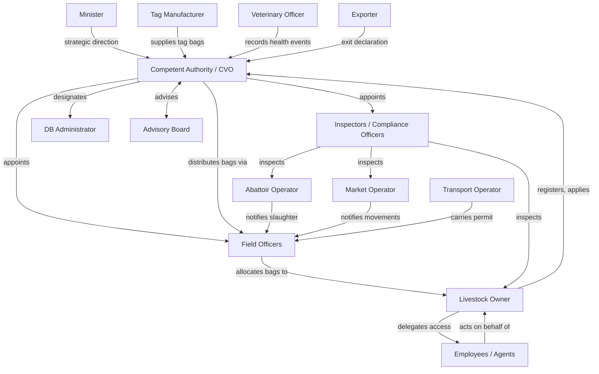

# SOMLITS Stakeholders and Responsibilities

**Version:** 0.1 — Draft for Review
**Date:** 2026-07-18
**Status:** Awaiting Ministry Approval

Classification key:
- **[A]** Supported by the IGAD Model Legal Framework for LITS (2016)
- **[B]** Proposed SOMLITS business rule
- **[C]** Requires Somalia Ministry confirmation

---

## 1. Governance Actors

### 1.1 The Minister

| Attribute | Detail | Class |
|---|---|---|
| IGAD Reference | Art. 5 | A |
| Identity | Minister responsible for livestock development, animal health, public health, and food safety | A |
| SOMLITS Role | Strategic authority and approver | |

**Responsibilities:**

| Responsibility | Class |
|---|---|
| Approves the national identification system and AID type; publishes in the Gazette | A |
| Approves and publishes the national animal coding and numbering scheme | A |
| Approves LITS fees and service charges | A |
| Reviews annual LITS reports from the Competent Authority | A |
| Approves which species are covered under the Somalia LITS Act | C |
| Approves the AHC template and certifying officers | C |
| Confirms pilot region for SOMLITS Phase 0 rollout | C |
| Establishes a dispute resolution mechanism | A |

---

### 1.2 Competent Authority (CVO / DVS / LITS Authority)

| Attribute | Detail | Class |
|---|---|---|
| IGAD Reference | Art. 6, Art. 7 | A |
| Identity | DVS/CVO designated by government as the national LITS Competent Authority | A |
| SOMLITS Role | Primary system owner and operational authority | |

**Responsibilities:**

| Responsibility | Class |
|---|---|
| Registration agency for owners, animals, facilities, and AIDs | A |
| Establishes and maintains the central database | A |
| Issues, approves, suspends, and revokes movement permits | A |
| Approves identification and traceability systems and devices | A |
| Appoints inspectors, compliance officers, and authorised persons | A |
| Issues LITS annual returns to the Minister | A |
| Delegates authority to sub-national LITS offices | A |
| Defines system access tiers and data-sharing rules | A |
| Cooperates with regional LITS authorities (Ethiopia, Kenya, Djibouti) | A |
| Activates and configures SOMLITS modules | B |

---

### 1.3 LITS Central Database Administrator

| Attribute | Detail | Class |
|---|---|---|
| IGAD Reference | Art. 14(7) | A |
| Identity | Duly qualified veterinarian in government service, designated by the Minister | A |
| SOMLITS Role | Operational custodian of the central database | |

**Responsibilities:**

| Responsibility | Class |
|---|---|
| Records registrations, notifications, and updates within 10 days of receipt | A |
| Notifies the DB of all approved devices supplied (Art. 29(4)) | A |
| Specifies terms and conditions of access to the central database | A |
| Charges fees for database services as approved by the Minister | A |
| Manages system users and access permissions | B |

---

### 1.4 LITS Advisory Board

| Attribute | Detail | Class |
|---|---|---|
| IGAD Reference | Art. 8, Art. 9 | A |
| Composition | Veterinarian chair, government nominees, stakeholder nominees, research and community representatives | A |
| SOMLITS Role | Advisory oversight | |

**Responsibilities:**

| Responsibility | Class |
|---|---|
| Advises the Authority on LITS implementation and policy | A |
| Advises on disease epidemic response and cross-border cooperation | A |
| Advises on pilot schemes and transition to national rollout | A |
| Submits annual report to the Minister | A |

---

### 1.5 LITS Inspector / Compliance Officer / Authorised Person

| Attribute | Detail | Class |
|---|---|---|
| IGAD Reference | Art. 39, Art. 40, Art. 41 | A |
| Identity | Appointed by Minister on advice of Competent Authority; qualified veterinarian | A |
| SOMLITS Role | Field enforcement and compliance | |

**Responsibilities:**

| Responsibility | Class |
|---|---|
| Enters and inspects registered LITS facilities at reasonable times | A |
| Verifies registration status of animals and facilities | A |
| Seizes records and documents in contravention of the Act | A |
| Issues certificates of compliance after a satisfactory inspection | A |
| Takes samples for laboratory analysis at the owner's expense | A |
| Issues return movement permits for untagged animals at markets or abattoirs | A |
| Carries serialised photo identity card issued by the Authority at all times | A |
| Records inspection outcomes in SOMLITS | B |
| Can view an animal's full history and movement records in SOMLITS | B |

---

### 1.6 Sub-national LITS Field Officer

| Attribute | Detail | Class |
|---|---|---|
| IGAD Reference | Art. 12, Art. 23 | A |
| Identity | Designated by Competent Authority at district or regional level | A |
| SOMLITS Role | First point of contact for registration, notification, and permit processing | |

**Responsibilities:**

| Responsibility | Class |
|---|---|
| Receives movement permit endorsements and animal movement notices from owners | A |
| Registers premises and owners at sub-national level | A |
| Distributes tag bags to owners and records each custody transfer | B |
| Assists offline registrations with later upload to central database | A |
| Receives and processes animal termination notices | A |

---

## 2. Owner Actors

### 2.1 Livestock Owner

| Attribute | Detail | Class |
|---|---|---|
| IGAD Reference | Art. 2 (definition), Art. 10, Art. 11 | A |
| Categories | Farmer (private/commercial), pastoral herder, livestock agent, importer, exporter, transporter, cross-border dealer, meat processor | A |
| SOMLITS Role | Primary registrant and data provider | |

**Responsibilities:**

| Responsibility | Class |
|---|---|
| Registers personal identity and owner category on the central database | A |
| Registers all animals born under their charge within 7 days | A |
| Registers all facilities where animals are kept | A |
| Maintains an accurate animal register for each facility, retained 10 years | A |
| Submits annual stock count return within 30 days of year-end | A |
| Applies for movement permits before moving animals | A |
| Notifies the Authority of animal death, theft, stray, or slaughter | A |
| Safeguards unused tag devices; reports loss to a LITS officer immediately | A |
| Makes exit declaration when exporting an animal | A |
| Grants and revokes delegated access for employees and agents in SOMLITS | B |

---

### 2.2 Owner Employee (Herdsman / Farm Worker)

| Attribute | Detail | Class |
|---|---|---|
| IGAD Reference | Implied by Art. 2 ("agent of the owner") | A |
| SOMLITS Role | Delegated operator acting on behalf of the owner, within the scope granted | |

**Responsibilities:**

| Responsibility | Class |
|---|---|
| Tags animals at birth on behalf of the owner | B |
| Records health events against animals in the owner's herd (if delegated) | B |
| Accompanies animals during movement and carries the movement permit | A |
| Endorses movement permits on behalf of the owner (if delegated) | A |
| Notifies LITS officer of deaths or strays in the field | A |
| Cannot grant further delegation (no sub-delegation) | B |

---

### 2.3 Livestock Agent / Dealer

| Attribute | Detail | Class |
|---|---|---|
| IGAD Reference | Art. 2 (stakeholder definition) | A |
| SOMLITS Role | Intermediary acting in the livestock value chain | |

**Responsibilities:**

| Responsibility | Class |
|---|---|
| Registered as a stakeholder with the Authority | A |
| Can apply for movement permits if authorised in writing by the owner | A |
| Must verify animal tags and registration status before purchasing | A |

---

## 3. Technical and Service Actors

### 3.1 Tag Manufacturer / Distributor

| Attribute | Detail | Class |
|---|---|---|
| IGAD Reference | Art. 27(4), Art. 29 | A |
| SOMLITS Role | Approved supplier of Animal Identification Devices | |

**Responsibilities:**

| Responsibility | Class |
|---|---|
| Applies to the Minister for AID type approval | A |
| Must obtain Authority approval before supplying tags | A |
| Notifies the Authority within 48 hours of any tag supply event, with tag codes and recipient details | A |
| Supplies tags in bags of 25 sequential numbers (SOMLITS rule) | B |
| Cannot supply tags bearing numbers not allocated by the Authority | A |

---

### 3.2 Veterinary Officer

| Attribute | Detail | Class |
|---|---|---|
| IGAD Reference | Art. 2, Art. 14(5)(b) | A |
| SOMLITS Role | Health event recorder and certifier | |

**Responsibilities:**

| Responsibility | Class |
|---|---|
| Records veterinary health events against individual animals or batches | B |
| Issues health restrictions that block movement permits | A |
| Conducts and records vaccination campaign events | B |
| Issues AHC for export consignments | A |
| Authorises and lifts quarantine orders | B |

---

### 3.3 Abattoir Operator

| Attribute | Detail | Class |
|---|---|---|
| IGAD Reference | Art. 25 | A |
| SOMLITS Role | Slaughter facility operator and slaughter notifier | |

**Responsibilities:**

| Responsibility | Class |
|---|---|
| Registers the abattoir as a LITS facility | A |
| Checks the central database before slaughtering each animal | A |
| Notifies the LITS officer of every animal slaughtered | A |
| Export abattoirs notify electronically in an Authority-approved format | A |
| Ensures carcass is marked for traceability back to the live animal | A |
| Keeps slaughter records for minimum 3 years | A |

---

### 3.4 Market Operator

| Attribute | Detail | Class |
|---|---|---|
| IGAD Reference | Art. 23(5) | A |
| SOMLITS Role | Operator of a registered livestock market (animal gathering) | |

**Responsibilities:**

| Responsibility | Class |
|---|---|
| Registers the market as a LITS facility of type animal gathering | A |
| Notifies LITS officer of arrivals and departures electronically by second working day | A |
| Operates tag scan check-in and check-out for each market session | B |
| Detains animals failing health checks pending Authority decision | A |

---

### 3.5 Transport Operator

| Attribute | Detail | Class |
|---|---|---|
| IGAD Reference | Art. 2 (stakeholder definition), Art. 21(6)(f) | A |
| SOMLITS Role | Carrier of livestock under a movement permit | |

**Responsibilities:**

| Responsibility | Class |
|---|---|
| Carries the movement permit and animal movement notice during transport | A |
| Notifies LITS officer of death in transit within 48 hours | A |
| Completes and submits animal termination notice for death in transit | A |
| Registered as a stakeholder with vehicle or vessel details | B |

---

### 3.6 Exporter / Importer

| Attribute | Detail | Class |
|---|---|---|
| IGAD Reference | Art. 13(1)(b), Art. 17, Art. 33 | A |
| SOMLITS Role | Cross-border movement actor | |

**Responsibilities:**

| Responsibility | Class |
|---|---|
| Registered as an exporter or importer stakeholder | A |
| Makes exit declaration at transitional facility | A |
| Ensures imported animals are tagged and registered within mandated deadlines | A |
| Provides required documentation for AHC | A |

---

### 3.7 SOMLITS System Administrator (IT)

| Attribute | Detail | Class |
|---|---|---|
| IGAD Reference | — | B |
| SOMLITS Role | Technical custodian of the SOMLITS platform | |

**Responsibilities:**

| Responsibility | Class |
|---|---|
| Manages system environments, deployments, and infrastructure | B |
| Administers system-level user accounts and service credentials | B |
| Does not have access to LITS data content unless granted by the DB Administrator | B |
| Escalates security incidents to the Competent Authority | B |

---

## 4. Stakeholder Interaction Map

---

STEP COMPLETE — awaiting approval before continuing.
