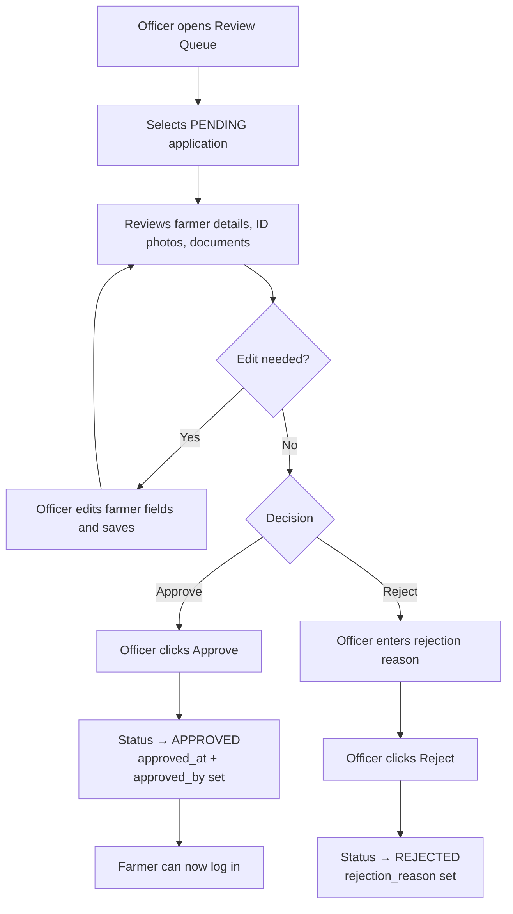
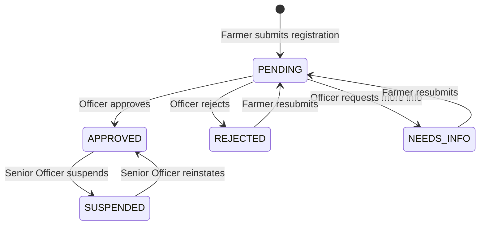

# MOD-01 — Farmer Registration Review
## Ministry Portal · Phase 1: Business Requirements & Workflow

---

## 1. Objective

Enable Ministry of Livestock officers to review, approve, and reject farmer registration applications submitted through the Farmer Portal. Only approved farmers may access SOMLITS services, register premises, tag animals, or apply for movement permits.

---

## 2. Scope

- View a queue of PENDING farmer applications
- Review full application details including identity documents and photos
- **Edit farmer data** before approving (correct errors, add missing fields)
- Approve or reject each application with a mandatory reason on rejection
- Search and filter the farmer registry (all statuses)
- View individual farmer profiles
- Trigger re-review of previously rejected applications

Out of scope for this module:
- OTP / phone verification (handled by Farmer Portal)
- SMS gateway notifications (not available at this stage)
- Premises registration
- Animal registration

---

## 3. Actors

| Actor | Role |
|---|---|
| Registration Officer | Reviews, edits, and decides on farmer applications |
| Senior Officer / Supervisor | May override decisions; accesses all regions |

---

## 4. Preconditions

- Ministry officer is authenticated and has role `REGISTRATION_OFFICER` or `SENIOR_OFFICER`
- Farmer application has been submitted via Farmer Portal (status = `PENDING`)
- Phone has been verified by farmer (OTP step complete)

---

## 5. Main Workflow — Approve Application



---

## 6. Alternative Workflows

### 6a. Request More Information
- Officer may flag application as `NEEDS_INFO` with a note
- Farmer receives SMS asking to update specific fields
- Application returns to queue after farmer resubmits

### 6b. Bulk Actions
- Senior Officer may select multiple PENDING applications and approve or reject in batch
- Individual rejection reasons still required for each rejected record

### 6c. Re-review after Rejection
- Farmer resubmits corrected application
- Status changes back to `PENDING`
- Rejection reason is cleared; previous rejection stored in audit history

---

## 7. Exception Workflows

| Exception | Handling |
|---|---|
| ID document image missing | Application shows warning; officer may still approve |
| Duplicate phone detected | System flags; officer must manually resolve |
| Duplicate national ID detected | Application blocked; system alert raised |
| Farmer already APPROVED | Re-approval not allowed; profile edit flow instead |

---

## 8. Status Lifecycle



---

## 9. Business Rules

1. An officer cannot approve their own registered test accounts.
2. Rejection requires a reason of at least 10 characters.
3. Only one APPROVED record per phone number and per national ID is allowed.
4. `approved_by` must record the officer's user ID, not their name (names change).
5. `approved_at` is stored in UTC.
6. A SUSPENDED farmer cannot log in or perform any transactions.
7. Audit log entry must be created for every status change.
8. Officers may only view applications in their assigned regions (unless `SENIOR_OFFICER`).

---

## 10. Authorization Matrix

| Action | Officer | Admin |
|---|---|---|
| View PENDING queue | ✓ (own region only) | ✓ (all regions) |
| Approve application | ✓ | ✓ |
| Reject application | ✓ | ✓ |
| Suspend approved farmer | ✗ | ✓ |
| View rejected history | ✓ (own region) | ✓ (all) |
| Edit farmer record | ✓ | ✓ |

---

## 11. Data Entities

### Farmer (existing — `farmers` table)

| Column | Type | Notes |
|---|---|---|
| id | uuid | Primary key |
| farmer_code | text | Auto-generated FRM-YYYY-NNNN |
| full_name | text | As on ID |
| date_of_birth | date | |
| gender | text | MALE / FEMALE / OTHER |
| phone_e164 | text | Unique |
| alt_phone | text | |
| email | text | |
| national_id | text | Unique |
| id_type | text | NATIONAL_ID / PASSPORT |
| region | text | |
| district | text | |
| village | text | |
| photo_url | text | Supabase Storage URL |
| id_front_url | text | Supabase Storage URL |
| id_back_url | text | Supabase Storage URL |
| status | text | PENDING / APPROVED / REJECTED / NEEDS_INFO / SUSPENDED |
| rejection_reason | text | Required when REJECTED |
| approved_at | timestamptz | UTC |
| approved_by | text | Ministry user ID |
| created_at | timestamptz | |
| updated_at | timestamptz | |

---

## 12. Relationships

- A farmer has one status at a time
- A farmer may have many audit log entries
- A Ministry officer (`approved_by`) may approve many farmers
- A farmer belongs to one region and district

---

## 13. API Contracts (to be defined in Phase 3)

| Method | Endpoint | Description |
|---|---|---|
| GET | `/api/farmers?status=PENDING&region=X` | List farmers by status/region |
| GET | `/api/farmers/:id` | Get single farmer detail |
| POST | `/api/farmers/:id/approve` | Approve application |
| POST | `/api/farmers/:id/reject` | Reject with reason |
| POST | `/api/farmers/:id/needs-info` | Request more info |
| POST | `/api/farmers/:id/suspend` | Suspend approved farmer |
| GET | `/api/farmers/:id/audit` | Farmer audit trail |

---

## 14. Domain Events

| Event | Trigger | Consumers |
|---|---|---|
| `farmer.approved` | Status → APPROVED | Notification service, Audit log |
| `farmer.rejected` | Status → REJECTED | Notification service, Audit log |
| `farmer.suspended` | Status → SUSPENDED | Notification service, Audit log |
| `farmer.needs_info` | Status → NEEDS_INFO | Notification service |

---

## 15. Notifications

No SMS gateway is available at this stage. Notifications are deferred to a future phase.

Farmers must check their application status by logging into the Farmer Portal or contacting their district livestock office directly.

> **Future:** When a gateway is integrated, events `farmer.approved` and `farmer.rejected` will trigger SMS and optional email notifications.

---

## 16. Audit Requirements

Every status change must create an audit log entry containing:
- `farmer_id`
- `action` (APPROVED / REJECTED / SUSPENDED / REINSTATED / NEEDS_INFO)
- `performed_by` (officer user ID)
- `reason` (if applicable)
- `previous_status`
- `new_status`
- `timestamp` (UTC)

---

## 17. UI Screens

### Screen 1 — Review Queue (list)
- Tab bar: Pending | Approved | Rejected | All
- Table: Farmer Code, Name, Region, District, ID Type, Submitted Date, Status badge, Action button
- Filters: Region, District, Date range, Search by name/phone/ID
- Pending count badge on tab
- Click row → opens Farmer Detail

### Screen 2 — Farmer Detail / Review
- Full farmer info: photo, name, DOB, gender, phone, email
- ID details: type, number, front/back image previews
- Location: region, district, village
- Submission date / time
- Status history
- Action panel (right side or bottom):
  - [Approve] green button
  - [Reject] red button → opens reason textarea
  - [Request Info] yellow button → opens note textarea
- Already approved/rejected: show read-only status with timestamp + officer name

### Screen 3 — Farmer Registry (searchable full list)
- All statuses, paginated
- Export to CSV
- Click → Farmer Detail

---

## 18. Validations

| Field | Rule |
|---|---|
| Rejection reason | Required, min 10 characters |
| Needs-info note | Required, min 10 characters |
| Region filter | Must match valid Somalia region |
| Approve action | Farmer must be in PENDING or NEEDS_INFO status |
| Reject action | Farmer must be in PENDING or NEEDS_INFO status |
| Suspend action | Farmer must be in APPROVED status |

---

## 19. Acceptance Criteria

- [ ] Officer sees a list of PENDING applications filtered to their region
- [ ] Officer can open a farmer application and see all submitted fields including ID photos
- [ ] Officer can approve an application; farmer status changes to APPROVED immediately
- [ ] Officer can reject with a reason; farmer status changes to REJECTED
- [ ] Rejected farmer's reason is visible on the detail screen
- [ ] Approval and rejection each create an audit log entry
- [ ] Senior Officer sees applications from all regions
- [ ] Search by name, phone, or ID number works across all statuses

---

## 20. Unit Tests

- `approve()` sets status=APPROVED, approved_at, approved_by
- `reject()` sets status=REJECTED, rejection_reason; validates reason length
- `reject()` fails if reason is empty
- `approve()` fails if farmer is already APPROVED
- `suspend()` fails if farmer is not APPROVED
- Status lifecycle transitions validated (no invalid transitions)

---

## 21. Integration Tests

- Full approve flow: POST approve → verify DB record updated → audit log created
- Full reject flow: POST reject → verify status + reason in DB → audit log created
- Unauthorized officer (wrong region) cannot approve — 403 returned
- Duplicate phone: second registration with same phone is flagged

---

## 22. API Tests

- `GET /farmers?status=PENDING` returns only PENDING records
- `POST /farmers/:id/approve` returns 200 and updated farmer object
- `POST /farmers/:id/reject` without reason body returns 400
- `POST /farmers/:id/approve` on APPROVED farmer returns 409 Conflict

---

## 23. UI Tests

- Pending tab shows correct badge count
- Approve button visible on PENDING application
- Approve button absent on APPROVED application
- Rejection modal requires reason before submitting
- Farmer name appears in approval confirmation toast

---

## 24. Security Tests

- Registration Officer cannot access `/api/farmers/:id/suspend` — 403
- Unauthenticated requests return 401
- Officer from Region A cannot see PENDING applications from Region B
- SQL injection attempt in search is sanitized

---

## 25. User Acceptance Tests

| # | Scenario | Expected |
|---|---|---|
| UAT-01 | Officer logs in, opens Pending tab, sees farmer application | Application visible with all fields |
| UAT-02 | Officer approves — farmer logs into Farmer Portal | Farmer can log in |
| UAT-03 | Officer rejects with reason — farmer sees rejection SMS | Farmer notified |
| UAT-04 | Senior Officer views applications from all regions | All regions visible |
| UAT-05 | Officer searches by phone number | Correct farmer returned |

---

## 26. Test Data

```sql
-- Test pending farmer (already inserted via supabase-farmers.sql)
-- status = 'PENDING', farmer_code = 'FRM-2026-0001'

-- Test approved farmer
INSERT INTO farmers (full_name, phone_e164, national_id, id_type, region, district, status, approved_at, approved_by)
VALUES ('Amina Hassan', '+252617000001', 'SOM-TEST-001', 'NATIONAL_ID', 'Banaadir', 'Hodan', 'APPROVED', now(), 'officer-uuid-001');

-- Test rejected farmer  
INSERT INTO farmers (full_name, phone_e164, national_id, id_type, region, district, status, rejection_reason)
VALUES ('Omar Farah', '+252617000002', 'SOM-TEST-002', 'NATIONAL_ID', 'Banaadir', 'Hodan', 'REJECTED', 'ID document photo is unclear. Please resubmit with a clearer image.');
```

---

## 27. Definition of Done

- [ ] Phase 1 (this document) reviewed and approved
- [ ] Phase 2: Database schema finalized and approved
- [ ] Phase 3: API contracts defined and approved
- [ ] Phase 4: Backend implemented with unit + integration tests passing
- [ ] Phase 5: Frontend implemented — Review Queue, Farmer Detail, Registry screens
- [ ] Phase 6: End-to-end test: farmer registers → officer approves → farmer logs in
- [ ] Phase 7: Deployed to staging environment

---

## 28. Open Business Questions

| # | Question | Status | Resolution |
|---|---|---|---|
| OBQ-01 | Should officers be able to edit farmer data before approving? | **RESOLVED** | Yes — all officers may edit |
| OBQ-02 | Is an SMS gateway available for notifications? | **RESOLVED** | No gateway at this stage; notifications deferred |
| OBQ-03 | What is the SLA for reviewing applications? | **CLOSED** | No SLA requirement |
| OBQ-04 | Should there be an escalation path if SLA is breached? | **CLOSED** | No SLA — not applicable |
| OBQ-05 | Are regional boundaries fixed (18 regions), or sub-region assignments? | **RESOLVED** | Officers see only their assigned region; Admin sees all regions |
| OBQ-06 | Should NEEDS_INFO notify the farmer, and how? | **DEFERRED** | No gateway now; revisit when gateway available |
