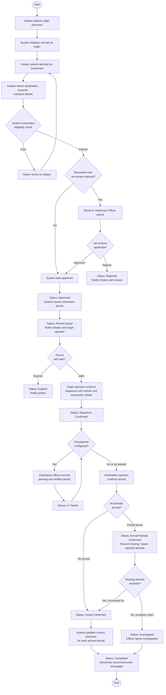
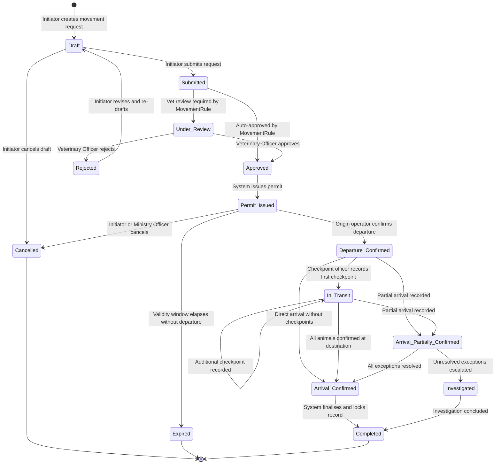
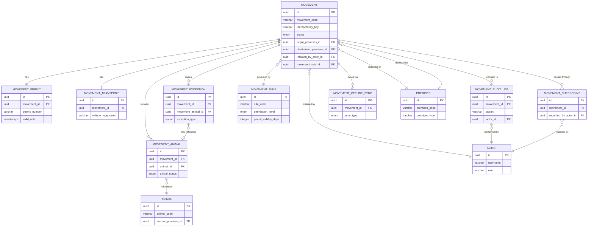

# MOD-11: Movement Tracking

**Module:** MOD-11  
**System:** Somalia Livestock Identification and Traceability System (SOMLITS)  
**Status:** Draft — Awaiting Ministry Approval  
**Version:** 1.0  
**Date:** 2026-07-28  
**Classification:** Government Official Document

---

## Table of Contents

1. [Objective](#1-objective)
2. [Scope](#2-scope)
3. [Actors](#3-actors)
4. [Preconditions](#4-preconditions)
5. [Main Workflow](#5-main-workflow)
6. [Alternative Workflows](#6-alternative-workflows)
7. [Exception Workflows](#7-exception-workflows)
8. [Status Lifecycle](#8-status-lifecycle)
9. [Business Rules](#9-business-rules)
10. [Authorization Matrix](#10-authorization-matrix)
11. [Data Entities](#11-data-entities)
12. [Relationships](#12-relationships)
13. [API Contracts](#13-api-contracts)
14. [Domain Events](#14-domain-events)
15. [Notifications](#15-notifications)
16. [Audit Requirements](#16-audit-requirements)
17. [UI Screens](#17-ui-screens)
18. [Validations](#18-validations)
19. [Acceptance Criteria](#19-acceptance-criteria)
20. [Unit Tests](#20-unit-tests)
21. [Integration Tests](#21-integration-tests)
22. [API Tests](#22-api-tests)
23. [UI Tests](#23-ui-tests)
24. [Security Tests](#24-security-tests)
25. [User Acceptance Tests](#25-user-acceptance-tests)
26. [Test Data](#26-test-data)
27. [Definition of Done](#27-definition-of-done)
28. [Open Business Questions](#28-open-business-questions)

---

## 1. Objective

The Movement Tracking module provides a complete, auditable, government-grade record of every live animal movement within Somalia's territory, from one approved premises to another, and for exports crossing national borders. It enforces health, identity, and regulatory controls before any movement may proceed, issues legally binding movement permits, tracks animals in transit through checkpoints, confirms arrival at destination, updates the animal's current premises only upon confirmed arrival, and maintains an immutable historical record.

This module supports the Ministry of Livestock, Forestry and Range (MLFR) in exercising its statutory duty of livestock disease control, traceability, quarantine enforcement, and export certification. It provides data to support traceback investigations in disease outbreak events, supports law enforcement in illegal movement cases, and generates statistical data for policy and trade purposes.

---

## 2. Scope

### 2.1 Movement Type Codes

Every movement is classified by a two-or-three-letter code that drives which MovementRules apply, which approval path is required, and which reports are generated.

| Code | Movement Type | Typical Actors |
|---|---|---|
| **P2P** | Premises to premises (general transfer) | Owner, Trader |
| **F2M** | Farm to livestock market | Owner, Trader |
| **M2P** | Market to buyer's premises | Market Operator, Trader |
| **F2Q** | Farm or market to quarantine facility | Vet Officer, Ministry Officer |
| **Q2S** | Quarantine to slaughterhouse | Quarantine Officer, Abattoir Operator |
| **Q2E** | Quarantine to export point | Quarantine Officer, Exporter |
| **Q2P** | Quarantine return to original premises | Quarantine Officer |
| **P2V** | Premises to veterinary facility | Owner, Vet Officer |
| **TRH** | Transhumance / seasonal grazing | Owner |
| **EXP** | Direct movement for export | Exporter |
| **RET** | Return movement (rejected animals or unsold market animals) | Origin Operator |
| **EMG** | Emergency movement | Vet Officer, Ministry Officer |
| **IMP** | Imported animal movement (first internal premises assignment) | Ministry Officer |

Every farm, livestock market, collection centre, quarantine station, slaughterhouse, port and grazing location involved in a movement must have an active Premises ID. WOAH specifically identifies these establishments as mandatory traceability locations.

---

### In Scope

- Creation and lifecycle management of movement requests for individual animals and groups
- Movement permit issuance and validity enforcement
- Vehicle and transporter registration on a movement
- Route planning and checkpoint recording
- Departure confirmation by the origin premises operator
- In-transit checkpoint recording by authorised officers
- Arrival confirmation by the destination premises operator
- Partial arrival handling and exception recording for missing, dead, or unidentified animals
- Rejection of animals at destination and return movement initiation
- Current premises update for each animal only upon confirmed arrival
- Emergency movement under special authorisation
- Recording of illegal movements discovered by officers
- Confiscation recording linked to illegal movements
- Cross-border export movements linked to export certification
- Offline departure and arrival recording with synchronisation on connectivity restoration
- Movement rule configuration (MovementRule table) controlling which origin-destination-purpose combinations are permitted, require veterinary review, or are prohibited
- Configurable permit validity periods per movement type
- Full audit history for every movement and every status change
- Integration with Animal Registry (MOD-01), Premises Registry (MOD-02), Health and Vaccination (MOD-05), and Quarantine (MOD-07) modules

### Out of Scope

- Export certification document generation (MOD-12)
- Market operations and sales transactions (MOD-09)
- Slaughter scheduling (MOD-10)
- Vaccination campaign management (MOD-05)
- Quarantine order issuance (MOD-07)
- Financial transactions, fees, or payment processing

---

## 3. Actors

| Actor | Role Description |
|---|---|
| **Owner** | Registered livestock owner who initiates movement of their own animals |
| **Owner Employee** | An employee authorised by the owner to act on their behalf for movements |
| **Trader** | A licensed livestock trader who may initiate movements of animals they have purchased or hold |
| **Market Operator** | Operator of a licensed livestock market who initiates movements to or from the market premises |
| **Exporter** | A licensed livestock exporter who initiates movements toward export collection points or borders |
| **Quarantine Officer** | Government officer who initiates, reviews, approves, or blocks movements involving quarantine premises |
| **Abattoir Operator** | Operator of a licensed abattoir who initiates or confirms arrival of animals for slaughter |
| **Veterinary Officer** | Government veterinarian who reviews movement applications and issues health clearance or rejection |
| **Ministry Officer** | A Ministry of Livestock officer who may act on behalf of any permitted actor, record illegal movements, manage movement rules, or escalate exceptions |
| **Checkpoint Officer** | A government officer stationed at a road checkpoint who records animal passage and verifies permits |
| **System** | The SOMLITS platform itself, performing automated validations, status transitions, expiry enforcement, and event publication |

---

## 4. Preconditions

The following conditions must be satisfied before a movement request may be submitted. The system enforces each condition and returns a specific error if any condition is not met.

| # | Precondition | Enforced By |
|---|---|---|
| PC-01 | The initiating actor is authenticated and authorised for the role they are acting in | Spring Security / RBAC |
| PC-02 | All animals on the movement are identified (registered in SOMLITS with an active primary tag) | Animal Registry Service |
| PC-03 | All animals are currently recorded as located at the stated origin premises | Animal Registry Service |
| PC-04 | All animals have a status of Active (not Dead, Slaughtered, Exported, or Suspended from movement) | Animal Registry Service |
| PC-05 | The origin premises is in Approved and Active status | Premises Registry Service |
| PC-06 | The destination premises is in Approved and Active status, unless the movement type is Export Cross-Border (destination is a foreign point of entry) | Premises Registry Service |
| PC-07 | No animal on the movement is currently subject to a movement-blocking health restriction or quarantine order | Health Service / Quarantine Service |
| PC-08 | The movement type is permitted by an active MovementRule for the origin premises type, destination premises type, and stated purpose | MovementRule configuration |
| PC-09 | The initiating actor has a valid relationship (ownership, employment, licence) to the animals or premises involved | Relationship Registry |
| PC-10 | For group movements, all animals are of the same species unless the movement rule explicitly permits mixed-species groups | MovementRule configuration |

---

## 5. Main Workflow

### 5.1 Narrative

The standard movement lifecycle proceeds through three phases: application and approval, transit, and arrival. An initiator begins by selecting the origin premises; the system then displays only those animals currently recorded at that premises. The initiator selects animals, specifies the destination and the movement purpose, and provides transport details. The system performs automated eligibility checks. Depending on the movement rule, the application is either automatically approved or routed for veterinary review. Once approved, a movement permit is issued with a validity window. The origin premises operator confirms departure. The movement progresses through any configured checkpoints. The destination operator confirms arrival, which may be full or partial. Only after arrival confirmation does the system update each animal's current premises. The completed movement record becomes immutable.

### 5.2 Main Flow Diagram



### 5.3 Step-by-Step Description

| Step | Actor | Action | System Response |
|---|---|---|---|
| 1 | Initiator | Selects origin premises from their associated premises list | System loads and displays animals currently at that premises, showing species, breed, tag number, and health status |
| 2 | Initiator | Selects one or more animals | System performs per-animal eligibility pre-check and flags ineligible animals with reason |
| 3 | Initiator | Selects destination premises and movement purpose | System validates the combination against active MovementRule records |
| 4 | Initiator | Enters transport details (vehicle registration, transporter name and licence, planned departure date/time, estimated arrival date/time, route description) | System records details in draft |
| 5 | Initiator | Submits movement request | System validates all preconditions, sets status to Submitted, and records idempotency key |
| 6 | System | Evaluates MovementRule for vet review requirement | If review not required, auto-approves and proceeds to Step 8 |
| 7 | Veterinary Officer | Reviews health status, premises certifications, and animal history; approves or rejects with reason | System records review decision and transitions status |
| 8 | System | Issues movement permit with permit number, validity window, and QR code payload | Status transitions to Permit Issued; permit document available for download |
| 9 | Origin Operator | Confirms actual departure: records actual departure time, confirms vehicle registration, may update animal count | Status transitions to Departure Confirmed |
| 10 | Checkpoint Officer | Scans permit QR code or enters permit number; records passing time and location | System validates permit and records checkpoint event; status transitions to In Transit if first checkpoint |
| 11 | Destination Operator | Records actual arrival time; confirms each animal by tag scan or manual entry | System compares arrived animals to manifest |
| 12 | System | Compares arrived list to movement manifest | If all match: Arrival Confirmed; if partial: Arrival Partially Confirmed with exception records |
| 13 | System | Updates current premises for each confirmed animal | Animal Registry updated; status moves to Completed |

---

## 6. Alternative Workflows

### 6.1 Ministry Officer Acting on Behalf of Owner

A Ministry Officer may submit a movement request on behalf of an owner who is unable to use the system (for example, in a remote area with no connectivity or literacy barriers). The Ministry Officer must record the owner's name and stated consent, and the audit log must capture that the submission was made by a Ministry Officer on behalf of the named owner. All other steps follow the main workflow.

### 6.2 Emergency Movement

When an animal or group must be moved urgently due to an immediate threat to animal welfare (flood, disease outbreak on adjacent premises, imminent infrastructure failure), a Veterinary Officer or Ministry Officer may authorise an Emergency Movement. The standard vet review step is bypassed. The system records the emergency justification and the authorising officer. The permit is issued immediately. A post-movement health review must be completed within a configurable number of days (default: 5 working days). The status set is otherwise the same as the standard workflow.

### 6.3 Group Movement with Individual Tag Scanning at Arrival

For large group movements, the arrival confirmation screen allows the destination operator to scan each animal's RFID tag individually. The system matches each scanned tag to the movement manifest in real time, showing a running count of confirmed, missing, and unrecognised animals. The operator may finalise when all animals are accounted for or when they are ready to raise an exception.

### 6.4 Offline Departure Confirmation

In areas without reliable internet connectivity, the origin operator may use the SOMLITS mobile application in offline mode. The application stores the signed departure confirmation locally with a timestamp from the device clock and the operator's biometric or PIN authentication. When connectivity is restored, the application synchronises the record to the server. The server validates that the departure timestamp is within the permit validity window before accepting the sync. The idempotency key prevents duplicate submissions on reconnect.

### 6.5 Offline Arrival Confirmation

Identical to Offline Departure Confirmation, applied to the destination operator confirming arrival. On sync, the server validates the arrival timestamp is after the recorded departure timestamp. Premises update occurs only after successful server-side processing of the synced record.

### 6.6 Return Movement After Destination Rejection

If the destination operator rejects all or some animals on arrival (for example, animals do not match the permit description, or the destination premises cannot accept them), the operator records a rejection with a reason. The system automatically drafts a return movement request with the original origin as the new destination. The return movement must go through the standard approval flow unless a Veterinary Officer grants an expedited return authorisation.

### 6.7 Cross-Border Export Movement

The initiator selects purpose Export Cross-Border. The destination field accepts a designated border exit point rather than a SOMLITS-registered domestic premises. The movement is linked to an export permit from MOD-12 (Export Certification). A Veterinary Officer review is mandatory regardless of other MovementRule settings. Checkpoint recording at the border exit point is mandatory. On border exit confirmation, animal status transitions to Exported and no further live-animal movements are possible for those animals.

### 6.8 Movement to Abattoir

The initiator selects purpose Slaughter. The destination must be an Active Approved abattoir premises. On arrival confirmation by the abattoir operator, the system triggers an automatic status transition to Slaughter Pending in the Animal Registry for each arrived animal. A subsequent slaughter confirmation in MOD-10 will set status to Slaughtered.

### 6.9 Ownership Transfer During a Sale Movement

Location transfer and ownership transfer are separate events that may occur together in a sale or independently. SOMLITS must not combine them automatically.

**Sale movement with ownership transfer:**

1. Seller creates the movement and proposes a new owner (buyer).
2. Buyer receives a notification and accepts the proposed ownership transfer.
3. Movement proceeds through the standard approval workflow.
4. Origin operator (seller or their representative) confirms departure.
5. Buyer or their representative confirms arrival at destination.
6. SOMLITS completes the location change (updates `current_premises_id`).
7. SOMLITS then completes the ownership change (updates `current_owner_id`).

**Location change without ownership transfer (e.g., moving to quarantine or a rented paddock):**

- The movement is created and completed normally.
- No ownership transfer event is created.
- `current_owner_id` is unchanged.

**Business rules:**

- If the buyer rejects the ownership transfer proposal, the movement may still proceed (animals move to the new premises) but ownership remains with the seller.
- Ownership transfer must never be applied automatically at departure; it applies only on confirmed arrival.
- WOAH treats change of owner or keeper as a distinct event that may occur independently from a location change.

---

### 6.10 Transhumance / Seasonal Grazing (TRH)

The movement module supports seasonal grazing movements where animals temporarily leave the home premises for a grazing location and later return.

Transhumance movement records must capture:

- Temporary grazing destination (may be an informal grazing zone registered as a TRH-type premises)
- Planned route description and intermediate watering or transit points
- Seasonal departure date and expected return date
- Group or batch identification (individual tagging may be impractical at scale; batch identification is permitted under an active MovementRule for TRH type)
- Actual route checkpoints recorded by checkpoint officers
- Return movement (type RET) created separately when animals come back

SOMLITS does **not** automatically close a TRH movement on the expected return date. A return movement must be explicitly created and confirmed to update the animals' current premises back to the home farm.

---

### 6.11 Market — Two-Movement Pattern

A livestock market transaction requires two separate movements:

1. **F2M movement**: Farm → Livestock Market (departure confirmed by seller; arrival confirmed by market operator).
2. **M2P movement**: Market → Buyer's Premises (departure confirmed by market operator; arrival confirmed by buyer).

These are two independent movement records. If animals are not sold and must return:

- A **RET (Return)** movement is created from the market back to the origin farm.
- The original F2M movement is **not** reopened or modified.

---

### 6.12 Movement to Quarantine


The initiator is typically a Veterinary Officer or Quarantine Officer. The destination must be an Active Approved quarantine facility. A movement-blocking health restriction on the animals is temporarily lifted specifically for this movement to permit legal transport to quarantine. The movement is linked to a quarantine order in MOD-07.

---

## 7. Exception Workflows

### 7.1 Partial Arrival — Missing Animals

When the number of animals confirmed at arrival is less than the movement manifest, the system sets status to Arrival Partially Confirmed and automatically creates a MovementException record for each missing animal. The destination operator must provide a reason code (animal escaped in transit, animal died in transit, animal not loaded, unknown). A Veterinary Officer or Ministry Officer must review and close each exception. If the exception cannot be resolved, the investigation workflow (Section 7.4) is triggered.

### 7.2 Unrecognised Animal at Arrival

If the destination operator scans a tag that is not on the movement manifest, the system creates an Unrecognised Animal event. The officer must record the tag number and the physical description of the animal. A Veterinary Officer or Ministry Officer investigates whether the animal was fraudulently added, is a data entry error, or is a stray animal that joined the group in transit.

### 7.3 Permit Expired Before Departure

If the origin operator does not confirm departure before the permit validity end date, the system automatically transitions the movement to Expired status. The initiator must submit a new movement request. Animals are not moved. The Ministry may configure an extension grace period (default: zero days unless explicitly configured).

### 7.4 Illegal Movement Investigation

If a Checkpoint Officer or Ministry Officer discovers animals being moved without a valid permit, they record an Illegal Movement. This creates a movement record with status Investigated. The recording officer documents the location, date, time, number and species of animals, vehicle details, and the persons present. The animals may be confiscated (Section 7.5). The investigation is assigned to a Ministry Officer who has authority to conclude it with an outcome (animals returned to owner, animals confiscated, referral for prosecution, administrative penalty).

### 7.5 Confiscation

When animals are confiscated as part of an illegal movement or health restriction enforcement, the system records a Confiscation record linked to the movement or investigation. The animals' current premises is updated to the government holding facility where they are taken. A Veterinary Officer must assess the animals within a configurable period. The confiscation record cannot be deleted.

### 7.6 Animal Death in Transit

If an animal dies in transit, the transporter or destination operator records the death with date, time, and location. The animal's status in the Animal Registry is updated to Dead. A post-mortem requirement flag is set if the movement rule requires it for the species or purpose. The movement continues for surviving animals.

### 7.7 Health Restriction Discovered at Checkpoint

If a Checkpoint Officer discovers a health restriction that was not present at permit issuance (for example, a new disease alert issued after the permit), they may flag the movement for hold. A Veterinary Officer must review within a configurable window. The officer may lift the hold and allow the movement to continue, or direct the animals to the nearest quarantine facility.

---

## 8. Status Lifecycle

### 8.1 Status Transition Diagram



### 8.2 Status Definitions

| Status | Description | Terminal? |
|---|---|---|
| **Draft** | Movement request created but not yet submitted | No |
| **Submitted** | Request submitted for processing; automated checks running | No |
| **Under Review** | Assigned to a Veterinary Officer for health and eligibility review | No |
| **Approved** | Request approved; permit to be issued | No |
| **Rejected** | Request rejected by Veterinary Officer; initiator notified with reason | No — may be re-drafted |
| **Permit Issued** | Legally binding movement permit generated and available | No |
| **Expired** | Permit validity window elapsed without departure confirmation | Yes |
| **Departure Confirmed** | Origin premises operator confirmed animals loaded and departed | No |
| **In Transit** | One or more checkpoint passings recorded | No |
| **Arrival Partially Confirmed** | Destination confirmed some but not all animals; exceptions open | No |
| **Arrival Confirmed** | All animals on manifest confirmed at destination | No |
| **Completed** | Current premises updated; record immutable | Yes |
| **Cancelled** | Movement cancelled before departure; no animals moved | Yes |
| **Investigated** | Illegal movement or unresolved exception under formal investigation | No |

---

## 9. Business Rules

### 9.1 Animal Eligibility Rules

| Rule ID | Rule |
|---|---|
| BR-01 | An animal must have status Active to be included in a movement |
| BR-02 | An animal with status Dead, Slaughtered, or Exported cannot be included in any live-animal movement |
| BR-03 | An animal may only be on one active movement at a time (one active movement where status is not Completed, Cancelled, Rejected, or Expired) |
| BR-04 | An animal subject to a movement-blocking health restriction or active quarantine order cannot be included in a standard movement; it may only be moved to a quarantine facility under a quarantine movement type |
| BR-05 | An animal's recorded current premises must match the stated origin premises on the movement |
| BR-06 | An animal must have an active primary tag to be included in a movement |

### 9.2 Premises Rules

| Rule ID | Rule |
|---|---|
| BR-07 | The origin premises must be in Approved and Active status at the time of movement submission |
| BR-08 | The destination premises must be in Approved and Active status at the time of movement submission, except for cross-border export movements where the destination is a border exit point |
| BR-09 | Origin and destination premises may not be the same premises |
| BR-10 | For abattoir movements, the destination premises type must be Abattoir |
| BR-11 | For quarantine movements, the destination premises type must be Quarantine Facility or Veterinary Isolation Facility |

### 9.3 Current Premises Update Rule

| Rule ID | Rule |
|---|---|
| BR-12 | An animal's current premises is updated only after the destination operator confirms arrival |
| BR-13 | Confirming departure does NOT update the animal's current premises |
| BR-14 | For partial arrivals, only the premises of animals confirmed as arrived is updated; animals listed as missing or dead retain their last known premises until the exception is resolved |
| BR-15 | When an animal dies in transit, its status is set to Dead and its current premises is not updated to the destination |

### 9.4 Movement Rule (Configurable Policy)

| Rule ID | Rule |
|---|---|
| BR-16 | Whether a movement from a given origin premises type to a given destination premises type for a given purpose is Permitted, Requires Veterinary Review, or Prohibited is determined by the MovementRule table, not by hard-coded logic |
| BR-17 | A Ministry Officer with the MovementRule Administrator role may create, activate, deactivate, or supersede movement rules |
| BR-18 | A change to a MovementRule does not retroactively affect movements already in progress |
| BR-19 | If no active MovementRule exists for a given combination, the movement is treated as Prohibited |
| BR-20 | Farm-to-export (direct from farm to export without passing through a collection centre or quarantine) may be permitted or prohibited by a MovementRule; this must not be hard-coded |

### 9.5 Permit Rules

| Rule ID | Rule |
|---|---|
| BR-21 | A movement permit has a validity period; if departure is not confirmed within that period, the movement expires |
| BR-22 | The permit validity period is defined by the applicable MovementRule (configurable per movement type) |
| BR-23 | A movement ID follows the SOMLITS format `SO-MOV-YYYY-[REG]-[SEQ6]-[C]` (e.g. `SO-MOV-2026-MUD-000001-5`), generated by the `generate_movement_id()` database function with a Luhn Mod-10 check digit |
| BR-24 | A permit carries a QR code whose payload is signed by the SOMLITS server private key and opens the External Verification Portal, which displays only: validity status, movement status, species, quantity, origin region, destination region, and issuing authority. Personal or owner identification information must not be publicly displayed via the QR code. |
| BR-25 | A permit may be extended once by a Ministry Officer for a configurable extension period before it expires |
| BR-25a | A movement can be cancelled **only before departure is confirmed**. Once the origin operator confirms departure, the manifest is locked and cancellation is no longer available. Post-departure corrections must be recorded as exception events or a return movement (type RET). The system must not allow cancellation of a movement in Departure Confirmed, In Transit, Arrival Partially Confirmed, Arrival Confirmed, or Completed status. |

### 9.6 Immutability Rules

| Rule ID | Rule |
|---|---|
| BR-26 | A movement record in Completed, Cancelled, or Expired status cannot be modified or deleted |
| BR-27 | The animal list on a movement cannot be changed after the status transitions to Approved |
| BR-28 | The origin and destination premises cannot be changed after Submitted status |

### 9.7 Idempotency and Concurrency

| Rule ID | Rule |
|---|---|
| BR-29 | Every movement submission must carry a client-generated idempotency key; re-submission with the same key returns the existing record without creating a duplicate |
| BR-30 | Movement records use optimistic locking (version field); concurrent updates return a conflict error |
| BR-31 | All timestamps are recorded and stored in UTC |

---

## 10. Authorization Matrix

| Action | Owner | Owner Employee | Trader | Market Operator | Exporter | Quarantine Officer | Abattoir Operator | Vet Officer | Ministry Officer | Checkpoint Officer | System |
|---|:---:|:---:|:---:|:---:|:---:|:---:|:---:|:---:|:---:|:---:|:---:|
| Create draft movement (own animals) | Y | Y | Y | Y | Y | Y | Y | — | Y | — | — |
| Submit movement request | Y | Y | Y | Y | Y | Y | Y | — | Y | — | — |
| Cancel own draft or submitted movement | Y | Y | Y | Y | Y | Y | Y | — | Y | — | — |
| Cancel any movement (Ministry) | — | — | — | — | — | — | — | — | Y | — | — |
| Review and approve movement (vet) | — | — | — | — | — | — | — | Y | Y | — | — |
| Reject movement (vet) | — | — | — | — | — | — | — | Y | Y | — | — |
| Auto-approve movement (no vet review) | — | — | — | — | — | — | — | — | — | — | Y |
| Issue permit | — | — | — | — | — | — | — | — | — | — | Y |
| Extend permit validity | — | — | — | — | — | — | — | — | Y | — | — |
| Confirm departure (own premises) | Y | Y | Y | Y | Y | Y | Y | — | Y | — | — |
| Confirm departure (any premises) | — | — | — | — | — | — | — | — | Y | — | — |
| Record checkpoint | — | — | — | — | — | — | — | — | Y | Y | — |
| Confirm arrival (own premises) | Y | Y | Y | Y | Y | Y | Y | — | Y | — | — |
| Confirm arrival (any premises) | — | — | — | — | — | — | — | — | Y | — | — |
| Record partial arrival / exception | Y | Y | Y | Y | Y | Y | Y | — | Y | Y | — |
| Resolve arrival exception | — | — | — | — | — | Y | — | Y | Y | — | — |
| Record illegal movement | — | — | — | — | — | Y | — | Y | Y | Y | — |
| Record confiscation | — | — | — | — | — | Y | — | — | Y | — | — |
| Record animal death in transit | Y | Y | Y | Y | Y | — | — | Y | Y | Y | — |
| Manage MovementRule configuration | — | — | — | — | — | — | — | — | Y (admin role) | — | — |
| View all movements (national) | — | — | — | — | — | — | — | Y | Y | — | — |
| View own movements | Y | Y | Y | Y | Y | Y | Y | — | Y | — | — |
| View checkpoint movements (zone) | — | — | — | — | — | — | — | — | Y | Y | — |
| Update current premises | — | — | — | — | — | — | — | — | — | — | Y |

---

## 11. Data Entities

### 11.1 Movement

The central record of a single movement event.

| Field | Type | Constraints | Description |
|---|---|---|---|
| `id` | UUID | PK, not null | Internal primary key |
| `movement_code` | VARCHAR(40) | Unique, not null | SOMLITS ID: `SO-MOV-YYYY-[REG]-[SEQ6]-[C]` (e.g. `SO-MOV-2026-MUD-000001-5`) |
| `movement_type_code` | VARCHAR(3) | not null | Two/three-letter code: P2P, F2M, M2P, F2Q, Q2S, Q2E, Q2P, P2V, TRH, EXP, RET, EMG, IMP |
| `idempotency_key` | VARCHAR(64) | Unique, not null | Client-supplied key to prevent duplicate submissions |
| `status` | ENUM | not null | Current lifecycle status |
| `movement_type` | ENUM | not null | Standard, Emergency, Export Cross-Border, Quarantine, Return |
| `purpose` | VARCHAR(100) | not null | Stated purpose of movement (e.g., Grazing, Sale, Slaughter, Export) |
| `origin_premises_id` | UUID | FK → Premises, not null | Origin premises |
| `destination_premises_id` | UUID | FK → Premises, nullable | Null for cross-border export |
| `destination_border_point_code` | VARCHAR(50) | nullable | Border exit point code for export movements |
| `initiated_by_actor_id` | UUID | FK → Actor, not null | Actor who created the movement |
| `initiated_on_behalf_of_owner_id` | UUID | FK → Owner, nullable | Owner when Ministry Officer acts on their behalf |
| `veterinary_officer_id` | UUID | FK → Actor, nullable | Assigned vet reviewer |
| `approved_by_actor_id` | UUID | FK → Actor, nullable | Actor who approved (or System for auto-approval) |
| `movement_rule_id` | UUID | FK → MovementRule, not null | Rule applied at submission time |
| `planned_departure_datetime` | TIMESTAMPTZ | not null | UTC |
| `planned_arrival_datetime` | TIMESTAMPTZ | not null | UTC |
| `actual_departure_datetime` | TIMESTAMPTZ | nullable | Set on departure confirmation |
| `actual_arrival_datetime` | TIMESTAMPTZ | nullable | Set on arrival confirmation |
| `animal_count_manifest` | INTEGER | not null | Count at time of permit issuance |
| `animal_count_departed` | INTEGER | nullable | Count confirmed at departure |
| `animal_count_arrived` | INTEGER | nullable | Count confirmed at arrival |
| `emergency_justification` | TEXT | nullable | Required for Emergency movement type |
| `emergency_authorised_by_actor_id` | UUID | FK → Actor, nullable | Required for Emergency movement type |
| `rejection_reason` | TEXT | nullable | Populated on rejection |
| `cancellation_reason` | TEXT | nullable | Populated on cancellation |
| `cancellation_by_actor_id` | UUID | FK → Actor, nullable | Actor who cancelled |
| `is_illegal_movement` | BOOLEAN | not null, default false | Set to true for illegal movement records |
| `illegal_movement_description` | TEXT | nullable | Description of illegal movement discovery |
| `export_permit_id` | UUID | FK → ExportPermit, nullable | Link to MOD-12 export permit |
| `quarantine_order_id` | UUID | FK → QuarantineOrder, nullable | Link to MOD-07 quarantine order |
| `version` | INTEGER | not null, default 1 | Optimistic locking version |
| `created_at` | TIMESTAMPTZ | not null | UTC |
| `updated_at` | TIMESTAMPTZ | not null | UTC |
| `created_by_actor_id` | UUID | not null | Audit |
| `updated_by_actor_id` | UUID | not null | Audit |

### 11.2 MovementAnimal

Links individual animals to a movement with per-animal arrival status.

| Field | Type | Constraints | Description |
|---|---|---|---|
| `id` | UUID | PK, not null | Internal primary key |
| `movement_id` | UUID | FK → Movement, not null | Parent movement |
| `animal_id` | UUID | FK → Animal, not null | Animal in the movement |
| `primary_tag_number` | VARCHAR(50) | not null | Tag number at time of movement creation (snapshot) |
| `animal_status_at_submission` | VARCHAR(30) | not null | Snapshot of animal status at submission |
| `arrival_status` | ENUM | nullable | Arrived, Missing, Dead In Transit, Rejected At Destination, Returned |
| `arrival_confirmed_at` | TIMESTAMPTZ | nullable | UTC |
| `death_in_transit_datetime` | TIMESTAMPTZ | nullable | UTC, if died in transit |
| `death_location_description` | TEXT | nullable | Description of location where death occurred |
| `exception_reason_code` | VARCHAR(50) | nullable | Reason code for non-arrival |
| `exception_notes` | TEXT | nullable | Officer notes |
| `created_at` | TIMESTAMPTZ | not null | UTC |
| `updated_at` | TIMESTAMPTZ | not null | UTC |

Unique constraint: (`movement_id`, `animal_id`)

### 11.3 MovementPermit

The legally binding permit issued for an approved movement.

| Field | Type | Constraints | Description |
|---|---|---|---|
| `id` | UUID | PK, not null | Internal primary key |
| `permit_number` | VARCHAR(40) | Unique, not null | Same as `movement_code`: `SO-MOV-YYYY-[REG]-[SEQ6]-[C]` |
| `movement_id` | UUID | FK → Movement, Unique, not null | One permit per movement |
| `issued_at` | TIMESTAMPTZ | not null | UTC |
| `issued_by_actor_id` | UUID | FK → Actor, not null | Actor or System |
| `valid_from` | TIMESTAMPTZ | not null | UTC |
| `valid_until` | TIMESTAMPTZ | not null | UTC |
| `extended_until` | TIMESTAMPTZ | nullable | Set if permit validity extended |
| `extended_by_actor_id` | UUID | FK → Actor, nullable | Ministry Officer who extended |
| `extension_reason` | TEXT | nullable | Required when extended |
| `qr_code_payload` | TEXT | not null | JSON payload signed with server private key |
| `qr_code_signature` | VARCHAR(512) | not null | Digital signature for offline verification |
| `is_voided` | BOOLEAN | not null, default false | True if movement cancelled after permit issued |
| `voided_at` | TIMESTAMPTZ | nullable | UTC |
| `voided_by_actor_id` | UUID | FK → Actor, nullable | |
| `created_at` | TIMESTAMPTZ | not null | UTC |

### 11.4 MovementTransport

Vehicle and transporter details for a movement.

| Field | Type | Constraints | Description |
|---|---|---|---|
| `id` | UUID | PK, not null | Internal primary key |
| `movement_id` | UUID | FK → Movement, not null | Parent movement |
| `vehicle_registration` | VARCHAR(30) | not null | Vehicle registration plate |
| `vehicle_type` | VARCHAR(50) | not null | e.g., Truck, Trailer, Livestock Carrier |
| `vehicle_capacity_head` | INTEGER | nullable | Maximum head capacity of vehicle |
| `transporter_name` | VARCHAR(150) | not null | Name of transporter or driver |
| `transporter_licence_number` | VARCHAR(50) | nullable | Transporter licence number if applicable |
| `transporter_contact_phone` | VARCHAR(20) | nullable | Contact phone number |
| `route_description` | TEXT | nullable | Planned route description |
| `created_at` | TIMESTAMPTZ | not null | UTC |
| `updated_at` | TIMESTAMPTZ | not null | UTC |

### 11.5 MovementCheckpoint

Records each checkpoint passing during transit.

| Field | Type | Constraints | Description |
|---|---|---|---|
| `id` | UUID | PK, not null | Internal primary key |
| `movement_id` | UUID | FK → Movement, not null | Parent movement |
| `checkpoint_name` | VARCHAR(150) | not null | Name or location of checkpoint |
| `checkpoint_location_latitude` | DECIMAL(9,6) | nullable | GPS latitude |
| `checkpoint_location_longitude` | DECIMAL(9,6) | nullable | GPS longitude |
| `recorded_by_actor_id` | UUID | FK → Actor, not null | Checkpoint Officer |
| `recorded_at` | TIMESTAMPTZ | not null | UTC timestamp of recording |
| `offline_captured_at` | TIMESTAMPTZ | nullable | Device timestamp if captured offline |
| `synced_at` | TIMESTAMPTZ | nullable | UTC when synced to server |
| `animals_verified_count` | INTEGER | nullable | Count of animals verified at this checkpoint |
| `permit_verified` | BOOLEAN | not null, default false | Whether permit was verified |
| `notes` | TEXT | nullable | Officer notes |
| `hold_flag` | BOOLEAN | not null, default false | True if movement placed on hold at this checkpoint |
| `hold_reason` | TEXT | nullable | Reason for hold |
| `created_at` | TIMESTAMPTZ | not null | UTC |

### 11.6 MovementException

Records discrepancies discovered at arrival or during the movement.

| Field | Type | Constraints | Description |
|---|---|---|---|
| `id` | UUID | PK, not null | Internal primary key |
| `movement_id` | UUID | FK → Movement, not null | Parent movement |
| `movement_animal_id` | UUID | FK → MovementAnimal, nullable | Animal-level exception if known |
| `exception_type` | ENUM | not null | MissingAnimal, UnrecognisedAnimal, CountDiscrepancy, TagMismatch, HealthConcern, Other |
| `description` | TEXT | not null | Detailed description |
| `reported_by_actor_id` | UUID | FK → Actor, not null | Actor who reported |
| `reported_at` | TIMESTAMPTZ | not null | UTC |
| `status` | ENUM | not null | Open, UnderInvestigation, Resolved, Closed |
| `resolved_by_actor_id` | UUID | FK → Actor, nullable | |
| `resolved_at` | TIMESTAMPTZ | nullable | UTC |
| `resolution_notes` | TEXT | nullable | |
| `created_at` | TIMESTAMPTZ | not null | UTC |
| `updated_at` | TIMESTAMPTZ | not null | UTC |

### 11.7 MovementRule

Configures which movement combinations are permitted, require vet review, or are prohibited.

| Field | Type | Constraints | Description |
|---|---|---|---|
| `id` | UUID | PK, not null | Internal primary key |
| `rule_code` | VARCHAR(30) | Unique, not null | Human-readable rule identifier |
| `origin_premises_type` | VARCHAR(50) | not null | e.g., Farm, Market, Quarantine |
| `destination_premises_type` | VARCHAR(50) | not null | e.g., Farm, Abattoir, Export Border Point |
| `movement_purpose` | VARCHAR(100) | not null | e.g., Grazing, Sale, Slaughter, Export |
| `species` | VARCHAR(50) | nullable | If null, applies to all species |
| `permission_level` | ENUM | not null | Permitted, RequiresVetReview, Prohibited |
| `permit_validity_days` | INTEGER | not null | Number of days the permit is valid |
| `permit_extension_days` | INTEGER | not null, default 0 | Maximum permitted extension in days |
| `post_movement_review_days` | INTEGER | nullable | Days within which post-movement review must occur |
| `requires_vet_certificate` | BOOLEAN | not null, default false | |
| `requires_health_attestation` | BOOLEAN | not null, default false | |
| `mixed_species_allowed` | BOOLEAN | not null, default false | |
| `max_animals_per_movement` | INTEGER | nullable | If null, no maximum |
| `effective_from` | DATE | not null | Date the rule becomes active |
| `effective_until` | DATE | nullable | Date the rule expires; null means indefinite |
| `is_active` | BOOLEAN | not null, default true | |
| `supersedes_rule_id` | UUID | FK → MovementRule, nullable | Link to the rule this one replaces |
| `notes` | TEXT | nullable | Policy rationale and notes |
| `created_by_actor_id` | UUID | not null | Audit |
| `created_at` | TIMESTAMPTZ | not null | UTC |
| `updated_at` | TIMESTAMPTZ | not null | UTC |

### 11.8 MovementAuditLog

Immutable log of every status change and significant action on a movement.

| Field | Type | Constraints | Description |
|---|---|---|---|
| `id` | UUID | PK, not null | Internal primary key |
| `movement_id` | UUID | FK → Movement, not null | |
| `action` | VARCHAR(80) | not null | e.g., SUBMITTED, APPROVED, PERMIT_ISSUED, DEPARTURE_CONFIRMED |
| `previous_status` | VARCHAR(30) | nullable | |
| `new_status` | VARCHAR(30) | nullable | |
| `actor_id` | UUID | FK → Actor, not null | Actor who performed the action |
| `acting_on_behalf_of_actor_id` | UUID | nullable | Owner when Ministry Officer acts on their behalf |
| `notes` | TEXT | nullable | Free-text notes or reason |
| `ip_address` | VARCHAR(45) | nullable | Client IP for web submissions |
| `device_id` | VARCHAR(100) | nullable | Mobile device ID for mobile submissions |
| `occurred_at` | TIMESTAMPTZ | not null | UTC — cannot be updated |

### 11.9 MovementOfflineSync

Tracks offline-captured records pending or completed sync.

| Field | Type | Constraints | Description |
|---|---|---|---|
| `id` | UUID | PK, not null | Internal primary key |
| `movement_id` | UUID | FK → Movement, not null | Parent movement |
| `sync_type` | ENUM | not null | DepartureConfirmation, ArrivalConfirmation, CheckpointRecord |
| `device_id` | VARCHAR(100) | not null | Mobile device identifier |
| `actor_id` | UUID | FK → Actor, not null | Actor who captured offline |
| `captured_at_device` | TIMESTAMPTZ | not null | Device-clock UTC timestamp |
| `payload` | JSONB | not null | The captured record payload |
| `sync_status` | ENUM | not null | Pending, Accepted, Rejected |
| `synced_at` | TIMESTAMPTZ | nullable | Server-side UTC |
| `rejection_reason` | TEXT | nullable | If sync rejected |
| `created_at` | TIMESTAMPTZ | not null | UTC |

---

## 12. Relationships



---

## 13. API Contracts

All endpoints are prefixed: `/api/v1/movements`  
All timestamps are in ISO 8601 UTC format.  
All requests require a valid JWT Bearer token.  
All responses use `application/json`.  
Standard error response: `{ "errorCode": "...", "message": "...", "fieldErrors": [...], "traceId": "..." }`

### 13.1 Create Movement Draft

**POST** `/api/v1/movements`

**Request:**
```json
{
  "idempotencyKey": "client-uuid-v4",
  "originPremisesId": "uuid",
  "destinationPremisesId": "uuid",
  "destinationBorderPointCode": null,
  "movementType": "Standard",
  "purpose": "Sale",
  "animalIds": ["uuid1", "uuid2"],
  "plannedDepartureDatetime": "2026-08-01T06:00:00Z",
  "plannedArrivalDatetime": "2026-08-01T14:00:00Z",
  "transport": {
    "vehicleRegistration": "SO-1234-X",
    "vehicleType": "Truck",
    "vehicleCapacityHead": 50,
    "transporterName": "Ahmed Hassan",
    "transporterLicenceNumber": "TL-2024-0055",
    "transporterContactPhone": "+252612345678",
    "routeDescription": "Via Afgooye road, through Marka checkpoint"
  },
  "initiatedOnBehalfOfOwnerId": null
}
```

**Response 201:**
```json
{
  "movementId": "uuid",
  "movementCode": "MVMT-2026-000123",
  "status": "Draft",
  "createdAt": "2026-07-28T10:00:00Z"
}
```

**Error codes:** `ANIMAL_NOT_AT_ORIGIN`, `ANIMAL_HEALTH_RESTRICTION`, `PREMISES_NOT_ACTIVE`, `MOVEMENT_RULE_PROHIBITED`, `DUPLICATE_IDEMPOTENCY_KEY`

---

### 13.2 Submit Movement Request

**POST** `/api/v1/movements/{movementId}/submit`

**Request:** Empty body (idempotency key in header: `X-Idempotency-Key`)

**Response 200:**
```json
{
  "movementId": "uuid",
  "movementCode": "MVMT-2026-000123",
  "status": "Submitted",
  "requiresVetReview": true,
  "assignedVetOfficerId": "uuid",
  "submittedAt": "2026-07-28T10:01:00Z"
}
```

---

### 13.3 Veterinary Officer Review Decision

**POST** `/api/v1/movements/{movementId}/vet-review`

**Request:**
```json
{
  "decision": "Approved",
  "notes": "All animals have valid health certificates. No disease alerts active in origin region."
}
```

`decision` values: `Approved`, `Rejected`

**Response 200:**
```json
{
  "movementId": "uuid",
  "movementCode": "MVMT-2026-000123",
  "status": "Approved",
  "reviewedBy": "uuid",
  "reviewedAt": "2026-07-28T11:00:00Z"
}
```

---

### 13.4 Get Movement Permit

**GET** `/api/v1/movements/{movementId}/permit`

**Response 200:**
```json
{
  "permitId": "uuid",
  "permitNumber": "MVMT-2026-000123",
  "movementId": "uuid",
  "issuedAt": "2026-07-28T11:05:00Z",
  "validFrom": "2026-07-28T11:05:00Z",
  "validUntil": "2026-08-04T23:59:59Z",
  "extendedUntil": null,
  "qrCodePayload": "base64-encoded-signed-json",
  "originPremisesCode": "PRM-2024-000045",
  "destinationPremisesCode": "PRM-2024-000099",
  "animalCount": 25,
  "isVoided": false
}
```

---

### 13.5 Extend Permit Validity

**POST** `/api/v1/movements/{movementId}/permit/extend`

**Request:**
```json
{
  "extendUntil": "2026-08-11T23:59:59Z",
  "reason": "Transport vehicle breakdown delayed departure"
}
```

**Response 200:**
```json
{
  "permitId": "uuid",
  "extendedUntil": "2026-08-11T23:59:59Z",
  "extendedBy": "uuid",
  "extendedAt": "2026-08-04T08:00:00Z"
}
```

---

### 13.6 Confirm Departure

**POST** `/api/v1/movements/{movementId}/confirm-departure`

**Request:**
```json
{
  "actualDepartureDatetime": "2026-08-01T06:15:00Z",
  "vehicleRegistration": "SO-1234-X",
  "animalCountDeparted": 25,
  "notes": "All animals loaded and tags verified",
  "offlineCapturedAt": null
}
```

**Response 200:**
```json
{
  "movementId": "uuid",
  "status": "Departure Confirmed",
  "actualDepartureDatetime": "2026-08-01T06:15:00Z"
}
```

---

### 13.7 Record Checkpoint

**POST** `/api/v1/movements/{movementId}/checkpoints`

**Request:**
```json
{
  "checkpointName": "Marka Checkpoint",
  "checkpointLocationLatitude": 1.7143,
  "checkpointLocationLongitude": 44.7719,
  "recordedAt": "2026-08-01T09:30:00Z",
  "animalsVerifiedCount": 25,
  "permitVerified": true,
  "holdFlag": false,
  "holdReason": null,
  "notes": null,
  "offlineCapturedAt": null
}
```

**Response 201:**
```json
{
  "checkpointId": "uuid",
  "movementId": "uuid",
  "status": "In Transit",
  "checkpointName": "Marka Checkpoint",
  "recordedAt": "2026-08-01T09:30:00Z"
}
```

---

### 13.8 Confirm Arrival

**POST** `/api/v1/movements/{movementId}/confirm-arrival`

**Request:**
```json
{
  "actualArrivalDatetime": "2026-08-01T14:10:00Z",
  "arrivedAnimals": [
    { "animalId": "uuid1", "tagNumber": "SO-2024-001001" },
    { "animalId": "uuid2", "tagNumber": "SO-2024-001002" }
  ],
  "missingAnimals": [
    {
      "animalId": "uuid3",
      "tagNumber": "SO-2024-001003",
      "reasonCode": "DiedInTransit",
      "notes": "Found dead at Marka checkpoint area, estimated morning"
    }
  ],
  "rejectedAnimals": [],
  "notes": "24 animals arrived in good condition, 1 died in transit",
  "offlineCapturedAt": null
}
```

**Response 200:**
```json
{
  "movementId": "uuid",
  "status": "Arrival Partially Confirmed",
  "animalCountArrived": 24,
  "exceptionsCreated": 1,
  "premisesUpdatedCount": 24
}
```

---

### 13.9 Get Movement Details

**GET** `/api/v1/movements/{movementId}`

**Response 200:**
```json
{
  "movementId": "uuid",
  "movementCode": "MVMT-2026-000123",
  "status": "Completed",
  "movementType": "Standard",
  "purpose": "Sale",
  "originPremises": {
    "premisesId": "uuid",
    "premisesCode": "PRM-2024-000045",
    "name": "Hassan Farm",
    "type": "Farm"
  },
  "destinationPremises": {
    "premisesId": "uuid",
    "premisesCode": "PRM-2024-000099",
    "name": "Mogadishu Central Market",
    "type": "Market"
  },
  "animals": [
    {
      "animalId": "uuid",
      "animalCode": "SOM-2023-000234",
      "tagNumber": "SO-2024-001001",
      "species": "Cattle",
      "arrivalStatus": "Arrived"
    }
  ],
  "transport": {
    "vehicleRegistration": "SO-1234-X",
    "transporterName": "Ahmed Hassan"
  },
  "permit": {
    "permitNumber": "MVMT-2026-000123",
    "validFrom": "2026-07-28T11:05:00Z",
    "validUntil": "2026-08-04T23:59:59Z"
  },
  "checkpoints": [],
  "exceptions": [],
  "auditHistory": [],
  "plannedDepartureDatetime": "2026-08-01T06:00:00Z",
  "actualDepartureDatetime": "2026-08-01T06:15:00Z",
  "plannedArrivalDatetime": "2026-08-01T14:00:00Z",
  "actualArrivalDatetime": "2026-08-01T14:10:00Z",
  "createdAt": "2026-07-28T10:00:00Z",
  "completedAt": "2026-08-01T14:15:00Z"
}
```

---

### 13.10 List Movements

**GET** `/api/v1/movements`

**Query Parameters:**

| Parameter | Type | Description |
|---|---|---|
| `status` | string | Filter by status |
| `originPremisesId` | UUID | Filter by origin premises |
| `destinationPremisesId` | UUID | Filter by destination premises |
| `animalId` | UUID | Filter by animal on movement |
| `movementType` | string | Filter by movement type |
| `purpose` | string | Filter by purpose |
| `fromDate` | date | Planned departure from date |
| `toDate` | date | Planned departure to date |
| `isIllegalMovement` | boolean | Filter for illegal movements |
| `page` | integer | Page number (0-based) |
| `size` | integer | Page size (max 100) |
| `sort` | string | Sort field and direction |

**Response 200:**
```json
{
  "content": [ ... ],
  "totalElements": 1543,
  "totalPages": 16,
  "number": 0,
  "size": 100
}
```

---

### 13.11 Cancel Movement

**POST** `/api/v1/movements/{movementId}/cancel`

**Request:**
```json
{
  "reason": "Sale arrangement fell through"
}
```

**Response 200:**
```json
{
  "movementId": "uuid",
  "status": "Cancelled",
  "cancelledAt": "2026-07-30T08:00:00Z"
}
```

---

### 13.12 Record Illegal Movement

**POST** `/api/v1/movements/illegal`

**Request:**
```json
{
  "discoveredByActorId": "uuid",
  "discoveredAt": "2026-08-01T10:00:00Z",
  "discoveryLocationDescription": "Afgooye road, 10km from Mogadishu",
  "vehicleRegistration": "SO-9999-Y",
  "transporterName": "Unknown",
  "estimatedAnimalCount": 30,
  "species": "Cattle",
  "personsPresent": "Driver refused to provide identification",
  "description": "Animals moving without any permit. Animals appear to be branded.",
  "actionTaken": "Animals held at Afgooye police station pending investigation"
}
```

**Response 201:**
```json
{
  "movementId": "uuid",
  "movementCode": "MVMT-2026-ILL-000004",
  "status": "Investigated",
  "createdAt": "2026-08-01T10:05:00Z"
}
```

---

### 13.13 Resolve Exception

**POST** `/api/v1/movements/{movementId}/exceptions/{exceptionId}/resolve`

**Request:**
```json
{
  "status": "Resolved",
  "resolutionNotes": "Animal tag SO-2024-001003 confirmed dead. Post-mortem completed. Animal Registry updated."
}
```

**Response 200:**
```json
{
  "exceptionId": "uuid",
  "status": "Resolved",
  "resolvedAt": "2026-08-03T09:00:00Z"
}
```

---

### 13.14 Movement Rule Management

**GET** `/api/v1/movement-rules`  
**POST** `/api/v1/movement-rules`  
**GET** `/api/v1/movement-rules/{ruleId}`  
**PUT** `/api/v1/movement-rules/{ruleId}`  
**POST** `/api/v1/movement-rules/{ruleId}/deactivate`

**POST /api/v1/movement-rules Request:**
```json
{
  "ruleCode": "FARM-MARKET-SALE-CATTLE",
  "originPremisesType": "Farm",
  "destinationPremisesType": "Market",
  "movementPurpose": "Sale",
  "species": "Cattle",
  "permissionLevel": "RequiresVetReview",
  "permitValidityDays": 7,
  "permitExtensionDays": 3,
  "postMovementReviewDays": null,
  "requiresVetCertificate": true,
  "requiresHealthAttestation": false,
  "mixedSpeciesAllowed": false,
  "maxAnimalsPerMovement": 200,
  "effectiveFrom": "2026-08-01",
  "effectiveUntil": null,
  "notes": "Standard cattle to market movement requires veterinary health certificate"
}
```

---

### 13.15 Sync Offline Record

**POST** `/api/v1/movements/offline-sync`

**Request:**
```json
{
  "movementId": "uuid",
  "syncType": "DepartureConfirmation",
  "deviceId": "device-uuid",
  "capturedAtDevice": "2026-08-01T06:15:00Z",
  "payload": { ... }
}
```

**Response 200:**
```json
{
  "syncId": "uuid",
  "syncStatus": "Accepted",
  "syncedAt": "2026-08-01T10:00:00Z"
}
```

---

## 14. Domain Events

All domain events are published to Azure Service Bus using the outbox pattern. Events are JSON messages with a standard envelope.

### Standard Event Envelope

```json
{
  "eventId": "uuid",
  "eventType": "movement.departed",
  "aggregateType": "Movement",
  "aggregateId": "uuid",
  "occurredAt": "2026-08-01T06:15:00Z",
  "publishedAt": "2026-08-01T06:15:01Z",
  "version": "1.0",
  "payload": { ... }
}
```

### Event Catalogue

| Event Type | Trigger | Consumers |
|---|---|---|
| `movement.draft.created` | Movement draft created | Notification Service |
| `movement.submitted` | Movement submitted | Vet Assignment Service, Notification Service |
| `movement.approved` | Movement approved (auto or vet) | Notification Service |
| `movement.rejected` | Movement rejected by vet | Notification Service |
| `movement.permit.issued` | Permit generated | Notification Service, Permit Registry |
| `movement.permit.expired` | Permit expiry elapsed | Notification Service, Reporting Service |
| `movement.departed` | Departure confirmed | Checkpoint Alert Service, Notification Service |
| `movement.checkpoint.recorded` | Checkpoint recorded | Notification Service, Monitoring Service |
| `movement.checkpoint.held` | Checkpoint hold placed | Vet Alert Service, Notification Service |
| `movement.arrived.full` | Full arrival confirmed | Animal Registry Service, Notification Service |
| `movement.arrived.partial` | Partial arrival confirmed | Animal Registry Service, Exception Service, Notification Service |
| `movement.exception.created` | Exception opened | Exception Service, Notification Service |
| `movement.exception.resolved` | Exception closed | Notification Service, Reporting Service |
| `movement.completed` | Movement completed and locked | Reporting Service, Animal Registry Service |
| `movement.cancelled` | Movement cancelled | Notification Service, Animal Registry Service (un-reserve) |
| `movement.illegal.recorded` | Illegal movement recorded | Investigation Service, Notification Service |
| `movement.confiscation.recorded` | Confiscation recorded | Animal Registry Service, Notification Service |
| `movement.rule.changed` | MovementRule created, activated, or deactivated | All movement-processing services (cache invalidation) |

### Key Payload: `movement.arrived.full`

```json
{
  "movementId": "uuid",
  "movementCode": "MVMT-2026-000123",
  "destinationPremisesId": "uuid",
  "arrivedAnimalIds": ["uuid1", "uuid2"],
  "arrivalConfirmedAt": "2026-08-01T14:10:00Z",
  "confirmedByActorId": "uuid"
}
```

The Animal Registry Service consumes this event and updates `current_premises_id` for each animal in the payload.

---

## 15. Notifications

| Trigger | Recipients | Channel | Message Summary |
|---|---|---|---|
| Movement submitted (vet review required) | Assigned Veterinary Officer | In-app, Email | Movement `{code}` submitted for your review. Origin: {origin}, Destination: {destination}, Animals: {count}. |
| Movement submitted (auto-approved) | Initiator | In-app | Movement `{code}` has been automatically approved. Permit is being generated. |
| Movement approved by vet | Initiator | In-app, SMS | Your movement `{code}` has been approved. Permit is ready. |
| Movement rejected | Initiator | In-app, Email | Your movement `{code}` has been rejected. Reason: {reason}. You may revise and resubmit. |
| Permit issued | Initiator, Origin Operator | In-app, Email | Movement permit `{code}` issued. Valid until {date}. Download and present at departure. |
| Permit expiry approaching (configurable days before) | Initiator | In-app, SMS | Your permit `{code}` expires on {date}. Confirm departure or apply for extension. |
| Permit expired | Initiator | In-app, Email | Movement `{code}` permit has expired. A new movement request must be submitted. |
| Departure confirmed | Destination Operator | In-app, SMS | Movement `{code}` departed {origin} at {time}. Estimated arrival at {destination}: {estimated time}. Expected animals: {count}. |
| Checkpoint hold placed | Initiating Owner, Vet Officer | In-app, SMS | Movement `{code}` has been placed on hold at {checkpoint}. Reason: {reason}. |
| Arrival confirmed (full) | Initiator, Origin Operator | In-app | Movement `{code}` fully completed. All {count} animals arrived at {destination}. |
| Arrival partially confirmed | Initiator, Vet Officer, Ministry Officer | In-app, Email | Movement `{code}` partially confirmed. {arrived} of {total} animals arrived. {count} exceptions require resolution. |
| Exception created | Ministry Officer, Vet Officer | In-app | New movement exception on `{code}`: {type}. |
| Exception resolved | Initiator | In-app | Exception on movement `{code}` has been resolved. |
| Movement completed | Initiator | In-app | Movement `{code}` is complete and the record has been finalised. |
| Illegal movement recorded | Ministry Officer (zone) | In-app, Email | Illegal movement recorded at {location} by {officer}. Estimated {count} animals. Ref: `{code}`. |
| Emergency movement authorised | Initiator, Vet Officer | In-app, SMS | Emergency movement `{code}` authorised. Post-movement review required within {days} days. |
| Post-movement review due | Vet Officer | In-app, Email | Post-movement review for `{code}` is due by {date}. |

Notification preferences (opt-out of email or SMS per actor) must be respected. Ministry alert notifications (illegal movement, exceptions at national level) cannot be opted out of.

---

## 16. Audit Requirements

### 16.1 What Must Be Audited

Every state-changing action on a Movement record must produce an immutable `MovementAuditLog` entry. This includes:

- Movement draft creation
- Each field edit while in Draft status (field name, old value, new value)
- Submission
- Veterinary review decision (approval or rejection with full notes)
- Auto-approval by System
- Permit issuance
- Permit extension
- Departure confirmation
- Each checkpoint recording
- Checkpoint hold placed and lifted
- Each arrival confirmation (full or partial)
- Each exception creation and resolution
- Movement cancellation with reason
- Permission extension
- Illegal movement recording
- Confiscation recording
- MovementRule creation, activation, deactivation
- Any offline sync acceptance or rejection

### 16.2 Audit Record Requirements

- Actor identity must be captured for every entry; System must be identifiable as a distinct actor
- When a Ministry Officer acts on behalf of an Owner, both identities must be captured
- The audit log must record the client IP address for web actions and device ID for mobile actions
- Timestamps must be stored in UTC and must not be modifiable
- Audit log records must never be deleted or modified; they are append-only
- Audit log must be queryable by movement ID, actor ID, action type, and date range
- Audit log must be retained for a minimum of 10 years (subject to Ministry data retention policy)

### 16.3 Essential Reports

SOMLITS must support the following minimum reports for the Movement module. SOMLITS must be capable of identifying an animal's previous and subsequent locations within minutes and supporting a full disease investigation within 24–48 hours, consistent with WOAH performance guidance.

| Report | Purpose |
|---|---|
| Complete animal movement history | Full chronological list of every movement an animal has been on |
| Trace-back: where did this animal come from? | Identify the previous premises and movements leading to the current location |
| Trace-forward: where did exposed animals go? | Identify all subsequent premises and movements from a suspected exposure point |
| Animals currently in transit | List of all movements in Departure Confirmed or In Transit status |
| Overdue arrivals | Movements where planned arrival has passed with no arrival confirmation |
| Expired or cancelled permits | All Expired and Cancelled movements for compliance monitoring |
| Movements by region, species, and purpose | Statistical summary for policy and planning |
| Quarantine and disease-restricted movements | Movements linked to quarantine orders or health-restricted animals |
| Movement discrepancies | All movements with open MovementException records |
| Unauthorised movement attempts | All rejected movement submissions and illegal movement records |
| Market, slaughterhouse, and export volumes | Animal flow volumes through each type of destination by period |
| Vehicle and transporter movement history | All movements associated with a vehicle registration or transporter |

---

## 17. UI Screens

### 17.0 Farmer Entry Points — Where to Initiate a Movement

The farmer or owner initiates a movement from the SOMLITS Farmer/Owner Mobile App. The button must read **"Request Animal Movement"** — not "Create Movement" — because the movement may require veterinary or regional approval.

#### Primary entry points

| Location | Placement | Label | Behaviour |
|---|---|---|---|
| Farmer Dashboard → Quick Actions | Alongside Register Animal, Request Tags, Report Lost Tag | **Request Animal Movement** | Opens the movement wizard with no pre-selection |
| Bottom navigation → Movements tab | Prominent button inside the Movements list page | **+ Request Movement** | Opens the movement wizard with no pre-selection |
| Premises detail page | Action button below the premises summary | **Move Animals from This Premises** | Opens the wizard with origin premises pre-selected |
| Animal or batch list page | Appears when one or more animals are selected | **Request Movement** | Opens the wizard with pre-selected animals in the manifest |

#### Interface rule

SOMLITS must display **only animals currently recorded at the selected origin premises** when the farmer selects or scans animals. Do not allow the farmer to manually select animals from a different premises.

If the premises or any selected animal has an active movement restriction:

- The button remains **visible** (do not hide or disable it silently).
- On tap, the system shows a blocking message: *"Movement cannot be requested because this premises / animal has an active restriction."*
- The restriction reason and the restricting authority are displayed.
- Only an authorised Veterinary Officer may override a restriction, with a mandatory reason and audit record. A warning must never allow the farmer to bypass a legal restriction.

#### Recommended farmer flow (10 steps)

| Step | Farmer action |
|---|---|
| 1 | Selects **Request Animal Movement** from dashboard or Movements tab |
| 2 | Selects origin premises (SOMLITS auto-selects if only one active premises) |
| 3 | Selects movement purpose: Sale / Market / Quarantine / Slaughter / Export / Veterinary treatment / Grazing / Transfer to another farm |
| 4 | Selects destination premises from active approved list |
| 5 | Selects or scans animals from the loaded animal list (only animals at origin premises shown) |
| 6 | Enters planned departure date and estimated arrival date |
| 7 | Enters transporter name, vehicle registration, and route |
| 8 | Uploads required documents (health certificates, export authorisation) |
| 9 | Reviews the complete request summary |
| 10 | Taps **Submit for Approval** |

---

### 17.1 Screen: Movement List (Dashboard)

**Path:** `/movements`  
**Actors:** All authenticated actors (filtered by role)  
**Description:** Tabular list of movements visible to the actor. Columns: Movement Code, Status, Origin, Destination, Purpose, Animal Count, Planned Departure, Actions. Filter bar: Status, Premises, Date Range, Movement Type. Pagination. Export to CSV button for Ministry Officers.  
**Status badges** colour-coded: Draft (grey), Submitted (blue), Under Review (amber), Approved (teal), Permit Issued (green), Departed (dark green), In Transit (dark green), Arrived (cyan), Completed (dark grey), Rejected (red), Expired (orange), Cancelled (black), Investigated (purple).

---

### 17.2 Screen: Create Movement (Step 1 — Select Origin and Animals)

**Path:** `/movements/new`  
**Actors:** Owner, Owner Employee, Trader, Market Operator, Exporter, Quarantine Officer, Abattoir Operator, Ministry Officer  
**Description:** Step 1 of a multi-step wizard. Actor selects origin premises from a dropdown listing only their associated active approved premises. On selection, the system loads a table of all animals currently at that premises. Table columns: Tag Number, Species, Breed, Sex, Age, Health Status, Last Movement. Each row has a checkbox. Filtering and sorting within the animal table. Ineligible animals shown in grey with a tooltip explaining why they cannot be selected. Minimum one animal must be selected to proceed.

---

### 17.3 Screen: Create Movement (Step 2 — Destination and Purpose)

**Path:** `/movements/new` (step 2)  
**Description:** Destination type radio buttons (Domestic Premises, Export Border Point). If Domestic: searchable dropdown of active approved premises with type filter. If Export: border point selector. Purpose dropdown (values filtered by applicable movement rules for selected origin and destination type). Date/time pickers for planned departure and planned arrival. Movement type selector visible only to Veterinary Officer and Ministry Officer (defaults to Standard). Emergency justification text area appears if Emergency selected.

---

### 17.4 Screen: Create Movement (Step 3 — Transport Details)

**Path:** `/movements/new` (step 3)  
**Description:** Form fields for vehicle registration, vehicle type, vehicle capacity, transporter name, transporter licence number, transporter contact phone, route description. All fields validated on blur. On behalf of owner toggle visible only to Ministry Officers; reveals owner search field.

---

### 17.5 Screen: Create Movement (Step 4 — Review and Submit)

**Path:** `/movements/new` (step 4)  
**Description:** Read-only summary of all entries from steps 1–3. Animal list with full details. Transport details. Applicable movement rule displayed: "This movement requires veterinary review" or "This movement will be auto-approved." Estimated permit validity period shown. Submit button (primary). Back buttons to each earlier step. Idempotency key generated client-side before submission. Spinner on submit. Success redirect to movement detail page. Error display with field-level messages.

---

### 17.6 Screen: Movement Detail

**Path:** `/movements/{movementCode}`  
**Actors:** All (filtered content by role)  
**Description:** Full movement record display. Status badge at top. Timeline of status transitions with timestamps and actors. Tabs: Overview, Animals, Permit, Transport, Checkpoints, Exceptions, Audit Log. Action buttons contextually visible: Approve, Reject (Vet Officer); Confirm Departure (Origin Operator); Record Checkpoint (Checkpoint Officer); Confirm Arrival (Destination Operator); Cancel (Initiator/Ministry Officer); Extend Permit (Ministry Officer). Permit tab shows permit details and a QR code image for download/print.

---

### 17.7 Screen: Veterinary Review

**Path:** `/movements/{movementCode}/vet-review`  
**Actors:** Veterinary Officer, Ministry Officer  
**Description:** Read-only movement summary. Animal list with health history summary for each animal (vaccination status, last health event, active restrictions). Health restriction alerts shown in red. Approve button (green, primary). Reject button (red, secondary) opens a required reason text area. Notes field (optional for approval, required for rejection). Submit decision button. Warning if the officer attempts to approve a movement with animals flagged for health restrictions.

---

### 17.8 Screen: Confirm Departure

**Path:** `/movements/{movementCode}/confirm-departure`  
**Actors:** Origin Operator (Owner, Owner Employee, Trader, Market Operator, Ministry Officer)  
**Description:** Displays permit details and animal manifest. Actual departure date/time picker (defaults to now). Vehicle registration field (pre-filled, editable). Animal count departed field. Notes field. Offline mode indicator if device has no connectivity (shows captured record will sync later). Confirm button. Warning if count departed does not match manifest count.

---

### 17.9 Screen: Record Checkpoint

**Path:** `/movements/{movementCode}/checkpoints/new`  
**Actors:** Checkpoint Officer, Ministry Officer  
**Description:** Permit number or QR code scan input. On permit load: movement summary displayed. Checkpoint name (text or selection from saved checkpoints list). GPS location capture button (reads device location). Animals verified count. Permit verified toggle. Hold flag toggle (reveals required hold reason field). Notes field. Timestamp (defaults to now). Offline mode indicator. Submit button.

---

### 17.10 Screen: Confirm Arrival

**Path:** `/movements/{movementCode}/confirm-arrival`  
**Actors:** Destination Operator (Owner, Owner Employee, Market Operator, Abattoir Operator, Ministry Officer)  
**Description:** Animal manifest displayed with scan input at top. Operator can scan RFID tags one by one; matched animals are ticked green in the list. Unmatched tags shown in orange "Unrecognised" section. Animals not yet scanned remain grey. Manual check-off option if no scanner. For each missing animal: reason code dropdown (Escaped, Died In Transit, Not Loaded, Unknown) and notes field. Rejected animals section: reason for rejection. Actual arrival date/time picker. Notes field. Finalise Arrival button (available when all manifest animals are accounted for or operator chooses to proceed with exceptions). Offline mode indicator.

---

### 17.11 Screen: Movement Rules Configuration

**Path:** `/admin/movement-rules`  
**Actors:** Ministry Officer (with MovementRule Administrator role only)  
**Description:** Table of all movement rules (active and inactive). Filter by premises type, purpose, species, status. Create New Rule button. Each row has Edit and Deactivate buttons. Edit opens a form with all MovementRule fields. Deactivate requires a reason and shows effective date. History view shows all superseded versions of each rule. Warning displayed when a rule change would affect currently in-progress movements.

---

### 17.12 Screen: Illegal Movement Recording

**Path:** `/movements/illegal/new`  
**Actors:** Checkpoint Officer, Quarantine Officer, Veterinary Officer, Ministry Officer  
**Description:** Form with fields: discovered at datetime, discovery location description (text), GPS capture button, vehicle registration, transporter name, estimated animal count, species selector, persons present, description, action taken. Photo upload (up to 5 photos). Submit button creates movement with `is_illegal_movement = true` and status Investigated.

---

## 18. Validations

### 18.1 Movement Creation Validations

| Field | Validation |
|---|---|
| `idempotencyKey` | Required, UUID v4 format, not previously used by this actor for a different movement |
| `originPremisesId` | Required, must exist, must be Active and Approved, actor must have a relationship to this premises |
| `destinationPremisesId` | Required unless cross-border export, must exist, must be Active and Approved, must differ from origin |
| `destinationBorderPointCode` | Required if cross-border export, must be a valid configured border point code |
| `movementType` | Required, must be a valid enum value; Emergency and Quarantine types restricted to authorised roles |
| `purpose` | Required, must match an active MovementRule for the origin/destination type combination |
| `animalIds` | Required, minimum 1, maximum configurable by MovementRule, all must be at origin premises, all must be Active, none may have a blocking health restriction, none may already be on an active movement |
| `plannedDepartureDatetime` | Required, must be in the future at time of submission |
| `plannedArrivalDatetime` | Required, must be after planned departure datetime |
| `transport.vehicleRegistration` | Required, max 30 characters |
| `transport.vehicleType` | Required, must be a valid configured vehicle type |
| `transport.transporterName` | Required, max 150 characters |

### 18.2 Departure Confirmation Validations

| Field | Validation |
|---|---|
| `actualDepartureDatetime` | Required, must not be in the future, must be within permit validity window |
| `vehicleRegistration` | Required |
| `animalCountDeparted` | Required, must be greater than 0, must not exceed manifest count |

### 18.3 Checkpoint Recording Validations

| Field | Validation |
|---|---|
| Permit | Movement must be in Departure Confirmed or In Transit status; permit must not be voided or expired |
| `checkpointName` | Required, max 150 characters |
| `recordedAt` | Required, must not be in the future, must be after actual departure datetime |
| `animalsVerifiedCount` | If provided, must be greater than 0 and not exceed manifest count |
| `holdReason` | Required if `holdFlag` is true |

### 18.4 Arrival Confirmation Validations

| Field | Validation |
|---|---|
| `actualArrivalDatetime` | Required, must not be in the future, must be after actual departure datetime |
| `arrivedAnimals` | All animal IDs must be on the movement manifest |
| `missingAnimals` | Each entry must include a `reasonCode`; reason code must be a valid enum value |
| Total accounted | Sum of arrived + missing + rejected must not exceed manifest count |
| Offline sync | Device-captured timestamp must be after departure timestamp; must be within a configurable sync acceptance window (default: 30 days) |

### 18.5 MovementRule Validations

| Field | Validation |
|---|---|
| `ruleCode` | Required, unique, max 30 characters, alphanumeric and hyphens only |
| `originPremisesType` | Required, must be a valid configured premises type |
| `destinationPremisesType` | Required, must be a valid configured premises type |
| `movementPurpose` | Required, max 100 characters |
| `permissionLevel` | Required, must be Permitted, RequiresVetReview, or Prohibited |
| `permitValidityDays` | Required, integer, minimum 1, maximum 365 |
| `effectiveFrom` | Required, must be a valid date |
| `effectiveUntil` | If provided, must be after `effectiveFrom` |
| Overlap check | A new active rule with the same origin type, destination type, purpose, and species combination where date ranges overlap must be confirmed by the administrator (warning, not hard block) |

---

## 19. Acceptance Criteria

### AC-01: Standard Movement — Auto-Approved

Given an active owner with active animals at an active approved premises  
And an active approved destination premises  
And a MovementRule with `permissionLevel = Permitted` for the combination  
When the owner submits a valid movement request  
Then the movement status transitions to Approved within 5 seconds  
And a movement permit is generated and available for download  
And the permit validity period matches the MovementRule configuration  
And the movement appears in the owner's movement list  
And an audit log entry exists for the submission and approval

### AC-02: Standard Movement — Requires Vet Review

Given all conditions from AC-01 except the MovementRule has `permissionLevel = RequiresVetReview`  
When the owner submits the movement request  
Then the status transitions to Under Review  
And the movement appears in the assigned Veterinary Officer's review queue  
And the Veterinary Officer receives an in-app notification

### AC-03: Vet Rejects Movement

Given a movement in Under Review status  
When the Veterinary Officer records a rejection with a reason  
Then status transitions to Rejected  
And the initiator receives an in-app and email notification with the rejection reason  
And the movement may be re-drafted by the initiator

### AC-04: Departure Confirmation Updates Status Only

Given a movement in Permit Issued status  
When the origin operator confirms departure  
Then the movement status transitions to Departure Confirmed  
And no animal's `current_premises_id` is changed  
And the destination operator receives a notification

### AC-05: Full Arrival Updates Current Premises

Given a movement in Departure Confirmed or In Transit status  
When the destination operator confirms all animals on the manifest have arrived  
Then the status transitions to Arrival Confirmed and then Completed  
And each animal's `current_premises_id` is updated to the destination premises  
And the movement record becomes read-only  
And a `movement.arrived.full` event is published to the service bus

### AC-06: Partial Arrival Creates Exceptions

Given a movement with 10 animals on the manifest  
When the destination operator confirms 8 animals arrived and records 2 as missing  
Then the status transitions to Arrival Partially Confirmed  
And 2 MovementException records are created  
And only the 8 confirmed animals have their `current_premises_id` updated  
And the 2 missing animals retain their previous `current_premises_id`  
And a `movement.arrived.partial` event is published

### AC-07: Permit Expiry

Given a movement in Permit Issued status  
When the system clock passes the `valid_until` timestamp  
Then the system automatically transitions the status to Expired  
And the initiator receives an expiry notification  
And no departure may be confirmed after expiry

### AC-08: Prohibited Movement Rule

Given a MovementRule with `permissionLevel = Prohibited` for an origin-destination-purpose combination  
When an initiator attempts to submit a movement for that combination  
Then the system returns a validation error `MOVEMENT_RULE_PROHIBITED`  
And no movement record is created

### AC-09: Health Restriction Blocks Movement

Given an animal with an active movement-blocking health restriction  
When an initiator attempts to include that animal in a standard movement  
Then the system returns a validation error `ANIMAL_HEALTH_RESTRICTION`  
And the movement is not created

### AC-10: Offline Departure Sync

Given a departure confirmation captured offline on a mobile device  
When the device regains connectivity and the application syncs  
Then the system accepts the departure confirmation if the device timestamp is within the permit validity window  
And the movement status transitions to Departure Confirmed  
And the offline sync record shows status Accepted  
And the audit log records that the action was captured offline and synced at a later time

### AC-11: Idempotency

Given a movement submission with idempotency key `KEY-001`  
When the same request is submitted again with the same idempotency key  
Then the system returns the original movement record without creating a duplicate  
And only one audit log entry for the submission exists

### AC-12: Movement Rule Change Does Not Affect In-Progress Movements

Given a movement in In Transit status  
When a Ministry Officer deactivates the MovementRule that governed that movement  
Then the in-progress movement continues unaffected  
And new submissions for the same combination are rejected

### AC-13: Cross-Border Export Sets Animal Status

Given a cross-border export movement  
When the border exit checkpoint records the animals as departed  
And the movement reaches Completed status  
Then each exported animal's status in the Animal Registry is updated to Exported  
And no further live-animal movement may be created for those animals

---

## 20. Unit Tests

### 20.1 Movement Domain Service

| Test ID | Test Description |
|---|---|
| UT-01 | `createDraft()` assigns Draft status and generates a movement code |
| UT-02 | `submit()` transitions status from Draft to Submitted |
| UT-03 | `submit()` throws `AnimalNotAtOriginException` when an animal is not recorded at origin |
| UT-04 | `submit()` throws `AnimalHealthRestrictionException` when an animal has a blocking restriction |
| UT-05 | `submit()` throws `PremisesNotActiveException` when origin premises is not Active |
| UT-06 | `submit()` throws `PremisesNotActiveException` when destination premises is not Active |
| UT-07 | `submit()` throws `MovementRuleProhibitedException` when no active rule permits the combination |
| UT-08 | `submit()` throws `DuplicateMovementException` when an animal is already on an active movement |
| UT-09 | `autoApprove()` transitions status from Submitted to Approved when rule permits |
| UT-10 | `routeToVetReview()` transitions status to Under Review when rule requires vet review |
| UT-11 | `issuePermit()` creates a MovementPermit with correct validity window from MovementRule |
| UT-12 | `confirmDeparture()` transitions to Departure Confirmed; does not update animal premises |
| UT-13 | `confirmArrival()` with full arrival transitions to Arrival Confirmed then Completed |
| UT-14 | `confirmArrival()` with partial arrival transitions to Arrival Partially Confirmed and creates exceptions |
| UT-15 | `confirmArrival()` only updates `current_premises_id` for animals with arrival status Arrived |
| UT-16 | `expireMovement()` transitions Permit Issued to Expired when validity has elapsed |
| UT-17 | `cancel()` is permitted from Draft, Submitted, Permit Issued status |
| UT-18 | `cancel()` throws `IllegalStateException` when movement is Completed or Expired |
| UT-19 | `recordCheckpoint()` transitions to In Transit if not already |
| UT-20 | `recordIllegalMovement()` creates movement with status Investigated and `is_illegal_movement = true` |
| UT-21 | `idempotencyCheck()` returns existing movement for duplicate idempotency key |
| UT-22 | `evaluateMovementRule()` returns correct permission level for given origin/destination/purpose/species |
| UT-23 | `evaluateMovementRule()` returns Prohibited when no active rule exists for combination |
| UT-24 | Dead animal cannot be added to movement |
| UT-25 | Slaughtered animal cannot be added to movement |
| UT-26 | Exported animal cannot be added to movement |
| UT-27 | Origin and destination premises must differ |
| UT-28 | `extendPermit()` updates `extended_until` and rejects extension beyond maximum extension days |

### 20.2 MovementRule Service

| Test ID | Test Description |
|---|---|
| UT-29 | New rule with valid data is created with Active status |
| UT-30 | Deactivating a rule sets `is_active = false` and `effective_until` |
| UT-31 | Rule lookup uses `effective_from` and `effective_until` relative to the current date |
| UT-32 | Species-specific rule takes precedence over species-null (all species) rule |

### 20.3 Permit Service

| Test ID | Test Description |
|---|---|
| UT-33 | QR code payload is correctly signed and includes all required fields |
| UT-34 | Permit is voided when movement is cancelled after permit issuance |

---

## 21. Integration Tests

| Test ID | Test Description |
|---|---|
| IT-01 | Full standard movement lifecycle: draft → submitted → approved → permit issued → departed → arrived → completed; animal `current_premises_id` updated at correct step |
| IT-02 | Full vet review lifecycle: draft → submitted → under review → approved → permit issued → ... → completed |
| IT-03 | Vet rejects movement; initiator revises and resubmits; second submission approved |
| IT-04 | Permit expires before departure; new movement required |
| IT-05 | Partial arrival: 3 of 5 animals arrived; 2 exceptions created; 2 unresolved exceptions escalated to Investigated; investigation concluded; movement Completed |
| IT-06 | Illegal movement recorded; confiscation created; animals' premises updated to government facility |
| IT-07 | Cross-border export: movement completed; animal statuses set to Exported; new movement for same animals rejected |
| IT-08 | Movement to abattoir: arrival confirmed; Animal Registry receives slaughter pending event |
| IT-09 | Emergency movement: vet review bypassed; post-movement review flag set; movement completed |
| IT-10 | Offline departure sync: departure captured offline; synced; system accepts and transitions status |
| IT-11 | Offline arrival sync: arrival captured offline; synced; premises updated |
| IT-12 | Offline sync rejected when device timestamp is outside permit validity window |
| IT-13 | Concurrent departure confirmation attempt returns optimistic lock conflict |
| IT-14 | MovementRule deactivated while movement in progress; movement unaffected; new submission for same combination rejected |
| IT-15 | `movement.arrived.full` event published to service bus on full arrival; Animal Registry service updates premises |
| IT-16 | `movement.completed` event published and movement record is read-only thereafter |
| IT-17 | Duplicate submission with same idempotency key returns original record; single audit log entry |
| IT-18 | Quarantine movement: health restriction lifted for transport to quarantine facility; animal premises updated to quarantine on arrival |
| IT-19 | Return movement created after destination rejection; return movement goes through standard approval |
| IT-20 | Checkpoint hold: movement halted at checkpoint; vet reviews; hold lifted; movement continues |

---

## 22. API Tests

All API tests use a test tenant with seeded reference data. Tests run against a deployed test instance.

| Test ID | Endpoint | Scenario | Expected HTTP Status |
|---|---|---|---|
| AT-01 | POST `/movements` | Valid request, auto-approve rule | 201 |
| AT-02 | POST `/movements` | Duplicate idempotency key | 200 (returns existing) |
| AT-03 | POST `/movements` | Missing required field (`originPremisesId`) | 400 |
| AT-04 | POST `/movements` | Animal not at origin premises | 422 |
| AT-05 | POST `/movements` | Movement rule prohibited | 422 |
| AT-06 | POST `/movements` | Unauthenticated request | 401 |
| AT-07 | POST `/movements` | Actor has no relationship to origin premises | 403 |
| AT-08 | POST `/movements/{id}/submit` | Valid state transition | 200 |
| AT-09 | POST `/movements/{id}/submit` | Movement already in Submitted status | 409 |
| AT-10 | POST `/movements/{id}/vet-review` | Approved by Vet Officer | 200 |
| AT-11 | POST `/movements/{id}/vet-review` | Called by non-Vet Officer actor | 403 |
| AT-12 | POST `/movements/{id}/vet-review` | Movement not in Under Review status | 409 |
| AT-13 | GET `/movements/{id}/permit` | Valid permit | 200 |
| AT-14 | GET `/movements/{id}/permit` | Movement not yet approved | 404 |
| AT-15 | POST `/movements/{id}/permit/extend` | Valid extension by Ministry Officer | 200 |
| AT-16 | POST `/movements/{id}/permit/extend` | Extension beyond maximum days | 422 |
| AT-17 | POST `/movements/{id}/confirm-departure` | Valid departure within permit window | 200 |
| AT-18 | POST `/movements/{id}/confirm-departure` | Actual departure after permit expiry | 422 |
| AT-19 | POST `/movements/{id}/checkpoints` | Valid checkpoint recording | 201 |
| AT-20 | POST `/movements/{id}/checkpoints` | Called by non-Checkpoint-Officer actor | 403 |
| AT-21 | POST `/movements/{id}/confirm-arrival` | Full arrival | 200 |
| AT-22 | POST `/movements/{id}/confirm-arrival` | Partial arrival | 200 (with exceptions) |
| AT-23 | POST `/movements/{id}/confirm-arrival` | Unrecognised animal ID not on manifest | 422 |
| AT-24 | GET `/movements` | Filtered by status | 200 with correct results |
| AT-25 | GET `/movements` | Actor can only see own movements (not Ministry Officer) | 200 with filtered results |
| AT-26 | POST `/movements/{id}/cancel` | Valid cancellation in Draft status | 200 |
| AT-27 | POST `/movements/{id}/cancel` | Attempt to cancel Completed movement | 409 |
| AT-28 | POST `/movements/illegal` | Valid illegal movement recorded by Checkpoint Officer | 201 |
| AT-29 | POST `/movements/illegal` | Called by Owner (not authorised) | 403 |
| AT-30 | POST `/movement-rules` | Valid new rule by Ministry Admin | 201 |
| AT-31 | POST `/movement-rules` | Called by non-Ministry-Admin actor | 403 |
| AT-32 | POST `/movements/offline-sync` | Valid sync within acceptance window | 200 Accepted |
| AT-33 | POST `/movements/offline-sync` | Device timestamp outside acceptance window | 422 |
| AT-34 | GET `/movements/{id}` | Movement ID does not exist | 404 |
| AT-35 | GET `/movements/{id}` | Actor has no right to view this movement | 403 |

---

## 23. UI Tests

All UI tests are automated using Playwright (TypeScript). They run against a deployed staging environment.

| Test ID | Screen | Scenario |
|---|---|---|
| UI-01 | Movement List | List loads and displays movements filtered for the logged-in actor |
| UI-02 | Movement List | Status filter correctly filters the list |
| UI-03 | Create Movement Step 1 | Origin premises selector populates animal list |
| UI-04 | Create Movement Step 1 | Ineligible animals shown greyed out with tooltip |
| UI-05 | Create Movement Step 1 | Cannot proceed without selecting at least one animal |
| UI-06 | Create Movement Step 2 | Purpose dropdown filtered by applicable movement rules |
| UI-07 | Create Movement Step 2 | Export type shows border point selector instead of premises selector |
| UI-08 | Create Movement Step 3 | All required transport fields must be filled before proceeding |
| UI-09 | Create Movement Step 4 | Review summary matches entries from earlier steps |
| UI-10 | Create Movement Step 4 | Movement rule requirement shown correctly (auto-approve vs vet review message) |
| UI-11 | Create Movement Step 4 | Submit creates movement and redirects to movement detail |
| UI-12 | Movement Detail | All tabs display correct data |
| UI-13 | Movement Detail | Correct action buttons shown for each actor role and status |
| UI-14 | Vet Review | Approve button requires no notes; reject button requires notes |
| UI-15 | Vet Review | Warning displayed for animals with health restrictions |
| UI-16 | Confirm Departure | Offline mode indicator shown when browser is offline |
| UI-17 | Record Checkpoint | QR code scan populates movement details correctly |
| UI-18 | Record Checkpoint | Hold flag toggle reveals required hold reason field |
| UI-19 | Confirm Arrival | Tag scan updates animal status to arrived in real time |
| UI-20 | Confirm Arrival | Missing animal reason code is required before finalisation |
| UI-21 | Movement Rules Configuration | Only Ministry Admin role can see and access the configuration page |
| UI-22 | Movement Rules Configuration | New rule form validates all fields before saving |
| UI-23 | Illegal Movement | Form saves and creates movement with Investigated status |
| UI-24 | Permit | QR code image displays and is downloadable |
| UI-25 | Accessibility | All screens pass WCAG 2.1 AA automated accessibility checks |

---

## 24. Security Tests

| Test ID | Category | Test Description |
|---|---|---|
| ST-01 | Authentication | All API endpoints return 401 for unauthenticated requests |
| ST-02 | Authentication | Expired JWT token is rejected |
| ST-03 | Authentication | Token from a different tenant is rejected |
| ST-04 | Authorisation | Owner cannot view or act on another owner's movements |
| ST-05 | Authorisation | Owner cannot access the Illegal Movement recording endpoint |
| ST-06 | Authorisation | Owner cannot access the Movement Rules configuration endpoints |
| ST-07 | Authorisation | Checkpoint Officer cannot approve or reject movements |
| ST-08 | Authorisation | Vet Officer role cannot cancel a movement they did not initiate |
| ST-09 | Authorisation | Ministry Officer cannot access movements in a different regional scope if regional scoping is enabled |
| ST-10 | Input Validation | SQL injection attempt in movement description field is rejected |
| ST-11 | Input Validation | XSS payload in notes field is sanitised and not rendered as HTML |
| ST-12 | Input Validation | Extremely large payload (>1MB JSON body) is rejected with 413 |
| ST-13 | Input Validation | Invalid UUID format in path parameter returns 400 |
| ST-14 | Rate Limiting | Rapid repeated submissions from the same actor are rate-limited |
| ST-15 | Immutability | Direct database update of a Completed movement's fields is prevented by application layer |
| ST-16 | Immutability | Audit log records cannot be modified via any API endpoint |
| ST-17 | Permit Integrity | Modified QR code payload fails signature verification |
| ST-18 | Offline Sync | Offline sync payload with forged actor ID is rejected |
| ST-19 | Sensitive Data | Animal health details are not included in movement list API response (only returned in detail view) |
| ST-20 | Transport Security | All endpoints enforce HTTPS; HTTP requests are rejected or redirected |
| ST-21 | OWASP Top 10 | Penetration test covering OWASP Top 10 categories must be completed before Ministry acceptance |

---

## 25. User Acceptance Tests

These tests are performed by Ministry of Livestock staff and designated livestock sector representatives in the UAT environment.

| Test ID | Actor | Scenario | Acceptance Condition |
|---|---|---|---|
| UAT-01 | Owner | Submit a movement for 5 cattle from own farm to a market | Movement approved, permit downloaded, and process felt straightforward |
| UAT-02 | Owner | Receive notification that movement was approved | Notification received within 2 minutes of approval |
| UAT-03 | Veterinary Officer | Review and approve a movement awaiting vet review | Review queue is accessible; approval recorded; initiator notified |
| UAT-04 | Veterinary Officer | Reject a movement with a reason | Rejection reason visible to initiator; movement can be resubmitted |
| UAT-05 | Market Operator | Confirm arrival of 20 goats; 2 did not arrive | Partial arrival recorded; system prompts for reason for missing 2 |
| UAT-06 | Market Operator | Record an unrecognised animal at arrival | System creates an exception; officer can record details |
| UAT-07 | Checkpoint Officer | Record a movement passing at a checkpoint using a printed QR code | QR code scan (or manual permit number entry) works; checkpoint recorded |
| UAT-08 | Checkpoint Officer | Place a hold on a suspicious movement | Hold recorded; responsible vet officer notified |
| UAT-09 | Ministry Officer | Record an illegal movement discovered on the road | Illegal movement form is clear and complete; record created successfully |
| UAT-10 | Ministry Officer | Configure a new movement rule | Rule creation form is understandable; rule takes effect as expected |
| UAT-11 | Ministry Officer | Deactivate an existing movement rule | Rule deactivated; new submissions for that combination rejected; in-progress movements unaffected |
| UAT-12 | Abattoir Operator | Confirm arrival of animals for slaughter | Arrival confirmation marks animals for slaughter pending |
| UAT-13 | Exporter | Submit a cross-border export movement | Export type visible; border point selectable; vet review triggered |
| UAT-14 | Owner (Mobile, Offline) | Confirm departure with no connectivity | Offline mode indicator shown; departure saved locally; synced on reconnect |
| UAT-15 | Owner | Attempt to move a dead animal | System prevents selection; clear error message displayed |
| UAT-16 | Any actor | View audit history for a completed movement | Full chronological history visible with actor names and timestamps |
| UAT-17 | Ministry Officer | Generate a list of all movements in the last month | Export to CSV works correctly |
| UAT-18 | Ministry Officer | View all movements for a specific animal's lifetime | Animal-level movement history is complete and accurate |

---

## 26. Test Data

### 26.1 Reference Premises (Seeded for Testing)

| Premises Code | Name | Type | Status |
|---|---|---|---|
| PRM-TEST-0001 | Hassan Farm — Afgooye | Farm | Approved, Active |
| PRM-TEST-0002 | Mogadishu Central Livestock Market | Market | Approved, Active |
| PRM-TEST-0003 | South Abattoir — Mogadishu | Abattoir | Approved, Active |
| PRM-TEST-0004 | National Quarantine Facility — Balcad | Quarantine Facility | Approved, Active |
| PRM-TEST-0005 | Berbera Export Collection Centre | Collection Centre | Approved, Active |
| PRM-TEST-0006 | SUSPENDED Farm — Do Not Use | Farm | Suspended |
| PRM-TEST-0007 | Hiiraan Trader Holding Yard | Trader Holding | Approved, Active |

### 26.2 Reference Animals (Seeded for Testing)

| Animal Code | Tag Number | Species | Status | Current Premises |
|---|---|---|---|---|
| ANI-TEST-0001 | SO-TEST-001001 | Cattle | Active | PRM-TEST-0001 |
| ANI-TEST-0002 | SO-TEST-001002 | Cattle | Active | PRM-TEST-0001 |
| ANI-TEST-0003 | SO-TEST-001003 | Cattle | Active | PRM-TEST-0001 |
| ANI-TEST-0004 | SO-TEST-001004 | Goat | Active | PRM-TEST-0001 |
| ANI-TEST-0005 | SO-TEST-001005 | Cattle | Dead | PRM-TEST-0001 |
| ANI-TEST-0006 | SO-TEST-001006 | Cattle | Active — Health Restriction | PRM-TEST-0001 |
| ANI-TEST-0007 | SO-TEST-001007 | Cattle | Exported | (no premises) |
| ANI-TEST-0008 | SO-TEST-001008 | Sheep | Active | PRM-TEST-0002 |

### 26.3 Reference Actors (Seeded for Testing)

| Username | Role | Associated Premises |
|---|---|---|
| `owner.hassan` | Owner | PRM-TEST-0001 |
| `employee.farah` | Owner Employee | PRM-TEST-0001 |
| `trader.omar` | Trader | PRM-TEST-0007 |
| `market.mog` | Market Operator | PRM-TEST-0002 |
| `abattoir.south` | Abattoir Operator | PRM-TEST-0003 |
| `vet.amina` | Veterinary Officer | (national) |
| `checkpoint.afgooye` | Checkpoint Officer | (Afgooye zone) |
| `ministry.admin` | Ministry Officer (with MovementRule Admin) | (national) |
| `exporter.berbera` | Exporter | PRM-TEST-0005 |

### 26.4 Reference MovementRules (Seeded for Testing)

| Rule Code | Origin Type | Destination Type | Purpose | Permission Level | Validity Days |
|---|---|---|---|---|---|
| FARM-MARKET-SALE | Farm | Market | Sale | RequiresVetReview | 7 |
| FARM-FARM-GRAZING | Farm | Farm | Grazing | Permitted | 3 |
| FARM-ABATTOIR-SLAUGHTER | Farm | Abattoir | Slaughter | Permitted | 5 |
| FARM-QUARANTINE-QUARANTINE | Farm | Quarantine Facility | Quarantine | RequiresVetReview | 2 |
| MARKET-FARM-RESALE | Market | Farm | Resale | Permitted | 5 |
| ANY-BORDER-EXPORT | Any | Export Border Point | Export | RequiresVetReview | 14 |
| FARM-MARKET-SALE-PROHIBITED | Suspended Farm | Market | Sale | Prohibited | — |

---

## 27. Definition of Done

A module phase is complete and ready for Ministry approval when all of the following criteria are satisfied:

### Documentation Phase (Current Phase)

- [ ] All 28 sections of this document are written and reviewed
- [ ] All Mermaid diagrams render correctly in the target documentation environment
- [ ] All business rules have been reviewed against the domain reference document (`Livestock-Identification-and-Traceability.pdf`)
- [ ] All open business questions (Section 28) have been identified and submitted to the Ministry for clarification
- [ ] The document has been reviewed by at least one domain expert from the Ministry of Livestock
- [ ] The document has been version-controlled in the SOMLITS repository

### Design Phase (Pending Approval)

- [ ] Database schema reviewed and approved by the technical architect
- [ ] API contracts reviewed and approved by the technical lead and Ministry representative
- [ ] MovementRule configuration approach confirmed as meeting Ministry policy needs
- [ ] Data retention and audit requirements confirmed by the Ministry legal team
- [ ] Security requirements reviewed by the Ministry cybersecurity unit
- [ ] Integration points with MOD-01, MOD-02, MOD-05, MOD-07, and MOD-12 agreed

### Implementation Phase (Pending Approval)

- [ ] All unit tests in Section 20 pass
- [ ] All integration tests in Section 21 pass
- [ ] All API tests in Section 22 pass
- [ ] No failing tests suppressed or skipped without documented reason
- [ ] Code reviewed by at least one senior engineer
- [ ] OpenAPI documentation generated and matches Section 13 contracts
- [ ] Flyway migrations written, tested, and reversible (or have documented justification for non-reversibility)
- [ ] Structured logging implemented for all state changes
- [ ] Exception handling covers all error scenarios in Section 18
- [ ] Docker configuration tested in local environment
- [ ] No hardcoded credentials, keys, or environment-specific values in source code

### Acceptance Phase (Pending Approval)

- [ ] All UI tests in Section 23 pass on staging environment
- [ ] All security tests in Section 24 pass, including OWASP Top 10 penetration test
- [ ] All UAT scenarios in Section 25 accepted by Ministry representatives
- [ ] Performance test: movement submission endpoint responds in under 2 seconds at 100 concurrent users
- [ ] Offline sync tested on physical mobile devices in simulated low-connectivity conditions
- [ ] Ministry data retention and privacy requirements confirmed as met
- [ ] Deployment runbook written and reviewed

---

## 28. Open Business Questions

The following questions require clarification and explicit decision by the Ministry of Livestock, Forestry and Range before implementation begins. Each question is assigned a reference number for tracking.

| OBQ # | Question | Impact | Status |
|---|---|---|---|
| OBQ-01 | What is the legal status of a movement permit in Somali law? Is it equivalent to an official government document and must it carry an official seal or signature? | Affects permit document generation, QR code signing requirements, and legal admissibility | Open |
| OBQ-02 | Which specific movement type combinations (origin type + destination type + purpose + species) must be in the initial MovementRule seed data? The system is configurable, but the Ministry must define the starting policy set. | Required before seeding and testing | Open |
| OBQ-03 | Must a veterinary health certificate accompany movements to market for all species, or only for certain species (e.g., cattle only)? What is the current regulatory requirement? | Affects `requires_vet_certificate` values in MovementRule seed data | Open |
| OBQ-04 | Is farm-to-export (direct from farm to border without a quarantine or collection centre stop) currently permitted under Somali livestock export regulations? | Determines the MovementRule entry for this combination; must not be assumed | Open |
| OBQ-05 | What is the minimum required permit validity period for each movement type? What is the maximum number of extension days allowed, and must an extension be approved or is it self-service by the initiator? | Affects MovementRule `permit_validity_days` and `permit_extension_days` fields | Open |
| OBQ-06 | Which road checkpoints are currently operational and staffed, and what are their locations? Should checkpoints be pre-configured in the system or entered freely by officers? | Affects checkpoint recording UI and whether a checkpoint master list is needed | Open |
| OBQ-07 | What is the official Ministry policy for resolving missing animals in transit? Is there a maximum number of days to resolve an exception before it becomes a mandatory investigation? | Affects exception resolution workflow timers and escalation rules | Open |
| OBQ-08 | For confiscated animals held at a government facility, who has authority to release them, and what process governs their eventual disposal (return, sale, slaughter)? | Affects confiscation workflow scope; may require additional module | Open |
| OBQ-09 | Does the Ministry require a physical stamped paper permit in addition to the digital QR permit? If yes, who is authorised to print permits, and what is the official paper format? | Affects permit generation feature scope and printing infrastructure | Open |
| OBQ-10 | What is the data retention period for movement records and audit logs? The document assumes 10 years; does this align with Somali government records retention law? | Affects storage infrastructure sizing and archive strategy | Open |
| OBQ-11 | Is there a licensing or registration scheme for livestock transporters in Somalia? Must the system validate transporter licence numbers against a register, or is the field informational only? | Affects transport validation and potential integration with a transport licensing registry | Open |
| OBQ-12 | For group movements of mixed species, is this currently practised in Somalia? Are there any regulatory restrictions on mixed-species transport? | Affects `mixed_species_allowed` values in MovementRule seed data | Open |
| OBQ-13 | What is the agreed definition of "border exit point" for cross-border export? Which physical points are designated and are they to be managed in SOMLITS or referenced from an external system? | Affects destination type for export movements and the border point code list | Open |
| OBQ-14 | For the offline mode, what is the maximum acceptable age of an offline-captured record before the server should reject it on sync (the document proposes 30 days as a default)? | Affects `MovementOfflineSync` rejection policy | Open |
| OBQ-15 | Must movement notifications be sent by official SMS channels (e.g., a government-contracted SMS gateway), and is there a budget and procurement process for this? | Affects notification infrastructure and operational cost | Open |
| OBQ-16 | Is there a requirement to notify the animal's registered owner when a Ministry Officer initiates or confirms a movement on their behalf? | Affects notification rules for on-behalf-of scenarios | Open |
| OBQ-17 | For post-movement reviews on emergency movements, who is responsible — the origin veterinary officer, the destination veterinary officer, or the officer who authorised the emergency? | Affects assignment logic for post-movement review tasks | Open |
| OBQ-18 | Should the system integrate with the Somali National Communications Authority or any other government body to validate transporter or vehicle registration information? | Affects integration scope and implementation timeline | Open |

---

*Document prepared for Ministry of Livestock, Forestry and Range review.*  
*All decisions marked as Open Business Questions must be resolved before Phase 3 (Database and API Design) may begin.*

---

STEP COMPLETE — awaiting approval before continuing.
