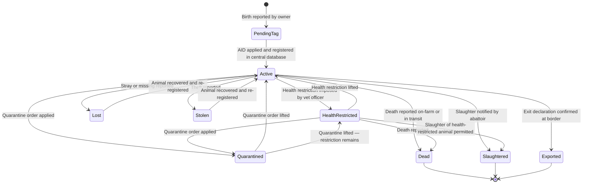
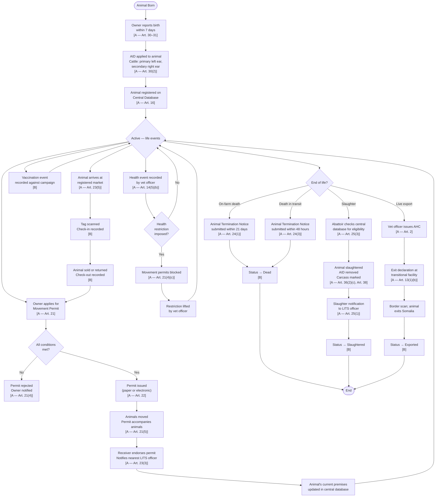
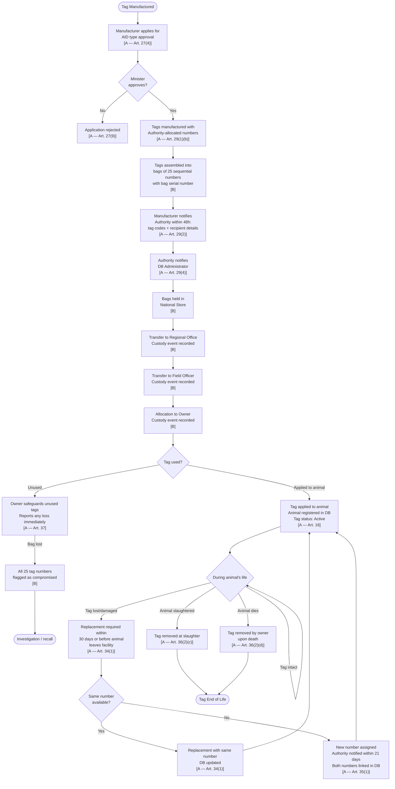
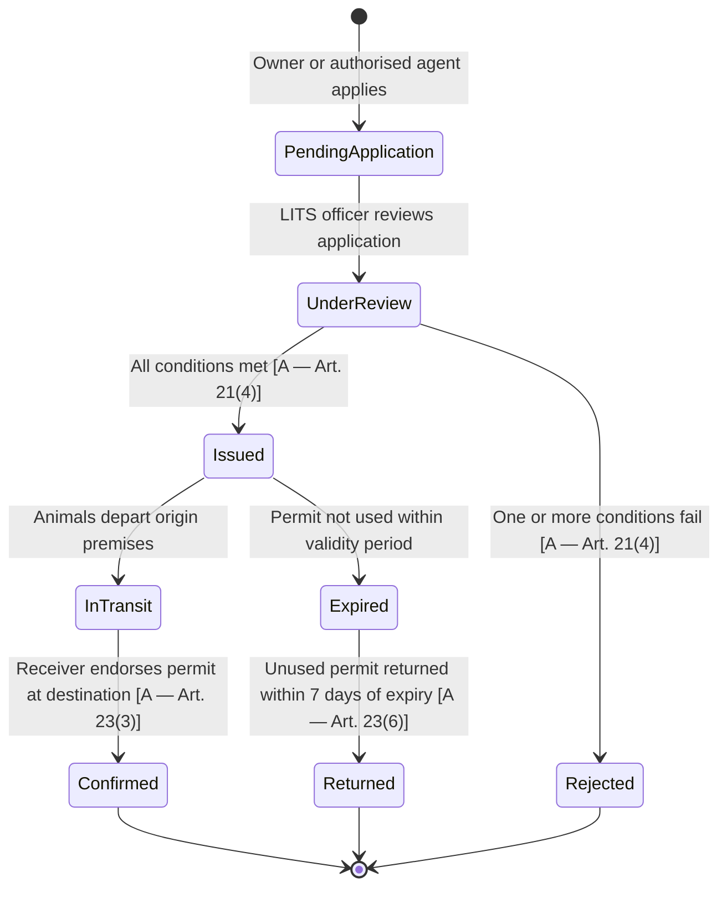
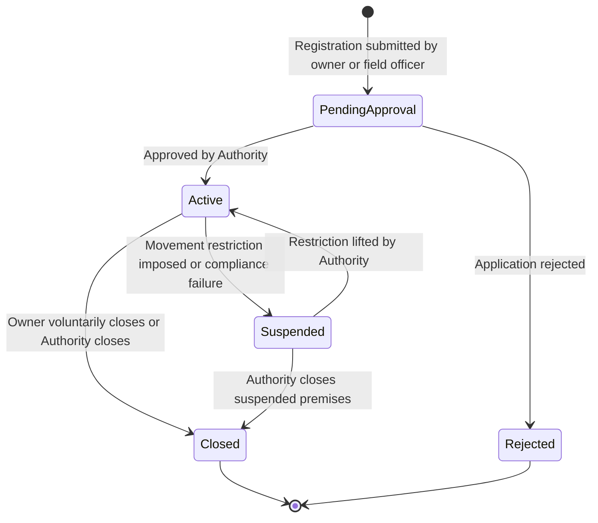

# High-Level Animal Lifecycle

**Version:** 0.1 — Draft for Review
**Date:** 2026-07-18
**Status:** Awaiting Ministry Approval

Classification key:
- **[A]** Supported by the IGAD Model Legal Framework for LITS (2016)
- **[B]** Proposed SOMLITS business rule
- **[C]** Requires Somalia Ministry confirmation

---

## 1. Animal Status Lifecycle

### Status Definitions

| Status | Description | Class |
|---|---|---|
| `PendingTag` | Birth reported but AID not yet applied. | B |
| `Active` | Animal is tagged, registered on the central database, no restrictions active. | A |
| `HealthRestricted` | A health restriction imposed by a veterinary officer. Movement permits blocked. | A |
| `Quarantined` | The animal or its premises is under a quarantine order. Movement permits blocked. | A |
| `Dead` | Death reported via Animal Termination Notice. | A |
| `Slaughtered` | Slaughter at a registered abattoir notified to the Authority. | A |
| `Exported` | Lawfully exported from Somalia. Active registration closed. | A |
| `Lost` | Reported stray or missing via Animal Termination Notice. | A |
| `Stolen` | Reported stolen via Animal Termination Notice; tag numbers flagged. | A |

### Animal Status Transitions



**Key rules:**
- Only `Active` animals may receive a movement permit. [A — Art. 21(4)]
- `Dead`, `Slaughtered`, and `Exported` animals cannot receive a new live-animal movement permit. [B]
- A health restriction prevents movement to another live premises but does not prevent slaughter. [A — Art. 21(4)(c)]
- A quarantine applies to the animal regardless of which premises it is currently on. [B]

---

## 2. Animal Lifecycle — End-to-End Event Flow



---

## 3. Tag (AID) Lifecycle



---

## 4. Movement Permit Lifecycle



**Movement permit issuance conditions [A — Art. 21(4)]:**

| Condition | Verified by |
|---|---|
| Animal bears an approved AID | System check |
| Origin premises is registered and Active | System check |
| Destination premises is registered and Active (or is outside Somalia for export) | System check |
| Neither premises is under a movement restriction or quarantine | System check |
| Animal health status does not pose a risk to either facility | Veterinary officer / system |
| If applicant is not the owner: written authorisation on record | Officer review |
| All previous permits for destination have been accounted for | System check |
| Animal is not in Dead, Slaughtered, or Exported status | System check |

---

## 5. Premises Status Lifecycle



---

## 6. Tag Bag Custody Chain

```mermaid
sequenceDiagram
    participant MFR as Manufacturer
    participant AUTH as Authority / DB Admin
    participant NS as National Store
    participant RO as Regional Office
    participant FO as Field Officer
    participant OWN as Owner

    MFR->>AUTH: Notify within 48h of supply — tag codes, recipient, quantity [A — Art. 29(2)]
    AUTH->>AUTH: Record bags in DB; notify DB Administrator [A — Art. 29(4)]
    MFR->>NS: Physical delivery of sealed tag bags [B]
    NS->>AUTH: Confirm receipt; custody event recorded [B]
    NS->>RO: Transfer bags; custody event recorded [B]
    RO->>FO: Issue bags to field officer; custody event recorded [B]
    FO->>OWN: Allocate bag(s) to owner; custody event recorded [B]
    OWN->>OWN: Apply tags to animals; activate each tag in DB [A — Art. 16]
    OWN->>AUTH: Lost bag reported immediately; 25 numbers flagged [A — Art. 37 / B]
```

---

## 7. Key Business Rules Summary

| Rule | Class |
|---|---|
| An animal has only one current owner at a time | B |
| An animal has only one current premises at a time | B |
| An animal has only one active primary tag at a time | A |
| Tag replacement does not create a new animal record | B |
| Completed movements cannot be deleted | B |
| Dead, Slaughtered, or Exported animals cannot make another live-animal movement | B |
| Health events and animal movements are separate records | B |
| A vaccination does not automatically create a movement | B |
| A health restriction may block a movement | A |
| An approved Active premises is required for normal movement origin and destination | A |
| All timestamps are recorded in UTC | B |
| Traceability records are never physically deleted | B |

---

STEP COMPLETE — awaiting approval before continuing.
