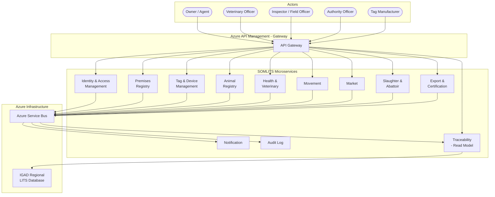

# Initial Bounded Contexts

**Version:** 0.1 — Draft for Review
**Date:** 2026-07-18
**Status:** Awaiting Ministry Approval

Classification key:
- **[A]** Supported by the IGAD Model Legal Framework for LITS (2016)
- **[B]** Proposed SOMLITS business rule
- **[C]** Requires Somalia Ministry confirmation

---

## 1. Purpose

This document identifies the initial set of bounded contexts for SOMLITS. Each bounded context corresponds to one microservice that owns its own PostgreSQL schema or database. No service may directly access another service's database; cross-context communication uses REST APIs or domain events via Azure Service Bus.

Bounded context boundaries will be refined during the design phase for each module.

---

## 2. Context Map

---

## 3. Bounded Context Descriptions

### 3.1 Identity and Access Management (IAM)

Manages the registration and authentication of all human actors in SOMLITS: owners, employee delegates, veterinary officers, inspectors, field officers, abattoir operators, market operators, manufacturers, and exporters.

| Aspect | Detail | Class |
|---|---|---|
| Key aggregates | Owner, Delegate, SystemUser, Role, Permission | B |
| Events published | OwnerRegistered, DelegateGranted, DelegateRevoked, UserSuspended | B |
| IGAD basis | Art. 10(3)(a), Art. 2 (Owner and Stakeholder definitions) | A |
| Critical rules | An owner must be registered before registering animals or premises. An agent must have explicit written authorisation from the owner. No sub-delegation. | A/B |

---

### 3.2 Premises Registry

Manages the registration, approval, and lifecycle of all facilities: farms, pastoral areas, transit facilities, markets, abattoirs, quarantine stations, border inspection posts, and export holding facilities.

| Aspect | Detail | Class |
|---|---|---|
| Key aggregates | Premises, PremisesType, PremisesStatusHistory | B |
| Events published | PremisesRegistered, PremisesApproved, PremisesSuspended, PremisesClosed | B |
| IGAD basis | Art. 2, Art. 10(2), Art. 21(4)(a) | A |
| Critical rules | Premises must be Active to serve as origin or destination on a movement permit. Premises Code assigned upon approval. Multiple premises may be registered under one owner. | A |

---

### 3.3 Tag and Device Management

Manages the lifecycle of Animal Identification Devices from Minister approval through manufacture, bag assembly, custody chain, owner allocation, tag activation, loss reporting, and end-of-life.

| Aspect | Detail | Class |
|---|---|---|
| Key aggregates | TagDevice, TagBag, CustodyEvent, TagAllocation | B |
| Events published | TagBagCreated, CustodyTransferred, TagAllocated, TagActivated, TagLost, TagCompromised | B |
| IGAD basis | Art. 27, Art. 28, Art. 29, Art. 34, Art. 35, Art. 37 | A |
| Critical rules | Every tag number is globally unique. A tag can be active on only one animal at a time. A lost bag triggers compromise of all 25 tag numbers. Only the Authority allocates tag numbers to manufacturers. | A/B |

---

### 3.4 Animal Registry

The authoritative source for animal identity. Manages registration of individual animals, their species, breed, birth details, current owner, current premises, current tag(s), and status lifecycle.

| Aspect | Detail | Class |
|---|---|---|
| Key aggregates | Animal, AnimalSpecies, AnimalTag, AnimalOwnershipHistory, AnimalPremisesHistory | B |
| Events published | AnimalRegistered, AnimalTagged, TagReplaced, OwnershipTransferred, PremisesChanged, AnimalStatusChanged | B |
| IGAD basis | Art. 10(3)(b), Art. 16, Art. 17, Art. 30, Art. 31 | A |
| Critical rules | An animal has one active primary tag, one current owner, and one current premises at any time. Tag replacement does not create a new animal record (UUID unchanged). Animal history is immutable; no hard deletes. | A/B |

---

### 3.5 Health and Veterinary

Records all health events against animals (disease diagnosis, treatment, test results, vaccination, on-farm death). Manages vaccination campaigns. Issues and lifts health restrictions. Raises and lifts quarantine orders.

| Aspect | Detail | Class |
|---|---|---|
| Key aggregates | HealthEvent, VaccinationCampaign, HealthRestriction, QuarantineOrder | B |
| Events published | HealthEventRecorded, HealthRestrictionImposed, HealthRestrictionLifted, QuarantineOrderRaised, QuarantineOrderLifted, AnimalDiedOnFarm | B |
| IGAD basis | Art. 14(5)(b), Art. 21(4)(c), Art. 21(7)(c), Art. 24 | A |
| Critical rules | A vaccination does not create a movement record. A health restriction or active quarantine blocks movement permit issuance. Health event records are immutable. A health restriction does not prevent slaughter. | A/B |

---

### 3.6 Movement

Manages movement permit applications, eligibility checks, issuance, endorsement, confirmation, expiry, and return. Records animal movement notices and walking permits.

| Aspect | Detail | Class |
|---|---|---|
| Key aggregates | MovementPermit, AnimalMovementNotice, WalkingPermit | B |
| Events published | MovementPermitApplied, MovementPermitIssued, MovementPermitRejected, MovementConfirmed, MovementPermitExpired, MovementPermitReturned | B |
| IGAD basis | Art. 21, Art. 22, Art. 23 | A |
| Critical rules | All Art. 21(4) conditions must pass before issuance. Confirmed movement updates animal's current premises in Animal Registry. Dead, Slaughtered, and Exported animals cannot receive a new permit. An idempotency key is required on permit applications. | A/B |

---

### 3.7 Market

Manages the registration of livestock markets (animal gatherings), market sessions, animal check-in and check-out, and electronic notification of arrivals and departures to the Authority.

| Aspect | Detail | Class |
|---|---|---|
| Key aggregates | Market, MarketSession, MarketArrival, MarketDeparture | B |
| Events published | MarketSessionOpened, AnimalCheckedIn, AnimalCheckedOut, MarketSessionClosed, MarketMovementNotificationSent | B |
| IGAD basis | Art. 23(5) | A |
| Critical rules | Market is a registered premises of type AnimalGathering in the Premises Registry. Electronic notification must be sent to Authority by second working day after session. Animals without tags at the market must be issued a return permit or detained. | A/B |

---

### 3.8 Slaughter and Abattoir

Manages pre-slaughter eligibility checks, slaughter notifications, carcass marking, and record retention for animals slaughtered at registered abattoirs.

| Aspect | Detail | Class |
|---|---|---|
| Key aggregates | SlaughterEvent, PreSlaughterCheck, CarcassLabel | B |
| Events published | PreSlaughterCheckCompleted, AnimalSlaughtered, CarcassMarked | B |
| IGAD basis | Art. 25, Art. 38 | A |
| Critical rules | Pre-slaughter check must confirm health status, origin, movement history, and eligibility. Slaughter notification closes the animal's active record. Tag removed at slaughter — the only authorised removal without replacement. Slaughter records retained minimum 3 years. | A |

---

### 3.9 Export and Certification

Manages live export consignments, exit declarations, Animal Health Certificates (AHC), and compliance certificates. Interfaces with border inspection posts.

| Aspect | Detail | Class |
|---|---|---|
| Key aggregates | ExportConsignment, AnimalHealthCertificate, ExitDeclaration, ComplianceCertificate | B |
| Events published | ExitDeclarationMade, AHCIssued, AnimalExported, CertificateRevoked | B |
| IGAD basis | Art. 13, Art. 33, Art. 41(2)(a) | A |
| Critical rules | AHC is issued per consignment by an authorised veterinary officer only. An exported animal's status is set to Exported; no further live-animal movement permit may be issued. AHC template requires Ministry approval. | A/C |

---

### 3.10 Traceability (Read Model)

Provides a read-optimised event timeline per animal for trace-back and trace-forward queries. Subscribes to all domain events across other contexts via Azure Service Bus to build a complete, immutable history.

| Aspect | Detail | Class |
|---|---|---|
| Key aggregates | AnimalTraceRecord (read model, CQRS projection) | B |
| Events consumed | All animal-related events from all other contexts | B |
| IGAD basis | Art. 3(f), Art. 14(5)(f)(i) | A |
| Critical rules | Trace data is immutable. Trace-back must return the complete history. Trace-forward must identify all animals co-located or co-moved within a configurable window. Selected data shared with IGAD regional database per bilateral agreement. | B/C |

---

### 3.11 Notification

Dispatches event-driven notifications (SMS, email, in-app push) to relevant actors based on domain events. Manages notification templates in Somali and English.

| Aspect | Detail | Class |
|---|---|---|
| Key aggregates | NotificationTemplate, NotificationLog | B |
| Events consumed | Domain events from all other contexts | B |
| Critical rules | Failed notifications are retried with exponential back-off and logged. An owner receives SMS and push notification for permit status, tag replacement, and health events on their animals. | B |

---

### 3.12 Audit Log

Provides the immutable, append-only audit log of all data changes across SOMLITS. Consumes audit events published by every other context.

| Aspect | Detail | Class |
|---|---|---|
| Key aggregates | AuditEvent | B |
| Events consumed | Audit events from all other contexts | B |
| IGAD basis | Art. 14(2)(f), Art. 18(1)(d), Art. 19(2)(c) | A |
| Critical rules | Audit log is append-only; no deletes or updates permitted. Retained minimum 10 years. Accessible to inspectors and the Authority; not to the general public. | A/B |

---

## 4. Cross-Cutting Concerns

| Concern | Approach | Class |
|---|---|---|
| Authentication and authorisation | OAuth 2.0 / JWT; all APIs enforce role-based access; managed via IAM context | B |
| UUID primary keys | Every aggregate uses UUID as its internal primary key; business codes are separate | B |
| Timestamps | All timestamps stored and transmitted in UTC | B |
| Optimistic locking | Applied wherever concurrent updates are possible (animal status, permit status, premises status) | B |
| Idempotency keys | All command endpoints accept an idempotency key to prevent duplicate processing | B |
| Outbox pattern | Each service writes domain events to a transactional outbox table before dispatch to Azure Service Bus | B |
| DTO boundary | REST controllers never expose JPA entity objects; DTOs with validation and standardised error responses are used | B |
| Soft delete only | Traceability records are never physically deleted; status transitions are used instead | B |
| No cross-service DB access | Each microservice has its own PostgreSQL schema/database; no direct cross-schema queries | B |
| Structured logging | All services emit structured JSON logs to Azure Monitor and Application Insights | B |

---

## 5. Data Ownership Summary

| Bounded Context | Owns |
|---|---|
| Identity & Access Management | Owner profiles, delegate grants, system users, roles |
| Premises Registry | Premises records, premises codes, status history |
| Tag & Device Management | Tag device records, bag records, custody events, allocations |
| Animal Registry | Animal records, species, tag assignments, ownership history, premises history |
| Health & Veterinary | Health events, vaccination campaigns, health restrictions, quarantine orders |
| Movement | Movement permits, animal movement notices, walking permits |
| Market | Market registrations, market sessions, arrival/departure records |
| Slaughter & Abattoir | Slaughter events, pre-slaughter checks, carcass labels |
| Export & Certification | Export consignments, AHCs, exit declarations, certificates |
| Traceability | Read-model event timeline per animal (derived; not authoritative) |
| Notification | Notification templates, notification logs |
| Audit Log | Immutable audit event records |

---

## 6. Module-to-Phase Mapping

| Phase | Bounded Contexts Involved |
|---|---|
| Phase 0 — Foundation | IAM, Premises Registry, Audit Log |
| Phase 1 — Identification | Tag & Device Management, Animal Registry, Audit Log |
| Phase 2 — Movement | Movement, Market, Notification, Audit Log |
| Phase 3 — Health | Health & Veterinary, Notification, Audit Log |
| Phase 4 — Exit | Slaughter & Abattoir, Export & Certification, Audit Log |
| Phase 5 — Intelligence | Traceability, Notification (enhanced), Audit Log (reporting) |

---

STEP COMPLETE — awaiting approval before continuing.
