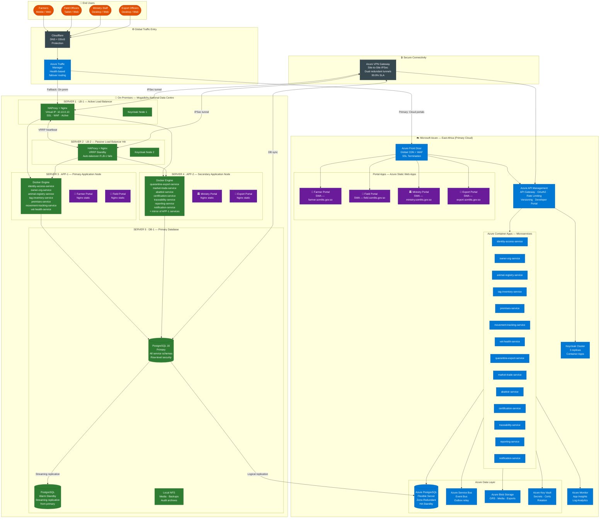
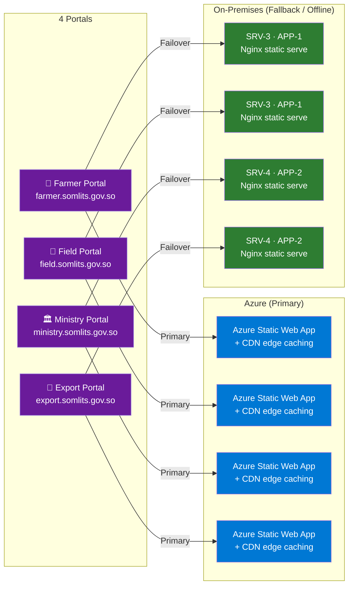
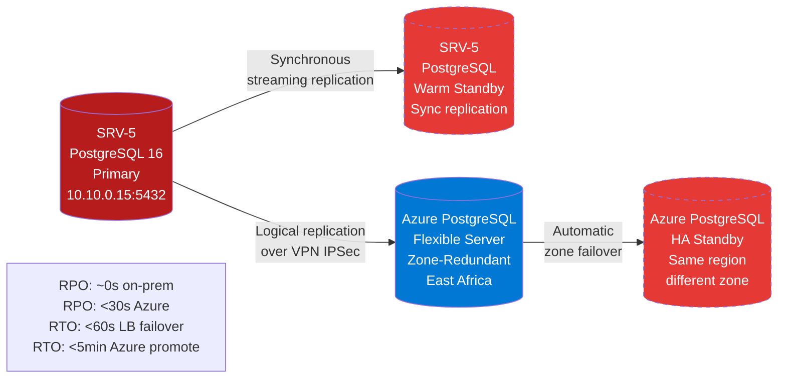
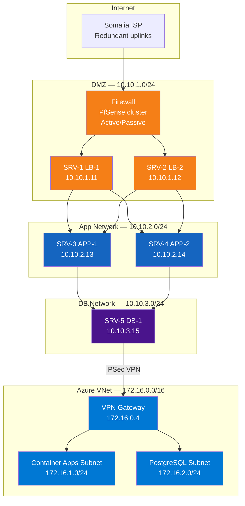
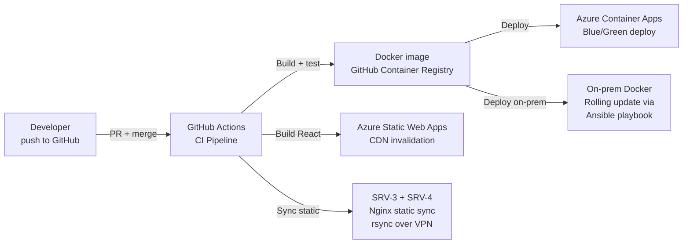

# SOMLITS — Complete Server Infrastructure Architecture

**Version:** 1.0  
**Date:** 2026-09-04  
**Scope:** Hybrid on-premises + Azure deployment with high availability and redundancy

---

## 1. Architecture Overview

SOMLITS operates as a **hybrid infrastructure**: five physical servers in the Mogadishu national data centre handle all day-to-day operations and provide offline resilience. Azure (East Africa region) provides cloud-scale DR, global CDN delivery of portal apps, and seamless failover.

**Design principles:**
- No single point of failure on-premises (active/passive LB pair, dual app nodes, primary + standby DB)
- All four portals are hosted on **both** on-premises servers and Azure — traffic is routed intelligently
- Microservices run on both on-premises app servers (mirrored) and Azure Container Apps
- PostgreSQL primary lives on-premises; Azure PostgreSQL receives streaming replication for DR
- VPN Site-to-Site tunnel keeps on-prem and Azure in sync at all times

---

## 2. High-Level Architecture Diagram

---

## 3. On-Premises Server Roles (5 Servers)

| Server | Role | Key Software | IP |
|--------|------|-------------|-----|
| **SRV-1 · LB-1** | Active Load Balancer + Auth Node | HAProxy, Nginx, Keycloak Node 1 | 10.10.0.11 (VIP: 10.10.0.10) |
| **SRV-2 · LB-2** | Passive Load Balancer (HA failover) | HAProxy, Nginx, Keycloak Node 2 | 10.10.0.12 |
| **SRV-3 · APP-1** | Primary Application Node | Docker Engine, 7 microservices + Farmer/Field portal static | 10.10.0.13 |
| **SRV-4 · APP-2** | Secondary Application Node | Docker Engine, 7 microservices + Ministry/Export portal static + mirror | 10.10.0.14 |
| **SRV-5 · DB-1** | Primary Database + Warm Standby | PostgreSQL 16 Primary, PostgreSQL Standby, NFS | 10.10.0.15 |

---

## 4. Portal Hosting Map

Each portal is deployed to **both on-premises and Azure**. Traffic Manager determines which path users hit.

---

## 5. Microservice Hosting Map

All 14 microservices run in **both environments** simultaneously. Azure Container Apps are the active-scale path; on-premises handles local and offline scenarios.

```mermaid
graph TB
    classDef azure fill:#0078D4,color:#fff
    classDef onprem fill:#2E7D32,color:#fff

    subgraph SVCS["14 Microservices"]
        direction TB
        S1[identity-access-service]
        S2[owner-org-service]
        S3[animal-registry-service]
        S4[tag-inventory-service]
        S5[premises-service]
        S6[movement-tracking-service]
        S7[vet-health-service]
        S8[quarantine-export-service]
        S9[market-trade-service]
        S10[abattoir-service]
        S11[certification-service]
        S12[traceability-service]
        S13[reporting-service]
        S14[notification-service]
    end

    subgraph AZ_SVC["Azure Container Apps\n(auto-scale · zone-redundant)"]
        AZ_GRP_A[Group A — Core\nidentity · owner · animal · tag]:::azure
        AZ_GRP_B[Group B — Operations\npremises · movement · vet · quarantine]:::azure
        AZ_GRP_C[Group C — Trade & Reporting\nmarket · abattoir · cert · trace · report · notify]:::azure
    end

    subgraph OP_SVC["On-Premises Docker\nSRV-3 APP-1 + SRV-4 APP-2"]
        OP_APP1[APP-1 · SRV-3\nidentity · owner · animal\ntag · premises · movement · vet]:::onprem
        OP_APP2[APP-2 · SRV-4\nquarantine · market · abattoir\ncert · trace · report · notify\n+ mirror of APP-1]:::onprem
    end

    S1 & S2 & S3 & S4 --> AZ_GRP_A
    S5 & S6 & S7 & S8 --> AZ_GRP_B
    S9 & S10 & S11 & S12 & S13 & S14 --> AZ_GRP_C

    S1 & S2 & S3 & S4 & S5 & S6 & S7 --> OP_APP1
    S8 & S9 & S10 & S11 & S12 & S13 & S14 --> OP_APP2
```

---

## 6. High Availability & Redundancy Matrix

| Component | On-Prem HA | Azure HA | Failover Mechanism |
|-----------|-----------|---------|-------------------|
| **Load Balancer** | SRV-1 active + SRV-2 passive (VRRP, <1s failover) | Azure Front Door (global anycast) | VRRP auto-takeover |
| **Farmer Portal** | SRV-3 Nginx | Azure SWA + CDN | Traffic Manager health probe |
| **Field Portal** | SRV-3 Nginx | Azure SWA + CDN | Traffic Manager health probe |
| **Ministry Portal** | SRV-4 Nginx | Azure SWA + CDN | Traffic Manager health probe |
| **Export Portal** | SRV-4 Nginx | Azure SWA + CDN | Traffic Manager health probe |
| **Microservices** | SRV-3 + SRV-4 mirrored | Azure Container Apps (min 2 replicas, zone-spread) | LB removes failed instance |
| **Keycloak (Auth)** | SRV-1 + SRV-2 cluster | 3-replica Container App | Session replication |
| **PostgreSQL** | SRV-5 Primary + Warm Standby | Azure PostgreSQL Zone-Redundant | Logical replication + manual promote |
| **API Gateway** | HAProxy on SRV-1/SRV-2 | Azure APIM (zone-redundant) | Traffic Manager |
| **Connectivity** | — | VPN dual tunnels | Auto-BGP failover to secondary tunnel |

---

## 7. Database Replication Architecture

---

## 8. Network Topology

---

## 9. CI/CD Deployment Flow

---

## 10. Open Questions for Ministry Approval

| # | Question | Impact |
|---|----------|--------|
| 1 | Are 5 physical servers to be provisioned by the Ministry or procured under the project? | Timeline |
| 2 | Is a dedicated fibre link or MPLS available between the data centre and Azure? (affects VPN vs ExpressRoute choice) | Cost / latency |
| 3 | Should on-premises be the **primary** path for all traffic, or Azure primary with on-prem as DR? | Architecture direction |
| 4 | What is the acceptable RTO (Recovery Time Objective) for database failover? | DR strategy |
| 5 | Who manages Keycloak cluster administration on-premises? | Ops model |
| 6 | Is a separate management VLAN / bastion host required for server administration? | Security |
| 7 | Will field offices have local caching proxies or is all traffic routed via Mogadishu? | WAN sizing |

---

STEP COMPLETE — awaiting approval before continuing.
