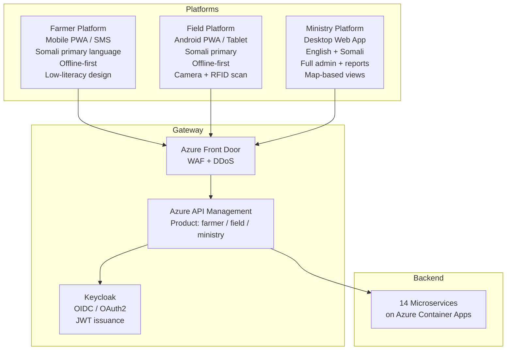
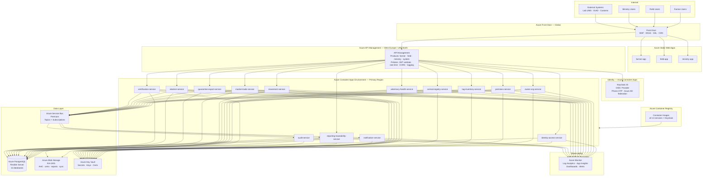
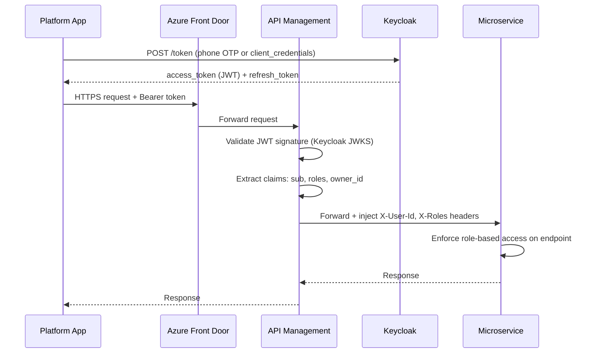
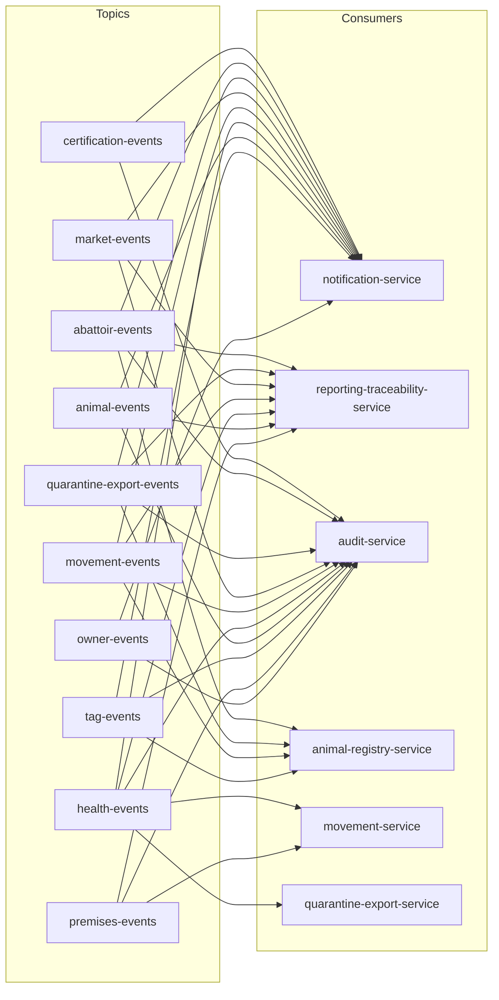
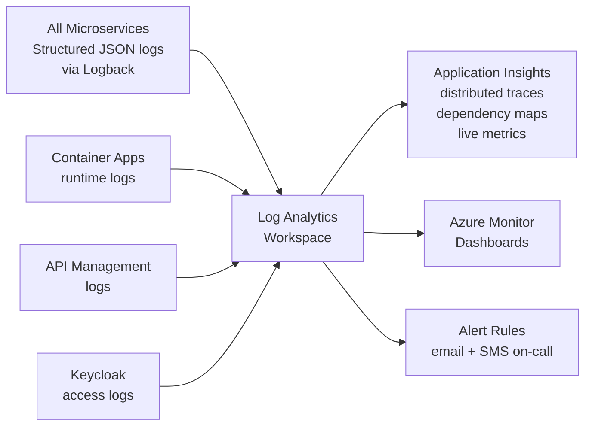

# SOMLITS — Solution Architecture

**Project:** Somalia Livestock Identification and Traceability System
**Version:** 0.1 — Draft for Review
**Date:** 2026-07-18
**Status:** Awaiting Ministry Approval
**Prepared by:** SOMLITS Architecture Team

---

## 1. Architecture Overview

SOMLITS is built as a cloud-native, microservices platform deployed on Microsoft Azure. It serves three distinct user platforms — Farmer, Field, and Ministry — through a single API gateway backed by 14 domain microservices. All services communicate asynchronously through Azure Service Bus and synchronously through REST APIs.

### 1.1 Guiding Principles

| Principle | Rationale |
|---|---|
| **Offline-first for field and farmer platforms** | Rural Somalia has unreliable internet; data must be capturable without connectivity |
| **Database-per-service** | Each microservice owns its own PostgreSQL database; no cross-service database reads |
| **Event-driven for cross-service communication** | Services publish domain events; consumers react independently; no tight coupling |
| **Immutable audit history** | Every write is audited; no traceability record is ever deleted |
| **Role-based access everywhere** | Every API endpoint enforces authorisation; no open endpoints except public health check |
| **Least-privilege secrets** | Each service's managed identity accesses only the secrets it needs in Key Vault |
| **Infrastructure as Code** | All Azure resources provisioned and versioned via Bicep; no manual portal changes |
| **Outbox pattern for reliable events** | Domain events written to DB in same transaction as business data before dispatch to Service Bus |

### 1.2 Technology Choices

| Layer | Technology | Rationale |
|---|---|---|
| Backend services | Java 21, Spring Boot 3, Spring Security, Spring Data JPA | Stable, well-supported, strong ecosystem for government-grade systems |
| REST API | Spring MVC, OpenAPI 3.1 | Standard; auto-generates API documentation |
| Messaging | Azure Service Bus (Premium) | Managed, geo-redundant, supports topics/subscriptions and dead-letter queues |
| Database | PostgreSQL 16 via Azure Database for PostgreSQL Flexible Server | Open standard; strong JSON support; Flyway for migrations |
| Frontend — Farmer | React 19, TypeScript, PWA (Progressive Web App) | Cross-platform; offline capability via service worker and IndexedDB |
| Frontend — Field | React 19, TypeScript, PWA optimised for Android tablets | Same stack; camera/RFID reader integration; aggressive offline caching |
| Frontend — Ministry | React 19, TypeScript, desktop-first | Full admin, reporting, dashboards, map views |
| Identity | Keycloak 25 on Azure Container Apps | Open-source OIDC/OAuth2; supports phone-number auth, offline tokens; federates with Azure AD for government users |
| Container runtime | Azure Container Apps | Serverless container hosting; auto-scales to zero; simpler than AKS for this team |
| API gateway | Azure API Management (APIM) | Rate limiting, JWT validation, OpenAPI portal, product tiers, analytics |
| Global entry | Azure Front Door | WAF, DDoS protection, global load balancing, SSL termination |
| IaC | Azure Bicep | Native Azure; no external state; readable |
| CI/CD | GitHub Actions | Integrated with repository; supports environment-gated deployments |

---

## 2. Three Platforms

SOMLITS presents three distinct user-facing platforms. All three call the same set of backend microservices through the same API gateway but expose different feature sets, UX patterns, and capability levels.



### 2.1 Farmer Platform

**Purpose:** Enable livestock owners and their delegates to register animals, manage tags, apply for movement permits, report deaths, view their herd, and receive notifications — primarily from a smartphone or feature phone.

| Aspect | Detail |
|---|---|
| Hosting | Azure Static Web Apps (React PWA) |
| Languages | Somali (default), English (switchable) |
| Authentication | Phone-number OTP via Keycloak; biometric PIN on repeat login |
| Offline capability | Registrations, health reports, and termination notices queued in IndexedDB; synced on connectivity restore |
| SMS fallback | Critical notifications delivered by SMS; basic commands via structured SMS for feature phones |
| Accessibility | Voice-guided navigation for low-literacy users; pictographic icon set for core actions |
| APIM product | `farmer` — limited rate, subset of endpoints, no admin functions |

**Core screens:** My Animals, Register Animal, Movement Permit Application, Report Death / Loss, Tag Replacement Request, Notifications, My Premises, My Profile.

### 2.2 Field Platform

**Purpose:** Equip District LITS Officers, CAHWs, Inspectors, and Field Veterinary Officers with a ruggedised tablet application for on-the-ground tagging, vaccination recording, health event capture, permit processing, and bag distribution.

| Aspect | Detail |
|---|---|
| Hosting | Azure Static Web Apps (React PWA, Android-optimised) |
| Languages | Somali (default), English |
| Authentication | Keycloak; long-lived offline tokens refreshed when connectivity is available |
| Offline capability | Full offline mode: register animals, record vaccinations, record deaths, scan tags — all queued and synced |
| Hardware integration | Camera-based QR/barcode scan; USB/Bluetooth RFID reader integration via Web Serial API |
| Sync indicator | Prominent pending-sync count; manual force-sync button; conflict resolution log |
| APIM product | `field` — moderate rate, field-officer and vet-officer endpoints, no ministry-admin functions |

**Core screens:** Tag Scan Lookup, Animal Registration (batch and individual), Vaccination Campaign Entry, Health Event Record, Movement Permit Processing, Tag Bag Distribution, Inspection Record, Death Report, Offline Queue Status.

### 2.3 Ministry Platform

**Purpose:** Provide MoLFR, CVO, regional coordinators, inspectors, abattoir operators, market operators, and exporters with a full-featured desktop web application for administration, oversight, reporting, and trace queries.

| Aspect | Detail |
|---|---|
| Hosting | Azure Static Web Apps |
| Languages | English (primary), Somali |
| Authentication | Keycloak federated with Azure AD for government staff; standard OIDC for non-government operators |
| Offline capability | Not required; Ministry users are expected to have reliable connectivity |
| Map integration | Azure Maps for geographic quarantine zones, movement heat maps, disease alert overlays |
| Reporting | Export to Excel, PDF; scheduled report delivery by email |
| APIM product | `ministry` — full access, admin endpoints, trace-back/trace-forward, quarantine management, AHC issuance |

**Core screens:** National Dashboard, Animal Search, Trace-back, Trace-forward, Movement Permit Management, Quarantine Order Management, AHC Issuance, Vaccination Campaign Management, Disease Investigation, Tag Inventory Management, User and Delegate Management, Premises Management, Report Builder, Audit Log Viewer, System Configuration.

---

## 3. Azure Deployment Architecture



### 3.1 Region Strategy

| Environment | Primary Region | Secondary Region | DR Model |
|---|---|---|---|
| Production | UAE North (closest to Somalia export markets) | South Africa North | Active-passive; Service Bus geo-DR; PostgreSQL geo-redundant backup |
| Staging | UAE North | — | Single region |
| Test | West Europe | — | Single region |
| Development | West Europe | — | Single region |

---

## 4. API Gateway Design

### 4.1 APIM Products and Subscriptions

| Product | Consumer | Rate Limit | Scope |
|---|---|---|---|
| `farmer` | Farmer mobile/web app | 100 req/min per user | Owner, animal read/write; movement applications; notifications |
| `field` | Field officer / CAHW app | 300 req/min per user | All farmer scope + health events, vaccinations, inspections, tag distribution |
| `ministry` | Ministry web app | 1000 req/min per user | Full scope including admin, trace queries, quarantine, AHC, reporting |
| `system` | Service-to-service calls | 5000 req/min | Internal event-driven callbacks; lab LIMS; IGAD integration |

### 4.2 APIM Policy Stack (applied per inbound request)

```mermaid
flowchart LR
    A[Inbound Request] --> B[CORS Policy]
    B --> C[JWT Validation\nKeycloak public key]
    C --> D[Rate Limit Check\nby product + user]
    D --> E[IP Allow/Block\nfor system product]
    E --> F[Request Logging\nApp Insights]
    F --> G[Route to Backend\nService URL]
    G --> H[Backend Service]
    H --> I[Response Logging]
    I --> J[Cache Response\nGET only, configurable TTL]
    J --> K[Outbound Response]
```



### 4.3 URL Routing Convention

All routes follow the pattern: `/api/v1/{service-prefix}/{resource}`

| Prefix | Service |
|---|---|
| `/api/v1/auth/` | identity-access-service |
| `/api/v1/owners/` | owner-org-service |
| `/api/v1/premises/` | premises-service |
| `/api/v1/tags/` | tag-inventory-service |
| `/api/v1/animals/` | animal-registry-service |
| `/api/v1/health/` | veterinary-health-service |
| `/api/v1/movements/` | movement-service |
| `/api/v1/markets/` | market-trade-service |
| `/api/v1/quarantine/` | quarantine-export-service (quarantine) |
| `/api/v1/exports/` | quarantine-export-service (export) |
| `/api/v1/abattoirs/` | abattoir-service |
| `/api/v1/certificates/` | certification-service |
| `/api/v1/reports/` | reporting-traceability-service (reports) |
| `/api/v1/trace/` | reporting-traceability-service (trace) |
| `/api/v1/audit/` | audit-service |

### 4.4 Authentication Flow



---

## 5. Azure Service Bus Event Design

### 5.1 Topic Topology

One topic per producing service. Each consuming service has its own subscription (with message filters if needed). Dead-letter queues enabled on all subscriptions.



### 5.2 Event Message Envelope

Every event on the bus follows this standard envelope:

```
{
  "messageId":    "<uuid — idempotency key>",
  "eventType":    "<ServiceName>.<EntityName>.<EventVerb>",
  "version":      "1.0",
  "occurredAt":   "<UTC ISO-8601 timestamp>",
  "sourceService":"<service-name>",
  "actorId":      "<user UUID who caused the event>",
  "correlationId":"<trace correlation ID>",
  "payload":      { ... event-specific fields ... }
}
```

Examples:
- `AnimalRegistry.Animal.Registered`
- `Movement.MovementPermit.Issued`
- `VeterinaryHealth.HealthRestriction.Imposed`
- `QuarantineExport.QuarantineOrder.Raised`

### 5.3 Outbox Pattern

Every service that publishes events uses the transactional outbox pattern:

1. Within the same database transaction that saves business data, a row is inserted into the `outbox_events` table.
2. A separate outbox processor (Spring `@Scheduled`) reads unprocessed outbox rows and publishes them to Service Bus.
3. On successful publish, the row is marked as `PUBLISHED`.
4. On failure, the row is retried with exponential back-off up to a configurable maximum.
5. Rows older than 7 days that remain unpublished trigger an alert.

This ensures no event is lost even if the service crashes between writing and dispatching.

### 5.4 Dead Letter Queue Handling

Each subscription has a dead-letter sub-queue. The notification-service and audit-service have DLQ monitors that alert the operations team when the DLQ depth exceeds a threshold. Ministry Platform has a DLQ inspector screen for manual replay or discard.

---

## 6. PostgreSQL Strategy

### 6.1 Database-per-Service

Each microservice has its own PostgreSQL **database** (not just schema) on the Azure PostgreSQL Flexible Server instance. No service may connect to another service's database under any circumstances.

| Service | Database Name |
|---|---|
| identity-access-service | `somlits_identity` |
| owner-org-service | `somlits_owner` |
| premises-service | `somlits_premises` |
| tag-inventory-service | `somlits_tag` |
| animal-registry-service | `somlits_animal` |
| veterinary-health-service | `somlits_health` |
| movement-service | `somlits_movement` |
| market-trade-service | `somlits_market` |
| quarantine-export-service | `somlits_quarantine` |
| abattoir-service | `somlits_abattoir` |
| certification-service | `somlits_certification` |
| notification-service | `somlits_notification` |
| reporting-traceability-service | `somlits_reporting` |
| audit-service | `somlits_audit` |
| Keycloak | `somlits_keycloak` |

### 6.2 Migration Strategy

- Flyway manages all schema changes
- Migrations are versioned and named: `V001__create_animal_table.sql`
- Migrations run automatically on service startup in dev and test; manually approved in staging and production
- No destructive migrations (DROP TABLE, DROP COLUMN) without a phased approach: add column → deploy → migrate data → remove column in next release
- Baseline migrations for each service run once on first deployment

### 6.3 Connection Pooling

- PgBouncer deployed as a sidecar Container App in transaction pooling mode
- Services connect to PgBouncer (port 6432), not PostgreSQL directly
- Maximum connections per service: 20 in production; 5 in development
- Azure PostgreSQL Flexible Server connection limit: 960 (Standard_D4s_v3 tier)

### 6.4 Performance

- Read replicas for `somlits_reporting` and `somlits_audit` (high read volume)
- Partial indexes on commonly queried columns (animal status, movement permit status, tag number)
- UUID primary keys; no auto-increment integer IDs
- JSONB columns for supplementary data (traditional marks, AHC country-specific fields)

### 6.5 High Availability and Backup

- Azure PostgreSQL Flexible Server with Zone-Redundant High Availability (two standby nodes in different AZs)
- Point-in-time restore (PITR) enabled; retention 35 days in production
- Geo-redundant backups enabled for production
- Backup schedule: continuous WAL archiving + daily full backup

---

## 7. Blob Storage Strategy

### 7.1 Container Structure

| Container | Contents | Retention | Access |
|---|---|---|---|
| `ahc-documents` | Generated AHC PDFs | Permanent (linked to animal records) | Private; service-managed SAS URLs |
| `certificates` | Registration, compliance, vaccination certificates | Permanent | Private; SAS URLs |
| `vet-reports` | Lab reports, inspection attachments | 10 years | Private; inspector role only |
| `offline-sync-packages` | Offline data batches from field app pending upload | 48 hours then auto-deleted | Private; field-service account only |
| `report-exports` | Ministry-generated Excel/PDF reports | 30 days | Private; per-user SAS URLs |
| `tag-photos` | Optional tag application photos | 5 years | Private; inspector role |
| `backups` | Database export backups (secondary to PITR) | 90 days | Private; restricted to DBA |

### 7.2 File Naming Convention

```
ahc-documents/{year}/{month}/{ahc-serial-number}.pdf
certificates/{type}/{year}/{certificate-id}.pdf
vet-reports/{animal-uuid}/{event-id}/{timestamp}-{filename}
offline-sync-packages/{device-id}/{batch-uuid}.json
report-exports/{user-uuid}/{report-type}/{timestamp}.xlsx
```

### 7.3 Access Control

- All containers are private (no public access)
- Services access Blob via Managed Identity (no connection strings stored in code)
- Users access documents via short-lived SAS URLs generated by the appropriate service (expiry 15 minutes for downloads, 5 minutes for uploads)
- Blob Storage firewall restricts access to Container Apps environment IPs

---

## 8. Key Vault Strategy

### 8.1 Vault Structure

One Key Vault per environment:
- `kv-somlits-dev`
- `kv-somlits-test`
- `kv-somlits-stg`
- `kv-somlits-prod`

### 8.2 Secret Naming Convention

```
{service-name}--db-connection-string
{service-name}--servicebus-connection-string
notification--sms-gateway-api-key
notification--smtp-password
keycloak--admin-password
keycloak--client-secret
integration--igad-api-key
integration--lab-lims-api-key
```

### 8.3 Access Control

- Each service is assigned an Azure Managed Identity
- Each identity is granted `Key Vault Secrets User` on only the secrets it needs
- No service has access to another service's secrets
- Key Vault access logs are shipped to Log Analytics
- Soft-delete and purge protection enabled on all vaults

### 8.4 Certificate Management

- TLS certificates for custom domains managed in Key Vault
- JWT signing keys for Keycloak rotated every 90 days; old keys retained for validation until all tokens expire
- Azure Front Door certificate managed via Azure-managed certificates (auto-renewed)

---

## 9. Logging and Monitoring

### 9.1 Log Architecture



### 9.2 Structured Log Fields (every log entry)

| Field | Value |
|---|---|
| `timestamp` | UTC ISO-8601 |
| `level` | INFO / WARN / ERROR |
| `service` | Service name |
| `traceId` | Distributed trace ID (from App Insights) |
| `spanId` | Current span ID |
| `userId` | Authenticated user UUID (if applicable) |
| `ownerId` | Owner UUID (if applicable) |
| `entityId` | Primary entity UUID (animal, permit, etc.) |
| `action` | Verb + noun (e.g., `animal.registered`) |
| `message` | Human-readable description |
| `durationMs` | Processing time for the operation |

### 9.3 Key Dashboards

| Dashboard | Audience | Key Metrics |
|---|---|---|
| Operations | IT Admin | Service health, error rates, CPU/memory, Service Bus queue depth |
| LITS Activity | CVO / DB Admin | Registrations per day, permits issued, vaccinations recorded, deaths reported |
| Disease Alert Map | CVO / Vet Authority | Active health restrictions and quarantine zones on a map |
| Export Pipeline | Export Authority | Consignments in progress, AHCs issued, border crossings |
| Tag Activation | Regional Coordinators | Bags distributed vs tags activated, by region |
| Notification | IT Admin | SMS/email delivery rate, failed notifications, DLQ depth |

### 9.4 Alert Rules

| Alert | Condition | Severity | Action |
|---|---|---|---|
| Service Unavailable | HTTP 5xx rate > 5% for 5 min | Critical | SMS to on-call + email |
| DB Connection Exhaustion | PgBouncer connection pool > 90% | High | Email to DBA |
| Service Bus DLQ Growing | DLQ depth > 100 on any subscription | High | Email to admin |
| OIE Disease Alert | Event type `VeterinaryHealth.Disease.OIENotifiable` published | Critical | SMS + email to CVO immediately |
| Unusual Registration Spike | > 500 animal registrations/min for any single owner | High | Alert for fraud review |
| Key Vault Access Failure | Any service unable to read its secrets | Critical | SMS to on-call |
| Offline Sync Backlog | offline-sync-packages blob count > 10,000 | Medium | Email to IT Admin |

---

## 10. Backup and Disaster Recovery

### 10.1 Recovery Targets

| Tier | RTO | RPO | Applies To |
|---|---|---|---|
| Production | 4 hours | 1 hour | All production data |
| Staging | 24 hours | 24 hours | Staging environment |
| Test / Dev | Best effort | 24 hours | Non-production |

### 10.2 Backup Schedule

| Resource | Method | Frequency | Retention |
|---|---|---|---|
| PostgreSQL | Azure PITR (continuous WAL) | Continuous | 35 days |
| PostgreSQL | Full backup | Daily at 01:00 UTC | 35 days |
| PostgreSQL | Geo-redundant copy | Automatic (async) | Paired region |
| Blob Storage | RA-GRS replication | Continuous | Per container policy |
| Service Bus | Geo-disaster recovery (Premium) | Continuous (async metadata only) | N/A |
| Key Vault | Soft-delete enabled | — | 90 days after deletion |
| Container Registry | Geo-replication | Automatic | Permanent |

### 10.3 Disaster Recovery Procedure

1. **Detection:** Azure Monitor alert fires; on-call team notified via SMS.
2. **Assessment:** Determine scope (single service, data layer, full region).
3. **Failover decision:** CTO or designated authority approves region failover.
4. **PostgreSQL failover:** Promote geo-redundant standby; update connection strings in Key Vault.
5. **Service Bus failover:** Initiate APIM namespace failover to secondary alias.
6. **Container Apps:** Deploy to secondary region using same container images from geo-replicated ACR.
7. **DNS update:** Azure Front Door automatically routes to secondary region.
8. **Validate:** Run smoke tests against secondary region endpoints.
9. **Communicate:** Notify CVO, Ministry, and field officers of maintenance window.

### 10.4 DR Drills

Production DR drill conducted quarterly. Drill includes full failover simulation to secondary region, validation of RTO/RPO, and post-drill report to Ministry.

---

## 11. Service Summary

Full service detail is in [docs/03-architecture/service-catalogue.md](service-catalogue.md).

| # | Service | Key Responsibility | DB | Scales on |
|---|---|---|---|---|
| 1 | identity-access-service | Authentication, JWT issuance, role management | somlits_identity | Auth request volume |
| 2 | owner-org-service | Owner registration, delegates, organisations | somlits_owner | Registration campaigns |
| 3 | premises-service | Premises registration, status, codes | somlits_premises | Low — stable dataset |
| 4 | tag-inventory-service | Tag bags, custody chain, allocation, activation | somlits_tag | Tag distribution events |
| 5 | animal-registry-service | Animal identity, status, history | somlits_animal | Birth registration campaigns |
| 6 | veterinary-health-service | Health events, campaigns, restrictions, lab samples | somlits_health | Disease outbreak response |
| 7 | movement-service | Movement permits, walking permits | somlits_movement | Market season peaks |
| 8 | market-trade-service | Markets, sessions, check-in/out | somlits_market | Market-day peaks |
| 9 | quarantine-export-service | Quarantine orders, export consignments, exit declarations | somlits_quarantine | Export season peaks |
| 10 | abattoir-service | Slaughter events, pre-slaughter checks, carcass marking | somlits_abattoir | Eid peak slaughter |
| 11 | certification-service | AHC, compliance certificates, vaccination certs | somlits_certification | Export season |
| 12 | notification-service | SMS, push, email dispatch | somlits_notification | Event-driven; burst |
| 13 | reporting-traceability-service | Trace-back, trace-forward, national reports | somlits_reporting | Report generation |
| 14 | audit-service | Immutable audit log | somlits_audit | Append-only; high write |

---

STEP COMPLETE — awaiting approval before continuing.
