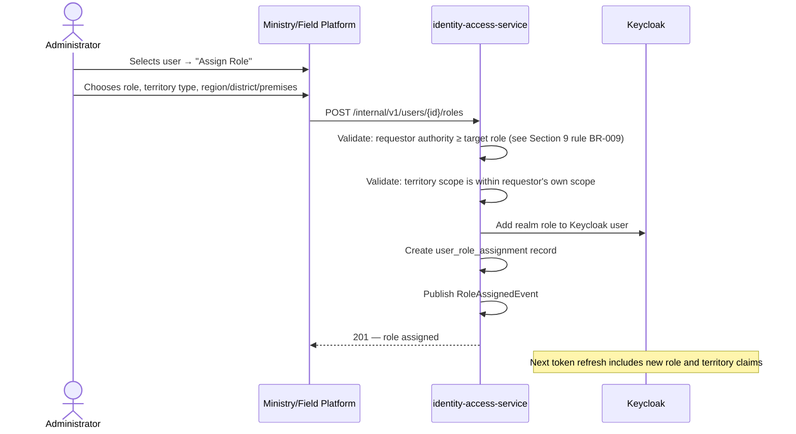
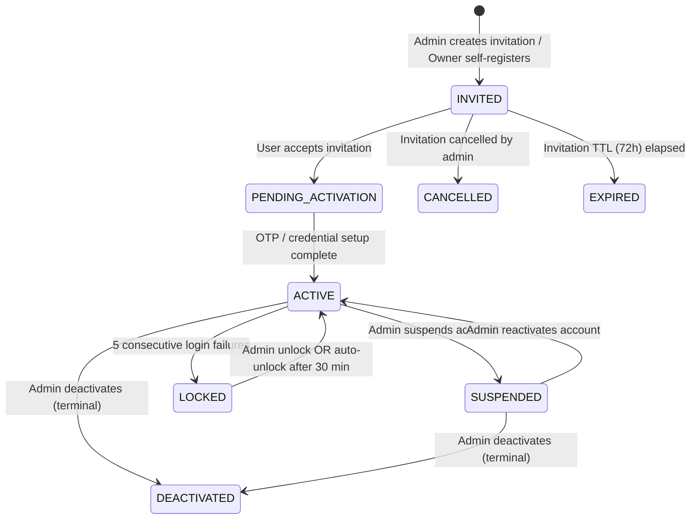
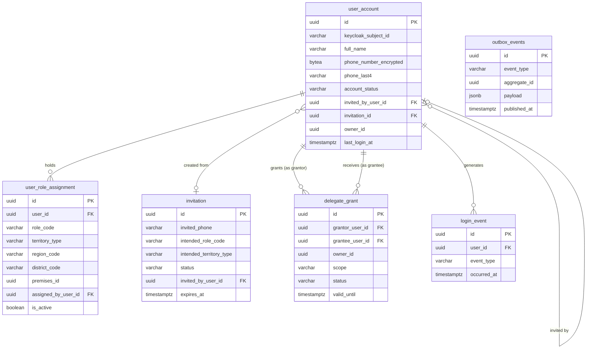

# Identity and Access Control — Module Specification

**Module:** identity-access-service
**Version:** 0.1 — Draft for Review
**Date:** 2026-07-18
**Phase:** Step 4 — Awaiting Approval
**Status:** Pending Review

---

## 1. Objective

The Identity and Access Control module provides all authentication, authorisation, user lifecycle management, and delegation capabilities for SOMLITS. It is the single source of truth for who can do what, within which territory, and on which premises. Every other SOMLITS service trusts the JWT issued through this module to make authorisation decisions.

The module wraps Keycloak 25 (the authentication engine) and adds SOMLITS-specific business logic: territory-scoped roles, premises-scoped access, owner sub-user management, delegation grants, invitation workflows, and the full user account lifecycle from invitation through deactivation.

---

## 2. Scope

**In scope:**
- User account creation, invitation, activation, suspension, deactivation
- Self-registration for livestock owners (phone OTP)
- Admin-invited registration for officers and operators
- Owner-created sub-user (OWNER_ADMIN creating OWNER_EMPLOYEE accounts)
- Role assignment with territory scope (national / regional / district)
- Role assignment with premises scope (market, abattoir, laboratory)
- Delegation grants (owner delegates view access to a third party)
- Password and credential reset
- Account locking (brute force and manual)
- Session management and forced logout
- Login event audit trail
- JWT claim design (roles + territory scope + premises scope)
- Publishing domain events on user lifecycle changes

**Out of scope:**
- Owner business registration (owner legal name, category, livestock details) — that is owner-org-service
- Animal ownership assignment — animal-registry-service
- LITS officer appointment by Ministry — that is a Ministry administrative process; SOMLITS records the outcome
- Biometric identity verification (national ID card reading) — deferred to future phase

---

## 3. Actors

### 3.1 Role Definitions

| Role Code | Actor Name | Description |
|---|---|---|
| `NATIONAL_ADMIN` | National administrator | Full system access. Manages all users, all data, all configuration. Typically MoLFR IT Administrator or CVO office. |
| `REGIONAL_ADMIN` | Regional administrator | Full access within an assigned region. Manages district admins and officers in their region. |
| `DISTRICT_ADMIN` | District administrator | Full access within an assigned district. Manages field officers, market operators, and abattoir officers in their district. |
| `LIVESTOCK_OWNER` | Livestock owner | Access to own animals, premises, permits, health events, and certificates only. Self-registers via phone OTP. |
| `OWNER_ADMIN` | Owner administrator | All LIVESTOCK_OWNER permissions plus ability to create and manage OWNER_EMPLOYEE accounts linked to the same owner entity. Typically a farm manager or ranch administrator. |
| `OWNER_EMPLOYEE` | Owner employee | Employee or herder working for a livestock owner. Access limited to animals and premises they are explicitly assigned to. Cannot apply for permits. |
| `VET_OFFICER` | Veterinary officer | Records health events, collects samples, approves movement permits within assigned territory. District-scoped by default. |
| `FIELD_SUPERVISOR` | Field supervisor | All VET_OFFICER permissions plus owner/premises/animal registration and registration approval within territory. |
| `TAG_PREP_OFFICER` | Tag preparation officer | Manages tag bag receipt, inventory, and allocation. No access to animal or owner data. |
| `MARKET_OPERATOR` | Market operator | Manages market sessions and animal check-in/out at their registered market premises only. |
| `QUARANTINE_OFFICER` | Quarantine officer | Issues, manages, and lifts quarantine orders. National scope by default; may be district-scoped. |
| `ABATTOIR_OFFICER` | Abattoir officer | Records pre-slaughter checks, slaughter events, carcass labels, and Halal declarations at their registered abattoir only. |
| `LAB_OFFICER` | Laboratory officer | Receives samples, enters lab results, and updates sample status at their registered laboratory only. |
| `EXPORT_OFFICER` | Export officer | Creates and manages export consignments, issues AHCs, and records exit declarations. |
| `AUDITOR` | Auditor | Read-only access to audit logs, login history, and all operational data. Cannot modify any record. |
| `READ_ONLY` | Read-only user | View-only access to non-personal operational data (animal counts, permit statistics). No access to personal data. |

### 3.2 Role Hierarchy for Administration

```
NATIONAL_ADMIN
  └── can create / manage → REGIONAL_ADMIN, DISTRICT_ADMIN, all officer roles
REGIONAL_ADMIN
  └── can create / manage → DISTRICT_ADMIN (within region), all officer roles (within region)
DISTRICT_ADMIN
  └── can create / manage → VET_OFFICER, FIELD_SUPERVISOR, TAG_PREP_OFFICER,
                            MARKET_OPERATOR, QUARANTINE_OFFICER, ABATTOIR_OFFICER,
                            LAB_OFFICER, EXPORT_OFFICER (within district)
LIVESTOCK_OWNER / OWNER_ADMIN
  └── can create / manage → OWNER_ADMIN (NATIONAL_ADMIN or higher required to assign),
                            OWNER_EMPLOYEE (within own owner entity)
```

No role can create or manage accounts at the same or higher level in the hierarchy without NATIONAL_ADMIN authority.

### 3.3 Territory Scoping

| Scope Type | Applied to | Enforcement |
|---|---|---|
| `NATIONAL` | NATIONAL_ADMIN, QUARANTINE_OFFICER (default), EXPORT_OFFICER, AUDITOR, TAG_PREP_OFFICER | No territory restriction |
| `REGIONAL` | REGIONAL_ADMIN | Can only access data where `region_code = assigned_region` |
| `DISTRICT` | DISTRICT_ADMIN, VET_OFFICER, FIELD_SUPERVISOR | Can only access data where `district_code = assigned_district` |
| `PREMISES` | MARKET_OPERATOR, ABATTOIR_OFFICER, LAB_OFFICER | Can only access data for their specific premises UUID |
| `OWNER` | LIVESTOCK_OWNER, OWNER_ADMIN, OWNER_EMPLOYEE | Can only access data linked to their owner entity |

A user may hold multiple role assignments with different territory scopes (e.g., a VET_OFFICER covering two districts has two separate district-scoped role assignments).

---

## 4. Preconditions

| Precondition | Details |
|---|---|
| Keycloak 25 realm `somlits` is configured | Clients, realm roles, identity providers, and token mappers are set up. |
| Somalia administrative codes loaded | Region and district codes are in the `common-domain` reference data. |
| At least one `NATIONAL_ADMIN` account exists | Bootstrapped during system initialisation via `bootstrap-keycloak.sh`. |
| Invited user has received invitation via SMS or email | Invitation code has not expired. |
| For officer accounts: the officer has been officially appointed by MoLFR | SOMLITS records the appointment but does not initiate it. |
| For OWNER_EMPLOYEE creation: the owner entity is registered and ACTIVE in owner-org-service | The OWNER_ADMIN's owner_id is resolved before sub-user creation. |

---

## 5. Main Workflows

### 5.1 Self-Registration (Livestock Owner)

Used by livestock owners and traders registering themselves via the Farmer Platform.

```mermaid
sequenceDiagram
    actor LO as Livestock Owner
    participant FP as Farmer Platform
    participant APIM as API Gateway
    participant IAS as identity-access-service
    participant KC as Keycloak
    participant SMS as Africa's Talking

    LO->>FP: Opens Farmer Platform, selects "Register"
    FP->>LO: Displays registration form (name, phone, language)
    LO->>FP: Submits name + phone number
    FP->>APIM: POST /v1/auth/register (name, phone, language)
    APIM->>IAS: POST /internal/v1/auth/register
    IAS->>IAS: Validate: phone format, not already registered
    IAS->>KC: Create Keycloak user (disabled, awaiting OTP)
    IAS->>IAS: Create user_account (PENDING_ACTIVATION)
    IAS->>SMS: Send OTP via Africa's Talking
    IAS-->>FP: 201 — OTP sent; reference token returned

    LO->>FP: Enters 6-digit OTP
    FP->>APIM: POST /v1/auth/verify-otp (reference, otp)
    APIM->>IAS: POST /internal/v1/auth/verify-otp
    IAS->>IAS: Validate OTP (within 10 minutes, max 3 attempts)
    IAS->>KC: Enable Keycloak user; assign LIVESTOCK_OWNER realm role
    IAS->>IAS: Update user_account status → ACTIVE
    IAS->>IAS: Publish UserActivatedEvent
    IAS-->>FP: 200 — user active; redirect to PIN setup

    LO->>FP: Sets 6-digit PIN
    FP->>KC: Keycloak PKCE flow — exchange code for tokens
    KC-->>FP: Access token + refresh token + offline token
    FP->>LO: Registration complete; dashboard shown
```

### 5.2 Invitation-Based Registration (Officers and Operators)

Used by DISTRICT_ADMIN or higher to register officers.

```mermaid
sequenceDiagram
    actor DA as District Admin
    actor OFF as Officer
    participant MP as Ministry Platform
    participant IAS as identity-access-service
    participant KC as Keycloak
    participant SMS as Africa's Talking (or Email)

    DA->>MP: Creates invitation (name, phone/email, role, territory scope)
    MP->>IAS: POST /internal/v1/invitations
    IAS->>IAS: Validate: DA authority over intended role + territory
    IAS->>IAS: Create invitation (status=PENDING, code generated, expires 72h)
    IAS->>SMS: Send invitation SMS/email with one-time code
    IAS-->>MP: 201 — invitation created

    OFF->>FP: Opens "Accept Invitation" link/code entry
    OFF->>IAS: POST /internal/v1/invitations/{code}/accept
    IAS->>IAS: Validate: code exists, not expired, not already accepted
    IAS->>KC: Create Keycloak user (enabled)
    IAS->>KC: Assign realm role matching invitation
    IAS->>IAS: Create user_account (ACTIVE)
    IAS->>IAS: Create user_role_assignment (role + territory scope from invitation)
    IAS->>IAS: Mark invitation ACCEPTED
    IAS->>IAS: Publish UserActivatedEvent + RoleAssignedEvent
    IAS-->>OFF: 201 — account created; redirect to password setup
    OFF->>KC: Keycloak PKCE flow — set password + configure TOTP
```

### 5.3 Owner Sub-User Creation (OWNER_ADMIN creates OWNER_EMPLOYEE)

```mermaid
sequenceDiagram
    actor OA as Owner Admin
    participant FP as Farmer Platform
    participant IAS as identity-access-service
    participant KC as Keycloak
    participant SMS as Africa's Talking

    OA->>FP: Navigates to "My Team" → "Add Employee"
    OA->>FP: Enters employee name, phone, optional premises restriction
    FP->>IAS: POST /internal/v1/users/owner-employees
    IAS->>IAS: Validate: OA is ACTIVE with OWNER_ADMIN role
    IAS->>IAS: Resolve OA's owner_id from user_account
    IAS->>IAS: Check phone not already registered
    IAS->>KC: Create Keycloak user (disabled)
    IAS->>IAS: Create user_account (INVITED; owner_id set to OA's owner_id)
    IAS->>IAS: Create user_role_assignment (OWNER_EMPLOYEE; premises_ids if restricted)
    IAS->>SMS: Send welcome SMS with activation code
    IAS-->>FP: 201 — employee invited

    Note over IAS,SMS: Employee activates via SMS code on their device (same OTP flow as 5.1)
```

### 5.4 Role Assignment



### 5.5 Account Suspension and Reactivation



### 5.6 Delegation Grant

An owner can delegate read-only access to a third party (e.g., a purchasing agent, bank, or veterinary consultant).

```mermaid
sequenceDiagram
    actor LO as Livestock Owner
    actor AGENT as Delegate (e.g. Buyer)
    participant FP as Farmer Platform
    participant IAS as identity-access-service

    LO->>FP: "Share Access" → enter delegate phone + scope + expiry
    FP->>IAS: POST /internal/v1/delegations
    IAS->>IAS: Validate: LO is ACTIVE with LIVESTOCK_OWNER role
    IAS->>IAS: Validate: delegate user exists and is ACTIVE
    IAS->>IAS: Validate: expiry ≤ 1 year
    IAS->>IAS: Create delegate_grant (ACTIVE)
    IAS->>IAS: Publish DelegationGrantedEvent
    IAS-->>FP: 201 — delegation created

    AGENT->>FP: Views shared animals (delegation scope embedded in token via next refresh)
    Note over IAS: Token mapper reads active delegate_grant; adds delegated owner scope to JWT

    LO->>FP: "Revoke Access" on delegation
    FP->>IAS: DELETE /internal/v1/delegations/{id}
    IAS->>IAS: Set delegate_grant.revoked_at, revoked_by
    IAS->>IAS: Publish DelegationRevokedEvent
    IAS->>KC: Force-logout all active sessions of delegate (to invalidate current tokens)
```

### 5.7 Password Reset (Self-Service)

```mermaid
sequenceDiagram
    actor User
    participant App as Platform
    participant IAS as identity-access-service
    participant KC as Keycloak
    participant SMS as Africa's Talking

    User->>App: "Forgot Password" → enters phone number
    App->>IAS: POST /internal/v1/auth/forgot-password
    IAS->>IAS: Resolve user by phone; validate ACTIVE
    IAS->>SMS: Send OTP (6-digit, 10-minute TTL, 3-attempt limit)
    IAS-->>App: 200 — OTP sent (response identical whether phone found or not; anti-enumeration)

    User->>App: Enters OTP + new password
    App->>IAS: POST /internal/v1/auth/reset-password (otp, newPassword)
    IAS->>IAS: Validate OTP
    IAS->>KC: Set new password via Admin API
    IAS->>KC: Revoke all existing sessions
    IAS->>IAS: Publish PasswordResetEvent
    IAS-->>App: 200 — password reset; redirect to login
```

---

## 6. Alternative Workflows

### 6.1 Azure AD Federation (Government Officers — Ministry Platform)

Government officers with an existing Azure AD government identity can log in without a Keycloak password:

1. Officer clicks "Login with Government ID" on Ministry Platform.
2. PKCE flow redirects to Keycloak, which redirects to Azure AD government tenant.
3. Azure AD authenticates (existing government SSO session or MSFT Authenticator).
4. Azure AD returns SAML assertion to Keycloak identity broker.
5. Keycloak creates or updates the brokered user account.
6. identity-access-service's event listener detects the new login; creates or updates `user_account` if first login.
7. Normal SOMLITS token (with roles and territory scope) issued.

### 6.2 Admin-Initiated Password Reset

An administrator (NATIONAL_ADMIN or REGIONAL_ADMIN for officers in their region) can force a password reset:

1. Admin selects user → "Reset Password".
2. `POST /internal/v1/users/{id}/reset-credentials` called.
3. identity-access-service calls Keycloak Admin API to set `required_actions: [UPDATE_PASSWORD]`.
4. All active sessions revoked.
5. User notified via SMS that they must reset their password on next login.

### 6.3 Bulk Officer Onboarding (CSV Import)

When a large number of officers must be onboarded (e.g., national rollout):

1. NATIONAL_ADMIN uploads CSV: `name, phone, role, region_code, district_code`.
2. `POST /internal/v1/users/bulk-invite` processes the CSV.
3. For each row: validate, create invitation, send SMS.
4. Response: created count, failed count, error detail per failed row.
5. Bulk import is idempotent on phone number — re-running skips already-registered users.

### 6.4 Multi-District VET_OFFICER

A veterinary officer covering two districts (rare but valid):
1. Admin assigns VET_OFFICER role with district scope A.
2. Admin adds a second role assignment: VET_OFFICER with district scope B.
3. JWT token claims include an array of territory scopes: `[{type: DISTRICT, code: A}, {type: DISTRICT, code: B}]`.
4. Services check if any of the user's territory scopes cover the requested record.

---

## 7. Exception Workflows

### 7.1 OTP Exhausted (3 failed attempts)

- OTP is invalidated after 3 consecutive wrong entries.
- User must request a new OTP (rate-limited: max 3 OTP requests per phone per 10 minutes).
- After 5 OTP requests in 10 minutes from the same IP: temporary IP block (15 minutes) at APIM rate-limiting layer.

### 7.2 Account Locked After Failed Logins

- 5 consecutive Keycloak login failures trigger account lock in Keycloak.
- identity-access-service Keycloak event listener detects `LOGIN_ERROR` (count ≥ 5).
- `user_account.status` → `LOCKED`; `locked_at` recorded.
- Auto-unlock after 30 minutes (scheduled job checks locked accounts).
- Manual unlock: `POST /internal/v1/users/{id}/unlock` (DISTRICT_ADMIN+ for officer accounts; NATIONAL_ADMIN for admin accounts).
- Lock event published: `AccountLockedEvent`.

### 7.3 Invitation Expired

- Invitations expire after 72 hours.
- A scheduled job (daily) marks expired invitations as `EXPIRED`.
- The Keycloak user created at invitation time (if any) is disabled.
- The inviting administrator is notified that the invitation expired.
- Admin can re-send the invitation: `POST /internal/v1/invitations/{id}/resend` (generates new code, resets TTL).

### 7.4 Delegate Grant Expiry

- A scheduled job checks `delegate_grant.valid_until` daily.
- On expiry: `delegate_grant.status` → `EXPIRED`; delegate user's sessions force-logged out.
- Owner notified: "Your access delegation to [name] has expired."

### 7.5 Requesting Admin Attempts to Exceed Their Authority

- Example: DISTRICT_ADMIN tries to assign REGIONAL_ADMIN role.
- identity-access-service validates: requestor's highest role must be above the intended role in the hierarchy.
- Returns `403 Forbidden` with error type `https://somlits.gov.so/errors/insufficient-authority`.
- Attempt is logged to audit-service.

---

## 8. Status Lifecycle

### 8.1 User Account Status

```
INVITED ──────────────► PENDING_ACTIVATION ──────────────► ACTIVE
   │                                                          │      │
   │ (cancelled / expired)                          (suspend) │      │ (lock)
   ▼                                                          ▼      ▼
CANCELLED / EXPIRED                                      SUSPENDED  LOCKED
                                                              │      │
                                              (deactivate)   │      │ (unlock / 30min auto)
                                                             ▼       └────────► ACTIVE
                                                       DEACTIVATED
```

**Terminal states:** `DEACTIVATED`, `CANCELLED`, `EXPIRED`. No transition out of terminal states.

### 8.2 Invitation Status

```
PENDING ──► ACCEPTED (user completes registration)
PENDING ──► EXPIRED  (72-hour TTL elapsed)
PENDING ──► CANCELLED (admin cancels before acceptance)
```

### 8.3 Delegate Grant Status

```
ACTIVE ──► REVOKED  (owner revokes; or admin revokes)
ACTIVE ──► EXPIRED  (valid_until elapsed)
```

### 8.4 Role Assignment Status

Role assignments are not a status machine — they are active or inactive (`is_active`). Removing a role sets `is_active = false` and records the `removed_at` timestamp (soft delete for audit purposes).

---

## 9. Business Rules

| ID | Rule |
|---|---|
| BR-001 | A phone number may be registered to only one ACTIVE or PENDING_ACTIVATION user account at a time. |
| BR-002 | An email address (where used) may be registered to only one ACTIVE or PENDING_ACTIVATION account at a time. |
| BR-003 | A DEACTIVATED account's phone number may be re-used by a new registration after 30 days. |
| BR-004 | An OTP is valid for 10 minutes and may be used only once. |
| BR-005 | A maximum of 3 OTP attempts are permitted before the OTP is invalidated and a new one must be requested. |
| BR-006 | A maximum of 3 OTP requests per phone number per 10-minute window are permitted. |
| BR-007 | After 5 consecutive login failures, the account is locked for 30 minutes (auto-unlock) or until a DISTRICT_ADMIN+ manually unlocks it. |
| BR-008 | An invitation code expires after 72 hours. A resend resets the TTL and invalidates the previous code. |
| BR-009 | An administrator may only assign roles that are strictly below their own highest role in the hierarchy (NATIONAL_ADMIN can assign any role; REGIONAL_ADMIN cannot assign NATIONAL_ADMIN or REGIONAL_ADMIN). |
| BR-010 | An administrator may only assign territory scope within their own territory (a DISTRICT_ADMIN for Baidoa cannot assign a role scoped to Mogadishu). |
| BR-011 | OWNER_ADMIN may only create OWNER_EMPLOYEE accounts. They cannot invite or assign officer roles. |
| BR-012 | An OWNER_EMPLOYEE is always linked to the same owner_id as the OWNER_ADMIN who created them. This cannot be changed. |
| BR-013 | A user may hold multiple role assignments simultaneously (e.g., VET_OFFICER for two districts). |
| BR-014 | A DEACTIVATED user's data is retained indefinitely. The account cannot be reinstated. A new account must be created if the person requires access again. |
| BR-015 | Delegation grants may only be created by LIVESTOCK_OWNER or OWNER_ADMIN for their own owner entity. Officers may not delegate their official roles. |
| BR-016 | A delegation grant may last at most 365 days. It may be renewed before expiry. |
| BR-017 | Forced logout of a user's sessions (on suspension, deactivation, or delegation revocation) revokes all active Keycloak sessions and refresh tokens. Access tokens remain valid until their TTL (15 minutes); this is accepted. |
| BR-018 | Password reset OTPs are functionally identical to registration OTPs in their rate-limiting and expiry rules. |
| BR-019 | No user, including NATIONAL_ADMIN, may modify their own role assignments or account status (to prevent privilege escalation and lock-out avoidance). A second NATIONAL_ADMIN account must perform these actions. |
| BR-020 | AUDITOR and READ_ONLY roles are view-only. Any attempt to perform a write operation via the API returns 403 regardless of other role assignments. |
| BR-021 | A user's territory scope is embedded in the JWT at token issue time. Scope changes take effect on next token refresh (maximum 15-minute delay). |
| BR-022 | OWNER_EMPLOYEE accounts may be optionally restricted to one or more premises UUIDs. If no premises restriction is set, the employee can access all premises under the owner entity. |

---

## 10. Authorization Matrix

### 10.1 Role Abbreviations

| Abbr | Role |
|---|---|
| NA | NATIONAL_ADMIN |
| RA | REGIONAL_ADMIN |
| DA | DISTRICT_ADMIN |
| LO | LIVESTOCK_OWNER |
| OA | OWNER_ADMIN |
| OE | OWNER_EMPLOYEE |
| VO | VET_OFFICER |
| FS | FIELD_SUPERVISOR |
| TP | TAG_PREP_OFFICER |
| MO | MARKET_OPERATOR |
| QO | QUARANTINE_OFFICER |
| AO | ABATTOIR_OFFICER |
| LB | LAB_OFFICER |
| EX | EXPORT_OFFICER |
| AU | AUDITOR |
| RO | READ_ONLY |

### 10.2 Key

| Symbol | Meaning |
|---|---|
| ✓ | Full access (any record in the system) |
| S | Scoped — territory (region/district) or premises only |
| O | Own records only (own owner entity) |
| P | Premises-scoped — only records for their assigned premises |
| — | Not permitted |
| [A] | Read access to records pending their approval action |

---

### 10.3 User and Identity Management

| Action | NA | RA | DA | LO | OA | OE | VO | FS | TP | MO | QO | AO | LB | EX | AU | RO |
|---|---|---|---|---|---|---|---|---|---|---|---|---|---|---|---|---|
| View own profile | ✓ | ✓ | ✓ | ✓ | ✓ | ✓ | ✓ | ✓ | ✓ | ✓ | ✓ | ✓ | ✓ | ✓ | ✓ | ✓ |
| Update own profile | ✓ | ✓ | ✓ | ✓ | ✓ | ✓ | ✓ | ✓ | ✓ | ✓ | ✓ | ✓ | ✓ | ✓ | ✓ | ✓ |
| View any user profile | ✓ | S | S | — | — | — | — | — | — | — | — | — | — | — | ✓ | — |
| Create officer / operator account (invite) | ✓ | S | S | — | — | — | — | — | — | — | — | — | — | — | — | — |
| Create owner employee account | ✓ | S | S | — | O | — | — | — | — | — | — | — | — | — | — | — |
| Activate user account | ✓ | S | S | — | — | — | — | — | — | — | — | — | — | — | — | — |
| Suspend user account | ✓ | S | S | — | — | — | — | — | — | — | — | — | — | — | — | — |
| Reactivate user account | ✓ | S | S | — | — | — | — | — | — | — | — | — | — | — | — | — |
| Deactivate user account (terminal) | ✓ | S | — | — | — | — | — | — | — | — | — | — | — | — | — | — |
| Unlock locked account | ✓ | S | S | — | — | — | — | — | — | — | — | — | — | — | — | — |
| Force logout all sessions (any user) | ✓ | S | S | — | — | — | — | — | — | — | — | — | — | — | — | — |
| Assign role to user | ✓ | S | S | — | — | — | — | — | — | — | — | — | — | — | — | — |
| Remove role from user | ✓ | S | S | — | — | — | — | — | — | — | — | — | — | — | — | — |
| Reset own password / credentials | ✓ | ✓ | ✓ | ✓ | ✓ | ✓ | ✓ | ✓ | ✓ | ✓ | ✓ | ✓ | ✓ | ✓ | ✓ | ✓ |
| Admin-initiate password reset (any user) | ✓ | S | S | — | — | — | — | — | — | — | — | — | — | — | — | — |
| View user login history (own) | ✓ | ✓ | ✓ | ✓ | ✓ | ✓ | ✓ | ✓ | ✓ | ✓ | ✓ | ✓ | ✓ | ✓ | ✓ | ✓ |
| View user login history (any user) | ✓ | S | S | — | — | — | — | — | — | — | — | — | — | — | ✓ | — |
| View invitation list | ✓ | S | S | — | O | — | — | — | — | — | — | — | — | — | ✓ | — |
| Cancel pending invitation | ✓ | S | S | — | O | — | — | — | — | — | — | — | — | — | — | — |
| Create delegation grant | — | — | — | O | O | — | — | — | — | — | — | — | — | — | — | — |
| View own delegation grants | — | — | — | O | O | — | — | — | — | — | — | — | — | — | ✓ | — |
| Revoke delegation grant | — | — | — | O | O | — | — | — | — | — | — | — | — | — | — | — |
| View all delegation grants (national) | ✓ | — | — | — | — | — | — | — | — | — | — | — | — | — | ✓ | — |

---

### 10.4 Owner and Organisation Data

*(Detail owned by owner-org-service; access decisions delegated through JWT claims)*

| Action | NA | RA | DA | LO | OA | OE | VO | FS | TP | MO | QO | AO | LB | EX | AU | RO |
|---|---|---|---|---|---|---|---|---|---|---|---|---|---|---|---|---|
| View any owner record | ✓ | S | S | O | O | O | S | S | — | — | S | — | — | S | ✓ | — |
| View own owner record | — | — | — | O | O | O | — | — | — | — | — | — | — | — | — | — |
| Submit owner registration | ✓ | S | S | O | — | — | S | S | — | — | — | — | — | — | — | — |
| Approve owner registration | ✓ | S | S | — | — | — | — | S | — | — | — | — | — | — | — | — |
| Reject owner registration | ✓ | S | S | — | — | — | — | S | — | — | — | — | — | — | — | — |
| Suspend owner registration | ✓ | S | S | — | — | — | — | — | — | — | — | — | — | — | — | — |
| Update owner profile | ✓ | S | S | O | O | — | — | S | — | — | — | — | — | — | — | — |

---

### 10.5 Animal Registry

| Action | NA | RA | DA | LO | OA | OE | VO | FS | TP | MO | QO | AO | LB | EX | AU | RO |
|---|---|---|---|---|---|---|---|---|---|---|---|---|---|---|---|---|
| View animal record | ✓ | S | S | O | O | O | S | S | — | P | ✓ | P | — | ✓ | ✓ | ✓ |
| View full animal lifecycle/history | ✓ | S | S | O | O | — | S | S | — | — | ✓ | — | — | ✓ | ✓ | — |
| Register new animal (birth) | ✓ | S | S | O | O | O | S | S | — | — | — | — | — | — | — | — |
| Approve animal registration | ✓ | S | S | — | — | — | S | S | — | — | — | — | — | — | — | — |
| Reject animal registration | ✓ | S | S | — | — | — | S | S | — | — | — | — | — | — | — | — |
| Update animal record (correction) | ✓ | S | S | — | — | — | S | S | — | — | — | — | — | — | — | — |
| Transfer ownership | ✓ | S | S | O | O | — | S | S | — | — | — | — | — | — | — | — |
| Record animal death | ✓ | S | S | O | O | — | S | S | — | — | — | — | — | — | — | — |
| Record animal export (update status) | ✓ | — | — | — | — | — | — | — | — | — | — | — | — | ✓ | — | — |
| Cancel animal status (undo error) | ✓ | — | — | — | — | — | — | — | — | — | — | — | — | — | — | — |

---

### 10.6 Premises

| Action | NA | RA | DA | LO | OA | OE | VO | FS | TP | MO | QO | AO | LB | EX | AU | RO |
|---|---|---|---|---|---|---|---|---|---|---|---|---|---|---|---|---|
| View premises record | ✓ | S | S | O | O | O | S | S | — | P | ✓ | P | P | ✓ | ✓ | ✓ |
| Submit premises registration | ✓ | S | S | O | O | — | S | S | — | — | — | — | — | — | — | — |
| Approve premises registration | ✓ | S | S | — | — | — | — | S | — | — | — | — | — | — | — | — |
| Reject premises registration | ✓ | S | S | — | — | — | — | S | — | — | — | — | — | — | — | — |
| Suspend premises | ✓ | S | S | — | — | — | — | S | — | — | S | — | — | — | — | — |
| Reactivate premises | ✓ | S | S | — | — | — | — | S | — | — | S | — | — | — | — | — |
| Close premises (terminal) | ✓ | S | — | — | — | — | — | — | — | — | — | — | — | — | — | — |
| Update premises record | ✓ | S | S | O | O | — | — | S | — | — | — | — | — | — | — | — |

---

### 10.7 Tag Inventory

| Action | NA | RA | DA | LO | OA | OE | VO | FS | TP | MO | QO | AO | LB | EX | AU | RO |
|---|---|---|---|---|---|---|---|---|---|---|---|---|---|---|---|---|
| View tag bag inventory | ✓ | S | S | — | — | — | S | S | ✓ | — | — | — | — | — | ✓ | — |
| Create tag bag (receive stock) | ✓ | — | — | — | — | — | — | — | ✓ | — | — | — | — | — | — | — |
| Allocate tag bags to district/officer | ✓ | S | S | — | — | — | — | — | ✓ | — | — | — | — | — | — | — |
| Record custody transfer of tag bag | ✓ | S | S | — | — | — | — | S | ✓ | — | — | — | — | — | — | — |
| Activate tag on animal | ✓ | S | S | — | — | — | S | S | — | — | — | — | — | — | — | — |
| Replace lost/damaged tag | ✓ | S | S | O | O | — | S | S | — | — | — | — | — | — | — | — |
| Report tag bag as lost/stolen | ✓ | S | S | — | — | — | S | S | ✓ | — | — | — | — | — | — | — |
| Deactivate destroyed tag | ✓ | S | S | — | — | — | S | S | — | — | — | — | — | — | — | — |
| View tag history | ✓ | S | S | O | O | — | S | S | ✓ | — | — | — | — | — | ✓ | — |

---

### 10.8 Movement Permits

| Action | NA | RA | DA | LO | OA | OE | VO | FS | TP | MO | QO | AO | LB | EX | AU | RO |
|---|---|---|---|---|---|---|---|---|---|---|---|---|---|---|---|---|
| View own movement permits | ✓ | S | S | O | O | O | S | S | — | — | ✓ | — | — | ✓ | ✓ | — |
| View all movement permits in territory | ✓ | S | S | — | — | — | S | S | — | — | ✓ | — | — | — | ✓ | — |
| Apply for movement permit | ✓ | S | S | O | O | — | S | S | — | — | — | — | — | — | — | — |
| Approve movement permit | ✓ | S | S | — | — | — | S | S | — | — | — | — | — | — | — | — |
| Reject movement permit | ✓ | S | S | — | — | — | S | S | — | — | — | — | — | — | — | — |
| Cancel movement permit (own) | ✓ | S | S | O | O | — | S | S | — | — | — | — | — | — | — | — |
| Issue walking permit | ✓ | S | S | — | — | — | S | S | — | — | — | — | — | — | — | — |
| Confirm movement completion | ✓ | S | S | O | O | — | S | S | — | — | — | — | — | — | — | — |
| View permit verification (checkpoint) | ✓ | S | S | — | — | — | S | S | — | — | — | — | — | — | ✓ | — |
| Override permit (emergency) | ✓ | — | — | — | — | — | — | — | — | — | — | — | — | — | — | — |

---

### 10.9 Veterinary Health Events

| Action | NA | RA | DA | LO | OA | OE | VO | FS | TP | MO | QO | AO | LB | EX | AU | RO |
|---|---|---|---|---|---|---|---|---|---|---|---|---|---|---|---|---|
| View health events (own animals) | ✓ | S | S | O | O | O | S | S | — | — | ✓ | — | — | ✓ | ✓ | — |
| View health events (territory) | ✓ | S | S | — | — | — | S | S | — | — | ✓ | — | — | — | ✓ | — |
| Record vaccination event | ✓ | S | S | — | — | — | S | S | — | — | — | — | — | — | — | — |
| Create vaccination campaign | ✓ | S | S | — | — | — | — | S | — | — | — | — | — | — | — | — |
| Approve vaccination campaign | ✓ | S | — | — | — | — | — | — | — | — | — | — | — | — | — | — |
| Record clinical examination | ✓ | S | S | — | — | — | S | S | — | — | — | — | — | — | — | — |
| Submit illness report (self-report) | ✓ | S | S | O | O | O | S | S | — | — | — | — | — | — | — | — |
| Issue health restriction | ✓ | S | S | — | — | — | S | S | — | — | ✓ | — | — | — | — | — |
| Lift health restriction | ✓ | S | S | — | — | — | S | S | — | — | ✓ | — | — | — | — | — |
| Collect lab sample | ✓ | S | S | — | — | — | S | S | — | — | — | — | — | — | — | — |
| Update sample status | — | — | — | — | — | — | — | — | — | — | — | — | P | — | — | — |
| Enter lab result | — | — | — | — | — | — | — | — | — | — | — | — | P | — | — | — |
| Trigger OIE notification | ✓ | — | — | — | — | — | — | — | — | — | — | — | — | — | — | — |
| Cancel health restriction | ✓ | S | — | — | — | — | — | — | — | — | ✓ | — | — | — | — | — |

---

### 10.10 Market Operations

| Action | NA | RA | DA | LO | OA | OE | VO | FS | TP | MO | QO | AO | LB | EX | AU | RO |
|---|---|---|---|---|---|---|---|---|---|---|---|---|---|---|---|---|
| View market list | ✓ | S | S | — | — | — | S | S | — | P | S | — | — | — | ✓ | ✓ |
| View market session | ✓ | S | S | — | — | — | S | S | — | P | S | — | — | — | ✓ | ✓ |
| Open market session | ✓ | S | S | — | — | — | — | S | — | P | — | — | — | — | — | — |
| Close market session | ✓ | S | S | — | — | — | — | S | — | P | — | — | — | — | — | — |
| Record animal check-in | ✓ | S | S | — | — | — | S | S | — | P | — | — | — | — | — | — |
| Record animal check-out | ✓ | S | S | — | — | — | S | S | — | P | — | — | — | — | — | — |
| Record untagged animal incident | ✓ | S | S | — | — | — | S | S | — | P | — | — | — | — | — | — |
| Cancel market session | ✓ | S | — | — | — | — | — | — | — | — | — | — | — | — | — | — |

---

### 10.11 Quarantine

| Action | NA | RA | DA | LO | OA | OE | VO | FS | TP | MO | QO | AO | LB | EX | AU | RO |
|---|---|---|---|---|---|---|---|---|---|---|---|---|---|---|---|---|
| View quarantine orders | ✓ | S | S | O | O | — | S | S | — | — | ✓ | — | — | ✓ | ✓ | — |
| Issue quarantine order | ✓ | S | S | — | — | — | — | — | — | — | ✓ | — | — | — | — | — |
| Add premises to quarantine zone | ✓ | S | S | — | — | — | — | — | — | — | ✓ | — | — | — | — | — |
| Remove premises from quarantine zone | ✓ | S | S | — | — | — | — | — | — | — | ✓ | — | — | — | — | — |
| Lift quarantine order | ✓ | S | — | — | — | — | — | — | — | — | ✓ | — | — | — | — | — |
| Approve quarantine lift | ✓ | — | — | — | — | — | — | — | — | — | — | — | — | — | — | — |
| Cancel quarantine order (error) | ✓ | — | — | — | — | — | — | — | — | — | — | — | — | — | — | — |

---

### 10.12 Abattoir and Slaughter

| Action | NA | RA | DA | LO | OA | OE | VO | FS | TP | MO | QO | AO | LB | EX | AU | RO |
|---|---|---|---|---|---|---|---|---|---|---|---|---|---|---|---|---|
| View abattoir record | ✓ | S | S | — | — | — | S | S | — | — | — | P | — | — | ✓ | — |
| View slaughter session | ✓ | S | S | O | O | — | S | S | — | — | — | P | — | — | ✓ | ✓ |
| Open slaughter session | ✓ | S | S | — | — | — | — | S | — | — | — | P | — | — | — | — |
| Record pre-slaughter check | ✓ | S | S | — | — | — | S | S | — | — | — | P | — | — | — | — |
| Record slaughter event | ✓ | S | S | — | — | — | S | S | — | — | — | P | — | — | — | — |
| Record Halal declaration | ✓ | — | — | — | — | — | — | — | — | — | — | P | — | — | — | — |
| Print / generate carcass label | ✓ | S | S | — | — | — | S | S | — | — | — | P | — | — | — | — |
| Reject pre-slaughter (animal fails check) | ✓ | S | S | — | — | — | S | S | — | — | — | P | — | — | — | — |
| Cancel slaughter event (error) | ✓ | S | — | — | — | — | — | — | — | — | — | — | — | — | — | — |

---

### 10.13 Export and Certification

| Action | NA | RA | DA | LO | OA | OE | VO | FS | TP | MO | QO | AO | LB | EX | AU | RO |
|---|---|---|---|---|---|---|---|---|---|---|---|---|---|---|---|---|
| View export consignment | ✓ | S | S | O | O | — | S | S | — | — | — | — | — | ✓ | ✓ | — |
| Create export consignment | ✓ | — | — | — | — | — | — | — | — | — | — | — | — | ✓ | — | — |
| Add animals to consignment | ✓ | — | — | — | — | — | — | — | — | — | — | — | — | ✓ | — | — |
| Approve export consignment | ✓ | — | — | — | — | — | — | — | — | — | — | — | — | ✓ | — | — |
| Reject export consignment | ✓ | — | — | — | — | — | — | — | — | — | — | — | — | ✓ | — | — |
| Cancel export consignment | ✓ | — | — | — | — | — | — | — | — | — | — | — | — | ✓ | — | — |
| Issue AHC | ✓ | — | — | — | — | — | — | — | — | — | — | — | — | ✓ | — | — |
| Revoke AHC | ✓ | — | — | — | — | — | — | — | — | — | — | — | — | — | — | — |
| View AHC (own animals) | ✓ | S | S | O | O | — | — | — | — | — | — | — | — | ✓ | ✓ | — |
| Record exit declaration | ✓ | — | — | — | — | — | — | — | — | — | — | — | — | ✓ | — | — |
| Manage AHC templates | ✓ | — | — | — | — | — | — | — | — | — | — | — | — | — | — | — |

---

### 10.14 Reports and Traceability

| Action | NA | RA | DA | LO | OA | OE | VO | FS | TP | MO | QO | AO | LB | EX | AU | RO |
|---|---|---|---|---|---|---|---|---|---|---|---|---|---|---|---|---|
| Run national KPI reports | ✓ | — | — | — | — | — | — | — | — | — | — | — | — | — | ✓ | — |
| Run regional reports | ✓ | S | — | — | — | — | — | — | — | — | — | — | — | — | ✓ | — |
| Run district reports | ✓ | S | S | — | — | — | S | S | — | — | — | — | — | — | ✓ | — |
| View own animal report | — | — | — | O | O | O | — | — | — | — | — | — | — | — | — | — |
| View disease surveillance report | ✓ | S | S | — | — | — | S | S | — | — | ✓ | — | — | — | ✓ | — |
| Run trace-back | ✓ | S | S | — | — | — | S | S | — | — | ✓ | — | — | — | ✓ | — |
| Run trace-forward | ✓ | S | — | — | — | — | — | — | — | — | ✓ | — | — | — | ✓ | — |
| View contact animal list | ✓ | S | S | — | — | — | S | S | — | — | ✓ | — | — | — | ✓ | — |
| Schedule report delivery | ✓ | S | S | — | — | — | — | — | — | — | — | — | — | — | — | — |
| Download report (PDF/CSV) | ✓ | S | S | O | — | — | S | S | — | — | S | — | — | S | ✓ | — |

---

### 10.15 Audit Log

| Action | NA | RA | DA | LO | OA | OE | VO | FS | TP | MO | QO | AO | LB | EX | AU | RO |
|---|---|---|---|---|---|---|---|---|---|---|---|---|---|---|---|---|
| View own audit trail | ✓ | ✓ | ✓ | ✓ | ✓ | ✓ | ✓ | ✓ | ✓ | ✓ | ✓ | ✓ | ✓ | ✓ | ✓ | — |
| View full audit log (national) | ✓ | — | — | — | — | — | — | — | — | — | — | — | — | — | ✓ | — |
| View audit log (territory) | ✓ | S | S | — | — | — | — | — | — | — | — | — | — | — | ✓ | — |
| Export audit evidence | ✓ | — | — | — | — | — | — | — | — | — | — | — | — | — | ✓ | — |
| Search audit log | ✓ | S | S | — | — | — | — | — | — | — | — | — | — | — | ✓ | — |

---

### 10.16 System Configuration

| Action | NA | RA | DA | LO | OA | OE | VO | FS | TP | MO | QO | AO | LB | EX | AU | RO |
|---|---|---|---|---|---|---|---|---|---|---|---|---|---|---|---|---|
| Manage species list | ✓ | — | — | — | — | — | — | — | — | — | — | — | — | — | — | — |
| Manage AID type list | ✓ | — | — | — | — | — | — | — | — | — | — | — | — | — | — | — |
| Manage region/district codes | ✓ | — | — | — | — | — | — | — | — | — | — | — | — | — | — | — |
| Manage notification templates | ✓ | — | — | — | — | — | — | — | — | — | — | — | — | — | — | — |
| Manage system parameters | ✓ | — | — | — | — | — | — | — | — | — | — | — | — | — | — | — |
| View system configuration | ✓ | S | — | — | — | — | — | — | — | — | — | — | — | — | ✓ | — |

---

## 11. Data Entities

### 11.1 `user_account`

The SOMLITS user record, linked to a Keycloak user via `keycloak_subject_id`.

| Column | Type | Constraints | Notes |
|---|---|---|---|
| `id` | UUID | PK | Generated by application |
| `keycloak_subject_id` | VARCHAR(36) | UNIQUE NOT NULL | Keycloak `sub` claim |
| `full_name` | VARCHAR(200) | NOT NULL | Legal name |
| `display_name` | VARCHAR(100) | NOT NULL | Preferred name for UI display |
| `phone_number_encrypted` | BYTEA | | pgcrypto AES-256 encrypted; last 4 digits also stored plaintext for display |
| `phone_last4` | VARCHAR(4) | | Last 4 digits for masked display only |
| `email` | VARCHAR(200) | | Optional; government officers may have email |
| `preferred_language` | VARCHAR(5) | NOT NULL DEFAULT 'so' | `so`, `ar`, `en` |
| `account_status` | VARCHAR(30) | NOT NULL | See Section 8.1 |
| `invited_by_user_id` | UUID | FK → user_account | NULL for self-registered |
| `invitation_id` | UUID | FK → invitation | NULL for self-registered |
| `failed_login_count` | INTEGER | NOT NULL DEFAULT 0 | Reset on successful login |
| `locked_at` | TIMESTAMPTZ | | Set when status → LOCKED |
| `lock_expires_at` | TIMESTAMPTZ | | Auto-unlock time |
| `last_login_at` | TIMESTAMPTZ | | Updated on each login event |
| `owner_id` | UUID | | FK reference to owner entity in owner-org-service (not a FK in DB — cross-service reference) |
| `version` | INTEGER | NOT NULL DEFAULT 0 | Optimistic locking |
| `created_at` | TIMESTAMPTZ | NOT NULL DEFAULT NOW() | |
| `updated_at` | TIMESTAMPTZ | NOT NULL DEFAULT NOW() | |
| `created_by` | UUID | NOT NULL | System UUID for self-registration |
| `updated_by` | UUID | NOT NULL | |

### 11.2 `user_role_assignment`

One record per role per user per territory scope. A user with two district-scoped VET_OFFICER assignments has two rows.

| Column | Type | Constraints | Notes |
|---|---|---|---|
| `id` | UUID | PK | |
| `user_id` | UUID | FK → user_account NOT NULL | |
| `role_code` | VARCHAR(50) | NOT NULL | Matches Keycloak realm role name |
| `territory_type` | VARCHAR(20) | NOT NULL | `NATIONAL`, `REGIONAL`, `DISTRICT`, `PREMISES`, `OWNER` |
| `region_code` | VARCHAR(10) | | NULL when territory_type = NATIONAL |
| `district_code` | VARCHAR(15) | | NULL unless territory_type = DISTRICT |
| `premises_id` | UUID | | NULL unless territory_type = PREMISES |
| `assigned_by_user_id` | UUID | FK → user_account NOT NULL | |
| `valid_from` | TIMESTAMPTZ | NOT NULL DEFAULT NOW() | |
| `valid_until` | TIMESTAMPTZ | | NULL = no expiry |
| `is_active` | BOOLEAN | NOT NULL DEFAULT TRUE | |
| `removed_at` | TIMESTAMPTZ | | Soft-remove |
| `removed_by_user_id` | UUID | FK → user_account | |
| `created_at` | TIMESTAMPTZ | NOT NULL DEFAULT NOW() | |

### 11.3 `invitation`

| Column | Type | Constraints | Notes |
|---|---|---|---|
| `id` | UUID | PK | |
| `invited_phone` | VARCHAR(30) | | At least one of phone/email required |
| `invited_email` | VARCHAR(200) | | |
| `invitation_code_hash` | VARCHAR(255) | NOT NULL | BCrypt hash of 32-char code |
| `intended_role_code` | VARCHAR(50) | NOT NULL | Role to assign on acceptance |
| `intended_territory_type` | VARCHAR(20) | NOT NULL | |
| `intended_region_code` | VARCHAR(10) | | |
| `intended_district_code` | VARCHAR(15) | | |
| `intended_premises_id` | UUID | | |
| `intended_owner_id` | UUID | | For OWNER_EMPLOYEE invitations |
| `invited_by_user_id` | UUID | FK → user_account NOT NULL | |
| `status` | VARCHAR(20) | NOT NULL DEFAULT 'PENDING' | `PENDING`, `ACCEPTED`, `EXPIRED`, `CANCELLED` |
| `expires_at` | TIMESTAMPTZ | NOT NULL | Default: invitation_created_at + 72h |
| `accepted_at` | TIMESTAMPTZ | | |
| `accepted_by_user_id` | UUID | FK → user_account | |
| `cancelled_at` | TIMESTAMPTZ | | |
| `cancelled_by_user_id` | UUID | FK → user_account | |
| `created_at` | TIMESTAMPTZ | NOT NULL DEFAULT NOW() | |

### 11.4 `delegate_grant`

| Column | Type | Constraints | Notes |
|---|---|---|---|
| `id` | UUID | PK | |
| `grantor_user_id` | UUID | FK → user_account NOT NULL | Owner who grants access |
| `grantee_user_id` | UUID | FK → user_account NOT NULL | User receiving access |
| `owner_id` | UUID | NOT NULL | The owner entity being delegated |
| `scope` | VARCHAR(50) | NOT NULL | `ANIMALS_READ`, `PERMITS_READ`, `FULL_OWNER_READ` |
| `valid_from` | TIMESTAMPTZ | NOT NULL DEFAULT NOW() | |
| `valid_until` | TIMESTAMPTZ | NOT NULL | Max 1 year from valid_from |
| `status` | VARCHAR(20) | NOT NULL DEFAULT 'ACTIVE' | `ACTIVE`, `REVOKED`, `EXPIRED` |
| `revoked_at` | TIMESTAMPTZ | | |
| `revoked_by_user_id` | UUID | FK → user_account | |
| `created_at` | TIMESTAMPTZ | NOT NULL DEFAULT NOW() | |
| `updated_at` | TIMESTAMPTZ | NOT NULL DEFAULT NOW() | |

### 11.5 `login_event`

Append-only. No updates.

| Column | Type | Constraints | Notes |
|---|---|---|---|
| `id` | UUID | PK | |
| `user_id` | UUID | FK → user_account | NULL on failed login for unknown phone |
| `keycloak_session_id` | VARCHAR(36) | | |
| `event_type` | VARCHAR(30) | NOT NULL | `LOGIN_SUCCESS`, `LOGIN_FAILED`, `LOGOUT`, `TOKEN_REFRESH`, `FORCED_LOGOUT`, `PASSWORD_RESET`, `OTP_VERIFIED`, `OTP_FAILED` |
| `failure_reason` | VARCHAR(100) | | `INVALID_CREDENTIALS`, `ACCOUNT_LOCKED`, `OTP_EXPIRED`, `OTP_INVALID` |
| `ip_address` | VARCHAR(50) | | Masked after 30 days: last octet zeroed |
| `user_agent` | VARCHAR(500) | | Browser/app identifier |
| `device_type` | VARCHAR(20) | | `WEB`, `PWA_FARMER`, `PWA_FIELD`, `PWA_MINISTRY`, `SMS` |
| `occurred_at` | TIMESTAMPTZ | NOT NULL | |

### 11.6 `outbox_events`

Standard outbox table (shared pattern for all services):

| Column | Type | Notes |
|---|---|---|
| `id` | UUID PK | |
| `event_type` | VARCHAR(100) | e.g., `UserActivatedEvent` |
| `aggregate_type` | VARCHAR(50) | `UserAccount`, `Invitation`, `DelegateGrant` |
| `aggregate_id` | UUID | |
| `payload` | JSONB | Full event payload |
| `occurred_at` | TIMESTAMPTZ | |
| `published_at` | TIMESTAMPTZ | NULL until published to Service Bus |
| `correlation_id` | UUID | |

---

## 12. Relationships



---

## 13. API Contracts

### 13.1 Authentication Endpoints (public — no JWT required)

| Method | Path | Description | Success |
|---|---|---|---|
| `POST` | `/internal/v1/auth/register` | Self-register livestock owner (sends OTP) | 201 — reference token |
| `POST` | `/internal/v1/auth/verify-otp` | Verify OTP and activate account | 200 — user active |
| `POST` | `/internal/v1/auth/forgot-password` | Initiate password reset (sends OTP) | 200 — always (anti-enum) |
| `POST` | `/internal/v1/auth/reset-password` | Complete password reset with OTP | 200 — password updated |

### 13.2 Invitation Endpoints

| Method | Path | Required Role | Description | Success |
|---|---|---|---|---|
| `POST` | `/internal/v1/invitations` | DA+ | Create and send invitation | 201 |
| `GET` | `/internal/v1/invitations` | DA+ | List invitations (paged; filter by status/role) | 200 |
| `GET` | `/internal/v1/invitations/{id}` | DA+ | Get invitation detail | 200 |
| `POST` | `/internal/v1/invitations/{id}/resend` | DA+ | Resend and reset TTL | 200 |
| `POST` | `/internal/v1/invitations/{id}/cancel` | DA+ | Cancel pending invitation | 204 |
| `POST` | `/internal/v1/invitations/{code}/accept` | None | Accept invitation (public) | 201 |
| `POST` | `/internal/v1/users/bulk-invite` | NA | Bulk CSV invitation | 200 — summary |

### 13.3 User Management Endpoints

| Method | Path | Required Role | Description | Success |
|---|---|---|---|---|
| `GET` | `/internal/v1/users` | DA+ | List users (paged; filter by status/role/territory) | 200 |
| `GET` | `/internal/v1/users/{id}` | DA+ or SELF | Get user profile | 200 |
| `PUT` | `/internal/v1/users/{id}/profile` | SELF or DA+ | Update profile (name, language) | 200 |
| `POST` | `/internal/v1/users/{id}/suspend` | DA+ (scoped) | Suspend account | 204 |
| `POST` | `/internal/v1/users/{id}/reactivate` | DA+ (scoped) | Reactivate from SUSPENDED | 204 |
| `POST` | `/internal/v1/users/{id}/deactivate` | RA+ | Permanently deactivate | 204 |
| `POST` | `/internal/v1/users/{id}/unlock` | DA+ (scoped) | Unlock locked account | 204 |
| `POST` | `/internal/v1/users/{id}/force-logout` | DA+ (scoped) | Revoke all sessions | 204 |
| `POST` | `/internal/v1/users/{id}/reset-credentials` | DA+ (scoped) | Force password reset on next login | 204 |
| `GET` | `/internal/v1/users/{id}/sessions` | SELF or DA+ | List active Keycloak sessions | 200 |
| `DELETE` | `/internal/v1/users/{id}/sessions/{sessionId}` | SELF or DA+ | Revoke specific session | 204 |
| `GET` | `/internal/v1/users/{id}/login-history` | SELF or DA+ | Paginated login events | 200 |
| `POST` | `/internal/v1/users/owner-employees` | OA+ | Create owner employee account | 201 |

### 13.4 Role Assignment Endpoints

| Method | Path | Required Role | Description | Success |
|---|---|---|---|---|
| `GET` | `/internal/v1/users/{id}/roles` | DA+ or SELF | List role assignments | 200 |
| `POST` | `/internal/v1/users/{id}/roles` | DA+ | Assign role with territory scope | 201 |
| `DELETE` | `/internal/v1/users/{id}/roles/{assignmentId}` | DA+ | Remove role assignment | 204 |

### 13.5 Delegation Endpoints

| Method | Path | Required Role | Description | Success |
|---|---|---|---|---|
| `POST` | `/internal/v1/delegations` | LO or OA | Create delegation grant | 201 |
| `GET` | `/internal/v1/delegations` | LO or OA | List own delegations (granted or received) | 200 |
| `GET` | `/internal/v1/delegations/{id}` | LO, OA, or NA | Get delegation detail | 200 |
| `DELETE` | `/internal/v1/delegations/{id}` | LO or OA (grantor only) | Revoke delegation | 204 |

### 13.6 Internal Service-to-Service Endpoints (not exposed via APIM)

| Method | Path | Description | Success |
|---|---|---|---|
| `GET` | `/internal/v1/users/by-subject/{keycloakSubjectId}` | Resolve Keycloak sub → SOMLITS user ID | 200 |
| `GET` | `/internal/v1/users/{id}/effective-permissions` | Return role assignments for JWT enrichment | 200 |
| `POST` | `/internal/v1/events/keycloak-webhook` | Receive Keycloak event listener callbacks | 204 |

### 13.7 Key Request/Response Schemas

**Register request:**
```json
{
  "fullName": "Axmed Cabdi Farah",
  "phoneNumber": "+252612345678",
  "preferredLanguage": "so"
}
```

**User response:**
```json
{
  "id": "550e8400-e29b-41d4-a716-446655440000",
  "fullName": "Axmed Cabdi Farah",
  "displayName": "Axmed Farah",
  "phoneLast4": "5678",
  "email": null,
  "preferredLanguage": "so",
  "accountStatus": "ACTIVE",
  "ownerId": "7c9e6679-...",
  "lastLoginAt": "2026-07-18T08:30:00Z",
  "createdAt": "2026-01-15T10:00:00Z"
}
```

**Role assignment request:**
```json
{
  "roleCode": "VET_OFFICER",
  "territoryType": "DISTRICT",
  "districtCode": "MG-HD",
  "validFrom": "2026-07-18T00:00:00Z",
  "validUntil": null
}
```

**Delegation grant request:**
```json
{
  "granteePhone": "+252611111111",
  "scope": "FULL_OWNER_READ",
  "validUntil": "2027-07-18T00:00:00Z"
}
```

---

## 14. Domain Events

Published to `somlits.identity` Service Bus topic.

| Event Type | Trigger | Key Payload Fields |
|---|---|---|
| `UserRegisteredEvent` | Self-registration OTP verified | `userId`, `phoneHash`, `preferredLanguage` |
| `UserActivatedEvent` | Invitation accepted + credential setup complete | `userId`, `roleCode`, `territoryScope` |
| `UserSuspendedEvent` | Admin suspends account | `userId`, `suspendedByUserId`, `reason` |
| `UserReactivatedEvent` | Admin reactivates account | `userId`, `reactivatedByUserId` |
| `UserDeactivatedEvent` | Admin permanently deactivates | `userId`, `deactivatedByUserId` |
| `AccountLockedEvent` | 5 consecutive login failures | `userId`, `lockedAt`, `lockExpiresAt` |
| `AccountUnlockedEvent` | Admin unlock or auto-unlock | `userId`, `unlockedByUserId` (null for auto) |
| `RoleAssignedEvent` | Role assignment created | `userId`, `roleCode`, `territoryType`, `regionCode`, `districtCode`, `premisesId` |
| `RoleRemovedEvent` | Role assignment removed | `userId`, `roleCode`, `removedByUserId` |
| `PasswordResetEvent` | Password reset completed | `userId`, `resetAt` |
| `DelegationGrantedEvent` | Delegation grant created | `grantorUserId`, `granteeUserId`, `ownerId`, `scope`, `validUntil` |
| `DelegationRevokedEvent` | Delegation revoked or expired | `grantId`, `grantorUserId`, `granteeUserId`, `reason` |
| `InvitationCreatedEvent` | Invitation sent | `invitationId`, `intendedRole`, `intendedTerritory` |
| `InvitationExpiredEvent` | 72-hour TTL elapsed | `invitationId` |

---

## 15. Notifications

| Trigger | Recipient | Channel | Template ID | Language |
|---|---|---|---|---|
| OTP for self-registration | User (phone) | SMS | `NOTIF-001-OTP-REGISTRATION` | User preferred |
| OTP for password reset | User (phone) | SMS | `NOTIF-002-OTP-PASSWORD-RESET` | User preferred |
| Invitation sent | Invitee (phone or email) | SMS / email | `NOTIF-003-INVITATION` | Somali (default) |
| Invitation resent | Invitee | SMS / email | `NOTIF-003-INVITATION` | Somali |
| Account activated | User | SMS | `NOTIF-004-ACCOUNT-ACTIVATED` | User preferred |
| Account suspended | User | SMS | `NOTIF-005-ACCOUNT-SUSPENDED` | User preferred |
| Account locked | User | SMS | `NOTIF-006-ACCOUNT-LOCKED` | User preferred |
| Account unlocked | User | SMS | `NOTIF-007-ACCOUNT-UNLOCKED` | User preferred |
| Role assigned | User | SMS | `NOTIF-008-ROLE-ASSIGNED` | User preferred |
| Delegation granted (to grantee) | Grantee | SMS | `NOTIF-009-DELEGATION-RECEIVED` | Grantee preferred |
| Delegation revoked (to grantee) | Grantee | SMS | `NOTIF-010-DELEGATION-REVOKED` | Grantee preferred |
| Delegation expires in 7 days | Grantor | SMS | `NOTIF-011-DELEGATION-EXPIRING` | Grantor preferred |
| Invitation expired (to inviting admin) | Inviting admin | In-app + email | `NOTIF-012-INVITATION-EXPIRED` | English |

---

## 16. Audit Requirements

Every state change in identity-access-service is published to audit-service via the `somlits.identity` topic. The audit-service stores the full `previous_state` and `new_state` as JSONB.

| Audited Event | Retention |
|---|---|
| User account created / status changed | 10 years |
| Role assigned / removed | 10 years |
| Login success | 2 years |
| Login failure | 2 years |
| Password reset | 10 years |
| Delegation grant created / revoked / expired | 10 years |
| Invitation created / accepted / cancelled | 5 years |
| Admin action (suspend, deactivate, force-logout) | 10 years |
| IP address in login events | Masked (last octet zeroed) after 30 days |
| Phone number in events | Stored as hash only after event publication; never in audit log in plain text |

---

## 17. UI Screens

### 17.1 Farmer Platform

| Screen | Route | Auth |
|---|---|---|
| Welcome / language select | `/` | None |
| Self-registration (name, phone) | `/register` | None |
| OTP verification | `/register/verify` | None |
| PIN setup | `/setup-pin` | Post-OTP |
| PIN login | `/login/pin` | None |
| My profile (view/edit) | `/profile` | LO+ |
| My team (OWNER_ADMIN only — list employees) | `/team` | OA |
| Add employee | `/team/add` | OA |
| My delegations (list active grants) | `/delegations` | LO, OA |
| Grant new delegation | `/delegations/new` | LO, OA |
| Forgot password (enter phone) | `/forgot-password` | None |
| Reset password (enter OTP + new PIN) | `/reset-password` | None |

### 17.2 Ministry Platform

| Screen | Route | Auth |
|---|---|---|
| User list (searchable, filterable) | `/admin/users` | DA+ |
| User detail | `/admin/users/:id` | DA+ |
| Create invitation | `/admin/users/invite` | DA+ |
| Bulk invite (CSV upload) | `/admin/users/bulk-invite` | NA |
| User role assignments | `/admin/users/:id/roles` | DA+ |
| Assign role modal | (modal on role list) | DA+ |
| Invitation list | `/admin/invitations` | DA+ |
| Delegation list (national) | `/admin/delegations` | NA, AU |
| Login history (per user) | `/admin/users/:id/login-history` | DA+ |

### 17.3 Field Platform

| Screen | Route | Auth |
|---|---|---|
| Officer login (username + TOTP) | `/login` | None |
| Offline PIN fallback | `/login/offline-pin` | None |
| My profile | `/profile` | All officer roles |

---

## 18. Validations

### 18.1 Phone Number

- Format: E.164 with Somalia country code (`+252` prefix).
- Pattern: `^\+252[0-9]{8,9}$`
- Mobile networks in Somalia: Hormuud (`+25261x`, `+25262x`), Golis (`+25290x`), Somtel (`+25263x`), Telesom (`+25263x`), SAMTV (`+25268x`).
- Validation is format-only at input; real reachability confirmed by OTP delivery success.

### 18.2 Password / PIN

- LIVESTOCK_OWNER, OWNER_ADMIN, OWNER_EMPLOYEE: 6-digit numeric PIN.
- Officers (all officer roles): minimum 10-character password, at least 1 uppercase, 1 lowercase, 1 number, 1 special character.
- Passwords managed by Keycloak password policy (configured in realm).
- TOTP required for all officer roles (enforced by Keycloak required actions).

### 18.3 Territory Scope

- `region_code` must exist in the region reference list (loaded from common-domain).
- `district_code` must belong to the specified `region_code`.
- `premises_id` must resolve to an ACTIVE premises record in premises-service (verified via API call at assignment time).

### 18.4 Delegation Grant

- `validUntil` must be at most 365 days from today.
- `validUntil` must be in the future.
- Grantee must be an ACTIVE user.
- Grantee must not already have an ACTIVE delegation grant from the same grantor for the same `owner_id` + `scope` combination.

### 18.5 Invitation

- Either `invitedPhone` or `invitedEmail` must be provided.
- `invitedPhone` must pass phone validation (above) and must not belong to an ACTIVE user.
- `intendedRoleCode` must be a valid SOMLITS role code.
- Inviting user's highest role must be above `intendedRoleCode` in hierarchy (BR-009).
- `intendedDistrictCode` must be within the inviting user's territory (BR-010).

---

## 19. Acceptance Criteria

| ID | Criterion |
|---|---|
| AC-001 | A livestock owner can self-register using a Somali mobile phone number and receive an OTP within 30 seconds. |
| AC-002 | An incorrect OTP blocks after 3 attempts and requires requesting a new OTP. |
| AC-003 | A DISTRICT_ADMIN can invite a VET_OFFICER for their own district, and the officer receives an SMS invitation within 60 seconds. |
| AC-004 | A DISTRICT_ADMIN cannot invite a REGIONAL_ADMIN — the attempt returns 403. |
| AC-005 | A DISTRICT_ADMIN in Mogadishu cannot create an invitation scoped to Bay Region — the attempt returns 422. |
| AC-006 | An OWNER_ADMIN can create an OWNER_EMPLOYEE account; the employee receives an SMS activation code. |
| AC-007 | The OWNER_EMPLOYEE account is linked to the same owner_id as the creating OWNER_ADMIN. |
| AC-008 | A livestock owner can grant a delegation to a buyer and the buyer can view the owner's animals. |
| AC-009 | Revoking a delegation forces logout of the delegate's active sessions within 5 minutes (next token check). |
| AC-010 | After 5 failed logins, the account is locked and the user receives an SMS notification. |
| AC-011 | A DISTRICT_ADMIN can unlock a locked officer account in their district. |
| AC-012 | A DISTRICT_ADMIN cannot unlock a REGIONAL_ADMIN account (hierarchy restriction). |
| AC-013 | Suspending a user immediately prevents them from using their existing access token within 15 minutes (next refresh fails). |
| AC-014 | All user management actions are recorded in the audit log with `performed_by` and timestamp. |
| AC-015 | An invitation that is not accepted within 72 hours is automatically marked EXPIRED and the user is notified. |
| AC-016 | The JWT issued by Keycloak includes the SOMLITS roles, territory scope, and premises IDs from the user's active role assignments. |
| AC-017 | A user with no active role assignments receives a JWT with empty roles — APIM returns 403 for any SOMLITS API call. |
| AC-018 | A government officer can log in using Azure AD without needing a separate Keycloak password. |
| AC-019 | The AUDITOR role provides read-only access and any write attempt via the API returns 403. |
| AC-020 | An IP address in login events is masked (last octet zeroed) after 30 days without any manual intervention. |

---

## 20. Unit Tests

| Test | What is verified |
|---|---|
| `UserAccountStatusTransitionTest` | Valid and invalid status transitions (Active→Suspended OK; Deactivated→Active rejected) |
| `RoleHierarchyValidationTest` | DISTRICT_ADMIN cannot assign REGIONAL_ADMIN; NATIONAL_ADMIN can assign all roles |
| `TerritoryValidationTest` | District code must belong to the assigned region; cross-region assignment rejected |
| `OtpValidationTest` | OTP expired after 10 min; consumed after first use; locked after 3 failures |
| `InvitationExpiryTest` | Invitation marked EXPIRED after 72 hours; resend resets TTL and invalidates old code |
| `DelegateGrantValidationTest` | `validUntil` ≤ 365 days; must be future; no duplicate active grants |
| `PhoneNumberFormatTest` | Valid Somalia E.164 numbers accepted; invalid formats rejected |
| `OwnerEmployeeScopeTest` | OWNER_EMPLOYEE always linked to same owner_id as creating OA; cannot change |
| `SelfRoleModificationTest` | User cannot modify their own role assignments (BR-019) |
| `LockThresholdTest` | Account locked after exactly 5 failures; not after 4 |

---

## 21. Integration Tests

| Test | What is verified |
|---|---|
| `SelfRegistrationFlowTest` | Full flow: register → OTP → verify → account ACTIVE in DB and Keycloak |
| `InvitationFlowTest` | Admin creates invitation → SMS stub receives call → officer accepts → account ACTIVE with correct role in Keycloak |
| `OwnerEmployeeCreationTest` | OA creates employee → employee activates → JWT includes OWNER_EMPLOYEE role scoped to owner_id |
| `DelegationJwtClaimTest` | LO grants delegation → grantee's next token refresh includes delegated owner scope |
| `AccountLockIntegrationTest` | 5 POST /auth/login failures → account_status = LOCKED in DB → login returns 401 |
| `SuspensionPreventsLoginTest` | Admin suspends → Keycloak user disabled → subsequent login returns 401 |
| `RoleAssignmentKeycloakSyncTest` | Role assigned via API → Keycloak realm role list for user updated → JWT on next refresh includes role |
| `BulkInviteTest` | CSV upload with 10 rows → 10 invitations created → 1 duplicate phone row → summary shows 9 created, 1 failed |
| `OutboxEventPublishingTest` | UserActivatedEvent published to Service Bus emulator after registration completes |
| `InvitationExpiryJobTest` | Scheduled job marks PENDING invitations older than 72h as EXPIRED; publishes InvitationExpiredEvent |

---

## 22. API Tests

Using REST Assured against a running Spring Boot instance with TestContainers (PostgreSQL + Service Bus emulator) and WireMock (Keycloak Admin API + Africa's Talking API):

| Test | Endpoint | Scenario |
|---|---|---|
| `RegisterReturns201` | POST /auth/register | Valid phone and name → 201 |
| `RegisterDuplicatePhone409` | POST /auth/register | Phone already ACTIVE → 409 |
| `RegisterInvalidPhone400` | POST /auth/register | Invalid phone format → 400 with field error |
| `VerifyOtpReturns200` | POST /auth/verify-otp | Correct OTP within 10 min → 200 |
| `VerifyOtpExpired422` | POST /auth/verify-otp | OTP submitted after 10 min → 422 |
| `VerifyOtpLockAfter3Failures` | POST /auth/verify-otp | 3 incorrect OTPs → OTP invalidated → 422 |
| `InviteReturns201` | POST /invitations | DISTRICT_ADMIN JWT → 201 |
| `InviteLowerRoleOnly403` | POST /invitations | DA inviting RA → 403 |
| `InviteCrossTerritory403` | POST /invitations | DA in Mogadishu inviting for Bay → 403 |
| `AssignRoleReturns201` | POST /users/{id}/roles | Valid assignment → 201 |
| `SuspendReturns204` | POST /users/{id}/suspend | DA suspends officer in district → 204 |
| `SuspendOutsideTerritory403` | POST /users/{id}/suspend | DA suspends officer in different district → 403 |
| `SuspendSelf403` | POST /users/{id}/suspend | User suspends self → 403 |
| `DelegationCreated201` | POST /delegations | LO grants delegation → 201 |
| `DelegationRevoked204` | DELETE /delegations/{id} | Grantor revokes → 204 |
| `AuditorCannotWrite403` | POST /users/{id}/suspend | AUDITOR JWT → 403 |
| `ReadOnlyCannotWrite403` | POST /delegations | READ_ONLY JWT → 403 |

---

## 23. UI Tests

Using Playwright against the staging environment:

| Test | Platform | Scenario |
|---|---|---|
| `SelfRegistrationJourney` | Farmer | Enter name + phone → receive OTP → enter OTP → set PIN → see dashboard |
| `InvitationJourney` | Ministry + Field | DA creates invitation → officer receives SMS → accepts on Field Platform → logs in |
| `OtpLocksAfterThreeAttempts` | Farmer | Enter wrong OTP 3 times → sees "Request new OTP" prompt |
| `AccountLockedAfterFiveFailedLogins` | Field | 5 wrong passwords → sees locked message → SMS received |
| `OwnerAdminAddsEmployee` | Farmer | OA navigates to My Team → adds employee → employee receives SMS |
| `DelegationFlow` | Farmer | LO grants delegation → logs in as grantee → can see delegated animals |
| `SuspensionPreventsLogin` | Ministry + Farmer | DA suspends LO → LO attempts login → sees suspended message |
| `AzureADLogin` | Ministry | Government officer clicks "Login with Government ID" → Azure AD → SOMLITS dashboard |
| `LanguageSwitcher` | Farmer | User switches from Somali to Arabic → all labels update to Arabic; RTL layout applied |

---

## 24. Security Tests

| Test | Tool | What is verified |
|---|---|---|
| JWT token required on all protected endpoints | REST Assured | Unauthenticated requests return 401 |
| Expired JWT rejected | REST Assured | Token with `exp` in past returns 401 |
| Wrong realm JWT rejected | REST Assured | JWT from a different Keycloak realm returns 401 |
| IDOR: user cannot access another user's profile | REST Assured | GET /users/{other_user_id} with LO JWT returns 403 |
| IDOR: owner employee cannot access other owner's animals | REST Assured | OE JWT with cross-owner animal ID returns 403 |
| Rate limiting on OTP endpoint | k6 | More than 3 OTP requests per phone per 10 min blocked at APIM |
| Brute force protection on login | k6 | 5 failures → lock; 6th failure → 401 with lock message |
| Anti-enumeration on forgot-password | REST Assured | Unknown phone returns 200 (same as known phone) |
| Phone number not returned in plain text | REST Assured | All user responses return `phoneLast4` only; no full number |
| SQL injection on search parameters | OWASP ZAP | Injected SQL in search query parameters is rejected (parameterised queries) |
| Privilege escalation: DISTRICT_ADMIN assigns REGIONAL_ADMIN | REST Assured | Returns 403 |
| Cross-territory access | REST Assured | DA in district A accessing data for district B returns 403 |
| Force-logout revokes sessions | REST Assured | Force-logout → subsequent API calls with old token return 401 within 15 min |

---

## 25. User Acceptance Tests

| UAT ID | Scenario | Actor | Expected Outcome |
|---|---|---|---|
| UAT-001 | Livestock owner registers using their mobile phone in Somali | Livestock owner | Registration complete in < 3 minutes; Somali OTP SMS received |
| UAT-002 | District administrator invites a veterinary officer | District administrator | Officer receives SMS; activates account; logs in with TOTP |
| UAT-003 | Owner administrator adds a herder as an owner employee | Owner administrator | Herder receives SMS; activates; can view animals at their premises |
| UAT-004 | Livestock owner grants delegation to a buyer | Livestock owner + buyer | Buyer logs into Farmer Platform; views owner's animals without owning them |
| UAT-005 | Administrator suspends a corrupt field officer | District administrator | Officer cannot log in; receives suspension notification |
| UAT-006 | Field officer forgets their password and resets it via SMS | Field officer | New password set; can log in with new credentials |
| UAT-007 | Ministry administrator creates bulk invitations from a spreadsheet | National administrator | 20 officers receive SMS invitations in < 5 minutes |
| UAT-008 | Auditor searches the audit log for all actions by a specific user | Auditor | Full action history displayed; auditor cannot modify any record |

---

## 26. Test Data

### 26.1 Test User Accounts (Local and Test Environments)

See [local-development.md](../../08-deployment/local-development.md) Section 4 for pre-seeded test users.

Additional test accounts for identity module tests:

| Name | Phone | Role | Territory |
|---|---|---|---|
| Ahmed (National Admin) | `+252610000001` | NATIONAL_ADMIN | National |
| Fadumo (Regional Admin) | `+252610000002` | REGIONAL_ADMIN | Benadir |
| Hassan (District Admin - Hodan) | `+252610000003` | DISTRICT_ADMIN | Hodan, Mogadishu |
| Ibrahim (Vet Officer - Hodan) | `+252610000004` | VET_OFFICER | Hodan, Mogadishu |
| Khadija (Livestock Owner) | `+252611000001` | LIVESTOCK_OWNER | Owner: OWN-MG-000001 |
| Maryam (Owner Admin) | `+252611000002` | OWNER_ADMIN | Owner: OWN-MG-000001 |
| Omar (Owner Employee) | `+252611000003` | OWNER_EMPLOYEE | Owner: OWN-MG-000001; Premises: PREMISES_001 |
| Sahra (Auditor) | `+252610000010` | AUDITOR | National |
| Newly Invited Officer | `+252610000099` | — | PENDING invitation |

### 26.2 Test Scenarios

- Owner with two active delegate grants (one expiring in 5 days → tests expiry notification)
- User with LOCKED status → tests unlock flow
- Officer with two district-scoped VET_OFFICER roles → tests multi-territory JWT claim
- Expired invitation (older than 72 hours) → tests expiry job

---

## 27. Definition of Done

This module is done when:

- [ ] All acceptance criteria (Section 19) verified by QA
- [ ] All unit tests pass with ≥ 80% line coverage
- [ ] All integration tests pass (including Keycloak and Service Bus emulator)
- [ ] All API tests pass
- [ ] All UI tests pass in the staging environment
- [ ] All security tests pass (no HIGH findings from OWASP ZAP)
- [ ] Keycloak realm configuration exported and committed to `infra/keycloak/realm-export.json`
- [ ] All 16 roles are defined as Keycloak realm roles in the dev environment
- [ ] JWT claims include `roles`, `somlits_territory`, `somlits_premises` from active role assignments
- [ ] Authorization matrix implemented and enforced via `@PreAuthorize` on all endpoints
- [ ] APIM policies for the Farmer, Field, and Ministry products are configured and tested
- [ ] All domain events published to `somlits.identity` topic and consumed by audit-service
- [ ] SMS delivery tested via Africa's Talking staging gateway (not production)
- [ ] OpenAPI spec committed to `libs/api-contracts/identity-access-service.yaml`
- [ ] Flyway migrations committed and tested in clean-DB state
- [ ] IP masking job scheduled and verified in dev environment
- [ ] Local development seed data updated to include all 16 test users
- [ ] Module documentation reviewed and approved by MoLFR IT representative
- [ ] Demo conducted with MoLFR stakeholder including Ministry UAT scenarios (Section 25)
- [ ] Formal written Ministry approval received for the authorisation matrix before any business module implementation begins

---

## 28. Open Business Questions

| ID | Question | Impact | Owner |
|---|---|---|---|
| OBQ-001 | Are Community Animal Health Workers (CAHWs) a distinct role or a sub-type of an existing role (e.g., VET_OFFICER with limited permissions)? CAHWs were a central actor in the domain discovery but do not appear in the 16 roles specified for this module. | Determines whether a 17th role `CAHW` is required, or whether CAHW functionality is delivered through `OWNER_EMPLOYEE` or a restricted `VET_OFFICER`. | MoLFR / CVO |
| OBQ-002 | What is the approved government email domain for Azure AD federation? (e.g., `@molfrsom.gov.so`) Without this, Azure AD integration cannot be configured in Keycloak. | Azure AD identity broker configuration | MoLFR IT |
| OBQ-003 | Does the Somalia LITS Act (D-016) provide a legal basis for mandatory officer account registration, or is SOMLITS officer registration voluntary pending legislation? | Determines whether officers can be compelled to complete registration or whether voluntary compliance is the only option in the pre-legislation period. | Minister / Attorney General |
| OBQ-004 | Should livestock owners in Somaliland be able to self-register in SOMLITS, or does Somaliland's non-participation (D-019) mean Somaliland phone numbers (+252) should be blocked or routed separately? | Determines phone number validation rules and registration geography. | Minister / Foreign Affairs |
| OBQ-005 | Can OWNER_ADMIN accounts be created by DISTRICT_ADMIN, or only by NATIONAL_ADMIN? The current design allows DISTRICT_ADMIN to assign OWNER_ADMIN. This gives district-level officials significant authority over private livestock businesses. | Role hierarchy enforcement | MoLFR |
| OBQ-006 | What is the approved account suspension policy for livestock owners who do not renew their owner registration (D-006 — renewal interval pending Ministry decision)? Should SOMLITS automatically suspend their SOMLITS account on renewal expiry, or only their owner registration status? | Determines automated account lifecycle rules | Minister |
| OBQ-007 | How should SOMLITS handle users with both government officer and livestock owner identities? (E.g., a DVS officer who also personally owns camels.) Should they have one account with multiple roles, or separate accounts? | Account model and authorization complexity | MoLFR IT / CVO |
| OBQ-008 | Is Africa's Talking the approved SMS gateway supplier for SOMLITS, or does MoF procurement require a separate tender? | Blocks SMS OTP implementation until supplier is confirmed | MoF Procurement |

---

STEP COMPLETE — awaiting approval before continuing.
