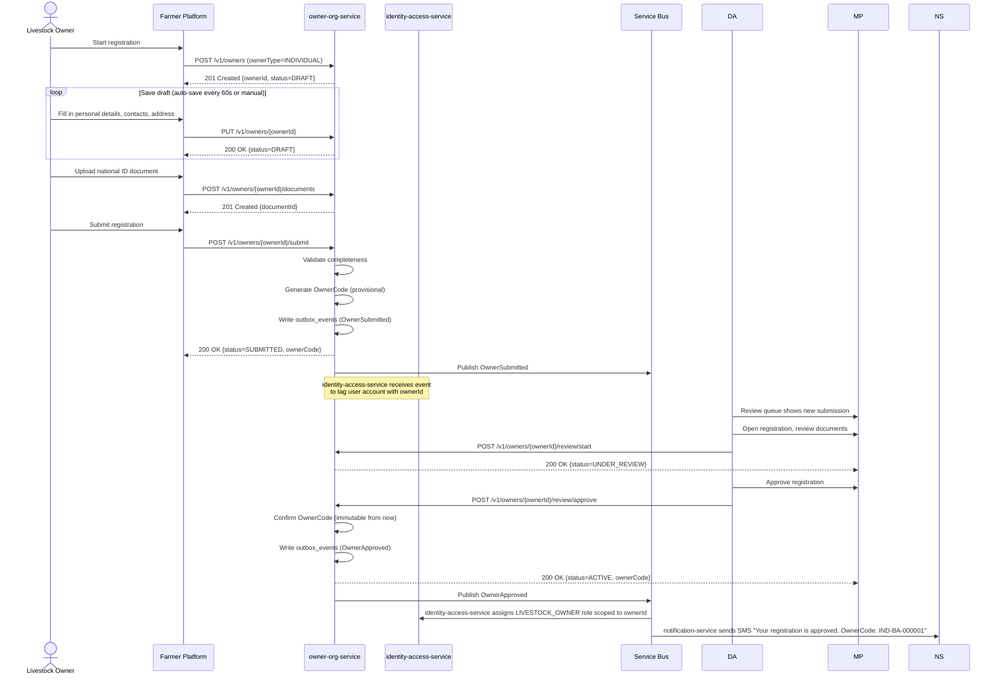
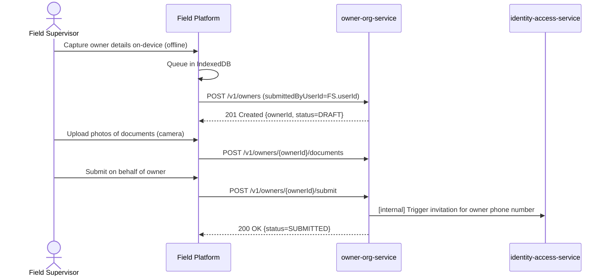
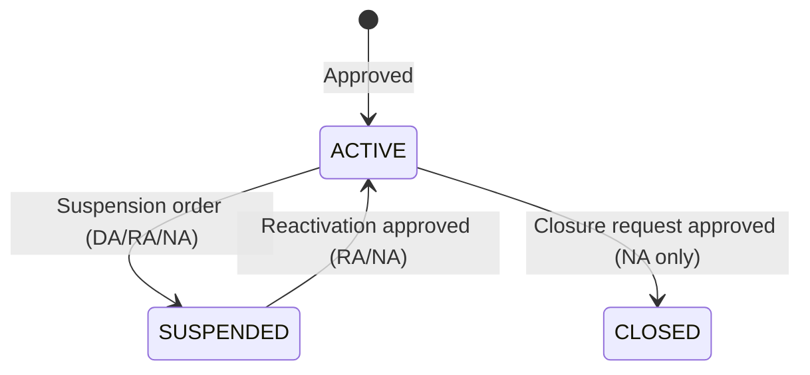
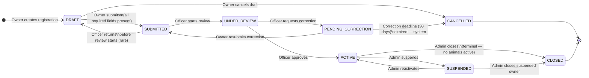

# Module 02 — Owner Registration

**Service:** `owner-org-service`
**Status:** Draft — awaiting approval
**Author:** SOMLITS Technical Team
**Date:** 2026-07-18

---

## Table of Contents

1. [Objective](#1-objective)
2. [Scope](#2-scope)
3. [Actors](#3-actors)
4. [Preconditions](#4-preconditions)
5. [Main Workflow — New Owner Registration](#5-main-workflow--new-owner-registration)
6. [Alternative Workflows](#6-alternative-workflows)
7. [Exception Workflows](#7-exception-workflows)
8. [Status Lifecycle](#8-status-lifecycle)
9. [Business Rules](#9-business-rules)
10. [Authorization Matrix](#10-authorization-matrix)
11. [Data Entities](#11-data-entities)
12. [Relationships](#12-relationships)
13. [API Contracts](#13-api-contracts)
14. [Domain Events](#14-domain-events)
15. [Notifications](#15-notifications)
16. [Audit Requirements](#16-audit-requirements)
17. [UI Screens](#17-ui-screens)
18. [Validations](#18-validations)
19. [Acceptance Criteria](#19-acceptance-criteria)
20. [Unit Tests](#20-unit-tests)
21. [Integration Tests](#21-integration-tests)
22. [API Tests](#22-api-tests)
23. [UI Tests](#23-ui-tests)
24. [Security Tests](#24-security-tests)
25. [User Acceptance Tests](#25-user-acceptance-tests)
26. [Test Data](#26-test-data)
27. [Definition of Done](#27-definition-of-done)
28. [Open Business Questions](#28-open-business-questions)

---

## 1. Objective

Register all entities that may legally own, manage, or operate with livestock in Somalia. Assign each owner a unique, human-readable **OwnerCode** alongside an internal UUID. Maintain a complete, immutable history of ownership status, document submissions, and verification decisions. Enforce role-based, delegated access so that owner employees may act only within their explicitly granted scope.

---

## 2. Scope

### In Scope

- Registration of all nine owner types (Individual, Company, Cooperative, Government Entity, Trader, Exporter, Abattoir Operator, Market Operator, Quarantine Operator)
- Draft, submission, district/Ministry verification, approval, rejection, correction, and resubmission workflows
- Suspension, reactivation, and closure lifecycle management
- Owner sub-user invitation (OWNER_ADMIN inviting OWNER_EMPLOYEE)
- Employee herd-data access delegation
- Document upload and verification record-keeping
- Complete status and audit history
- OwnerCode generation on first approval

### Out of Scope

- Animal registration (Module 03 — Animal Registry)
- Ownership transfer between owners (Module 07 — Movements)
- Financial transactions or fee collection
- Licensing fee payment tracking
- User account management (Module 01 — Identity and Access)

---

## 3. Actors

| Actor | Role Code | Description |
|---|---|---|
| Livestock Owner | `LIVESTOCK_OWNER` | Natural person or entity representative registering themselves |
| Owner Admin | `OWNER_ADMIN` | Designated administrator of an approved owner; invites employees |
| Owner Employee | `OWNER_EMPLOYEE` | Employee with delegated access to specific herd data |
| District Admin | `DISTRICT_ADMIN` | Verifies and approves owners within their district |
| Regional Admin | `REGIONAL_ADMIN` | Verifies and approves owners within their region; escalation point |
| National Admin | `NATIONAL_ADMIN` | Full system access; approves Government Entity registrations |
| Field Supervisor | `FIELD_SUPERVISOR` | Assists owners with offline/in-field registration; submits on their behalf |
| Veterinary Officer | `VET_OFFICER` | Read access to owner and herd data for health events |
| Auditor | `AUDITOR` | Read-only access for compliance review |
| System | internal | Generates OwnerCode; processes expiry of PENDING_CORRECTION records |

---

## 4. Preconditions

1. The registrant must have an active user account in `identity-access-service` with at least one of: `LIVESTOCK_OWNER`, `OWNER_ADMIN`, `DISTRICT_ADMIN`, `FIELD_SUPERVISOR`.
2. For Individual owners: the registrant is typically the same person as the owner.
3. For Company, Cooperative, and Government Entity owners: the registrant is an authorised representative whose identity must be verified separately.
4. For commercial operators (Trader, Exporter, Abattoir, Market, Quarantine): a valid operating license number must exist before submission can be accepted.
5. The district and region codes provided must exist in the Ministry's administrative boundary reference data.
6. Document uploads must not exceed 10 MB per file and must be PDF, JPEG, or PNG.

---

## 5. Main Workflow — New Owner Registration

### 5.1 Happy Path (Individual Owner — Self-Registration)



### 5.2 Workflow Step Summary

| Step | Actor | Action | Resulting Status |
|---|---|---|---|
| 1 | Owner | Creates registration | `DRAFT` |
| 2 | Owner | Saves partial data | `DRAFT` |
| 3 | Owner | Uploads documents | `DRAFT` |
| 4 | Owner | Submits registration | `SUBMITTED` |
| 5 | DA/RA/NA | Starts review | `UNDER_REVIEW` |
| 6a | DA/RA/NA | Approves | `ACTIVE` |
| 6b | DA/RA/NA | Requests correction | `PENDING_CORRECTION` |

---

## 6. Alternative Workflows

### 6.1 Draft Saving

An owner may save their registration as a draft at any point before submission. There is no time limit on drafts. A draft is private and invisible to officers.

- `PUT /v1/owners/{ownerId}` — full replacement of draft fields
- `PATCH /v1/owners/{ownerId}` — partial update (single section)
- The draft may be discarded (DELETE) by the owner before submission.

### 6.2 Field Officer–Assisted Registration

A Field Supervisor may create and submit a registration on behalf of a livestock owner who does not have digital access. The owner's mobile number is recorded; identity-access-service will send an activation OTP so the owner can later claim their account.



### 6.3 Company / Cooperative Registration

Requires additional organisation data section. The company representative logs in with their own user account and registers the company as the owner. The `representative_user_id` links the submitting user to the company owner record. After approval, additional OWNER_ADMIN users may be added.

Required additional fields:
- Legal company name (must match registration certificate)
- Company registration number
- Registration authority name
- Date of registration
- Tax identification number (if applicable — **[C] Ministry decision required**)
- Director/authorised signatory name and national ID

### 6.4 Commercial Operator Registration

Applies to: Trader, Exporter, Abattoir Operator, Market Operator, Quarantine Operator.

In addition to standard owner fields, the operating license section is mandatory:

- License type (TRADING / EXPORT / ABATTOIR / MARKET / QUARANTINE)
- License number
- Issuing authority
- Issue date
- Expiry date
- License document (upload required)

The license validity is checked at approval time. An expired license blocks approval. **[C] License renewal integration with the issuing ministry is out of scope for v1.**

### 6.5 Government Entity Registration

Government entities are registered by NATIONAL_ADMIN only. They do not follow the standard self-registration flow.

- A NATIONAL_ADMIN creates the record directly (`status=ACTIVE`, no approval workflow)
- Government entities do not require document uploads of the same type as individuals
- An official authorisation letter must be uploaded as a document
- OwnerCode is generated immediately on creation

### 6.6 Rejection and Resubmission

```mermaid
sequenceDiagram
    actor DA as District Admin
    actor LO as Livestock Owner
    participant MP as Ministry Platform
    participant FP as Farmer Platform
    participant OOS as owner-org-service

    DA->>MP: Review documents — issues found
    DA->>OOS: POST /v1/owners/{ownerId}/review/reject
              Note: body {reason, correctionNotes, correctionDeadline}
    OOS-->>MP: 200 OK {status=PENDING_CORRECTION}
    OOS->>NS: SMS to owner with correction instructions

    LO->>FP: View rejection reason
    LO->>FP: Update documents / fields
    LO->>OOS: PUT /v1/owners/{ownerId} (update fields)
    LO->>OOS: POST /v1/owners/{ownerId}/documents (new documents)
    LO->>OOS: POST /v1/owners/{ownerId}/correction (submit correction)
    OOS-->>FP: 200 OK {status=SUBMITTED}

    DA->>MP: Reviews corrected submission
    DA->>OOS: POST /v1/owners/{ownerId}/review/approve
    OOS-->>MP: 200 OK {status=ACTIVE}
```

### 6.7 Owner Sub-User Invitation (OWNER_ADMIN → OWNER_EMPLOYEE)

```mermaid
sequenceDiagram
    actor OA as Owner Admin
    participant MP as Ministry/Farmer Platform
    participant OOS as owner-org-service
    participant IAS as identity-access-service

    OA->>MP: Invite employee (phone number, access scope)
    MP->>OOS: POST /v1/owners/{ownerId}/invitations
             Note: body {phoneNumber, accessScope, validUntil}
    OOS->>IAS: [internal] POST /internal/v1/invitations
              (role=OWNER_EMPLOYEE, ownerId, scope)
    IAS-->>OOS: 201 {invitationId}
    OOS-->>MP: 201 Created {invitationId}
    IAS->>NS: SMS invitation link to employee phone
```

Employee access scopes:
| Scope Code | Description |
|---|---|
| `ANIMALS_READ` | View all animals under this owner |
| `ANIMALS_WRITE` | View and update animal records |
| `MOVEMENTS_READ` | View movement records |
| `MOVEMENTS_APPLY` | Apply for movement permits |
| `HEALTH_READ` | View health events |
| `FULL_OWNER_READ` | All read access (no write) |
| `FULL_OWNER_WRITE` | All read and write access (no admin) |

### 6.8 Suspension and Reactivation



Suspension requires:
- Stated reason (enum: REGULATORY_VIOLATION, DOCUMENT_EXPIRED, FRAUD_SUSPICION, COURT_ORDER, OTHER)
- Free-text suspension notes (mandatory for COURT_ORDER and FRAUD_SUSPICION)
- Minimum approver level: DISTRICT_ADMIN (can suspend), REGIONAL_ADMIN (can reactivate), NATIONAL_ADMIN (can do both)
- Animals owned by a SUSPENDED owner remain in the system but movement permits are blocked at movement-service level

---

## 7. Exception Workflows

### 7.1 Duplicate National ID Detected

At submission time, `owner-org-service` checks the encrypted national ID hash against existing active owner records.

- If a match is found for INDIVIDUAL owners: return 409 with `owner-not-found` → **[C]** Policy for handling genuine duplicates (e.g. name change, ID renewal) requires Ministry guidance. For v1: block submission, prompt owner to contact District Admin.
- For other owner types: company registration numbers are checked for uniqueness.

### 7.2 Document Upload Failure

If Azure Blob Storage is unavailable during document upload:
- Return 502 with `upstream-unavailable` error
- The draft is preserved; the owner may retry upload
- The registration cannot be submitted until at least the required documents are present

### 7.3 Correction Deadline Expired

A scheduled system job runs daily at 02:00 UTC:
- Queries all records in `PENDING_CORRECTION` where `correction_deadline < NOW()`
- Transitions status to `CANCELLED`
- Writes outbox event `OwnerRegistrationCancelled`
- Sends SMS to owner notifying them to restart registration

### 7.4 Verification Escalation

If a DISTRICT_ADMIN is unable to verify (e.g. foreign company, Government Entity), they may escalate:
- `POST /v1/owners/{ownerId}/review/escalate` — moves responsibility to REGIONAL_ADMIN or NATIONAL_ADMIN
- Reason for escalation is recorded
- Original reviewer is notified when the escalated review is complete

### 7.5 Operating License Expired at Approval Time

For commercial operator types, if the license expiry date is in the past at the time of approval:
- Return 422 with `https://somlits.gov.so/errors/license-expired`
- The approver must either:
  a. Wait for the owner to upload a renewed license document and resubmit the approval
  b. Set `approval_override_reason` (NATIONAL_ADMIN only) if the license is in the renewal grace period

---

## 8. Status Lifecycle



### Status Definitions

| Status | Description | Who Can Set |
|---|---|---|
| `DRAFT` | Incomplete registration being prepared | Owner, Field Supervisor |
| `SUBMITTED` | Complete submission awaiting review | Owner, Field Supervisor; also set on correction resubmission |
| `UNDER_REVIEW` | Actively being reviewed by an officer | DA / RA / NA |
| `PENDING_CORRECTION` | Returned to owner for specific corrections | DA / RA / NA |
| `ACTIVE` | Registration approved; owner may transact | DA / RA / NA (approvers) |
| `SUSPENDED` | Temporarily blocked from transacting | DA / RA / NA |
| `CANCELLED` | Registration abandoned or expired | Owner (draft only), System (correction expiry) |
| `CLOSED` | Permanently deactivated | NA only |

---

## 9. Business Rules

| Rule | Description |
|---|---|
| BR-OWN-001 | `owner.id` is a UUID generated by the system and never exposed in public-facing identifiers |
| BR-OWN-002 | `owner.owner_code` is the unique, human-readable identifier. Format: `{TYPE3}-{REGION2}-{SEQ6}` — e.g. `IND-BA-000001`. **[C]** Exact format subject to Ministry approval |
| BR-OWN-003 | Owner names are **not** unique identifiers. Two individuals may share the same name |
| BR-OWN-004 | Owner records are **never physically deleted**. Use status transitions only |
| BR-OWN-005 | `owner_code` is generated on the transition to `SUBMITTED` (provisional) and becomes immutable on transition to `ACTIVE` |
| BR-OWN-006 | Individual owners must provide a national ID number or passport number. The number is stored encrypted; a salted hash is stored for uniqueness checks |
| BR-OWN-007 | Company owners must provide a business registration number unique within Somalia. **[C]** Authority name is free-text in v1 pending integration with Ministry of Commerce registry |
| BR-OWN-008 | Cooperative owners must provide a cooperative registration number |
| BR-OWN-009 | Government Entity owners are created directly in `ACTIVE` status by NATIONAL_ADMIN only; no approval workflow applies |
| BR-OWN-010 | Trader, Exporter, Abattoir Operator, Market Operator, and Quarantine Operator must provide a valid unexpired operating license before approval |
| BR-OWN-011 | A SUBMITTED registration cannot be returned to DRAFT. The owner must wait for rejection or approval |
| BR-OWN-012 | A `PENDING_CORRECTION` registration must be resubmitted within 30 calendar days or it transitions to `CANCELLED` |
| BR-OWN-013 | An `ACTIVE` owner with active (non-terminal) animals cannot be `CLOSED`. The officer must first confirm all animals are transferred, deceased, or exported |
| BR-OWN-014 | A `CLOSED` owner is terminal. It cannot be reactivated or reopened under any circumstances |
| BR-OWN-015 | A `SUSPENDED` owner's animals remain in the system; movement permits for those animals are blocked by movement-service |
| BR-OWN-016 | Each owner registration has exactly one primary contact (phone). The primary phone must be a valid Somali or international number in E.164 format |
| BR-OWN-017 | Primary contact phone number must be unique across `ACTIVE` and `SUBMITTED` owner records |
| BR-OWN-018 | Geographic region code and district code must exist in the system's administrative boundary reference table |
| BR-OWN-019 | Documents submitted as part of a SUBMITTED registration are immutable. Corrections require uploading replacement documents (originals are retained with status `SUPERSEDED`) |
| BR-OWN-020 | An `OWNER_ADMIN` may invite up to 20 `OWNER_EMPLOYEE` users per owner. **[C]** This limit requires Ministry policy confirmation |
| BR-OWN-021 | An `OWNER_EMPLOYEE` may only view or act on data within their explicitly granted scope for this specific owner |
| BR-OWN-022 | A Field Supervisor who creates a registration on behalf of an owner must record the owner's phone number; the system triggers an account invitation to that number |
| BR-OWN-023 | The `verification_officer_user_id` on the approval record must belong to an officer with territory scope covering the owner's registered district |
| BR-OWN-024 | Verification notes (rejection reasons, correction requests) are permanently stored and visible to the owner |
| BR-OWN-025 | An owner may have at most one registration in `SUBMITTED`, `UNDER_REVIEW`, or `PENDING_CORRECTION` status at a time |

---

## 10. Authorization Matrix

Symbols: **C** = Create, **R** = Read, **U** = Update, **A** = Approve/Reject, **S** = Suspend/Reactivate, **X** = Close, **—** = No access, **O** = Own records only, **T** = Territory-scoped

| Resource / Action | NA | RA | DA | FS | LO | OA | OE | AU | RO |
|---|---|---|---|---|---|---|---|---|---|
| **Owner record — create draft** | C | — | — | C | C | — | — | — | — |
| **Owner record — read** | R | R·T | R·T | R·T | O | O | O·scope | R | R |
| **Owner record — update draft** | U | — | — | U·T | O | — | — | — | — |
| **Owner record — submit** | U | — | — | U·T | O | — | — | — | — |
| **Owner record — start review** | A | A·T | A·T | — | — | — | — | — | — |
| **Owner record — approve** | A | A·T | A·T | — | — | — | — | — | — |
| **Owner record — reject / request correction** | A | A·T | A·T | — | — | — | — | — | — |
| **Owner record — escalate review** | A | A·T | A·T | — | — | — | — | — | — |
| **Owner record — suspend** | S | S·T | S·T | — | — | — | — | — | — |
| **Owner record — reactivate** | S | S·T | — | — | — | — | — | — | — |
| **Owner record — close** | X | — | — | — | — | — | — | — | — |
| **Documents — upload** | C | — | — | C·T | O | O | — | — | — |
| **Documents — read** | R | R·T | R·T | R·T | O | O | O·scope | R | — |
| **Status history — read** | R | R·T | R·T | R·T | O | O | — | R | R |
| **Verification notes — read** | R | R·T | R·T | R·T | O | O | — | R | — |
| **Sub-user invitations — create** | C | — | — | — | — | O | — | — | — |
| **Sub-user invitations — revoke** | U | — | — | — | — | O | — | — | — |
| **Employee access — view** | R | R·T | R·T | — | — | O | — | R | — |
| **Government Entity — create** | C | — | — | — | — | — | — | — | — |
| **List all owners** | R | R·T | R·T | R·T | — | — | — | R | R |

**Key:** T = territory-scoped to officer's assigned region or district; O = own owner record only; scope = within delegated access scope granted to this OWNER_EMPLOYEE

---

## 11. Data Entities

### 11.1 `owner`

Core registration record. One row per registered owner.

| Column | Type | Constraints | Description |
|---|---|---|---|
| `id` | UUID | PK | Internal identifier — never exposed in URLs as a guessable value |
| `owner_code` | VARCHAR(20) | UNIQUE, NOT NULL after submission | Human-readable unique code (e.g. `IND-BA-000001`) |
| `owner_type` | VARCHAR(30) | NOT NULL | `INDIVIDUAL`, `COMPANY`, `COOPERATIVE`, `GOVERNMENT_ENTITY`, `TRADER`, `EXPORTER`, `ABATTOIR_OPERATOR`, `MARKET_OPERATOR`, `QUARANTINE_OPERATOR` |
| `status` | VARCHAR(30) | NOT NULL | See §8 status lifecycle |
| `registered_by_user_id` | UUID | NOT NULL, FK→user_account | User who created the draft (may be FS or the owner themselves) |
| `submitted_at` | TIMESTAMPTZ | | Timestamp of first submission |
| `approved_at` | TIMESTAMPTZ | | Timestamp of most recent approval |
| `approved_by_user_id` | UUID | FK→user_account | Officer who approved |
| `suspended_at` | TIMESTAMPTZ | | Timestamp of suspension |
| `suspended_by_user_id` | UUID | FK→user_account | |
| `suspension_reason` | VARCHAR(50) | | Enum code (see §6.8) |
| `suspension_notes` | TEXT | | Mandatory for COURT_ORDER and FRAUD_SUSPICION |
| `closed_at` | TIMESTAMPTZ | | Timestamp of closure |
| `closed_by_user_id` | UUID | FK→user_account | |
| `closure_reason` | TEXT | | |
| `correction_deadline` | TIMESTAMPTZ | | Set when status → PENDING_CORRECTION |
| `primary_phone_e164` | VARCHAR(20) | UNIQUE on (ACTIVE, SUBMITTED) | E.164 format primary contact phone |
| `region_code` | VARCHAR(10) | NOT NULL | Must exist in boundary reference table |
| `district_code` | VARCHAR(10) | NOT NULL | Must exist in boundary reference table |
| `created_at` | TIMESTAMPTZ | NOT NULL | |
| `updated_at` | TIMESTAMPTZ | NOT NULL | |
| `version` | INTEGER | NOT NULL DEFAULT 0 | Optimistic locking |

### 11.2 `owner_individual_detail`

One row per INDIVIDUAL owner (1:1 with `owner` where `owner_type = INDIVIDUAL`).

| Column | Type | Constraints | Description |
|---|---|---|---|
| `owner_id` | UUID | PK, FK→owner | |
| `given_name` | VARCHAR(100) | NOT NULL | First/given name (Somali: magaca) |
| `family_name` | VARCHAR(100) | NOT NULL | Family/clan name |
| `given_name_somali` | VARCHAR(100) | | Somali-script name (optional — **[C]** Unicode Somali script pending keyboard support) |
| `date_of_birth` | DATE | | Used to disambiguate same-name individuals |
| `sex` | VARCHAR(10) | | `MALE`, `FEMALE` |
| `nationality` | VARCHAR(3) | | ISO 3166-1 alpha-3 (default `SOM`) |
| `national_id_encrypted` | BYTEA | | Encrypted using Azure Key Vault CMK |
| `national_id_hash` | VARCHAR(64) | UNIQUE (partial: where not NULL) | SHA-256 of normalised ID number (for duplicate check) |
| `passport_number_encrypted` | BYTEA | | Encrypted; required if no national ID |
| `passport_number_hash` | VARCHAR(64) | | |
| `passport_expiry_date` | DATE | | |

### 11.3 `owner_organisation_detail`

One row per non-individual owner (1:1 with `owner` where `owner_type != INDIVIDUAL`).

| Column | Type | Constraints | Description |
|---|---|---|---|
| `owner_id` | UUID | PK, FK→owner | |
| `legal_name` | VARCHAR(200) | NOT NULL | Official registered name |
| `trading_name` | VARCHAR(200) | | Trading or common name (if different) |
| `registration_number` | VARCHAR(100) | | Company / cooperative / authority code |
| `registration_authority` | VARCHAR(200) | | Name of issuing authority |
| `registration_date` | DATE | | |
| `registration_country` | VARCHAR(3) | | ISO 3166-1 alpha-3 |
| `tax_id` | VARCHAR(50) | | **[C]** Tax system pending |
| `representative_name` | VARCHAR(200) | NOT NULL | Name of authorised signatory |
| `representative_title` | VARCHAR(100) | | e.g. "Director", "Cooperative Chair" |
| `representative_national_id_encrypted` | BYTEA | | |
| `representative_national_id_hash` | VARCHAR(64) | | |

### 11.4 `owner_operating_license`

One row per license. Commercial operators may hold multiple licenses (e.g. Trader + Exporter).

| Column | Type | Constraints | Description |
|---|---|---|---|
| `id` | UUID | PK | |
| `owner_id` | UUID | NOT NULL, FK→owner | |
| `license_type` | VARCHAR(30) | NOT NULL | `TRADING`, `EXPORT`, `ABATTOIR`, `MARKET`, `QUARANTINE` |
| `license_number` | VARCHAR(100) | NOT NULL | |
| `issuing_authority` | VARCHAR(200) | NOT NULL | |
| `issue_date` | DATE | NOT NULL | |
| `expiry_date` | DATE | NOT NULL | |
| `document_id` | UUID | FK→owner_document | Uploaded license scan |
| `status` | VARCHAR(20) | NOT NULL | `ACTIVE`, `EXPIRED`, `REVOKED`, `SUPERSEDED` |
| `created_at` | TIMESTAMPTZ | NOT NULL | |
| `version` | INTEGER | NOT NULL DEFAULT 0 | |

### 11.5 `owner_contact`

Multiple contacts per owner (primary phone, secondary phone, email, emergency contact, etc.).

| Column | Type | Constraints | Description |
|---|---|---|---|
| `id` | UUID | PK | |
| `owner_id` | UUID | NOT NULL, FK→owner | |
| `contact_type` | VARCHAR(20) | NOT NULL | `PHONE_PRIMARY`, `PHONE_SECONDARY`, `EMAIL`, `EMERGENCY` |
| `value` | VARCHAR(200) | NOT NULL | Phone in E.164 or email address |
| `contact_name` | VARCHAR(200) | | For emergency contacts — name of the contact person |
| `is_verified` | BOOLEAN | NOT NULL DEFAULT FALSE | True when OTP-verified (primary phone) |
| `created_at` | TIMESTAMPTZ | NOT NULL | |

### 11.6 `owner_address`

Multiple addresses per owner (physical location, postal, operational site).

| Column | Type | Constraints | Description |
|---|---|---|---|
| `id` | UUID | PK | |
| `owner_id` | UUID | NOT NULL, FK→owner | |
| `address_type` | VARCHAR(20) | NOT NULL | `PHYSICAL`, `POSTAL`, `OPERATIONAL` |
| `is_primary` | BOOLEAN | NOT NULL DEFAULT FALSE | Only one primary per type |
| `region_code` | VARCHAR(10) | NOT NULL | |
| `district_code` | VARCHAR(10) | NOT NULL | |
| `village_locality` | VARCHAR(200) | | |
| `street_description` | VARCHAR(500) | | Free text — Somalia has no formal postcode system |
| `latitude` | DECIMAL(9,6) | | GPS coordinate (captured from device or entered) |
| `longitude` | DECIMAL(9,6) | | |
| `what3words` | VARCHAR(50) | | **[C]** what3words integration optional for v1 |
| `created_at` | TIMESTAMPTZ | NOT NULL | |
| `updated_at` | TIMESTAMPTZ | NOT NULL | |

### 11.7 `owner_document`

All uploaded files. Stored in Azure Blob Storage; this table holds the metadata and verification state.

| Column | Type | Constraints | Description |
|---|---|---|---|
| `id` | UUID | PK | |
| `owner_id` | UUID | NOT NULL, FK→owner | |
| `document_type` | VARCHAR(50) | NOT NULL | See document type enum (§18) |
| `document_status` | VARCHAR(20) | NOT NULL | `PENDING`, `ACCEPTED`, `REJECTED`, `SUPERSEDED` |
| `file_name` | VARCHAR(255) | NOT NULL | Original filename |
| `content_type` | VARCHAR(50) | NOT NULL | `application/pdf`, `image/jpeg`, `image/png` |
| `file_size_bytes` | BIGINT | NOT NULL | |
| `blob_path` | VARCHAR(500) | NOT NULL | Azure Blob path (never exposed to clients directly) |
| `uploaded_by_user_id` | UUID | NOT NULL, FK→user_account | |
| `uploaded_at` | TIMESTAMPTZ | NOT NULL | |
| `reviewed_by_user_id` | UUID | FK→user_account | Officer who accepted/rejected this document |
| `reviewed_at` | TIMESTAMPTZ | | |
| `rejection_reason` | TEXT | | |
| `superseded_by_document_id` | UUID | FK→owner_document | Set when a replacement document is uploaded |

### 11.8 `owner_status_history`

Immutable append-only log of every status transition.

| Column | Type | Constraints | Description |
|---|---|---|---|
| `id` | UUID | PK | |
| `owner_id` | UUID | NOT NULL, FK→owner | |
| `from_status` | VARCHAR(30) | | NULL for initial DRAFT creation |
| `to_status` | VARCHAR(30) | NOT NULL | |
| `changed_by_user_id` | UUID | NOT NULL, FK→user_account | |
| `changed_at` | TIMESTAMPTZ | NOT NULL | |
| `reason` | TEXT | | Mandatory for rejection, suspension, and closure |
| `correction_notes` | TEXT | | Detail of what must be corrected (rejection only) |
| `correction_deadline` | TIMESTAMPTZ | | Set for PENDING_CORRECTION transitions |
| `correlation_id` | UUID | NOT NULL | From X-Correlation-ID header |

### 11.9 `owner_verification_note`

Free-form notes added by officers during review (multiple notes allowed).

| Column | Type | Constraints | Description |
|---|---|---|---|
| `id` | UUID | PK | |
| `owner_id` | UUID | NOT NULL, FK→owner | |
| `note_type` | VARCHAR(30) | NOT NULL | `GENERAL`, `DOCUMENT_QUERY`, `FIELD_VISIT`, `ESCALATION`, `CORRECTION_DETAIL` |
| `note_text` | TEXT | NOT NULL | |
| `is_visible_to_owner` | BOOLEAN | NOT NULL DEFAULT TRUE | Internal-only notes may be hidden from the owner |
| `created_by_user_id` | UUID | NOT NULL, FK→user_account | |
| `created_at` | TIMESTAMPTZ | NOT NULL | |

### 11.10 `outbox_events`

Shared pattern (see V1 Flyway migration in identity-access-service). `owner-org-service` has its own instance.

---

## 12. Relationships

```mermaid
erDiagram
    owner ||--o| owner_individual_detail : "1:0..1 (INDIVIDUAL only)"
    owner ||--o| owner_organisation_detail : "1:0..1 (non-INDIVIDUAL only)"
    owner ||--|{ owner_contact : "1:many"
    owner ||--|{ owner_address : "1:many"
    owner ||--|{ owner_document : "1:many"
    owner ||--|{ owner_operating_license : "1:many (commercial operators)"
    owner ||--|{ owner_status_history : "1:many (append-only)"
    owner ||--|{ owner_verification_note : "1:many"

    owner {
        uuid id PK
        varchar owner_code UK
        varchar owner_type
        varchar status
        uuid registered_by_user_id FK
        varchar region_code
        varchar district_code
    }

    owner_individual_detail {
        uuid owner_id PK_FK
        varchar given_name
        varchar family_name
        bytea national_id_encrypted
        varchar national_id_hash UK
    }

    owner_organisation_detail {
        uuid owner_id PK_FK
        varchar legal_name
        varchar registration_number
    }

    owner_document {
        uuid id PK
        uuid owner_id FK
        varchar document_type
        varchar document_status
        varchar blob_path
    }

    owner_operating_license {
        uuid id PK
        uuid owner_id FK
        varchar license_type
        date expiry_date
        varchar status
    }

    owner_status_history {
        uuid id PK
        uuid owner_id FK
        varchar from_status
        varchar to_status
        timestamptz changed_at
    }
```

---

## 13. API Contracts

Base path: `/v1/owners`
All endpoints require `Authorization: Bearer {jwt}` except where noted.
All responses for 4xx/5xx use RFC 7807 `application/problem+json`.

### 13.1 Create Registration Draft

```
POST /v1/owners
```

**Request body:**
```json
{
  "ownerType": "INDIVIDUAL",
  "regionCode": "BA",
  "districtCode": "BND",
  "primaryPhoneE164": "+252612345678"
}
```

**Response 201:**
```json
{
  "ownerId": "3fa85f64-5717-4562-b3fc-2c963f66afa6",
  "ownerCode": null,
  "status": "DRAFT",
  "ownerType": "INDIVIDUAL",
  "createdAt": "2026-07-18T10:00:00Z"
}
```

**Errors:** 422 (`validation-failed`), 409 (`phone-number-taken`)

---

### 13.2 Get Owner

```
GET /v1/owners/{ownerId}
```

**Response 200:** Full owner representation including contacts, addresses, and current status.

**Errors:** 404 (`owner-not-found`), 403 (`forbidden`)

---

### 13.3 Update Draft

```
PUT /v1/owners/{ownerId}
```

Only allowed when `status = DRAFT` or `status = PENDING_CORRECTION`.

**Request body:** Full owner payload (all sections).

**Errors:** 404, 403, 422 (`validation-failed`), 409 (`status-not-draft`)

---

### 13.4 Patch Draft Section

```
PATCH /v1/owners/{ownerId}
```

Partial update. Body contains only the section being updated (e.g., `contacts`, `addresses`, `individualDetail`).

---

### 13.5 Submit Registration

```
POST /v1/owners/{ownerId}/submit
```

**Preconditions:** Status must be `DRAFT` or `PENDING_CORRECTION`. All required fields and documents must be present (completeness check run server-side).

**Response 200:**
```json
{
  "ownerId": "...",
  "ownerCode": "IND-BA-000001",
  "status": "SUBMITTED",
  "submittedAt": "2026-07-18T10:05:00Z"
}
```

**Errors:** 422 (`validation-failed`, `incomplete-registration`), 409 (`already-submitted`)

---

### 13.6 Cancel Draft

```
DELETE /v1/owners/{ownerId}
```

Only allowed when `status = DRAFT`. Transitions to `CANCELLED`.

**Response:** 204 No Content

---

### 13.7 Start Review

```
POST /v1/owners/{ownerId}/review/start
```

**Roles:** DA, RA, NA (territory-scoped).

**Response 200:** `{status: "UNDER_REVIEW", reviewStartedAt, reviewerUserId}`

**Errors:** 409 (`already-under-review`)

---

### 13.8 Approve Registration

```
POST /v1/owners/{ownerId}/review/approve
```

**Request body:**
```json
{
  "approvalNotes": "All documents verified. Physical premises visited 2026-07-15."
}
```

**Response 200:**
```json
{
  "ownerId": "...",
  "ownerCode": "IND-BA-000001",
  "status": "ACTIVE",
  "approvedAt": "2026-07-18T14:00:00Z",
  "approvedByUserId": "..."
}
```

**Errors:** 409 (`status-not-under-review`), 422 (`license-expired`)

---

### 13.9 Reject / Request Correction

```
POST /v1/owners/{ownerId}/review/reject
```

**Request body:**
```json
{
  "reason": "DOCUMENT_INSUFFICIENT",
  "correctionNotes": "National ID scan is not legible. Please upload a clear colour scan.",
  "correctionDeadline": "2026-08-17T23:59:59Z"
}
```

**Response 200:** `{status: "PENDING_CORRECTION", correctionDeadline}`

**Errors:** 422 if `correctionDeadline` is in the past or more than 30 days in the future

---

### 13.10 Submit Correction

```
POST /v1/owners/{ownerId}/correction
```

Transitions `PENDING_CORRECTION → SUBMITTED`.

**Request body:**
```json
{
  "correctionSummary": "Uploaded a new high-resolution scan of national ID."
}
```

**Response 200:** `{status: "SUBMITTED"}`

**Errors:** 422 (`correction-deadline-expired`), 409 (`status-not-pending-correction`)

---

### 13.11 Escalate Review

```
POST /v1/owners/{ownerId}/review/escalate
```

**Request body:** `{escalateTo: "REGIONAL_ADMIN", reason: "Foreign company — district cannot verify."}`

**Response 200:** `{status: "UNDER_REVIEW", escalatedToTerritoryType: "REGIONAL"}`

---

### 13.12 Suspend Owner

```
POST /v1/owners/{ownerId}/suspend
```

**Request body:**
```json
{
  "suspensionReason": "REGULATORY_VIOLATION",
  "suspensionNotes": "Livestock moved without permits on three occasions."
}
```

**Response 200:** `{status: "SUSPENDED", suspendedAt}`

---

### 13.13 Reactivate Owner

```
POST /v1/owners/{ownerId}/reactivate
```

**Request body:** `{reactivationNotes: "Compliance confirmed by RA office."}`

**Response 200:** `{status: "ACTIVE"}`

**Roles:** RA, NA only.

---

### 13.14 Close Owner

```
POST /v1/owners/{ownerId}/close
```

**Request body:** `{closureReason: "Owner deceased. Estate settled."}`

**Response 200:** `{status: "CLOSED", closedAt}`

**Roles:** NA only.

**Errors:** 422 (`owner-has-active-animals`)

---

### 13.15 Upload Document

```
POST /v1/owners/{ownerId}/documents
Content-Type: multipart/form-data
```

**Form fields:** `documentType`, `file`

**Response 201:**
```json
{
  "documentId": "...",
  "documentType": "NATIONAL_ID",
  "status": "PENDING",
  "uploadedAt": "2026-07-18T10:02:00Z"
}
```

**Errors:** 413 (file > 10 MB), 415 (unsupported type), 422 (`invalid-document-type-for-owner-type`)

---

### 13.16 List Documents

```
GET /v1/owners/{ownerId}/documents
```

**Response 200:** Array of document metadata (no blob content — use pre-signed URL endpoint).

---

### 13.17 Get Document Download URL

```
GET /v1/owners/{ownerId}/documents/{documentId}/download-url
```

**Response 200:** `{url: "https://somlitsstorage.blob.core.windows.net/...?sas_token", expiresAt}`

Pre-signed SAS URL with 15-minute TTL. No document content is returned directly by the API.

---

### 13.18 Get Status History

```
GET /v1/owners/{ownerId}/status-history
```

**Response 200:** Array of status transition records.

---

### 13.19 Invite Sub-User (OWNER_ADMIN only)

```
POST /v1/owners/{ownerId}/invitations
```

Delegates to `identity-access-service` internally.

**Request body:**
```json
{
  "phoneE164": "+252615000001",
  "accessScope": "ANIMALS_WRITE",
  "validUntil": "2027-07-18T00:00:00Z"
}
```

**Response 201:** `{invitationId, expiresAt}`

---

### 13.20 List Owner Users

```
GET /v1/owners/{ownerId}/users
```

**Response 200:** Array of users with access to this owner (OWNER_ADMIN, OWNER_EMPLOYEE) including their scopes.

---

### 13.21 List Owners (paginated)

```
GET /v1/owners?ownerType=INDIVIDUAL&status=ACTIVE&regionCode=BA&page=0&size=20&sort=createdAt,desc
```

**Response 200:**
```json
{
  "content": [...],
  "page": 0,
  "size": 20,
  "totalElements": 142,
  "totalPages": 8
}
```

---

## 14. Domain Events

**Topic:** `somlits.owners`

All events include: `eventId` (UUID), `eventType` (string), `aggregateType` ("Owner"), `aggregateId` (ownerId UUID), `occurredAt` (ISO 8601 UTC), `correlationId` (UUID).

| Event Type | Published When | Key Payload Fields |
|---|---|---|
| `OwnerDraftCreated` | Registration draft created | `ownerType`, `regionCode`, `districtCode`, `registeredByUserId` |
| `OwnerSubmitted` | Registration submitted | `ownerCode`, `ownerType`, `submittedByUserId`, `submittedAt` |
| `OwnerReviewStarted` | Officer starts review | `reviewerUserId`, `reviewStartedAt` |
| `OwnerApproved` | Registration approved | `ownerCode`, `ownerType`, `approvedByUserId`, `regionCode`, `districtCode` |
| `OwnerCorrectionRequested` | Rejected — correction required | `correctionDeadline`, `rejectedByUserId`, `reason` |
| `OwnerCorrectionSubmitted` | Owner resubmits after correction | `correctionSummary`, `submittedByUserId` |
| `OwnerReviewEscalated` | Review escalated to higher tier | `escalatedToTerritoryType`, `reason` |
| `OwnerSuspended` | Owner suspended | `suspensionReason`, `suspendedByUserId`, `suspendedAt` |
| `OwnerReactivated` | Suspension lifted | `reactivatedByUserId`, `reactivatedAt` |
| `OwnerClosed` | Owner permanently closed | `closureReason`, `closedByUserId`, `closedAt` |
| `OwnerRegistrationCancelled` | Draft cancelled or correction expired | `cancellationReason` (`OWNER_CANCELLED`, `CORRECTION_EXPIRED`) |
| `OwnerSubUserInvited` | OWNER_ADMIN invited an employee | `invitationId`, `accessScope`, `invitedByUserId` |
| `OwnerDocumentUploaded` | Document uploaded | `documentId`, `documentType`, `uploadedByUserId` |
| `OwnerDocumentReviewed` | Document accepted or rejected by officer | `documentId`, `documentStatus`, `reviewedByUserId` |

**Consumers:**

| Service | Event(s) Consumed | Purpose |
|---|---|---|
| `identity-access-service` | `OwnerApproved` | Tag user account with ownerId; confirm LIVESTOCK_OWNER role scope |
| `identity-access-service` | `OwnerSuspended`, `OwnerClosed` | Revoke active sessions for the owner's users |
| `movement-service` | `OwnerSuspended`, `OwnerReactivated` | Block / unblock movement permit applications |
| `notification-service` | `OwnerSubmitted`, `OwnerApproved`, `OwnerCorrectionRequested`, `OwnerSuspended`, `OwnerReactivated`, `OwnerRegistrationCancelled` | SMS and in-app notifications |
| `audit-service` | All events | Immutable audit log |

---

## 15. Notifications

| Trigger | Recipient | Channel | Template Key |
|---|---|---|---|
| Registration submitted | Owner (primary phone) | SMS | `OWNER_SUBMITTED` |
| Registration approved | Owner (primary phone) | SMS + in-app | `OWNER_APPROVED` |
| Correction requested | Owner (primary phone) | SMS + in-app | `OWNER_CORRECTION_REQUESTED` |
| Correction deadline 3 days away | Owner | SMS | `OWNER_CORRECTION_DEADLINE_REMINDER` |
| Registration cancelled (expired) | Owner | SMS | `OWNER_REGISTRATION_CANCELLED` |
| Owner suspended | Owner (OWNER_ADMIN) | SMS + in-app | `OWNER_SUSPENDED` |
| Owner reactivated | Owner (OWNER_ADMIN) | SMS + in-app | `OWNER_REACTIVATED` |
| Sub-user invited | Invitee phone | SMS | Shared with IAM `INVITATION_SENT` |
| License expiring (30 days) | Owner (OWNER_ADMIN) | SMS + in-app | `OWNER_LICENSE_EXPIRING` |

**Note:** No personal data (national ID, passport number) may appear in any notification message body.

---

## 16. Audit Requirements

| Event | Retention | Notes |
|---|---|---|
| Every status transition | 10 years | Stored in `owner_status_history` |
| Every document upload | 10 years | Stored in `owner_document` |
| Every document acceptance/rejection | 10 years | |
| Every API call mutating owner state | 10 years | Via `audit-service` |
| Officer review actions | 10 years | Including officer user ID and timestamp |
| Sub-user invitation history | 5 years | |
| All outbound notifications sent | 2 years | |

All audit records include: `owner_id`, `changed_by_user_id`, `changed_at` (UTC), `correlation_id`.

Audit records are **never modified or deleted**. Soft-delete exceptions: none.

---

## 17. UI Screens

### 17.1 Farmer Platform (Livestock Owner)

| Screen | Route | Description |
|---|---|---|
| Registration Start | `/register/owner` | Select owner type; create draft |
| Personal Details | `/register/owner/personal` | Name, DOB, sex, nationality |
| Contact Details | `/register/owner/contacts` | Primary phone, secondary contacts |
| Address | `/register/owner/address` | Region, district, village, GPS |
| Identity Documents | `/register/owner/documents` | Upload national ID / passport |
| Organisation Details | `/register/owner/organisation` | Company / cooperative fields (conditional) |
| License Details | `/register/owner/license` | Operating license (commercial operators) |
| Review & Submit | `/register/owner/review` | Summary of all fields; submit button |
| Registration Status | `/owner/status` | Shows current status, correction notes |
| Correction View | `/owner/correction` | Displays correction request; allows field updates and resubmit |
| Owner Dashboard | `/owner/dashboard` | Summary of status, animals, linked users |
| Manage Employees | `/owner/employees` | List; invite new; revoke access |

### 17.2 Ministry Platform (Officers)

| Screen | Route | Description |
|---|---|---|
| Owner Review Queue | `/owners/queue` | Paginated list of SUBMITTED / UNDER_REVIEW owners |
| Owner Detail | `/owners/{ownerId}` | Full record with documents, notes, history |
| Approve / Reject | `/owners/{ownerId}/review` | Action buttons with reason capture |
| Add Verification Note | `/owners/{ownerId}/notes/new` | Officer notes during review |
| Suspension Management | `/owners/{ownerId}/suspend` | Suspend / reactivate form |
| Owner List | `/owners` | Full list with filters (status, type, region, date range) |
| Owner Closure | `/owners/{ownerId}/close` | NA only; confirm no active animals |

---

## 18. Validations

### Document Type Requirements by Owner Type

| Owner Type | Required Documents | Optional Documents |
|---|---|---|
| INDIVIDUAL | `NATIONAL_ID` or `PASSPORT` | `PROOF_OF_RESIDENCE` |
| COMPANY | `COMPANY_REGISTRATION_CERT`, `REPRESENTATIVE_ID` | `TAX_REGISTRATION`, `MEMORANDUM_OF_ASSOCIATION` |
| COOPERATIVE | `COOPERATIVE_REGISTRATION_CERT`, `REPRESENTATIVE_ID` | `MEMBERSHIP_LIST` |
| GOVERNMENT_ENTITY | `GOVERNMENT_AUTHORISATION_LETTER` | — |
| TRADER | `NATIONAL_ID` or `PASSPORT`, `TRADING_LICENSE` | `PROOF_OF_PREMISES` |
| EXPORTER | `NATIONAL_ID` or `PASSPORT`, `EXPORT_LICENSE` | `COMPANY_REGISTRATION_CERT` |
| ABATTOIR_OPERATOR | `NATIONAL_ID` or `PASSPORT`, `ABATTOIR_LICENSE` | `HEALTH_CLEARANCE_CERT` |
| MARKET_OPERATOR | `NATIONAL_ID` or `PASSPORT`, `MARKET_LICENSE` | `PROOF_OF_PREMISES` |
| QUARANTINE_OPERATOR | `NATIONAL_ID` or `PASSPORT`, `QUARANTINE_LICENSE` | `FACILITY_CERTIFICATION` |

### Field Validations

| Field | Rule |
|---|---|
| `primaryPhoneE164` | Must match `^\+[1-9]\d{7,14}$`; preferably `+252` prefix for Somali numbers |
| `regionCode` | Must exist in `administrative_boundary` reference table |
| `districtCode` | Must belong to the provided `regionCode` |
| `dateOfBirth` | Must be in the past; individual must be ≥ 18 years old |
| `passportExpiry` | Must not be in the past at submission time |
| `licenseExpiryDate` | Must be > 30 days in the future at approval time |
| `correctionDeadline` | 1 to 30 days from rejection date |
| Document file size | ≤ 10 MB |
| Document content type | `application/pdf`, `image/jpeg`, `image/png` only |
| `validUntil` (sub-user) | Maximum 1 year from today (BR-IAM-021 equivalent) |

---

## 19. Acceptance Criteria

| ID | Criterion |
|---|---|
| AC-OWN-001 | An individual owner can create a draft, fill in all sections, upload their national ID, submit, and receive confirmation with their OwnerCode within one working day |
| AC-OWN-002 | A draft with missing required fields cannot be submitted; the API returns 422 listing each missing field |
| AC-OWN-003 | Submitting with an already-used national ID hash returns 409 |
| AC-OWN-004 | A rejected registration with correction notes is visible to the owner; the owner can update fields and resubmit |
| AC-OWN-005 | A correction not resubmitted within 30 days is automatically cancelled by the scheduled job |
| AC-OWN-006 | An approved owner's OwnerCode is immutable — no API call can change it after approval |
| AC-OWN-007 | Closing an owner with active animals returns 422 `owner-has-active-animals` |
| AC-OWN-008 | A suspended owner's movement permit applications are blocked in `movement-service` |
| AC-OWN-009 | An OWNER_EMPLOYEE with `ANIMALS_READ` scope cannot call any write endpoints |
| AC-OWN-010 | An officer with DISTRICT territory scope cannot approve an owner registered in a different district |
| AC-OWN-011 | Every status change is recorded in `owner_status_history` with the correct user ID and timestamp |
| AC-OWN-012 | Document content is never returned directly from the API — only pre-signed SAS URLs |
| AC-OWN-013 | National ID numbers are never stored in plaintext — only encrypted value and hash |
| AC-OWN-014 | A Government Entity is created in ACTIVE status by NA; no approval workflow triggers |
| AC-OWN-015 | All domain events are published to `somlits.owners` via the outbox pattern (at-least-once, idempotent consumer) |

---

## 20. Unit Tests

Tests are defined here and must be implemented in `owner-org-service` before business logic is written (test-first).

### 20.1 Domain Model Tests (`OwnerTest.java`)

```
OwnerTest
├── canSubmit
│   ├── given_draft_with_all_required_fields_and_documents_should_return_true
│   ├── given_draft_missing_primary_phone_should_return_false
│   ├── given_draft_missing_required_document_should_return_false_for_owner_type
│   ├── given_status_submitted_should_return_false
│   └── given_pending_correction_within_deadline_should_return_true
├── canCorrect
│   ├── given_pending_correction_before_deadline_should_return_true
│   └── given_pending_correction_after_deadline_should_return_false
├── canClose
│   ├── given_active_owner_with_no_animals_should_return_true
│   └── given_active_owner_with_active_animals_should_return_false
├── canSuspend
│   ├── given_active_owner_should_return_true
│   └── given_closed_owner_should_return_false
└── ownerCodeGeneration
    ├── given_individual_in_banaadir_should_generate_IND_BA_prefix
    ├── given_company_in_woqooyi_galbeed_should_generate_COM_WG_prefix
    └── generated_codes_should_be_sequential_and_padded_to_six_digits
```

### 20.2 Completeness Validator Tests (`OwnerCompletenessValidatorTest.java`)

```
OwnerCompletenessValidatorTest
├── INDIVIDUAL_owner
│   ├── with_national_id_and_national_id_document_should_be_complete
│   ├── with_passport_and_passport_document_should_be_complete
│   ├── with_neither_national_id_nor_passport_should_be_incomplete
│   └── without_primary_contact_should_be_incomplete
├── COMPANY_owner
│   ├── with_company_cert_and_rep_id_should_be_complete
│   └── without_company_cert_should_be_incomplete
├── TRADER_owner
│   ├── with_trading_license_not_expired_should_be_complete
│   └── with_trading_license_expired_should_be_incomplete
└── GOVERNMENT_ENTITY_owner
    └── always_complete_when_created_by_national_admin
```

### 20.3 OwnerCode Generator Tests (`OwnerCodeGeneratorTest.java`)

```
OwnerCodeGeneratorTest
├── generates_unique_code_for_each_owner_type
├── code_is_formatted_TYPE_REGION_SEQUENCE
├── sequence_increments_independently_per_type_and_region
└── concurrent_generation_does_not_produce_duplicates (uses DB sequence)
```

### 20.4 Status Transition Guard Tests (`OwnerStatusTransitionTest.java`)

```
OwnerStatusTransitionTest
├── DRAFT_can_transition_to_SUBMITTED
├── DRAFT_can_transition_to_CANCELLED
├── SUBMITTED_can_transition_to_UNDER_REVIEW
├── SUBMITTED_cannot_transition_to_DRAFT
├── UNDER_REVIEW_can_transition_to_ACTIVE
├── UNDER_REVIEW_can_transition_to_PENDING_CORRECTION
├── PENDING_CORRECTION_can_transition_to_SUBMITTED
├── PENDING_CORRECTION_can_transition_to_CANCELLED
├── ACTIVE_can_transition_to_SUSPENDED
├── ACTIVE_can_transition_to_CLOSED_when_no_active_animals
├── ACTIVE_cannot_transition_to_CLOSED_when_has_active_animals
├── SUSPENDED_can_transition_to_ACTIVE
├── SUSPENDED_can_transition_to_CLOSED
├── CLOSED_cannot_transition_to_any_status
└── CANCELLED_cannot_transition_to_any_status
```

### 20.5 Domain Rule Enforcement Tests (`OwnerBusinessRulesTest.java`)

```
OwnerBusinessRulesTest
├── primary_phone_uniqueness
│   ├── submitting_with_phone_already_used_by_active_owner_throws_conflict
│   └── submitting_with_phone_used_by_cancelled_owner_is_allowed
├── national_id_uniqueness
│   ├── duplicate_national_id_hash_throws_conflict
│   └── different_national_ids_do_not_conflict
├── territory_scope
│   ├── district_admin_cannot_approve_owner_in_different_district
│   └── regional_admin_can_approve_owner_in_any_district_within_region
└── government_entity
    └── only_national_admin_can_create_government_entity_directly_active
```

---

## 21. Integration Tests

All integration tests use TestContainers (PostgreSQL 16). No mocked database.

### 21.1 Full Registration Lifecycle (`OwnerRegistrationIntegrationTest.java`)

```
OwnerRegistrationIntegrationTest
├── full_individual_registration_draft_to_active
│   - Create draft
│   - Fill all sections
│   - Upload national ID document
│   - Submit
│   - Officer starts review
│   - Officer approves
│   - Verify status=ACTIVE, ownerCode set, status_history has 4 entries
│   - Verify OwnerApproved event in outbox_events
├── company_registration_with_correction_cycle
│   - Create draft
│   - Submit (officer rejects: missing company cert)
│   - Owner uploads document and resubmits
│   - Officer approves
│   - Verify final status=ACTIVE
├── correction_deadline_expiry_job
│   - Create registration in PENDING_CORRECTION with deadline = yesterday
│   - Run scheduled job
│   - Verify status=CANCELLED
│   - Verify OwnerRegistrationCancelled in outbox_events
├── suspend_and_reactivate
│   - Active owner: NATIONAL_ADMIN suspends
│   - Verify OwnerSuspended event
│   - REGIONAL_ADMIN reactivates
│   - Verify OwnerReactivated event
│   - Verify status history entries
├── close_blocked_by_active_animals
│   - Mock animal-registry-service: return 1 active animal for owner
│   - Attempt close → expect 422
├── close_with_no_active_animals
│   - Mock animal-registry-service: return 0 active animals
│   - NATIONAL_ADMIN closes
│   - Verify status=CLOSED, terminal (further transitions blocked)
├── sub_user_invitation_flow
│   - OWNER_ADMIN invites OWNER_EMPLOYEE
│   - Verify internal call to identity-access-service
│   - Verify OwnerSubUserInvited in outbox_events
└── document_upload_and_sas_url
    - Upload PDF document
    - Verify documentId returned
    - Fetch SAS URL: verify URL is non-empty and expires within 15 minutes
```

### 21.2 Concurrent Access Tests (`OwnerConcurrencyIntegrationTest.java`)

```
OwnerConcurrencyIntegrationTest
├── concurrent_owner_code_generation_produces_no_duplicates
│   - 50 threads each create and submit an INDIVIDUAL owner in BA district
│   - Assert all 50 OwnerCodes are unique
└── optimistic_lock_prevents_double_approval
    - Two officers both load the same UNDER_REVIEW owner
    - Both try POST /review/approve concurrently
    - First succeeds (200), second fails (409 optimistic-lock-conflict)
```

---

## 22. API Tests

Using REST Assured. Tests run against a real Spring Boot context with TestContainers.

### 22.1 Endpoint Coverage

```
OwnerApiTest
├── POST /v1/owners
│   ├── returns_201_with_ownerId_and_status_DRAFT
│   ├── returns_422_when_region_code_invalid
│   └── returns_409_when_primary_phone_already_used
├── GET /v1/owners/{ownerId}
│   ├── owner_can_read_own_record
│   ├── district_admin_can_read_owner_in_own_district
│   ├── district_admin_cannot_read_owner_in_different_district (403)
│   └── unauthenticated_request_returns_401
├── PUT /v1/owners/{ownerId}
│   ├── owner_can_update_own_draft
│   ├── returns_409_when_status_is_SUBMITTED
│   └── field_supervisor_can_update_draft_in_own_territory
├── POST /v1/owners/{ownerId}/submit
│   ├── returns_200_with_ownerCode_and_status_SUBMITTED
│   ├── returns_422_when_required_document_missing
│   └── returns_422_when_primary_phone_invalid
├── POST /v1/owners/{ownerId}/review/approve
│   ├── district_admin_approves_owner_in_own_district
│   ├── district_admin_cannot_approve_owner_in_other_district (403)
│   └── returns_422_when_commercial_license_expired
├── POST /v1/owners/{ownerId}/suspend
│   ├── district_admin_can_suspend
│   └── returns_422_when_suspension_reason_empty_for_COURT_ORDER
├── POST /v1/owners/{ownerId}/close
│   ├── national_admin_can_close_owner_with_no_animals
│   ├── district_admin_cannot_close_owner (403)
│   └── returns_422_when_owner_has_active_animals
├── POST /v1/owners/{ownerId}/documents
│   ├── returns_201_with_documentId
│   ├── returns_413_when_file_exceeds_10MB
│   └── returns_415_for_unsupported_content_type
├── GET /v1/owners/{ownerId}/documents/{documentId}/download-url
│   └── returns_200_with_sas_url_expiring_within_15_minutes
└── POST /v1/owners/{ownerId}/invitations
    ├── owner_admin_can_invite_employee
    └── owner_employee_cannot_invite (403)
```

---

## 23. UI Tests

Using Playwright (E2E). Tests run against deployed dev environment.

```
OwnerRegistrationE2ETest
├── individual_registration_happy_path
│   - Navigate to /register/owner
│   - Select INDIVIDUAL
│   - Fill all form pages
│   - Upload national ID photo
│   - Submit
│   - Assert confirmation page shows OwnerCode and SUBMITTED status
├── draft_auto_save
│   - Fill first 2 sections, wait 65 seconds
│   - Reload page
│   - Assert data is preserved
├── correction_flow
│   - Officer logs in, rejects a submission
│   - Owner logs in, views rejection reason
│   - Owner updates document, resubmits
│   - Assert status changes to SUBMITTED
├── officer_approval_flow
│   - Officer navigates to review queue
│   - Opens a SUBMITTED registration
│   - Approves
│   - Assert status = ACTIVE in detail view
├── employee_invitation
│   - OWNER_ADMIN navigates to /owner/employees
│   - Invites employee via phone number
│   - Assert invitation confirmation displayed
└── field_validation
    - Submit form with missing required fields
    - Assert field-level error messages shown for each missing field
```

---

## 24. Security Tests

```
OwnerSecurityTest
├── cross_owner_data_isolation
│   - Owner A authenticates; attempts GET /v1/owners/{ownerBId} → 403
│   - Owner A attempts GET /v1/owners/{ownerBId}/documents → 403
│   - Owner A attempts POST /v1/owners/{ownerBId}/submit → 403
├── employee_scope_enforcement
│   - OWNER_EMPLOYEE with ANIMALS_READ scope
│   - Attempts PUT /v1/owners/{ownerId} → 403
│   - Attempts POST /v1/owners/{ownerId}/invitations → 403
│   - GET /v1/owners/{ownerId} → 200 (allowed)
├── territory_isolation
│   - DA in district BND attempts to approve owner in district BLW → 403
│   - RA in Banaadir region attempts to approve owner in Mudug region → 403
├── national_id_not_exposed
│   - GET /v1/owners/{ownerId} response must not contain national_id field
│   - Verify encrypted value not present in any response body
├── sas_url_expiry
│   - Retrieve SAS URL
│   - Wait 16 minutes
│   - Attempt to access blob using stale URL → 403 (Azure Storage rejects)
├── unauthenticated_access
│   - All owner endpoints return 401 without token
│   - Error body is RFC 7807 format
└── government_entity_creation_restricted
    - DA attempts POST /v1/owners with ownerType=GOVERNMENT_ENTITY → 403
    - RA attempts same → 403
    - NA succeeds → 201
```

---

## 25. User Acceptance Tests

| UAT ID | Scenario | Actor | Steps | Expected Result |
|---|---|---|---|---|
| UAT-OWN-001 | Individual registers and gets approved within 1 working day | Livestock Owner | Create account → fill registration → upload national ID → submit → DA reviews and approves | Receives SMS with OwnerCode; status shows ACTIVE |
| UAT-OWN-002 | Farmer corrects registration after rejection | Livestock Owner | Receive rejection SMS → log in → read correction notes → upload better photo → resubmit | Registration moves to SUBMITTED; officer can re-review |
| UAT-OWN-003 | Company registration by representative | Company Representative | Log in → select COMPANY → fill org details → upload company cert and rep ID → submit | DA reviews company cert; on approval, company OwnerCode issued |
| UAT-OWN-004 | Field Supervisor registers on behalf of farmer | Field Supervisor | Open Field platform → capture farmer details → photograph ID with camera → submit | Farmer receives SMS invitation; registration appears in queue |
| UAT-OWN-005 | District Admin reviews and approves in Ministry platform | District Admin | Log in Ministry platform → review queue → open registration → verify documents → approve | Owner notified; OwnerCode confirmed; record visible in owner list |
| UAT-OWN-006 | Owner Admin invites employee and employee sees delegated data | Owner Admin + Employee | OA invites via phone → employee activates account → logs in → sees animals only within granted scope | Employee cannot access owner admin screens |
| UAT-OWN-007 | Suspended owner cannot apply for movement permit | Livestock Owner | National Admin suspends owner → owner logs in → attempts to apply for movement permit | Movement permit rejected with "owner suspended" message |
| UAT-OWN-008 | Closed owner terminal — no reactivation | National Admin | Confirm no active animals → close owner → attempt reactivate | System returns 422; CLOSED status is permanent |

---

## 26. Test Data

### Seed Users (preconfigured in Keycloak local realm)

| Username | Role | Territory | Purpose |
|---|---|---|---|
| `farmer.hassan` | LIVESTOCK_OWNER | — | Individual owner registration flow |
| `company.rep.aisha` | LIVESTOCK_OWNER | — | Company registration flow |
| `fs.fadumo` | FIELD_SUPERVISOR | DA=BND | Field-officer-assisted registration |
| `da.omar` | DISTRICT_ADMIN | DA=BND (Banaadir) | Review and approval |
| `ra.halima` | REGIONAL_ADMIN | RA=BA (Banaadir) | Regional escalation |
| `na.admin` | NATIONAL_ADMIN | NATIONAL | Government entity creation; closure |

### Seed Owner Records

| Fixture Name | Owner Type | Status | Purpose |
|---|---|---|---|
| `owner-draft-individual` | INDIVIDUAL | DRAFT | Update/submit flow tests |
| `owner-submitted-individual` | INDIVIDUAL | SUBMITTED | Review queue tests |
| `owner-active-individual` | INDIVIDUAL | ACTIVE | Suspension, sub-user, closure tests |
| `owner-pending-correction` | INDIVIDUAL | PENDING_CORRECTION | Correction/resubmit tests; deadline expiry |
| `owner-active-company` | COMPANY | ACTIVE | Cross-owner isolation tests |
| `owner-active-trader` | TRADER | ACTIVE | License expiry tests |
| `owner-suspended` | INDIVIDUAL | SUSPENDED | Reactivation tests |
| `owner-closed` | INDIVIDUAL | CLOSED | Terminal state tests (no transitions allowed) |

### Seed Documents

| Document | Owner | Type | Status |
|---|---|---|---|
| `doc-national-id-accepted.pdf` | `owner-active-individual` | NATIONAL_ID | ACCEPTED |
| `doc-national-id-rejected.pdf` | `owner-pending-correction` | NATIONAL_ID | REJECTED |
| `doc-company-cert.pdf` | `owner-active-company` | COMPANY_REGISTRATION_CERT | ACCEPTED |

---

## 27. Definition of Done

### Development Complete
- [ ] All 10 Flyway migrations created and tested (V2 onwards for `owner-org-service`)
- [ ] All API endpoints implemented with `@PreAuthorize` on every method
- [ ] All business rules (BR-OWN-001 through BR-OWN-025) enforced in service layer
- [ ] OwnerCode generation uses a database sequence to prevent concurrency duplicates
- [ ] National ID / passport stored encrypted (Azure Key Vault CMK reference in application config)
- [ ] Document blob path references stored; no blob content returned directly from API
- [ ] Outbox relay publishes all 14 event types
- [ ] Scheduled job for correction deadline expiry implemented and tested
- [ ] Idempotent event consumers in downstream services

### Tests Pass
- [ ] All unit tests green
- [ ] All integration tests green (TestContainers)
- [ ] All API tests green (REST Assured)
- [ ] JaCoCo gate: ≥ 80% line coverage, ≥ 70% branch coverage
- [ ] No HIGH or CRITICAL Trivy findings in Docker image
- [ ] OWASP Dependency Check passes

### Deployed to Dev
- [ ] `owner-org-service` deployed to `somlits-dev` Container App
- [ ] Flyway migrations run successfully on dev PostgreSQL
- [ ] Service Bus topic `somlits.owners` created in dev namespace
- [ ] Smoke test: `GET /v1/actuator/health` returns `{"status":"UP"}`

### Documentation Updated
- [ ] OpenAPI spec committed at `libs/api-contracts/owner-org-service.yaml`
- [ ] `application-local.yml.example` updated with any new config keys
- [ ] This module spec updated if any design changes made during implementation

### Review and Sign-Off
- [ ] Code reviewed by one peer engineer
- [ ] Security review completed (cross-owner isolation, national ID encryption confirmed)
- [ ] Ministry sign-off on OwnerCode format **[C]** if still outstanding

### Module Completion Gate
The module is complete when all 15 acceptance criteria (AC-OWN-001 through AC-OWN-015) pass in the dev environment.

---

## 28. Open Business Questions

| ID | Question | Impact | Class |
|---|---|---|---|
| OBQ-OWN-001 | What is the exact OwnerCode format approved by the Ministry? Proposed: `{TYPE3}-{REGION2}-{SEQ6}`. Are region codes 2-letter ISO or custom Somali codes? | OwnerCode generation, UI display | **[C]** Ministry decision |
| OBQ-OWN-002 | Should the system integrate with the Ministry of Commerce company registry to auto-validate company registration numbers? | Company registration UX, fraud prevention | **[C]** Ministry decision |
| OBQ-OWN-003 | What is the policy when a duplicate national ID is detected? Investigate? Merge? Block? | BR-OWN-006 implementation | **[C]** Ministry decision |
| OBQ-OWN-004 | Does Somalia have a national tax identification system that should be recorded for Company owners? | `owner_organisation_detail.tax_id` | **[C]** Ministry of Finance guidance |
| OBQ-OWN-005 | Is what3words integration required for address capture in v1? | Address UX; offline GPS alternative | **[C]** Ministry preference |
| OBQ-OWN-006 | What is the maximum number of OWNER_EMPLOYEE users per owner? Currently proposed: 20. Large cooperatives may need more. | BR-OWN-020 | **[C]** Ministry policy |
| OBQ-OWN-007 | Should an OWNER_ADMIN be able to suspend an OWNER_EMPLOYEE's access, or only NATIONAL_ADMIN can revoke employee access? | Sub-user lifecycle | **[C]** Ministry policy |
| OBQ-OWN-008 | Are operating licenses (Trader, Exporter, etc.) issued by MOLF or by other ministries? Will they eventually push license data via API, or is manual entry + scan acceptable for v1? | Commercial operator integration | **[C]** Ministry of Livestock and Forestry decision |
| OBQ-OWN-009 | What happens to animals owned by a CLOSED owner? Should they be transferred to a Government holding entity? | Module 07 (Movements) | Requires legal guidance |
| OBQ-OWN-010 | Are there any Sharia law considerations affecting the data collected from individual owners that the Ministry wants noted in the system? | Data model; cultural sensitivity | **[C]** Ministry policy |
| OBQ-OWN-011 | Should Cooperative members (individuals) also be registered as individual owners, or is the Cooperative the sole SOMLITS actor? | Data model depth | **[C]** Ministry decision |
| OBQ-OWN-012 | What is the official list of Somalia regions and districts (with codes) that should be used? The administrative boundary reference table needs the authoritative source. | Validation; territory scoping | UNFPA/UN OCHA Somalia boundary data recommended pending Ministry confirmation |
