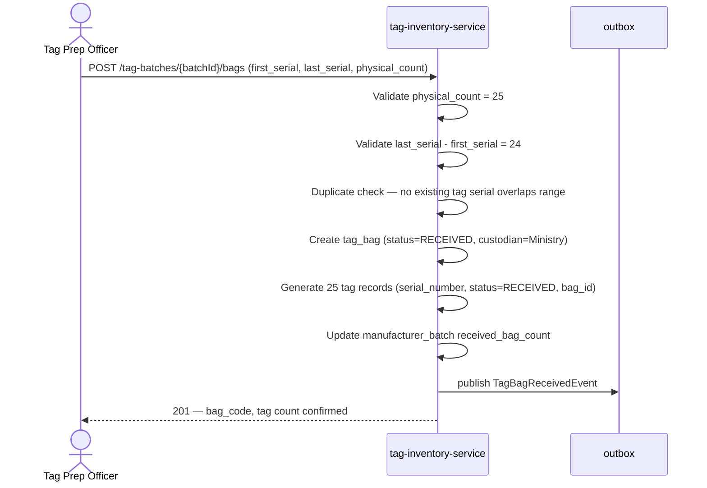
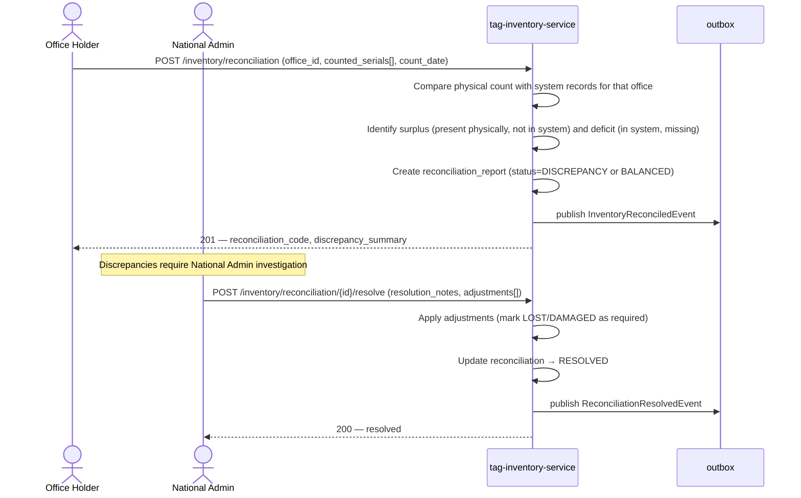
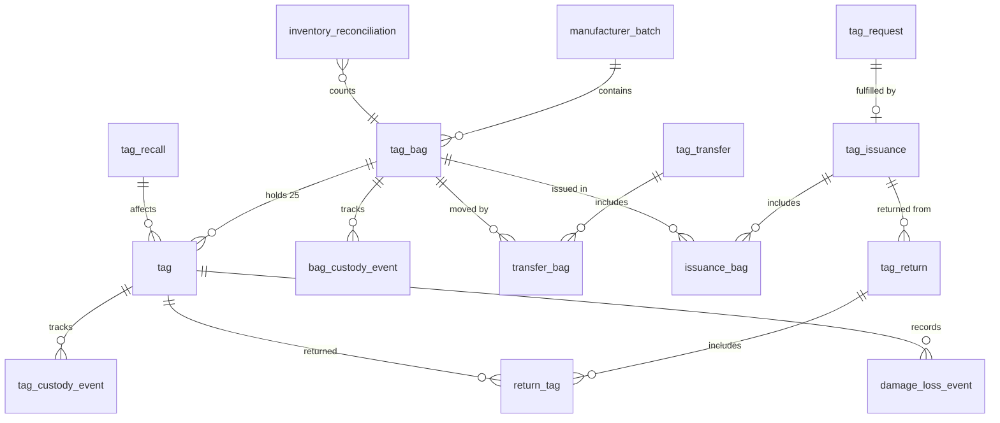

# Tag Inventory and Distribution — Module Specification

**Module:** tag-inventory-service  
**Version:** 0.1 — Draft for Review  
**Date:** 2026-07-19  
**Phase:** Step 1 — Business Requirements and Workflow Documentation  
**Status:** Pending Review

---

## 1. Objective

The Tag Inventory and Distribution module manages the complete lifecycle of livestock
identification tags from manufacturer delivery through custody transfer, farmer issuance,
owner acknowledgement, return, damage, loss, recall, and retirement. The module is the
single source of truth for the location, custodian, and status of every tag and every bag
of tags at all times. It does not assign tags to individual animals — that responsibility
belongs to the animal-registry-service.

---

## 2. Scope

**In scope:**
- Manufacturer batch registration and bag-level receiving
- Serial-number validation (range check, duplicate detection, gap detection)
- Generation of exactly 25 individual tag records per bag after validation
- Bag and tag custody history at every transfer step
- Transfers: Ministry → Regional Office → District Office
- Farmer tag requests and approval workflows
- Atomic reservation of complete bags against a request
- Physical issuance to owner and digital acknowledgement
- Return of unused tags to district inventory
- Damaged-stock and lost-stock recording
- Periodic inventory reconciliation
- Tag recall (safety/quality/counterfeiting) across any custody level
- Audit inspection (read-only)
- Domain event publication for downstream services

**Out of scope:**
- Tag-to-animal assignment — animal-registry-service
- Tag manufacturing quality control — external manufacturer process
- Physical printing or encoding of tag chips — external manufacturing process
- Financial charges for tags — owner-billing-service (future)
- Import customs clearance — external government process; SOMLITS records receipt only

---

## 3. Actors

| Actor | Role Code | Responsibilities |
|---|---|---|
| National Tag Administrator | `NATIONAL_ADMIN` | Register manufacturer batches; manage national inventory; initiate recalls |
| Tag Preparation Officer | `TAG_PREP_OFFICER` | Receive bags; inspect serials; prepare bags for issuance; report damage |
| Regional Administrator | `REGIONAL_ADMIN` | Accept transfers; manage regional stock; initiate regional-to-district transfers |
| District Administrator | `DISTRICT_ADMIN` | Accept transfers; manage district stock; approve farmer requests; issue tags |
| Field Supervisor | `FIELD_SUPERVISOR` | Submit tag requests on behalf of farmers; assist with acknowledgement |
| Livestock Owner / Owner Admin | `LIVESTOCK_OWNER`, `OWNER_ADMIN` | Submit tag requests; acknowledge receipt; report returns, damage, loss |
| Auditor | `AUDITOR` | Read-only access to all inventory records and custody history |
| Manufacturer (external system) | — | Supplies bags with pre-printed serial ranges; provides batch manifests |

---

## 4. Preconditions

| Precondition | Details |
|---|---|
| Ministry receiving office is registered | Represented as a NATIONAL-scope office entity with a UUID |
| Regional and district offices are registered | Each office has a UUID and territory scope in the system |
| Farmer is ACTIVE in identity-access-service | Owner ID is resolvable before a request is submitted |
| Tag serial format agreed with manufacturer | Serials are numeric strings, zero-padded, agreed length; Ministry records format version |
| At least one approved manufacturer batch exists | Before bags can be received, the batch metadata must be registered |
| Sufficient stock at issuing office | Enough complete reserved bags must exist before issuance |

---

## 5. Main Workflows

### 5.1 Manufacturer Batch Registration

A Ministry officer registers the expected delivery from a manufacturer.

```mermaid
sequenceDiagram
    actor NA as National Admin
    participant SYS as tag-inventory-service
    participant OB as outbox

    NA->>SYS: POST /tag-batches (manufacturer, date, bag_count, serial_format)
    SYS->>SYS: Validate: bag_count > 0; serial format recognised
    SYS->>SYS: Create manufacturer_batch (status=EXPECTED)
    SYS->>OB: publish BatchRegisteredEvent
    SYS-->>NA: 201 — batch_code returned
```

### 5.2 Tag-Bag Receiving

A Tag Preparation Officer physically receives bags and records each one.



### 5.3 Central-to-Regional Transfer

Ministry transfers a set of bags to a Regional Office.

```mermaid
sequenceDiagram
    actor NA as National Admin
    actor RA as Regional Admin
    participant SYS as tag-inventory-service
    participant OB as outbox

    NA->>SYS: POST /tag-transfers (from=MINISTRY, to=REGIONAL_OFFICE:{id}, bag_ids[])
    SYS->>SYS: Validate: all bags IN_STOCK at Ministry; no bag IN_TRANSFER or RESERVED
    SYS->>SYS: Create tag_transfer (status=IN_TRANSIT)
    SYS->>SYS: Update each bag status → IN_TRANSFER; record custody event
    SYS->>OB: publish TagTransferInitiatedEvent
    SYS-->>NA: 201 — transfer_code

    RA->>SYS: POST /tag-transfers/{id}/receive (received_bag_codes[], discrepancy_notes?)
    SYS->>SYS: Validate: transfer IN_TRANSIT; receiver is correct office
    SYS->>SYS: Update each bag → IN_STOCK; custodian = Regional Office
    SYS->>SYS: Update each tag custodian
    SYS->>SYS: Close transfer (status=COMPLETED)
    SYS->>OB: publish TagTransferReceivedEvent
    SYS-->>RA: 200 — confirmed
```

### 5.4 Regional-to-District Transfer

Same as 5.3 with from=REGIONAL_OFFICE, to=DISTRICT_OFFICE. Authority check: Regional Admin
may only transfer bags held at their own regional office to a district within their region.

### 5.5 Farmer Tag Request and Approval

```mermaid
sequenceDiagram
    actor LO as Livestock Owner
    actor DA as District Admin
    actor TPO as Tag Prep Officer
    participant SYS as tag-inventory-service
    participant OB as outbox

    LO->>SYS: POST /tag-requests (owner_id, district_id, requested_count, justification)
    SYS->>SYS: Validate: owner ACTIVE; district exists; count > 0
    SYS->>SYS: Create tag_request (status=PENDING)
    SYS->>OB: publish TagRequestSubmittedEvent
    SYS-->>LO: 201 — request_code

    DA->>SYS: POST /tag-requests/{id}/approve (approved_count, notes)
    SYS->>SYS: Validate: DA authority over district; request PENDING
    SYS->>SYS: Atomically reserve N complete bags from district inventory
    SYS->>SYS: Update request (status=APPROVED; reserved_bag_ids[])
    SYS->>SYS: Update each bag (status=RESERVED; reservation_ref=request_id)
    SYS->>OB: publish TagRequestApprovedEvent
    SYS->>OB: publish TagPreparationRequiredEvent  [→ TAG_PREP_OFFICER notification]
    SYS-->>DA: 200 — reserved bag codes

    Note over TPO: TAG_PREP_OFFICER notified via TagPreparationRequiredEvent
```

### 5.6 Tag Issuance to Owner

```mermaid
sequenceDiagram
    actor TPO as Tag Prep Officer / District Admin
    actor LO as Livestock Owner
    participant SYS as tag-inventory-service
    participant OB as outbox

    TPO->>SYS: POST /tag-issuances (request_id, bag_ids[], issued_by, notes)
    SYS->>SYS: Validate: bags RESERVED for this request; owner matches
    SYS->>SYS: Create tag_issuance (status=PENDING_ACKNOWLEDGEMENT)
    SYS->>SYS: Update bags → ISSUED_TO_OWNER; custodian = owner
    SYS->>SYS: Update tags → ISSUED_TO_OWNER; custodian = owner
    SYS->>OB: publish TagsIssuedEvent
    SYS-->>TPO: 201 — issuance_code

    LO->>SYS: POST /tag-issuances/{id}/acknowledge (received_bag_codes[], discrepancy_notes?)
    SYS->>SYS: Validate: issuance PENDING_ACKNOWLEDGEMENT; owner matches
    SYS->>SYS: Update issuance → ACKNOWLEDGED; acknowledged_at = now()
    SYS->>OB: publish TagsAcknowledgedEvent
    SYS-->>LO: 200 — acknowledged
```

### 5.7 Return of Unused Tags

```mermaid
sequenceDiagram
    actor LO as Livestock Owner
    actor DA as District Admin
    participant SYS as tag-inventory-service
    participant OB as outbox

    LO->>SYS: POST /tag-returns (issuance_id, returned_serials[], reason)
    SYS->>SYS: Validate: tags ISSUED_TO_OWNER, not ASSIGNED_TO_ANIMAL or LOST/DAMAGED
    SYS->>SYS: Create tag_return (status=PENDING_RECEIPT)
    SYS->>OB: publish TagReturnInitiatedEvent
    SYS-->>LO: 201 — return_code

    DA->>SYS: POST /tag-returns/{id}/receive (received_serials[], condition_notes)
    SYS->>SYS: Validate: return PENDING_RECEIPT
    SYS->>SYS: Update received tags → RETURNED; custodian = District Office
    SYS->>SYS: Update return → COMPLETED
    SYS->>OB: publish TagsReturnedEvent
    SYS-->>DA: 200 — confirmed
```

### 5.8 Damaged Stock

```mermaid
sequenceDiagram
    actor ANY as Any Custodian
    participant SYS as tag-inventory-service
    participant OB as outbox

    ANY->>SYS: POST /tags/{serial}/report-damaged (reason, photo_reference?)
    SYS->>SYS: Validate: reporter is current custodian of tag
    SYS->>SYS: Update tag → DAMAGED; record damage_event
    SYS->>OB: publish TagDamagedEvent
    SYS-->>ANY: 200 — recorded

    Note over SYS: If entire bag is damaged, bag status → DAMAGED
```

### 5.9 Lost Stock

Same pattern as 5.8. Reporter must be current custodian. Tag status → LOST.
A LOST tag cannot be re-issued. National Admin may mark as CANCELLED after investigation.

### 5.10 Inventory Reconciliation



### 5.11 Tag Recall

```mermaid
sequenceDiagram
    actor NA as National Admin
    participant SYS as tag-inventory-service
    participant OB as outbox

    NA->>SYS: POST /tag-recalls (serial_from, serial_to, reason, urgency)
    SYS->>SYS: Validate serial range; identify all affected tags
    SYS->>SYS: Create tag_recall record
    SYS->>SYS: Mark all affected IN_STOCK/RESERVED tags → RECALLED immediately
    SYS->>OB: publish TagRecallInitiatedEvent (includes owner_ids for issued tags)
    SYS-->>NA: 201 — recall_code, affected_count, issued_to_owners_count

    Note over SYS: identity-access-service and notification-service handle owner SMS/notification
    Note over SYS: Tags already ASSIGNED_TO_ANIMAL are flagged; animal-registry-service handles tag replacement
```

### 5.12 Audit Inspection

Auditor can query any inventory record, custody chain, or reconciliation report with no
state changes. All read endpoints are accessible to `AUDITOR` role.

---

## 6. Alternative Workflows

### 6.1 Partial Transfer Discrepancy

If the receiving office finds fewer bags than the transfer manifest:

1. Receiver records `POST /tag-transfers/{id}/receive` with only the bags physically received.
2. System marks remaining bags as `TRANSFER_DISCREPANCY`; transfer status = `PARTIALLY_RECEIVED`.
3. National Admin investigates and resolves (reclassify as LOST or schedule follow-up transfer).

### 6.2 Bag Count Mismatch at Receiving

If physical bag count ≠ `physical_count` parameter:

1. System rejects the receive request with validation error.
2. Officer re-counts and resubmits with correct count.
3. If manufacturer error confirmed: batch discrepancy report created; manufacturer notified.

### 6.3 Field Supervisor Requesting on Behalf of Owner

A FIELD_SUPERVISOR may submit `POST /tag-requests` on behalf of an owner if the owner does
not have digital access. The `owner_id` in the request body must refer to an ACTIVE owner
that the field supervisor's district scope covers.

### 6.4 Emergency Issuance (District Out of Stock)

If district has insufficient bags:

1. District Admin submits `POST /tag-transfers` to request stock from Regional Office.
2. Regional Admin approves and initiates transfer.
3. Once received, normal approval and issuance flow proceeds.

### 6.5 Owner Refuses Acknowledgement (Dispute)

If owner disputes the bags received:

1. Owner submits `POST /tag-issuances/{id}/dispute (disputed_serials[], reason)`.
2. District Admin reviews and either corrects the issuance record or closes dispute.
3. Disputed tags remain `ISSUED_TO_OWNER` until resolved.

---

## 7. Exception Workflows

### 7.1 Duplicate Serial Detected

On `POST /tag-batches/{batchId}/bags`:

- System detects overlap with existing tag serial range.
- Request rejected with `409 CONFLICT` listing the overlapping serials.
- Tag Prep Officer escalates to manufacturer.
- No bag or tag records are created.

### 7.2 Serial Range Not Exactly 25

- `last_serial - first_serial ≠ 24`: rejected with `422 UNPROCESSABLE_ENTITY`.
- Manufacturer batch remains EXPECTED; no bag record created.

### 7.3 Bag Already Issued (Re-issue Attempt)

- System detects bag status is not `IN_STOCK` or `RESERVED`.
- Request rejected with `409 CONFLICT`.
- Incident logged with requestor identity for audit.

### 7.4 Recall of Already-Assigned Tags

- Tags in `ASSIGNED_TO_ANIMAL` status are flagged in the recall record with `recall_action_required = true`.
- Domain event `TagRecallWithAnimalImpactEvent` emitted — consumed by animal-registry-service to trigger tag-replacement workflow.
- SOMLITS does not force-change the tag status without the animal replacement process completing.

### 7.5 Non-Numeric Serial Format

- If the manufacturer uses non-numeric serials, range-arithmetic validation is not possible.
- System falls back to manifest validation: manufacturer provides explicit list of 25 serials per bag.
- This mode must be configured at the batch level (`serial_validation_mode: RANGE | MANIFEST`).
- Manifest mode is subject to Ministry approval.

---

## 8. Status Lifecycle

### 8.1 Tag Status

```mermaid
stateDiagram-v2
    [*] --> MANUFACTURED : Batch registered (tag not yet physically received)
    MANUFACTURED --> RECEIVED : Bag received and validated by TAG_PREP_OFFICER
    RECEIVED --> IN_STOCK : Bag checked into office inventory
    IN_STOCK --> IN_TRANSFER : Transfer initiated
    IN_TRANSFER --> IN_STOCK : Transfer received at destination
    IN_STOCK --> RESERVED : Atomically reserved for approved request
    RESERVED --> ISSUED_TO_OWNER : Issued and pending acknowledgement
    ISSUED_TO_OWNER --> ASSIGNED_TO_ANIMAL : animal-registry-service sets this (event-driven)
    ISSUED_TO_OWNER --> RETURNED : Owner returns unused tag
    RETURNED --> IN_STOCK : Returned tag re-enters district inventory
    IN_STOCK --> DAMAGED : Reported damaged (pre-issuance)
    ISSUED_TO_OWNER --> DAMAGED : Reported damaged (post-issuance)
    ASSIGNED_TO_ANIMAL --> DAMAGED : Damaged in field
    IN_STOCK --> LOST : Reported lost (pre-issuance)
    ISSUED_TO_OWNER --> LOST : Reported lost (post-issuance)
    ASSIGNED_TO_ANIMAL --> REPLACED : Replaced on animal (animal-registry triggers)
    IN_STOCK --> RECALLED : Recall covers serial; auto-applied
    RESERVED --> RECALLED : Recall covers serial; reservation cancelled
    ISSUED_TO_OWNER --> RECALLED : Recall; owner notified to return
    ASSIGNED_TO_ANIMAL --> RECALLED : Recall; animal-registry action required
    RECALLED --> RETURNED : Owner returns recalled tag
    DAMAGED --> CANCELLED : Written off by National Admin
    LOST --> CANCELLED : Written off after investigation
    RECALLED --> CANCELLED : Recalled and destroyed
    ASSIGNED_TO_ANIMAL --> RETIRED : Animal died/exported; tag lifecycle ended
    REPLACED --> RETIRED : Replaced tag retired
```

### 8.2 Tag Bag Status

```mermaid
stateDiagram-v2
    [*] --> MANUFACTURED : Batch registered
    MANUFACTURED --> RECEIVED : Physical receipt recorded
    RECEIVED --> IN_STOCK : Checked into inventory
    IN_STOCK --> IN_TRANSFER : Transfer initiated
    IN_TRANSFER --> IN_STOCK : Transfer completed
    IN_STOCK --> RESERVED : All tags reserved for request
    RESERVED --> ISSUED : All tags issued to owner
    ISSUED --> PARTIALLY_RETURNED : Some tags returned
    ISSUED --> FULLY_RETURNED : All tags returned
    PARTIALLY_RETURNED --> FULLY_RETURNED : Remaining returned
    IN_STOCK --> RECALLED : Recall covers all serials
    RESERVED --> RECALLED : Recall cancels reservation
    ISSUED --> RECALLED : Recall; bags must be returned
    IN_STOCK --> DAMAGED : Entire bag damaged
    DAMAGED --> CANCELLED : Written off
    RECALLED --> CANCELLED : Destroyed after recall
```



### 8.3 Transfer Status

| Status | Meaning |
|---|---|
| `INITIATED` | Transfer record created; bags marked IN_TRANSFER |
| `IN_TRANSIT` | Physically in transit |
| `PARTIALLY_RECEIVED` | Discrepancy; some bags received |
| `COMPLETED` | All bags confirmed at destination |
| `CANCELLED` | Cancelled before physical movement |

### 8.4 Tag Request Status

| Status | Meaning |
|---|---|
| `PENDING` | Submitted; awaiting approval |
| `APPROVED` | Approved; bags atomically reserved |
| `REJECTED` | Rejected by admin |
| `ISSUED` | Tags physically issued |
| `CANCELLED` | Withdrawn by owner or admin |

### 8.5 Recall Status

| Status | Meaning |
|---|---|
| `ACTIVE` | Recall in effect; affected tags flagged |
| `PARTIALLY_RESOLVED` | Some tags returned/cancelled; others outstanding |
| `RESOLVED` | All affected tags accounted for |
| `CANCELLED` | Recall withdrawn (e.g., false alarm) |

---

## 9. Business Rules

| Code | Rule |
|---|---|
| BR-TAG-001 | Each bag contains exactly 25 tags. Any other count is a validation failure. |
| BR-TAG-002 | `last_serial - first_serial` must equal exactly 24 in RANGE validation mode. |
| BR-TAG-003 | No serial number may exist in more than one tag record. Duplicates are rejected at the bag-receive step. |
| BR-TAG-004 | Serial numbers within a batch must form a contiguous range. Gaps indicate a counting or manufacture error. |
| BR-TAG-005 | Bags must be reserved and issued as complete units of 25. No partial-bag issuance. |
| BR-TAG-006 | Reservation of bags is atomic: all bags in a request are reserved in one transaction or none are. |
| BR-TAG-007 | A bag in `RESERVED` status cannot be transferred or re-reserved. |
| BR-TAG-008 | A bag in `IN_TRANSFER` status cannot be reserved, issued, or re-transferred. |
| BR-TAG-009 | Only the current custodian of a bag or tag may initiate a transfer, issue, return, or damage/loss report. |
| BR-TAG-010 | An owner may only acknowledge issuances where they are the named owner on the issuance record. |
| BR-TAG-011 | A `LOST` or `DAMAGED` tag cannot be re-issued. It must be written off (`CANCELLED`) by National Admin. |
| BR-TAG-012 | A `RETURNED` tag enters the issuing office's inventory and may be re-issued in a new request. |
| BR-TAG-013 | A tag in `ASSIGNED_TO_ANIMAL` status cannot be returned directly. It must go through the tag-replacement workflow in animal-registry-service first. |
| BR-TAG-014 | A recall automatically marks all `IN_STOCK` and `RESERVED` tags in the serial range as `RECALLED`. `ISSUED_TO_OWNER` and `ASSIGNED_TO_ANIMAL` tags are flagged but require owner/officer action. |
| BR-TAG-015 | Inventory reconciliation must be performed at least annually per office. The system enforces this by flagging overdue reconciliations. |
| BR-TAG-016 | The system must always be able to produce a custody chain from manufacturer through to current holder for any tag serial. |
| BR-TAG-017 | All serial numbers are treated as strings and compared case-insensitively. Leading zeros are significant. |
| BR-TAG-018 | An approved manufacturer batch must exist before bags in that batch can be received. |
| BR-TAG-019 | Transfers may only flow downward in the hierarchy (Ministry → Regional → District) or upward as returns. Cross-regional and cross-district transfers require National Admin authority. |
| BR-TAG-020 | A rejected tag request may be resubmitted. Each submission creates a new request record. |

---

## 10. Authorization Matrix

| Operation | NATIONAL_ADMIN | TAG_PREP_OFFICER | REGIONAL_ADMIN | DISTRICT_ADMIN | FIELD_SUPERVISOR | LIVESTOCK_OWNER | AUDITOR |
|---|:---:|:---:|:---:|:---:|:---:|:---:|:---:|
| Register manufacturer batch | ✓ | — | — | — | — | — | — |
| Receive tag bag | ✓ | ✓ | — | — | — | — | — |
| View batch / bag details | ✓ | ✓ | Own region | Own district | Own district | Own issuances | ✓ |
| Initiate Ministry→Regional transfer | ✓ | — | — | — | — | — | — |
| Receive Ministry→Regional transfer | ✓ | — | Own region | — | — | — | — |
| Initiate Regional→District transfer | ✓ | — | Own region | — | — | — | — |
| Receive Regional→District transfer | ✓ | — | — | Own district | — | — | — |
| Submit tag request | ✓ | — | — | ✓ | ✓ (for owner) | ✓ | — |
| Approve tag request | ✓ | — | Own region | Own district | — | — | — |
| Reject tag request | ✓ | — | Own region | Own district | — | — | — |
| Reserve bags (system action on approval) | System | — | — | — | — | — | — |
| Issue tags to owner | ✓ | ✓ | — | ✓ | — | — | — |
| Acknowledge issuance | ✓ | — | — | — | ✓ (assisting) | ✓ (own) | — |
| Report tag damaged | ✓ | ✓ | — | ✓ | ✓ (as custodian) | ✓ (as custodian) | — |
| Report tag lost | ✓ | ✓ | — | ✓ | ✓ (as custodian) | ✓ (as custodian) | — |
| Initiate return | ✓ | — | — | — | — | ✓ (own) | — |
| Receive returned tags | ✓ | ✓ | — | ✓ | — | — | — |
| Initiate recall | ✓ | — | — | — | — | — | — |
| Submit reconciliation | ✓ | ✓ | Own region | Own district | — | — | — |
| Resolve reconciliation discrepancy | ✓ | — | — | — | — | — | — |
| Write off LOST/DAMAGED tag | ✓ | — | — | — | — | — | — |
| View custody chain | ✓ | ✓ | Own region | Own district | Own district | Own tags | ✓ |
| View all inventory | ✓ | — | Own region | Own district | Own district | Own tags | ✓ |

---

## 11. Data Entities

### 11.1 manufacturer_batch

| Column | Type | Notes |
|---|---|---|
| `id` | UUID PK | |
| `batch_code` | VARCHAR(30) UNIQUE | Human-readable, e.g. `BATCH-20260701-001` |
| `manufacturer_name` | VARCHAR(150) NOT NULL | |
| `manufacturer_country` | CHAR(2) NOT NULL | ISO 3166-1 alpha-2 |
| `manufactured_date` | DATE NOT NULL | |
| `expected_bag_count` | INT NOT NULL | |
| `received_bag_count` | INT NOT NULL DEFAULT 0 | |
| `serial_format` | VARCHAR(30) NOT NULL | e.g. `NUMERIC_10` |
| `serial_validation_mode` | VARCHAR(20) NOT NULL | `RANGE` or `MANIFEST` |
| `status` | VARCHAR(30) NOT NULL | `EXPECTED`, `PARTIALLY_RECEIVED`, `FULLY_RECEIVED`, `CLOSED` |
| `registered_by` | UUID NOT NULL | User ID |
| `registered_at` | TIMESTAMPTZ NOT NULL | |
| `notes` | TEXT | |

### 11.2 tag_bag

| Column | Type | Notes |
|---|---|---|
| `id` | UUID PK | |
| `bag_code` | VARCHAR(30) UNIQUE | e.g. `BAG-2026-000001` |
| `batch_id` | UUID FK → manufacturer_batch | |
| `first_serial` | VARCHAR(50) NOT NULL | As printed on bag |
| `last_serial` | VARCHAR(50) NOT NULL | As printed on bag |
| `tag_count` | INT NOT NULL | Always 25 |
| `status` | VARCHAR(30) NOT NULL | See §8.2 |
| `current_custodian_type` | VARCHAR(30) NOT NULL | `MINISTRY`, `REGIONAL_OFFICE`, `DISTRICT_OFFICE`, `OWNER` |
| `current_custodian_id` | UUID NOT NULL | Office UUID or owner UUID |
| `received_by` | UUID | TAG_PREP_OFFICER who received |
| `received_at` | TIMESTAMPTZ | |
| `issued_to_owner_id` | UUID FK → user_account | Set at issuance |
| `issued_at` | TIMESTAMPTZ | |
| `acknowledged_at` | TIMESTAMPTZ | |
| `version` | INT NOT NULL DEFAULT 0 | Optimistic lock |
| `created_at` | TIMESTAMPTZ NOT NULL | |
| `updated_at` | TIMESTAMPTZ NOT NULL | |

### 11.3 tag

| Column | Type | Notes |
|---|---|---|
| `id` | UUID PK | |
| `serial_number` | VARCHAR(50) UNIQUE NOT NULL | |
| `bag_id` | UUID FK → tag_bag NOT NULL | |
| `status` | VARCHAR(30) NOT NULL | See §8.1 |
| `current_custodian_type` | VARCHAR(30) NOT NULL | Same as bag initially; diverges after partial return etc. |
| `current_custodian_id` | UUID NOT NULL | |
| `owner_id` | UUID | Set at issuance; cleared on full return |
| `animal_id` | UUID | Set by animal-registry-service via event; not set by this service |
| `recall_id` | UUID FK → tag_recall | Populated if tag is recalled |
| `version` | INT NOT NULL DEFAULT 0 | |
| `created_at` | TIMESTAMPTZ NOT NULL | |
| `updated_at` | TIMESTAMPTZ NOT NULL | |

### 11.4 bag_custody_event

| Column | Type | Notes |
|---|---|---|
| `id` | UUID PK | |
| `bag_id` | UUID FK → tag_bag NOT NULL | |
| `event_type` | VARCHAR(50) NOT NULL | `RECEIVED`, `TRANSFER_OUT`, `TRANSFER_IN`, `RESERVED`, `ISSUED`, `ACKNOWLEDGED`, `RETURNED`, `DAMAGED`, `LOST`, `RECALLED`, `CANCELLED` |
| `from_custodian_type` | VARCHAR(30) | |
| `from_custodian_id` | UUID | |
| `to_custodian_type` | VARCHAR(30) | |
| `to_custodian_id` | UUID | |
| `reference_id` | UUID | Transfer ID, issuance ID, request ID etc. |
| `reference_type` | VARCHAR(30) | `TRANSFER`, `ISSUANCE`, `RETURN`, `RECALL` etc. |
| `notes` | TEXT | |
| `recorded_by` | UUID NOT NULL | |
| `occurred_at` | TIMESTAMPTZ NOT NULL | |

### 11.5 tag_custody_event

Same structure as `bag_custody_event` but references an individual `tag_id`. Created when a
tag's status or custodian changes independently from the bag (e.g., a single tag is reported
damaged while the rest of the bag is still in stock).

### 11.6 tag_transfer

| Column | Type | Notes |
|---|---|---|
| `id` | UUID PK | |
| `transfer_code` | VARCHAR(30) UNIQUE | e.g. `TRF-20260701-001` |
| `from_custodian_type` | VARCHAR(30) NOT NULL | |
| `from_custodian_id` | UUID NOT NULL | |
| `to_custodian_type` | VARCHAR(30) NOT NULL | |
| `to_custodian_id` | UUID NOT NULL | |
| `status` | VARCHAR(30) NOT NULL | See §8.3 |
| `bag_count` | INT NOT NULL | |
| `initiated_by` | UUID NOT NULL | |
| `initiated_at` | TIMESTAMPTZ NOT NULL | |
| `received_by` | UUID | |
| `received_at` | TIMESTAMPTZ | |
| `notes` | TEXT | |
| `idempotency_key` | UUID UNIQUE NOT NULL | |

### 11.7 transfer_bag (join table)

| Column | Type | Notes |
|---|---|---|
| `transfer_id` | UUID FK → tag_transfer | |
| `bag_id` | UUID FK → tag_bag | |
| `received` | BOOLEAN NOT NULL DEFAULT false | |
| `discrepancy_note` | TEXT | |
| PK | `(transfer_id, bag_id)` | |

### 11.8 tag_request

| Column | Type | Notes |
|---|---|---|
| `id` | UUID PK | |
| `request_code` | VARCHAR(30) UNIQUE | e.g. `REQ-20260701-001` |
| `owner_id` | UUID NOT NULL | FK → user_account |
| `district_id` | UUID NOT NULL | District office UUID |
| `requested_bag_count` | INT NOT NULL | Derived from tag count / 25 |
| `approved_bag_count` | INT | Set on approval |
| `status` | VARCHAR(30) NOT NULL | See §8.4 |
| `justification` | TEXT | |
| `submitted_by` | UUID NOT NULL | Owner or field supervisor |
| `submitted_at` | TIMESTAMPTZ NOT NULL | |
| `reviewed_by` | UUID | |
| `reviewed_at` | TIMESTAMPTZ | |
| `rejection_reason` | TEXT | |
| `idempotency_key` | UUID UNIQUE NOT NULL | |
| `version` | INT NOT NULL DEFAULT 0 | |

### 11.9 tag_issuance

| Column | Type | Notes |
|---|---|---|
| `id` | UUID PK | |
| `issuance_code` | VARCHAR(30) UNIQUE | |
| `request_id` | UUID FK → tag_request NOT NULL | |
| `owner_id` | UUID NOT NULL | |
| `issued_by` | UUID NOT NULL | |
| `issued_at` | TIMESTAMPTZ NOT NULL | |
| `status` | VARCHAR(30) NOT NULL | `PENDING_ACKNOWLEDGEMENT`, `ACKNOWLEDGED`, `DISPUTED`, `CANCELLED` |
| `acknowledged_by` | UUID | |
| `acknowledged_at` | TIMESTAMPTZ | |
| `notes` | TEXT | |

### 11.10 issuance_bag (join table)

| Column | Type | Notes |
|---|---|---|
| `issuance_id` | UUID FK → tag_issuance | |
| `bag_id` | UUID FK → tag_bag | |
| PK | `(issuance_id, bag_id)` | |

### 11.11 tag_return

| Column | Type | Notes |
|---|---|---|
| `id` | UUID PK | |
| `return_code` | VARCHAR(30) UNIQUE | |
| `issuance_id` | UUID FK → tag_issuance NOT NULL | |
| `owner_id` | UUID NOT NULL | |
| `status` | VARCHAR(30) NOT NULL | `PENDING_RECEIPT`, `COMPLETED`, `DISPUTED` |
| `reason` | TEXT | |
| `initiated_by` | UUID NOT NULL | |
| `initiated_at` | TIMESTAMPTZ NOT NULL | |
| `received_by` | UUID | |
| `received_at` | TIMESTAMPTZ | |
| `condition_notes` | TEXT | |

### 11.12 return_tag (join table)

| Column | Type | Notes |
|---|---|---|
| `return_id` | UUID FK → tag_return | |
| `tag_id` | UUID FK → tag | |
| `received` | BOOLEAN NOT NULL DEFAULT false | |
| PK | `(return_id, tag_id)` | |

### 11.13 damage_loss_event

| Column | Type | Notes |
|---|---|---|
| `id` | UUID PK | |
| `tag_id` | UUID FK → tag NOT NULL | |
| `event_type` | VARCHAR(10) NOT NULL | `DAMAGED` or `LOST` |
| `reason` | TEXT NOT NULL | |
| `photo_reference` | VARCHAR(500) | Azure Blob Storage URL |
| `reported_by` | UUID NOT NULL | |
| `reported_at` | TIMESTAMPTZ NOT NULL | |
| `written_off_by` | UUID | National Admin who approved write-off |
| `written_off_at` | TIMESTAMPTZ | |

### 11.14 tag_recall

| Column | Type | Notes |
|---|---|---|
| `id` | UUID PK | |
| `recall_code` | VARCHAR(30) UNIQUE | |
| `serial_from` | VARCHAR(50) NOT NULL | |
| `serial_to` | VARCHAR(50) NOT NULL | |
| `reason` | TEXT NOT NULL | |
| `urgency` | VARCHAR(20) NOT NULL | `ROUTINE`, `URGENT`, `EMERGENCY` |
| `status` | VARCHAR(30) NOT NULL | See §8.5 |
| `affected_tag_count` | INT NOT NULL | |
| `resolved_tag_count` | INT NOT NULL DEFAULT 0 | |
| `initiated_by` | UUID NOT NULL | |
| `initiated_at` | TIMESTAMPTZ NOT NULL | |
| `resolved_at` | TIMESTAMPTZ | |

### 11.15 inventory_reconciliation

| Column | Type | Notes |
|---|---|---|
| `id` | UUID PK | |
| `reconciliation_code` | VARCHAR(30) UNIQUE | |
| `office_type` | VARCHAR(30) NOT NULL | |
| `office_id` | UUID NOT NULL | |
| `count_date` | DATE NOT NULL | |
| `system_count` | INT NOT NULL | Tags system expects at this office |
| `physical_count` | INT NOT NULL | Tags physically counted |
| `surplus_count` | INT NOT NULL DEFAULT 0 | |
| `deficit_count` | INT NOT NULL DEFAULT 0 | |
| `status` | VARCHAR(30) NOT NULL | `BALANCED`, `DISCREPANCY`, `RESOLVED` |
| `submitted_by` | UUID NOT NULL | |
| `submitted_at` | TIMESTAMPTZ NOT NULL | |
| `resolved_by` | UUID | |
| `resolved_at` | TIMESTAMPTZ | |
| `resolution_notes` | TEXT | |

---

## 12. Entity Relationships



---

## 13. API Contracts

### 13.1 Manufacturer Batch

```
POST   /internal/v1/tag-batches                        Register batch
GET    /internal/v1/tag-batches                        List batches (paginated)
GET    /internal/v1/tag-batches/{id}                   Get batch detail
```

**POST /internal/v1/tag-batches request:**
```json
{
  "manufacturerName": "string",
  "manufacturerCountry": "string (ISO-3166-1 alpha-2)",
  "manufacturedDate": "date",
  "expectedBagCount": 100,
  "serialFormat": "NUMERIC_10",
  "serialValidationMode": "RANGE",
  "notes": "string?"
}
```

**Response 201:**
```json
{
  "id": "uuid",
  "batchCode": "BATCH-20260701-001",
  "status": "EXPECTED"
}
```

### 13.2 Tag Bag Receiving

```
POST   /internal/v1/tag-batches/{batchId}/bags         Receive a bag
GET    /internal/v1/tag-bags                           List bags (filterable by status, custodian, batch)
GET    /internal/v1/tag-bags/{id}                      Get bag detail
GET    /internal/v1/tag-bags/{id}/tags                 List 25 tags in bag
GET    /internal/v1/tag-bags/{id}/custody-history      Full custody chain for bag
```

**POST /internal/v1/tag-batches/{batchId}/bags request:**
```json
{
  "firstSerial": "0000000001",
  "lastSerial": "0000000025",
  "physicalCount": 25,
  "idempotencyKey": "uuid",
  "notes": "string?"
}
```

**Response 201:**
```json
{
  "id": "uuid",
  "bagCode": "BAG-2026-000001",
  "firstSerial": "0000000001",
  "lastSerial": "0000000025",
  "tagCount": 25,
  "status": "RECEIVED",
  "custodian": { "type": "MINISTRY", "id": "uuid" }
}
```

### 13.3 Tags

```
GET    /internal/v1/tags/{serial}                      Get tag by serial number
GET    /internal/v1/tags/{serial}/custody-history      Full custody chain for tag
GET    /internal/v1/tags                               Search tags (serial, status, custodian, owner)
```

### 13.4 Transfers

```
POST   /internal/v1/tag-transfers                      Initiate transfer
GET    /internal/v1/tag-transfers/{id}                 Get transfer
POST   /internal/v1/tag-transfers/{id}/receive         Confirm receipt (with bag-level confirmation)
POST   /internal/v1/tag-transfers/{id}/cancel          Cancel before physical movement
```

**POST /internal/v1/tag-transfers request:**
```json
{
  "fromCustodianType": "MINISTRY",
  "fromCustodianId": "uuid",
  "toCustodianType": "REGIONAL_OFFICE",
  "toCustodianId": "uuid",
  "bagIds": ["uuid", "uuid"],
  "idempotencyKey": "uuid",
  "notes": "string?"
}
```

### 13.5 Tag Requests

```
POST   /internal/v1/tag-requests                       Submit request
GET    /internal/v1/tag-requests/{id}                  Get request
POST   /internal/v1/tag-requests/{id}/approve          Approve and atomically reserve bags
POST   /internal/v1/tag-requests/{id}/reject           Reject with reason
POST   /internal/v1/tag-requests/{id}/cancel           Cancel (owner or admin)
```

**POST /internal/v1/tag-requests request:**
```json
{
  "ownerId": "uuid",
  "districtId": "uuid",
  "requestedTagCount": 25,
  "justification": "string",
  "idempotencyKey": "uuid"
}
```

**POST /internal/v1/tag-requests/{id}/approve request:**
```json
{
  "approvedBagCount": 1,
  "notes": "string?"
}
```

### 13.6 Issuances

```
POST   /internal/v1/tag-issuances                      Issue tags to owner
GET    /internal/v1/tag-issuances/{id}                 Get issuance
POST   /internal/v1/tag-issuances/{id}/acknowledge     Owner acknowledges receipt
POST   /internal/v1/tag-issuances/{id}/dispute         Owner disputes bags received
```

### 13.7 Returns

```
POST   /internal/v1/tag-returns                        Initiate return
GET    /internal/v1/tag-returns/{id}                   Get return
POST   /internal/v1/tag-returns/{id}/receive           Office confirms return receipt
```

### 13.8 Damage and Loss

```
POST   /internal/v1/tags/{serial}/report-damaged       Report single tag damaged
POST   /internal/v1/tags/{serial}/report-lost          Report single tag lost
POST   /internal/v1/tags/{serial}/write-off            National Admin writes off LOST/DAMAGED
```

### 13.9 Recalls

```
POST   /internal/v1/tag-recalls                        Initiate recall
GET    /internal/v1/tag-recalls/{id}                   Get recall status and affected tags
POST   /internal/v1/tag-recalls/{id}/cancel            Cancel recall (false alarm)
POST   /internal/v1/tag-recalls/{id}/resolve           Mark recall resolved
```

### 13.10 Inventory

```
GET    /internal/v1/inventory/summary                  Stock summary by office (role-scoped)
GET    /internal/v1/inventory/office/{officeId}        Detailed stock for one office
POST   /internal/v1/inventory/reconciliation           Submit physical count
GET    /internal/v1/inventory/reconciliation/{id}      Get reconciliation report
POST   /internal/v1/inventory/reconciliation/{id}/resolve   Resolve discrepancy
```

### 13.11 Standard Error Response

All errors follow the same envelope:
```json
{
  "errorCode": "ERR-TAG-003",
  "message": "Serial range 0000000001–0000000025 overlaps with existing batch BAG-2026-000001",
  "timestamp": "2026-07-19T10:00:00Z",
  "correlationId": "uuid"
}
```

| Error Code | Condition |
|---|---|
| `ERR-TAG-001` | Bag count ≠ 25 |
| `ERR-TAG-002` | Serial range ≠ 24 gap |
| `ERR-TAG-003` | Duplicate serial detected |
| `ERR-TAG-004` | Bag not in required status for operation |
| `ERR-TAG-005` | Insufficient stock for reservation |
| `ERR-TAG-006` | Caller is not current custodian |
| `ERR-TAG-007` | Idempotency key conflict (duplicate request) |
| `ERR-TAG-008` | Transfer hierarchy violation |

---

## 14. Domain Events

All events are published via the outbox pattern to `somlits.tag-inventory` topic on Azure Service Bus.

| Event | Trigger | Key Payload Fields |
|---|---|---|
| `BatchRegisteredEvent` | Batch created | `batchId`, `batchCode`, `expectedBagCount` |
| `TagBagReceivedEvent` | Bag received and 25 tags generated | `bagId`, `bagCode`, `firstSerial`, `lastSerial`, `batchId` |
| `TagTransferInitiatedEvent` | Transfer created | `transferId`, `fromCustodian`, `toCustodian`, `bagCount` |
| `TagTransferReceivedEvent` | Transfer confirmed at destination | `transferId`, `receivedBagCount`, `discrepancyCount` |
| `TagTransferDiscrepancyEvent` | Transfer partially received | `transferId`, `missingBagIds[]` |
| `TagRequestSubmittedEvent` | Request created | `requestId`, `ownerId`, `districtId`, `requestedBagCount` |
| `TagRequestApprovedEvent` | Request approved + bags reserved | `requestId`, `ownerId`, `reservedBagIds[]` |
| `TagRequestRejectedEvent` | Request rejected | `requestId`, `ownerId`, `reason` |
| `TagPreparationRequiredEvent` | Bags reserved; prep team action needed | `requestId`, `districtId`, `reservedBagIds[]` |
| `TagsIssuedEvent` | Bags physically issued to owner | `issuanceId`, `ownerId`, `bagIds[]`, `serialRanges[]` |
| `TagsAcknowledgedEvent` | Owner confirmed receipt | `issuanceId`, `ownerId`, `acknowledgedAt` |
| `TagReturnInitiatedEvent` | Return submitted | `returnId`, `ownerId`, `serialCount` |
| `TagsReturnedEvent` | Return confirmed by office | `returnId`, `ownerId`, `returnedSerials[]` |
| `TagDamagedEvent` | Tag reported damaged | `tagId`, `serial`, `reportedBy`, `custodianType` |
| `TagLostEvent` | Tag reported lost | `tagId`, `serial`, `reportedBy`, `custodianType` |
| `TagWrittenOffEvent` | LOST/DAMAGED tag cancelled | `tagId`, `serial`, `writtenOffBy` |
| `TagRecallInitiatedEvent` | Recall created | `recallId`, `serialFrom`, `serialTo`, `urgency`, `issuedToOwnerIds[]` |
| `TagRecallWithAnimalImpactEvent` | Recalled tags include ASSIGNED_TO_ANIMAL | `recallId`, `animalTagPairs[{animalId, serial}]` |
| `InventoryReconciledEvent` | Reconciliation submitted | `reconciliationId`, `officeId`, `status`, `discrepancyCount` |
| `ReconciliationResolvedEvent` | Discrepancy resolved | `reconciliationId`, `officeId`, `resolvedBy` |

---

## 15. Notifications

| Trigger | Recipient | Channel | Message |
|---|---|---|---|
| `TagRequestSubmittedEvent` | District Admin (district) | In-app + SMS | "New tag request REQ-xxx from owner [name]" |
| `TagRequestApprovedEvent` | Livestock Owner | SMS | "Tag request approved. Tags will be issued at [district office]" |
| `TagRequestRejectedEvent` | Livestock Owner | SMS | "Tag request rejected: [reason]" |
| `TagPreparationRequiredEvent` | TAG_PREP_OFFICER (district) | In-app | "Prepare [N] bags for issuance to [owner name]. Request: REQ-xxx" |
| `TagsIssuedEvent` | Livestock Owner | SMS | "Tags issued. Please collect bags [codes] and confirm receipt" |
| `TagRecallInitiatedEvent` (URGENT/EMERGENCY) | All affected owners | SMS | "SOMLITS NOTICE: Tags [serial range] recalled. Please return to [district office]" |
| `TagRecallInitiatedEvent` (ROUTINE) | All affected owners | In-app | Standard recall notice |
| `InventoryReconciledEvent` (DISCREPANCY) | National Admin | In-app | "Discrepancy found at [office]: [N] deficit, [N] surplus" |

---

## 16. Audit Requirements

All state-changing operations must be recorded with `recorded_by` (user UUID),
`occurred_at` (UTC), and the previous and new status values. The following are
auditable events that must be queryable by serial number:

- Bag reception (who, when, batch)
- Every custody transfer (from → to, who initiated, who confirmed)
- Reservation (who approved, when)
- Issuance (who issued, when)
- Acknowledgement (who, when)
- Return (who, when, which serials)
- Damage or loss report (who, when, reason)
- Write-off (who, when)
- Recall flag (auto-applied, recall ID)
- Reconciliation entries

Retention: audit records are permanent. No physical deletion of any audit record.

---

## 17. UI Screens (tag-inventory-service frontend)

The tag inventory UI is part of the **Ministry Platform** and **Field Officer Platform** —
not the Farmer Platform. For Phase 7 the following screens are required:

### Ministry Platform (National Admin / TAG_PREP_OFFICER)
1. **Batch List** — table of manufacturer batches with status and received count
2. **Register Batch** — form: manufacturer, date, expected bag count, serial format
3. **Receive Bag** — form: select batch, enter first/last serial; auto-validates and generates 25 tags
4. **Bag Detail** — serial list of 25 tags; custody chain timeline
5. **Transfer Initiation** — select bags, destination office, submit
6. **Transfer List** — outbound and inbound transfers with status
7. **Inventory Summary** — stock counts by office with drill-down
8. **Recall Management** — initiate, view affected count, track resolution
9. **Reconciliation** — submit physical count; view discrepancy report

### Field Officer Platform (District Admin)
1. **My Stock** — bags in district inventory with status
2. **Tag Requests** — list of pending requests; approve/reject with reason
3. **Issuance** — select reserved bags; record issue; await acknowledgement
4. **Return Receipt** — confirm returned tags; update inventory
5. **Report Damage/Loss** — serial lookup; report form

### Farmer Platform (Livestock Owner)
1. **My Tags** — list of issued bags; status of each tag; return button
2. **Request Tags** — form: tag count, justification; submit
3. **Acknowledge Issuance** — confirm bag codes received
4. **Report Damage/Loss** — serial input; reason; submit

---

## 18. Validations

| Field | Rule |
|---|---|
| `firstSerial` / `lastSerial` | Non-empty string; matches `serial_format` regex; `last >= first` |
| Serial range gap | `toBigDecimal(lastSerial) - toBigDecimal(firstSerial) == 24` (RANGE mode) |
| `physicalCount` | Must equal 25 |
| Serial uniqueness | No overlap with any existing tag_serial (checked atomically in DB) |
| `requestedTagCount` | Multiple of 25; minimum 25; maximum configurable (default 500) |
| `idempotencyKey` | Valid UUID; if resubmitted with same key must return original response |
| `fromCustodianId` | Caller's office or owner must match current custodian |
| Transfer hierarchy | `DISTRICT_OFFICE → REGIONAL_OFFICE → MINISTRY` upward, or downward |
| `manufacturerCountry` | Valid ISO 3166-1 alpha-2 code |
| `count_date` (reconciliation) | Cannot be a future date |

---

## 19. Acceptance Criteria

| ID | Criterion |
|---|---|
| AC-TAG-001 | A bag with `last_serial - first_serial ≠ 24` is rejected with `ERR-TAG-002` |
| AC-TAG-002 | A bag whose serial range overlaps an existing tag is rejected with `ERR-TAG-003` |
| AC-TAG-003 | Receiving a valid bag creates exactly 25 tag records with correct serial numbers |
| AC-TAG-004 | Generating tags for a valid bag is idempotent — submitting the same idempotency key twice returns the same bag ID, not a second bag |
| AC-TAG-005 | Approving a request with N bags atomically sets all N bags to RESERVED; no bag is partially reserved |
| AC-TAG-006 | If insufficient bags are in stock, approval fails with `ERR-TAG-005`; no bags are reserved |
| AC-TAG-007 | A bag cannot be issued if its status is not RESERVED for the specific request |
| AC-TAG-008 | A transfer cannot be initiated if any bag is IN_TRANSFER or RESERVED |
| AC-TAG-009 | A recall instantly marks all IN_STOCK bags in range as RECALLED; ISSUED bags are flagged but not auto-changed |
| AC-TAG-010 | The custody chain for any tag can be retrieved from first receipt to current status |
| AC-TAG-011 | A LOST or DAMAGED tag cannot be re-issued |
| AC-TAG-012 | A RETURNED tag re-enters district IN_STOCK inventory |
| AC-TAG-013 | A tag in ASSIGNED_TO_ANIMAL status cannot be returned via this service |
| AC-TAG-014 | Inventory reconciliation correctly identifies surplus and deficit |
| AC-TAG-015 | All state changes are recorded in audit tables with user ID, timestamp, and previous/new status |

---

## 20. Unit Tests

| Test | Class | Description |
|---|---|---|
| UT-TAG-001 | `SerialRangeValidatorTest` | Reject range where last - first ≠ 24 |
| UT-TAG-002 | `SerialRangeValidatorTest` | Accept valid range of exactly 25 |
| UT-TAG-003 | `SerialRangeValidatorTest` | Reject non-numeric serial in RANGE mode |
| UT-TAG-004 | `TagGenerationServiceTest` | Generate exactly 25 tag entities from valid bag |
| UT-TAG-005 | `TagGenerationServiceTest` | Confirm serial sequence is contiguous and complete |
| UT-TAG-006 | `BagReservationServiceTest` | Reserve exactly N complete bags atomically |
| UT-TAG-007 | `BagReservationServiceTest` | Fail with insufficient-stock exception when stock < N |
| UT-TAG-008 | `TransferServiceTest` | Reject transfer if any bag is IN_TRANSFER |
| UT-TAG-009 | `TransferServiceTest` | Reject transfer if any bag is RESERVED |
| UT-TAG-010 | `RecallServiceTest` | Mark all IN_STOCK/RESERVED bags in range as RECALLED |
| UT-TAG-011 | `RecallServiceTest` | Flag ISSUED bags without auto-status change |
| UT-TAG-012 | `CustodyServiceTest` | Reject damage report from non-custodian |
| UT-TAG-013 | `CustodyServiceTest` | Accept damage report from current custodian |
| UT-TAG-014 | `IdempotencyTest` | Same idempotency key returns original result, not duplicate |

---

## 21. Integration Tests

| Test | Description |
|---|---|
| IT-TAG-001 | Full flow: register batch → receive bag → transfer to district → approve request → reserve → issue → acknowledge |
| IT-TAG-002 | Duplicate serial detection across batches |
| IT-TAG-003 | Recall flow: initiate → verify IN_STOCK flagged → verify ISSUED flagged → resolve |
| IT-TAG-004 | Return flow: issue → owner acknowledges → owner initiates return → office receives |
| IT-TAG-005 | Reconciliation: submit physical count with discrepancy → verify discrepancy report → resolve |
| IT-TAG-006 | Concurrent reservation: two requests simultaneously try to reserve same bags; only one succeeds |
| IT-TAG-007 | Outbox: TagBagReceivedEvent is published after successful bag reception |
| IT-TAG-008 | Idempotency: receiving same bag twice with same idempotency key returns same bag, creates no duplicate |

---

## 22. API Tests

| Test | Endpoint | Scenario |
|---|---|---|
| AT-TAG-001 | POST /tag-batches | 201 on valid; 400 on missing fields |
| AT-TAG-002 | POST /tag-batches/{id}/bags | 201 on valid; 422 on wrong count; 409 on duplicate |
| AT-TAG-003 | GET /tags/{serial} | 200 with full tag; 404 on unknown serial |
| AT-TAG-004 | POST /tag-requests/{id}/approve | 200 and bags reserved; 409 if insufficient stock |
| AT-TAG-005 | POST /tag-transfers/{id}/receive | 200 confirmed; 400 wrong receiver identity |
| AT-TAG-006 | POST /tag-recalls | 201 recall created; correct count of affected tags |
| AT-TAG-007 | POST /tags/{serial}/report-damaged | 403 if caller is not custodian; 200 if custodian |

---

## 23. UI Tests

| Test | Platform | Screen | Scenario |
|---|---|---|---|
| UIT-TAG-001 | Ministry | Receive Bag | Serial validation error shown when range ≠ 25 |
| UIT-TAG-002 | Ministry | Receive Bag | Success: 25 tags displayed after valid receive |
| UIT-TAG-003 | Field | Tag Requests | Approval form: insufficient stock warning shown |
| UIT-TAG-004 | Farmer | Acknowledge Issuance | Confirmation screen after acknowledgement |
| UIT-TAG-005 | Ministry | Inventory Summary | Stock counts update after transfer |

---

## 24. Security Tests

| Test | Description |
|---|---|
| ST-TAG-001 | LIVESTOCK_OWNER cannot access another owner's issuances |
| ST-TAG-002 | DISTRICT_ADMIN cannot approve requests for a district outside their scope |
| ST-TAG-003 | REGIONAL_ADMIN cannot initiate transfers to a district outside their region |
| ST-TAG-004 | AUDITOR can read all records but receives 403 on any write endpoint |
| ST-TAG-005 | Non-custodian receives 403 when reporting damage/loss on a tag they do not hold |
| ST-TAG-006 | Recall endpoint returns 403 for non-NATIONAL_ADMIN roles |

---

## 25. User Acceptance Tests

| ID | Scenario | Actors | Expected Outcome |
|---|---|---|---|
| UAT-TAG-001 | TAG_PREP_OFFICER receives a bag of 25 tags from a Ministry delivery | TAG_PREP_OFFICER | System confirms 25 tags registered; bag appears in Ministry stock |
| UAT-TAG-002 | Ministry transfers 10 bags to Banadir Regional Office | National Admin, Regional Admin | Transfer created; Banadir inventory increases by 10 bags on confirmation |
| UAT-TAG-003 | Livestock owner requests 25 tags; District Admin approves | Owner, District Admin | Tags reserved; owner notified; bags prepared for collection |
| UAT-TAG-004 | Owner collects tags and acknowledges on their phone | Owner | Issuance marked ACKNOWLEDGED; owner's tag list shows bags |
| UAT-TAG-005 | Owner returns 5 unused tags 30 days later | Owner, District Admin | 5 tags back in district stock; return record visible in audit |
| UAT-TAG-006 | Ministry initiates a recall of a serial range due to counterfeiting | National Admin, Owners | In-stock tags recalled immediately; owners with issued tags receive SMS |
| UAT-TAG-007 | Annual inventory reconciliation reveals 2 tags missing at a district | District Admin, National Admin | Discrepancy report raised; National Admin investigates and writes off |

---

## 26. Test Data

| Dataset | Contents |
|---|---|
| `batch_alpha` | Manufacturer batch with 4 bags, all received; serial range `0000000001`–`0000000100` |
| `batch_beta` | Batch with 1 bag partially received; 1 bag pending |
| `district_stock` | 4 bags IN_STOCK at Hodan District Office |
| `owner_request_001` | Approved request for 1 bag; bags reserved |
| `active_issuance_001` | Bags issued to owner `owner-uuid-001`; PENDING_ACKNOWLEDGEMENT |
| `duplicate_bag_attempt` | Attempt to receive serial range `0000000001`–`0000000025` — should fail |
| `recall_001` | Active recall on serials `0000000026`–`0000000050` |

---

## 27. Definition of Done

- [ ] All 28 specification sections reviewed and approved
- [ ] Flyway migrations written and tested
- [ ] All domain entities, repositories, and services implemented
- [ ] Atomic reservation verified under concurrent load (optimistic locking test)
- [ ] All 14 unit tests pass
- [ ] All 8 integration tests pass (TestContainers PostgreSQL)
- [ ] All 7 API tests pass (REST Assured)
- [ ] Outbox relay verified for all domain events
- [ ] Authorization matrix enforced in all endpoints (Spring Security `@PreAuthorize`)
- [ ] OpenAPI documentation published at `/internal/v1/api-docs`
- [ ] Tag-level and bag-level custody history queryable for any serial
- [ ] Concurrent reservation stress test passes with no double-reservation
- [ ] Duplicate serial detection confirmed with database unique constraint
- [ ] Recall flow tested end-to-end across all custodian types
- [ ] Frontend screens implemented on Ministry and Field platforms (Phase 7)
- [ ] User acceptance tests signed off by Ministry representative

---

## 28. Open Business Questions

| ID | Question | Impact | Owner |
|---|---|---|---|
| OBQ-TAG-001 | What is the official Somali livestock tag serial number format? (length, prefix, check digit) | Determines serial validation logic | Ministry of Livestock, Forestry and Range |
| OBQ-TAG-002 | Is `MANIFEST` validation mode (non-sequential serials) required, or are all manufacturer serials guaranteed sequential? | Complexity of bag-receiving validation | Ministry + Approved Manufacturer |
| OBQ-TAG-003 | Can a livestock owner request more than one bag (25 tags) in a single request? What is the maximum? | `requestedTagCount` upper bound; approval workflow complexity | Ministry policy |
| OBQ-TAG-004 | Are tags ever transferred from a district back to a regional or national office (upward transfer)? What triggers this? | Transfer hierarchy rule BR-TAG-019 | Ministry operations |
| OBQ-TAG-005 | Who is the approved tag manufacturer? Is there a single supplier or multiple? | Batch registration; manufacturer ID validation | Ministry procurement |
| OBQ-TAG-006 | What is the cost of a tag to the farmer (if any)? Does tag issuance trigger a billing event? | Integration with a future owner-billing-service | Ministry finance |
| OBQ-TAG-007 | Should lost tags be reportable by the district office (theft/stock room loss) or only by the farmer? | Custody rules for loss reporting | Ministry |
| OBQ-TAG-008 | What is the required frequency of inventory reconciliation? (annual, quarterly, monthly?) | Overdue-reconciliation flag threshold | Ministry audit policy |
| OBQ-TAG-009 | Should the recall feature send SMS to farmers automatically, or does it require a human to trigger the notification step? | Notification service integration design | Ministry IT + Operations |
| OBQ-TAG-010 | Are RFID chips included in the tags? If so, does the system need to record the chip EPC/EID separately from the visual serial? | Separate `chip_id` field; EID/EPC scanning at receiving | Ministry + Manufacturer |
