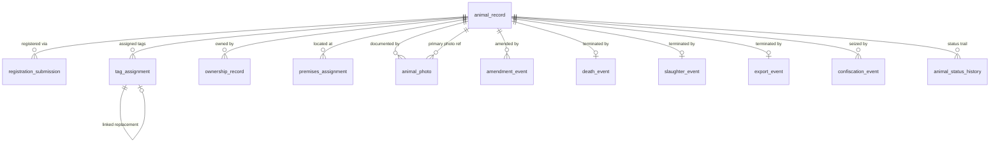

# Animal Registry — Module Specification

**Module:** animal-registry-service  
**Version:** 0.1 — Draft for Review  
**Date:** 2026-07-19  
**Phase:** Step 1 — Business Requirements and Workflow Documentation  
**Status:** Pending Review

---

## 1. Objective

The Animal Registry module is the central record of every livestock animal
registered in Somalia. It is the authoritative source for each animal's
identity, species, breed, sex, date of birth, source, owner, premises, tag
assignment, photo evidence, and status. It maintains a permanent, unalterable
history of all changes so that any animal can be traced from birth (or import)
through every change of ownership, premises, and status to its end of life.

The module does not process movement permits, health events, market transactions,
slaughter operations, or export declarations directly — those are responsibilities
of separate services that consume events published by this module.

---

## 2. Scope

**In scope:**
- Birth registration of new animals born on Somali premises
- Purchase registration of animals acquired by a new owner
- Import registration of animals entering Somalia from abroad
- Batch registration — grouping multiple animals registered in the same field session under a shared Batch Number
- Tag application — linking a tag serial number to an animal record
- Tag replacement when a tag is lost or damaged
- Owner-of-record transfer
- Premises-of-record assignment
- Animal registration data amendment (corrections by authorised officers)
- Photo capture and management (primary and supplementary photos)
- Death notification and status transition to Dead
- Slaughter notification and status transition to Slaughtered
- Live-export declaration and status transition to Exported
- Confiscation recording by enforcement authority
- Archiving of fully terminated records
- Domain event publication for downstream services

**Out of scope:**
- Movement permit issuance and tracking — movement-permit-service
- Veterinary health events, vaccinations, and disease reports — health-service
- Market check-in/check-out — market-service
- Abattoir operations and carcass marking — slaughter-service
- Export border formalities and Animal Health Certificates — export-service
- Tag manufacturing, bag custody, and tag inventory — tag-inventory-service
- Owner identity, authentication, and premises registration — owner-registration-service and premises-service

---

## 3. Actors

| Actor | Role Code | Responsibilities |
|---|---|---|
| Livestock Owner | `LIVESTOCK_OWNER` | Register own animals; view own herd; upload photos; notify death; initiate transfer |
| Owner Administrator | `OWNER_ADMIN` | Manage registrations on behalf of an owner entity |
| Field Registration Officer | `FIELD_REG_OFFICER` | Assist owners in registering animals; apply tags on site; verify registration data |
| District Veterinary Officer | `DISTRICT_VET_OFFICER` | Review submitted registrations; approve or reject; apply health restrictions |
| Regional Administrator | `REGIONAL_ADMIN` | Oversee registrations in their region; resolve escalations |
| National Administrator | `NATIONAL_ADMIN` | Full system access; data corrections; confiscation orders; archive management |
| Enforcement Officer | `ENFORCEMENT_OFFICER` | Record confiscation events on animals found without valid registration |
| Auditor | `AUDITOR` | Read-only access to all records and history |
| System (automated) | — | Status transitions triggered by domain events from other services |

---

## 4. Preconditions

| Precondition | Details |
|---|---|
| Owner is ACTIVE | The registering owner must be a verified, active account in identity-access-service |
| Premises is ACTIVE | The premises of record must be registered and approved in premises-service |
| Tag is ISSUED_TO_OWNER | The tag serial to be applied must be in ISSUED_TO_OWNER status in tag-inventory-service for the same owner |
| Species and breed codes exist | The system maintains a reference table of approved species and breed codes; only approved codes may be used |
| Officer is authorised for the district | FIELD_REG_OFFICER and DISTRICT_VET_OFFICER must have scope over the district where registration occurs |
| Import permit reference is available | For import registrations, a valid import permit number from the appropriate authority must be supplied |

---

## 5. Main Workflows

### 5.1 Birth Registration

An owner reports a new animal born on their premises.

```mermaid
sequenceDiagram
    actor LO as Livestock Owner / Field Officer
    participant SYS as animal-registry-service
    participant TIS as tag-inventory-service (event)
    participant OB as outbox

    LO->>SYS: POST /animal-registrations (type=BIRTH, species, breed, sex, dob, premises_id, owner_id, tag_serial, photos[])
    SYS->>SYS: Validate: owner ACTIVE; premises ACTIVE and belongs to owner; tag ISSUED_TO_OWNER for owner
    SYS->>SYS: Validate: species/breed valid combination; dob not future; sex valid
    SYS->>SYS: Create animal_record (status=DRAFT, animal_code=generated)
    SYS->>SYS: Create registration_submission (type=BIRTH, status=SUBMITTED)
    SYS->>SYS: Store photo references (Azure Blob Storage URLs)
    SYS->>OB: publish AnimalRegistrationSubmittedEvent
    SYS-->>LO: 201 — animal_code, submission_id

    Note over SYS: DISTRICT_VET_OFFICER reviews

    SYS->>SYS: Officer: POST /animal-registrations/{id}/verify
    SYS->>SYS: Validate: officer has scope over district
    SYS->>SYS: Update animal_record status → ACTIVE
    SYS->>SYS: Update registration_submission status → VERIFIED
    SYS->>SYS: Link tag serial → animal (tag_assignment record created)
    SYS->>OB: publish AnimalRegisteredEvent (animalId, ownerId, premisesId, tagSerial, species)
    SYS->>OB: publish TagAssignedToAnimalEvent → consumed by tag-inventory-service
    SYS-->>SYS: tag-inventory-service sets tag → ASSIGNED_TO_ANIMAL
```

### 5.2 Purchase / Acquisition Registration

An owner acquires an animal that does not yet have a SOMLITS record. This covers
animals purchased at market from unregistered stock, traditional acquisitions, and
gifted animals.

```mermaid
sequenceDiagram
    actor LO as New Owner / Field Officer
    participant SYS as animal-registry-service
    participant OB as outbox

    LO->>SYS: POST /animal-registrations (type=PURCHASE, species, breed, sex, approx_dob, source_type=MARKET/PRIVATE/GIFT, source_description, premises_id, owner_id, tag_serial, photos[])
    SYS->>SYS: Validate inputs (same as birth; approx_dob accepted)
    SYS->>SYS: Create animal_record (status=DRAFT)
    SYS->>SYS: Create registration_submission (type=PURCHASE, source_type, source_description)
    SYS->>SYS: Store photo references
    SYS->>OB: publish AnimalRegistrationSubmittedEvent
    SYS-->>LO: 201 — animal_code, submission_id

    Note over SYS: DISTRICT_VET_OFFICER reviews — may request additional evidence

    SYS->>SYS: Officer verifies; animal_record status → ACTIVE; tag assigned
    SYS->>OB: publish AnimalRegisteredEvent
    SYS->>OB: publish TagAssignedToAnimalEvent
```

### 5.3 Import Registration

An animal entering Somalia from abroad must be registered after veterinary
border clearance.

```mermaid
sequenceDiagram
    actor LO as Importer / Field Officer
    participant SYS as animal-registry-service
    participant OB as outbox

    LO->>SYS: POST /animal-registrations (type=IMPORT, species, breed, sex, approx_dob, country_of_origin, import_permit_number, foreign_id_number?, premises_id, owner_id, tag_serial, photos[])
    SYS->>SYS: Validate import_permit_number format; premises ACTIVE; owner ACTIVE; tag valid
    SYS->>SYS: Create animal_record (status=DRAFT)
    SYS->>SYS: Create registration_submission (type=IMPORT, import details linked)
    SYS->>SYS: Store photo references
    SYS->>OB: publish AnimalRegistrationSubmittedEvent
    SYS-->>LO: 201 — animal_code, submission_id

    Note over SYS: Regional or National Admin reviews import registration

    SYS->>SYS: Admin verifies; animal_record status → ACTIVE; Somali tag assigned
    SYS->>OB: publish AnimalRegisteredEvent
    SYS->>OB: publish TagAssignedToAnimalEvent
```

### 5.4 Tag Application

A tag is applied to an animal that was registered but not yet tagged (DRAFT
or SUBMITTED status). Also used when a previously untagged animal is presented
for registration with a tag already applied.

```mermaid
sequenceDiagram
    actor OFFICER as Field Reg Officer / Owner
    participant SYS as animal-registry-service
    participant OB as outbox

    OFFICER->>SYS: POST /animals/{animalId}/tag-application (tag_serial, applied_by, applied_at, application_notes?)
    SYS->>SYS: Validate: animal exists; tag_serial ISSUED_TO_OWNER for the animal's owner; animal has no ACTIVE tag assignment
    SYS->>SYS: Create tag_assignment (tag_serial, animal_id, assigned_at, status=ACTIVE)
    SYS->>SYS: Record tag_assignment_event in audit history
    SYS->>OB: publish TagAssignedToAnimalEvent (animalId, tagSerial, ownerId)
    SYS-->>OFFICER: 201 — tag_assignment_id
```

### 5.5 Tag Replacement

A tag is lost or damaged. A replacement tag must be applied. The animal record
is preserved; only the tag assignment changes.

```mermaid
sequenceDiagram
    actor OFFICER as Field Reg Officer / Owner
    participant SYS as animal-registry-service
    participant TIS as tag-inventory-service (event)
    participant OB as outbox

    OFFICER->>SYS: POST /animals/{animalId}/tag-replacement (reason=LOST|DAMAGED, new_tag_serial, replacement_notes?, new_tag_same_number=bool)
    SYS->>SYS: Validate: animal is ACTIVE; has ACTIVE tag assignment; new_tag_serial ISSUED_TO_OWNER for animal's owner
    SYS->>SYS: Close current tag_assignment (status=REPLACED, closed_at=now())
    SYS->>SYS: Create new tag_assignment (new_tag_serial, status=ACTIVE)
    SYS->>SYS: Record tag_replacement_event: old serial, new serial, reason, officer
    SYS->>OB: publish TagReplacedOnAnimalEvent (animalId, oldSerial, newSerial, reason)
    SYS->>OB: publish TagReleasedEvent (oldSerial) → tag-inventory-service marks old tag REPLACED
    SYS-->>OFFICER: 200 — new_tag_assignment_id

    Note over SYS: If new_tag_same_number=true (same serial re-used), DB updated with same serial; event records continuity [Art. 34(1)]
    Note over SYS: If new serial, both numbers are linked in DB [Art. 35(1)]. Ministry notified within 21 days.
```

### 5.6 Owner Transfer (Change of Ownership)

An animal is sold or transferred to a new owner. The previous owner's record
is preserved in the ownership history.

```mermaid
sequenceDiagram
    actor PREV as Previous Owner
    actor NEW as New Owner
    actor OFFICER as Field Reg Officer
    participant SYS as animal-registry-service
    participant OB as outbox

    PREV->>SYS: POST /animals/{animalId}/owner-transfer (new_owner_id, transfer_date, transfer_reference, notes?)
    SYS->>SYS: Validate: animal ACTIVE; caller is current owner or authorised officer; new_owner ACTIVE; new_owner has ACTIVE premises
    SYS->>SYS: Close current ownership_record (ended_at = transfer_date)
    SYS->>SYS: Create new ownership_record (owner_id = new_owner_id, started_at = transfer_date)
    SYS->>SYS: Update animal_record.current_owner_id = new_owner_id
    SYS->>SYS: Record transfer event in audit history
    SYS->>OB: publish AnimalOwnerTransferredEvent (animalId, previousOwnerId, newOwnerId, transferDate)
    SYS-->>PREV: 200 — transfer confirmed

    Note over SYS: New owner must confirm receipt and update premises via workflow 5.7
```

### 5.7 Premises Assignment

An animal is assigned to a different premises of the same or a new owner.
This is the premises-of-record update and does not replace the movement permit
workflow.

```mermaid
sequenceDiagram
    actor LO as Owner / Officer
    participant SYS as animal-registry-service
    participant OB as outbox

    LO->>SYS: POST /animals/{animalId}/premises-assignment (new_premises_id, effective_date, reason?)
    SYS->>SYS: Validate: animal ACTIVE; new_premises ACTIVE; belongs to current owner (or officer override)
    SYS->>SYS: Close current premises_assignment (ended_at = effective_date)
    SYS->>SYS: Create new premises_assignment (premises_id = new_premises_id, started_at = effective_date)
    SYS->>SYS: Update animal_record.current_premises_id = new_premises_id
    SYS->>OB: publish AnimalPremisesChangedEvent (animalId, previousPremisesId, newPremisesId)
    SYS-->>LO: 200 — premises updated
```

### 5.8 Registration Data Amendment

Correction of factual errors in an animal's registration record. Only
authorised officers may amend data after verification.

```mermaid
sequenceDiagram
    actor OFFICER as Field Reg Officer / National Admin
    participant SYS as animal-registry-service
    participant OB as outbox

    OFFICER->>SYS: POST /animals/{animalId}/amendments (fields_to_change{}, amendment_reason, supporting_notes)
    SYS->>SYS: Validate: caller has amendment authority; animal not in terminal status (Dead/Slaughtered/Exported/Archived)
    SYS->>SYS: Record amendment_event: previous values, new values, officer, reason, timestamp
    SYS->>SYS: Apply changes to animal_record
    SYS->>OB: publish AnimalDataAmendedEvent (animalId, changedFields[], amendedBy, reason)
    SYS-->>OFFICER: 200 — amendment recorded

    Note over SYS: Species and tag serial are immutable after ACTIVE status — only National Admin may amend with Ministry approval
```

### 5.9 Death Notification

An owner or officer reports that an animal has died.

```mermaid
sequenceDiagram
    actor LO as Owner / Field Officer
    participant SYS as animal-registry-service
    participant OB as outbox

    LO->>SYS: POST /animals/{animalId}/death-notification (death_date, cause_of_death, location, photo_reference?, notes?)
    SYS->>SYS: Validate: animal is ACTIVE or RESTRICTED; death_date not future; caller is owner or officer
    SYS->>SYS: Create death_event record
    SYS->>SYS: Update animal_record status → DEAD; terminated_at = death_date
    SYS->>SYS: Close active tag_assignment (status=RETIRED)
    SYS->>OB: publish AnimalDiedEvent (animalId, ownerId, tagSerial, deathDate, causeOfDeath)
    SYS->>OB: publish TagRetiredEvent (tagSerial) → tag-inventory-service marks tag RETIRED
    SYS-->>LO: 200 — death recorded

    Note over LO: Owner must submit Animal Termination Notice within 21 days (on-farm) or 48h (in transit) [Art. 24]
```

### 5.10 Slaughter Notification

An abattoir or officer notifies the system that a registered animal has been
slaughtered. This is the SOMLITS registration update — slaughter operations
are managed by the slaughter-service.

```mermaid
sequenceDiagram
    actor ABATTOIR as Abattoir Officer / Slaughter Service (event)
    participant SYS as animal-registry-service
    participant OB as outbox

    ABATTOIR->>SYS: POST /animals/{animalId}/slaughter-notification (slaughter_date, abattoir_id, slaughter_ref)
    SYS->>SYS: Validate: animal ACTIVE or RESTRICTED; slaughter_date not future; abattoir_id is registered
    SYS->>SYS: Create slaughter_event record
    SYS->>SYS: Update animal_record status → SLAUGHTERED; terminated_at = slaughter_date
    SYS->>SYS: Close active tag_assignment (status=RETIRED)
    SYS->>OB: publish AnimalSlaughteredEvent (animalId, ownerId, tagSerial, abattoirId, slaughterDate)
    SYS->>OB: publish TagRetiredEvent (tagSerial)
    SYS-->>ABATTOIR: 200 — slaughter recorded
```

### 5.11 Photo Upload and Management

An owner or officer uploads photos of an animal at any point in its lifecycle.
Photos serve as visual identification evidence for verification and dispute
resolution.

```mermaid
sequenceDiagram
    actor USER as Owner / Field Officer
    participant SYS as animal-registry-service
    participant BLOB as Azure Blob Storage
    participant OB as outbox

    USER->>SYS: POST /animals/{animalId}/photos/upload-url (photo_type=PRIMARY|SUPPLEMENTARY, file_extension, content_type)
    SYS->>SYS: Validate: animal exists; caller is owner or officer; animal not ARCHIVED
    SYS->>BLOB: Generate pre-signed upload URL (short TTL, max 10 MB, image/jpeg or image/png only)
    SYS->>SYS: Create pending photo_record (status=PENDING_UPLOAD, blob_path, photo_type)
    SYS-->>USER: 200 — { uploadUrl, photoId, expiresAt }

    USER->>BLOB: PUT file directly to pre-signed URL
    BLOB-->>USER: 200 — upload complete

    USER->>SYS: POST /animals/{animalId}/photos/{photoId}/confirm (file_size_bytes, taken_at?)
    SYS->>BLOB: Verify blob exists at expected path and is within size limit
    SYS->>SYS: Update photo_record status → ACTIVE; record file_size, taken_at, confirmed_at
    SYS->>SYS: If photo_type=PRIMARY: mark previous PRIMARY photo as SUPERSEDED
    SYS->>OB: publish AnimalPhotoAddedEvent (animalId, photoId, photoType, blobPath)
    SYS-->>USER: 200 — photo confirmed

    Note over SYS: Photos are never deleted — set to REMOVED status with reason if needed (National Admin only)
    Note over SYS: One PRIMARY photo per animal at a time; unlimited SUPPLEMENTARY photos
    Note over SYS: All photos are retained as permanent identification evidence
```

**Photo types:**

| Type | Description | Limit |
|---|---|---|
| `PRIMARY` | Main identification photo (full body, tag visible) | 1 active at a time |
| `SUPPLEMENTARY` | Additional photos (close-up of tag, markings, distinguishing features) | Unlimited |
| `AMENDMENT_EVIDENCE` | Photo submitted as evidence for a data amendment | Per amendment |
| `DEATH_EVIDENCE` | Photo submitted with a death notification | Per event |

### 5.12 Confiscation Recording

An enforcement officer records the confiscation of an animal found without
valid registration, travelling without a permit, or seized under a Ministry
order.

```mermaid
sequenceDiagram
    actor ENF as Enforcement Officer
    participant SYS as animal-registry-service
    participant OB as outbox

    ENF->>SYS: POST /animals/{animalId}/confiscation (confiscation_date, reason, location, enforcement_order_ref, photos[])
    SYS->>SYS: Validate: animal exists; caller has ENFORCEMENT_OFFICER role; animal not already CONFISCATED or terminal
    SYS->>SYS: Create confiscation_event record (reason, order ref, officer, date, location)
    SYS->>SYS: Update animal_record status → CONFISCATED
    SYS->>SYS: Freeze owner-transfer and premises-assignment operations on this animal
    SYS->>OB: publish AnimalConfiscatedEvent (animalId, ownerId, tagSerial, reason, enforcementOrderRef)
    SYS-->>ENF: 201 — confiscation_event_id

    Note over SYS: National Admin may release (→ ACTIVE) or condemn (→ SLAUGHTERED/DEAD) a CONFISCATED animal
```

**Confiscation of unregistered animals:**
If an animal has no SOMLITS record, the enforcement officer uses:
```
POST /unregistered-seizures (species, approx_breed, sex, tag_serial_found?, location, photos[], enforcement_order_ref)
```
A provisional `animal_record` (status=`CONFISCATED`) is created pending investigation.

### 5.13 Live Export Declaration

The animal-registry-service records the status transition when an animal is
confirmed exported. The border formalities and Animal Health Certificate are
managed by the export-service; this workflow consumes the resulting event.

```mermaid
sequenceDiagram
    participant EXS as export-service (event)
    participant SYS as animal-registry-service
    participant OB as outbox

    EXS->>OB: publish AnimalExportConfirmedEvent (animalId[], exitBorderPost, exportDate, exportPermitRef)
    SYS->>SYS: Consume AnimalExportConfirmedEvent
    SYS->>SYS: Validate: each animal ACTIVE; not DEAD/SLAUGHTERED/EXPORTED
    SYS->>SYS: Update animal_record status → EXPORTED; terminated_at = exportDate
    SYS->>SYS: Close active tag_assignment (status=RETIRED)
    SYS->>SYS: Create export_event (exitBorderPost, exportDate, exportPermitRef)
    SYS->>OB: publish AnimalExportedEvent (animalId, ownerId, tagSerial, exportDate)
    SYS->>OB: publish TagRetiredEvent (tagSerial)
```

Officers may also initiate this directly:
```
POST /animals/{animalId}/export-declaration (export_date, border_post_id, export_permit_ref)
```

---

## 6. Alternative Workflows

### 6.1 Field Officer Registering on Behalf of Owner

A FIELD_REG_OFFICER may submit any registration on behalf of an owner who
does not have digital access. The `owner_id` field in the request body must
refer to an ACTIVE owner within the officer's district scope. The
`submitted_by` field records the officer's identity separately from the owner.

### 6.2 Group Registration (Herd Import or Batch Purchase)

When an owner acquires multiple animals of the same species, breed, and sex in a
single transaction, the officer may submit a group registration request:
```
POST /animal-registrations/batch (type=PURCHASE|IMPORT, count, shared_fields{}, animal_overrides[])
```
The system creates one `registration_submission` record and one `animal_record`
per animal in the batch. Each animal receives an independent animal code and
tag serial. Photo upload is required for at least one animal per batch; per-animal
photos are strongly recommended.

### 6.3 Registration Rejected — Resubmission

If a DISTRICT_VET_OFFICER rejects a registration:
1. Owner or officer is notified with the rejection reason.
2. A new `registration_submission` is created on resubmission (the original
   rejection is preserved in history).
3. The `animal_record` remains in `DRAFT` status until verified.

### 6.4 Photo Upload — Mobile Offline Mode

When a field officer has no connectivity:
1. Photos are captured to device storage alongside a pending registration.
2. On reconnection, the device app calls the standard upload-url and confirm
   endpoints.
3. The animal record may be created in `DRAFT` status with no photos; photos
   are added within 48 hours of reconnection.

### 6.5 Ownership Transfer by Deceased Owner's Estate

If an owner is deceased:
1. National Admin overrides the transfer on behalf of the estate.
2. The amendment reason field records the legal basis.
3. All standard ownership history rules apply.

---

## 7. Exception Workflows

### 7.1 Tag Not Issued to Owner

If the tag serial supplied is not in `ISSUED_TO_OWNER` status for the owner:
- Registration rejected with `ERR-AR-005`.
- Owner is directed to tag-inventory-service to acquire and acknowledge tags
  before proceeding.

### 7.2 Duplicate Animal Detection

If an animal is submitted with a tag serial already `ASSIGNED_TO_ANIMAL`:
- Registration rejected with `ERR-AR-006` (tag already in use).
- If the duplicate appears to be a data error, National Admin may investigate
  and amend via the amendment workflow (5.8).

### 7.3 Photo Upload URL Expired

If the owner does not upload within the pre-signed URL TTL (15 minutes):
1. The `photo_record` remains in `PENDING_UPLOAD` status.
2. Owner requests a new upload URL via `POST /animals/{animalId}/photos/upload-url`.
3. Previous `PENDING_UPLOAD` photo records older than 24 hours are auto-cleaned
  by a scheduled job.

### 7.4 Photo File Too Large or Wrong Format

- Azure Blob Storage rejects uploads exceeding 10 MB or of unsupported MIME type.
- The confirm step checks blob existence; if the blob was rejected, the photo
  record remains `PENDING_UPLOAD` and the owner is instructed to re-upload.

### 7.5 Amendment of Immutable Fields

If a caller attempts to amend `species` or `tag_serial` on an `ACTIVE` record:
- Request rejected with `ERR-AR-009` unless caller is `NATIONAL_ADMIN`.
- National Admin amendments to immutable fields require a Ministry approval
  reference number recorded in `amendment_reason`.

### 7.6 Death Notification for CONFISCATED Animal

A CONFISCATED animal that dies in custody:
- Only `NATIONAL_ADMIN` or `ENFORCEMENT_OFFICER` may submit a death notification
  for a CONFISCATED animal.
- The status transitions `CONFISCATED → DEAD`.

---

## 8. Status Lifecycle

### 8.1 Animal Status Definitions

| Status | Description |
|---|---|
| `DRAFT` | Registration submitted; not yet verified by officer |
| `SUBMITTED` | Registration formally submitted and queued for officer review |
| `VERIFIED` | Officer has verified the registration; animal is now ACTIVE |
| `ACTIVE` | Animal is registered, tagged, and in good standing |
| `RESTRICTED` | Animal is under a health or movement restriction imposed by a vet officer |
| `MISSING` | Animal reported missing or strayed |
| `CONFISCATED` | Animal seized by enforcement authority; all transfers frozen |
| `DEAD` | Death notified and recorded |
| `SLAUGHTERED` | Slaughter at registered abattoir recorded |
| `EXPORTED` | Animal confirmed as exported from Somalia |
| `ARCHIVED` | Record fully terminated and archived; no further changes permitted |

### 8.2 Animal Status Transitions

```mermaid
stateDiagram-v2
    [*] --> DRAFT : Registration submitted (birth, purchase, import)
    DRAFT --> SUBMITTED : Owner or officer formally submits for review
    SUBMITTED --> VERIFIED : Officer reviews and approves
    VERIFIED --> ACTIVE : Tag application confirmed; animal live in system
    DRAFT --> REJECTED : Officer rejects registration
    SUBMITTED --> REJECTED : Officer rejects registration
    REJECTED --> DRAFT : Owner resubmits with corrections

    ACTIVE --> RESTRICTED : Health or movement restriction applied by vet officer
    RESTRICTED --> ACTIVE : Restriction lifted by vet officer

    ACTIVE --> MISSING : Owner reports animal missing
    MISSING --> ACTIVE : Animal recovered and verified

    ACTIVE --> CONFISCATED : Enforcement order applied
    RESTRICTED --> CONFISCATED : Enforcement order applied
    CONFISCATED --> ACTIVE : Release order from National Admin
    CONFISCATED --> DEAD : Animal dies in custody
    CONFISCATED --> SLAUGHTERED : Condemned animal slaughtered

    ACTIVE --> DEAD : Death notified [Art. 24]
    RESTRICTED --> DEAD : Death notified
    ACTIVE --> SLAUGHTERED : Slaughter notified [Art. 25]
    RESTRICTED --> SLAUGHTERED : Slaughter of restricted animal notified
    ACTIVE --> EXPORTED : Export confirmed at border [Art. 13]

    DEAD --> ARCHIVED : Record archived after retention period
    SLAUGHTERED --> ARCHIVED : Record archived after retention period
    EXPORTED --> ARCHIVED : Record archived after retention period
    CONFISCATED --> ARCHIVED : Fully disposed; National Admin archives
```



---

## 9. Business Rules

| Code | Rule |
|---|---|
| BR-AR-001 | An animal has only one current owner at a time. Ownership history is preserved indefinitely. |
| BR-AR-002 | An animal has only one current premises of record at a time. Premises history is preserved indefinitely. |
| BR-AR-003 | An animal has only one active primary tag (AID) at a time. Tag replacement does not create a new animal record. |
| BR-AR-004 | A tag serial may only be ASSIGNED_TO_ANIMAL for one animal at a time. Assigning a tag that is already ASSIGNED_TO_ANIMAL is rejected. |
| BR-AR-005 | A tag must be in ISSUED_TO_OWNER status for the registering owner before it can be applied to an animal. |
| BR-AR-006 | The `species` field is immutable once the animal record reaches ACTIVE status. Changes require National Admin authority and a Ministry approval reference. |
| BR-AR-007 | Date of birth may be approximate (month+year or year only) for purchase and import registrations. The system records the precision level alongside the date. |
| BR-AR-008 | An animal in DEAD, SLAUGHTERED, EXPORTED, or ARCHIVED status may not receive a new tag assignment, owner transfer, or premises change. |
| BR-AR-009 | A CONFISCATED animal may not receive an owner transfer, premises change, or new tag assignment until released by National Admin. |
| BR-AR-010 | A RESTRICTED animal may still be slaughtered. The slaughter-service must verify the restriction type before permitting slaughter. |
| BR-AR-011 | No animal registration record is ever physically deleted. Terminal records are archived, not removed. |
| BR-AR-012 | All complete tag assignment history must be preserved: serial, applied date, replaced/retired date, and reason. |
| BR-AR-013 | All ownership history must be preserved with start and end dates and transfer references. |
| BR-AR-014 | All premises-of-record history must be preserved with start and end dates. |
| BR-AR-015 | A PRIMARY photo must be uploaded within 30 days of ACTIVE status. After 30 days without a PRIMARY photo, the officer is flagged for follow-up. |
| BR-AR-016 | Photos are never deleted from storage. A photo may be set to REMOVED status with a reason by National Admin only. |
| BR-AR-017 | Death must be notified within 21 days for on-farm death, within 48 hours for death in transit. [Art. 24] |
| BR-AR-018 | Tag replacement must be completed within 30 days of tag loss or damage, or before the animal leaves the premises, whichever is sooner. [Art. 34(1)] |
| BR-AR-019 | When a replacement tag uses a new serial number, both the old and new serial numbers must remain linked in the database. [Art. 35(1)] |
| BR-AR-020 | Optimistic locking is enforced on all animal record writes. Concurrent updates are rejected with a 409 response. |
| BR-AR-021 | All timestamps are recorded in UTC. |
| BR-AR-022 | Import registrations must carry a valid import permit reference. The system does not validate the permit number against an external authority during Phase 1 — the officer verifies the document. |
| BR-AR-023 | Animal codes follow the format `SOM-{YEAR}-{NNNNNN}` (e.g., `SOM-2025-000001`). Codes are assigned at DRAFT creation and do not change. |
| BR-AR-024 | An amendment event is written for every field change on an ACTIVE or later record, recording the before and after values. |

---

## 10. Authorization Matrix

| Operation | NATIONAL_ADMIN | REGIONAL_ADMIN | DISTRICT_VET_OFFICER | FIELD_REG_OFFICER | ENFORCEMENT_OFFICER | LIVESTOCK_OWNER | AUDITOR |
|---|:---:|:---:|:---:|:---:|:---:|:---:|:---:|
| Submit birth/purchase/import registration | ✓ | Own region | Own district | Own district | — | Own animals | — |
| Verify (approve) registration | ✓ | Own region | Own district | — | — | — | — |
| Reject registration | ✓ | Own region | Own district | — | — | — | — |
| Apply tag to animal | ✓ | Own region | Own district | Own district | — | Own animals | — |
| Replace tag | ✓ | Own region | Own district | Own district | — | Own animals | — |
| Transfer ownership | ✓ | Own region | Own district | — | — | Own animals | — |
| Assign premises | ✓ | Own region | Own district | Own district | — | Own animals | — |
| Amend standard fields | ✓ | Own region | Own district | — | — | — | — |
| Amend immutable fields (species, code) | ✓ | — | — | — | — | — | — |
| Upload primary photo | ✓ | Own region | Own district | Own district | — | Own animals | — |
| Upload supplementary photo | ✓ | Own region | Own district | Own district | — | Own animals | — |
| Remove photo (REMOVED status) | ✓ | — | — | — | — | — | — |
| Notify death | ✓ | Own region | Own district | Own district | — | Own animals | — |
| Notify slaughter | ✓ | Own region | Own district | Own district | — | — | — |
| Record export declaration | ✓ | Own region | Own district | — | — | — | — |
| Record confiscation | ✓ | — | — | — | Own district | — | — |
| Release confiscated animal | ✓ | — | — | — | — | — | — |
| Archive record | ✓ | — | — | — | — | — | — |
| View own animal records | ✓ | Own region | Own district | Own district | Own district | Own animals | ✓ |
| View all animal records | ✓ | Own region | Own district | Own district | — | — | ✓ |
| View full audit history | ✓ | Own region | Own district | — | — | — | ✓ |
| Submit batch registration | ✓ | Own region | Own district | Own district | — | — | — |

---

## 11. Data Entities

### 11.1 animal_record

| Column | Type | Notes |
|---|---|---|
| `id` | UUID PK | Internal identifier |
| `animal_code` | VARCHAR(25) UNIQUE NOT NULL | Human-readable: `SOM-2025-000001` |
| `species` | VARCHAR(30) NOT NULL | `CATTLE`, `CAMEL`, `GOAT`, `SHEEP` |
| `breed` | VARCHAR(60) NOT NULL | From approved breed reference |
| `sex` | VARCHAR(10) NOT NULL | `MALE`, `FEMALE`, `UNKNOWN` |
| `dob` | DATE | Null if entirely unknown |
| `dob_precision` | VARCHAR(10) NOT NULL | `EXACT`, `MONTH`, `YEAR`, `UNKNOWN` |
| `coat_color` | VARCHAR(100) | Primary coat colour and markings |
| `distinguishing_marks` | TEXT | Free text: brands, scars, distinctive features |
| `status` | VARCHAR(20) NOT NULL | See §8.1 |
| `current_owner_id` | UUID NOT NULL | FK → owner_registration_service (external) |
| `current_premises_id` | UUID NOT NULL | FK → premises_service (external) |
| `batch_id` | UUID | FK → premises_service.animal_batch; null if registered individually |
| `batch_code` | VARCHAR(30) | Human-readable batch code (BAT-...); denormalised for display |
| `active_tag_serial` | VARCHAR(50) | Denormalised for fast lookup; null if no active tag |
| `primary_photo_id` | UUID | FK → animal_photo |
| `source_type` | VARCHAR(20) NOT NULL | `BIRTH`, `PURCHASE`, `IMPORT` |
| `terminated_at` | TIMESTAMPTZ | Set when status → DEAD/SLAUGHTERED/EXPORTED |
| `registered_by` | UUID NOT NULL | User who created the record |
| `registered_at` | TIMESTAMPTZ NOT NULL | |
| `version` | INT NOT NULL DEFAULT 0 | Optimistic lock |
| `created_at` | TIMESTAMPTZ NOT NULL | |
| `updated_at` | TIMESTAMPTZ NOT NULL | |

### 11.2 registration_submission

| Column | Type | Notes |
|---|---|---|
| `id` | UUID PK | |
| `submission_code` | VARCHAR(30) UNIQUE | e.g. `REG-2025-000001` |
| `animal_id` | UUID FK → animal_record NOT NULL | |
| `submission_type` | VARCHAR(20) NOT NULL | `BIRTH`, `PURCHASE`, `IMPORT` |
| `status` | VARCHAR(20) NOT NULL | `DRAFT`, `SUBMITTED`, `VERIFIED`, `REJECTED` |
| `source_type` | VARCHAR(20) | For PURCHASE: `MARKET`, `PRIVATE`, `GIFT` |
| `source_description` | TEXT | Seller name, market name, gift circumstances |
| `import_permit_number` | VARCHAR(100) | For IMPORT registrations |
| `country_of_origin` | CHAR(2) | ISO 3166-1 alpha-2; for IMPORT |
| `foreign_id_number` | VARCHAR(100) | Foreign tag/ID from country of origin |
| `submitted_by` | UUID NOT NULL | Owner or officer who submitted |
| `submitted_at` | TIMESTAMPTZ NOT NULL | |
| `reviewed_by` | UUID | Officer who verified or rejected |
| `reviewed_at` | TIMESTAMPTZ | |
| `rejection_reason` | TEXT | |
| `officer_notes` | TEXT | |
| `idempotency_key` | UUID UNIQUE NOT NULL | |

### 11.3 tag_assignment

| Column | Type | Notes |
|---|---|---|
| `id` | UUID PK | |
| `animal_id` | UUID FK → animal_record NOT NULL | |
| `tag_serial` | VARCHAR(50) NOT NULL | |
| `status` | VARCHAR(20) NOT NULL | `ACTIVE`, `REPLACED`, `RETIRED` |
| `assigned_at` | TIMESTAMPTZ NOT NULL | |
| `assigned_by` | UUID NOT NULL | |
| `closed_at` | TIMESTAMPTZ | Null if still ACTIVE |
| `close_reason` | VARCHAR(20) | `REPLACED`, `ANIMAL_DEAD`, `ANIMAL_SLAUGHTERED`, `ANIMAL_EXPORTED`, `RECALL` |
| `replacement_reason` | VARCHAR(20) | `LOST`, `DAMAGED` — populated when close_reason = REPLACED |
| `new_serial_is_same` | BOOLEAN | True if replacement reuses same serial number |
| `linked_replacement_id` | UUID FK → tag_assignment | Points to the successor assignment |

### 11.4 ownership_record

| Column | Type | Notes |
|---|---|---|
| `id` | UUID PK | |
| `animal_id` | UUID FK → animal_record NOT NULL | |
| `owner_id` | UUID NOT NULL | FK → owner in identity-access-service |
| `started_at` | TIMESTAMPTZ NOT NULL | |
| `ended_at` | TIMESTAMPTZ | Null if current owner |
| `transfer_reference` | VARCHAR(100) | Sale receipt, permit number, etc. |
| `transfer_notes` | TEXT | |
| `recorded_by` | UUID NOT NULL | |
| `created_at` | TIMESTAMPTZ NOT NULL | |

### 11.5 premises_assignment

| Column | Type | Notes |
|---|---|---|
| `id` | UUID PK | |
| `animal_id` | UUID FK → animal_record NOT NULL | |
| `premises_id` | UUID NOT NULL | FK → premises in premises-service |
| `started_at` | TIMESTAMPTZ NOT NULL | |
| `ended_at` | TIMESTAMPTZ | Null if current premises |
| `reason` | TEXT | Why premises changed |
| `recorded_by` | UUID NOT NULL | |
| `created_at` | TIMESTAMPTZ NOT NULL | |

### 11.6 animal_photo

| Column | Type | Notes |
|---|---|---|
| `id` | UUID PK | |
| `animal_id` | UUID FK → animal_record NOT NULL | |
| `photo_type` | VARCHAR(30) NOT NULL | `PRIMARY`, `SUPPLEMENTARY`, `AMENDMENT_EVIDENCE`, `DEATH_EVIDENCE` |
| `status` | VARCHAR(20) NOT NULL | `PENDING_UPLOAD`, `ACTIVE`, `SUPERSEDED`, `REMOVED` |
| `blob_path` | VARCHAR(500) NOT NULL | Azure Blob Storage path |
| `blob_url` | VARCHAR(500) NOT NULL | Full URL (signed at read time) |
| `file_size_bytes` | BIGINT | Set on confirm |
| `content_type` | VARCHAR(50) NOT NULL | `image/jpeg` or `image/png` |
| `taken_at` | TIMESTAMPTZ | Date/time photo was taken (optional) |
| `caption` | VARCHAR(250) | Officer or owner caption |
| `uploaded_by` | UUID NOT NULL | |
| `uploaded_at` | TIMESTAMPTZ NOT NULL | |
| `confirmed_at` | TIMESTAMPTZ | Set on confirm call |
| `removed_by` | UUID | National Admin who removed |
| `removal_reason` | TEXT | |
| `reference_event_id` | UUID | For evidence photos: links to the event record |

### 11.7 amendment_event

| Column | Type | Notes |
|---|---|---|
| `id` | UUID PK | |
| `animal_id` | UUID FK → animal_record NOT NULL | |
| `amended_by` | UUID NOT NULL | |
| `amended_at` | TIMESTAMPTZ NOT NULL | |
| `amendment_reason` | TEXT NOT NULL | |
| `ministry_approval_ref` | VARCHAR(100) | Required for immutable field changes |
| `fields_changed` | JSONB NOT NULL | Array of `{ field, previousValue, newValue }` |

### 11.8 death_event

| Column | Type | Notes |
|---|---|---|
| `id` | UUID PK | |
| `animal_id` | UUID FK → animal_record NOT NULL | |
| `death_date` | DATE NOT NULL | |
| `cause_of_death` | VARCHAR(100) | |
| `location_description` | TEXT | |
| `photo_id` | UUID FK → animal_photo | |
| `notes` | TEXT | |
| `recorded_by` | UUID NOT NULL | |
| `recorded_at` | TIMESTAMPTZ NOT NULL | |

### 11.9 slaughter_event

| Column | Type | Notes |
|---|---|---|
| `id` | UUID PK | |
| `animal_id` | UUID FK → animal_record NOT NULL | |
| `slaughter_date` | DATE NOT NULL | |
| `abattoir_id` | UUID NOT NULL | FK → abattoir in slaughter-service |
| `slaughter_ref` | VARCHAR(100) NOT NULL | Abattoir record reference |
| `recorded_by` | UUID NOT NULL | |
| `recorded_at` | TIMESTAMPTZ NOT NULL | |

### 11.10 export_event

| Column | Type | Notes |
|---|---|---|
| `id` | UUID PK | |
| `animal_id` | UUID FK → animal_record NOT NULL | |
| `export_date` | DATE NOT NULL | |
| `border_post_id` | UUID NOT NULL | |
| `export_permit_ref` | VARCHAR(100) NOT NULL | |
| `destination_country` | CHAR(2) NOT NULL | ISO 3166-1 alpha-2 |
| `recorded_by` | UUID NOT NULL | |
| `recorded_at` | TIMESTAMPTZ NOT NULL | |

### 11.11 confiscation_event

| Column | Type | Notes |
|---|---|---|
| `id` | UUID PK | |
| `animal_id` | UUID FK → animal_record NOT NULL | |
| `confiscation_date` | DATE NOT NULL | |
| `reason` | TEXT NOT NULL | |
| `location_description` | TEXT | |
| `enforcement_order_ref` | VARCHAR(100) NOT NULL | |
| `enforcement_officer_id` | UUID NOT NULL | |
| `recorded_at` | TIMESTAMPTZ NOT NULL | |
| `released_by` | UUID | National Admin who released |
| `released_at` | TIMESTAMPTZ | |
| `release_reason` | TEXT | |

### 11.12 animal_status_history

Immutable log of every status transition.

| Column | Type | Notes |
|---|---|---|
| `id` | UUID PK | |
| `animal_id` | UUID FK → animal_record NOT NULL | |
| `from_status` | VARCHAR(20) | Null for initial creation |
| `to_status` | VARCHAR(20) NOT NULL | |
| `reason` | TEXT | |
| `reference_event_id` | UUID | ID of triggering event (death_event, etc.) |
| `triggered_by` | UUID NOT NULL | User or system identity |
| `occurred_at` | TIMESTAMPTZ NOT NULL | |

---

## 12. Entity Relationships



---

## 13. API Contracts

### 13.1 Animal Registration

```
POST   /internal/v1/animal-registrations               Submit registration (birth/purchase/import)
POST   /internal/v1/animal-registrations/batch         Submit batch registration
GET    /internal/v1/animal-registrations/{id}          Get submission status
POST   /internal/v1/animal-registrations/{id}/verify   Officer approves
POST   /internal/v1/animal-registrations/{id}/reject   Officer rejects with reason
```

**POST /internal/v1/animal-registrations request (BIRTH):**
```json
{
  "submissionType": "BIRTH",
  "species": "CATTLE",
  "breed": "BORAN",
  "sex": "FEMALE",
  "dob": "2025-03-12",
  "dobPrecision": "EXACT",
  "coatColor": "Brown with white patch on left flank",
  "distinguishingMarks": "Nick on right ear tip",
  "ownerId": "uuid",
  "premisesId": "uuid",
  "tagSerial": "0000012345",
  "idempotencyKey": "uuid"
}
```

**Response 201:**
```json
{
  "animalId": "uuid",
  "animalCode": "SOM-2025-000142",
  "submissionId": "uuid",
  "submissionCode": "REG-2025-000142",
  "status": "DRAFT"
}
```

### 13.2 Animal Queries

```
GET    /internal/v1/animals                            Search animals (species, owner, status, region, tag serial)
GET    /internal/v1/animals/{id}                       Get animal detail
GET    /internal/v1/animals/by-code/{animalCode}       Lookup by SOM code
GET    /internal/v1/animals/by-tag/{tagSerial}         Lookup by tag serial
GET    /internal/v1/animals/{id}/history               Full event history (status, tags, owners, premises)
GET    /internal/v1/animals/{id}/tag-assignments       All tag assignments (active and historical)
GET    /internal/v1/animals/{id}/ownership-history     All ownership records
GET    /internal/v1/animals/{id}/premises-history      All premises assignments
```

### 13.3 Tag Management

```
POST   /internal/v1/animals/{id}/tag-application       Apply tag to animal
POST   /internal/v1/animals/{id}/tag-replacement       Replace tag (lost/damaged)
```

### 13.4 Transfers

```
POST   /internal/v1/animals/{id}/owner-transfer        Transfer ownership
POST   /internal/v1/animals/{id}/premises-assignment   Update premises of record
```

### 13.5 Photos

```
POST   /internal/v1/animals/{id}/photos/upload-url     Request pre-signed upload URL
POST   /internal/v1/animals/{id}/photos/{photoId}/confirm  Confirm upload complete
GET    /internal/v1/animals/{id}/photos                List all photos
GET    /internal/v1/animals/{id}/photos/{photoId}      Get photo metadata and signed read URL
POST   /internal/v1/animals/{id}/photos/{photoId}/remove   National Admin removes photo
```

**POST /internal/v1/animals/{id}/photos/upload-url request:**
```json
{
  "photoType": "PRIMARY",
  "fileExtension": "jpg",
  "contentType": "image/jpeg"
}
```

**Response 200:**
```json
{
  "photoId": "uuid",
  "uploadUrl": "https://somlitsblob.blob.core.windows.net/animal-photos/...?sas-token",
  "expiresAt": "2026-07-19T12:15:00Z",
  "maxFileSizeBytes": 10485760
}
```

### 13.6 Lifecycle Events

```
POST   /internal/v1/animals/{id}/death-notification    Record death
POST   /internal/v1/animals/{id}/slaughter-notification  Record slaughter
POST   /internal/v1/animals/{id}/export-declaration    Record export
POST   /internal/v1/animals/{id}/confiscation          Record confiscation
POST   /internal/v1/animals/{id}/confiscation/release  Release confiscated animal
POST   /internal/v1/animals/{id}/amendments            Amend registration data
```

### 13.7 Unregistered Seizures

```
POST   /internal/v1/unregistered-seizures              Create provisional record for unregistered confiscated animal
GET    /internal/v1/unregistered-seizures/{id}         Get seizure detail
POST   /internal/v1/unregistered-seizures/{id}/register  Convert to full animal record
```

### 13.8 Standard Error Response

```json
{
  "errorCode": "ERR-AR-005",
  "message": "Tag serial 0000012345 is not in ISSUED_TO_OWNER status for owner uuid",
  "timestamp": "2026-07-19T10:00:00Z",
  "correlationId": "uuid"
}
```

| Error Code | Condition |
|---|---|
| `ERR-AR-001` | Owner not ACTIVE |
| `ERR-AR-002` | Premises not ACTIVE or does not belong to owner |
| `ERR-AR-003` | Invalid species/breed combination |
| `ERR-AR-004` | Date of birth is in the future |
| `ERR-AR-005` | Tag not in ISSUED_TO_OWNER status for this owner |
| `ERR-AR-006` | Tag serial already ASSIGNED_TO_ANIMAL |
| `ERR-AR-007` | Animal already has an ACTIVE tag assignment |
| `ERR-AR-008` | Operation not permitted for current animal status |
| `ERR-AR-009` | Attempted amendment of immutable field without required authority |
| `ERR-AR-010` | Concurrent modification — optimistic lock failure |
| `ERR-AR-011` | Import permit number is required for IMPORT registrations |
| `ERR-AR-012` | Idempotency key conflict — duplicate request detected |
| `ERR-AR-013` | Photo upload URL expired or blob not found at expected path |

---

## 14. Domain Events

All events are published via the outbox pattern to `somlits.animal-registry` topic on Azure Service Bus.

| Event | Trigger | Key Payload Fields |
|---|---|---|
| `AnimalRegistrationSubmittedEvent` | DRAFT created | `submissionId`, `animalId`, `animalCode`, `ownerId`, `premisesId`, `species`, `submissionType` |
| `AnimalRegisteredEvent` | Registration verified; animal ACTIVE | `animalId`, `animalCode`, `ownerId`, `premisesId`, `tagSerial`, `species`, `breed`, `sex` |
| `AnimalRegistrationRejectedEvent` | Registration rejected | `submissionId`, `animalId`, `ownerId`, `rejectionReason` |
| `TagAssignedToAnimalEvent` | Tag linked to animal | `animalId`, `animalCode`, `tagSerial`, `ownerId`, `assignedAt` |
| `TagReplacedOnAnimalEvent` | Tag replacement completed | `animalId`, `oldSerial`, `newSerial`, `reason`, `replacedAt` |
| `TagReleasedEvent` | Old tag closed (replaced/retired) | `tagSerial`, `animalId`, `closeReason` |
| `AnimalOwnerTransferredEvent` | Ownership changed | `animalId`, `previousOwnerId`, `newOwnerId`, `transferDate`, `transferReference` |
| `AnimalPremisesChangedEvent` | Premises of record changed | `animalId`, `previousPremisesId`, `newPremisesId`, `effectiveDate` |
| `AnimalDataAmendedEvent` | Fields amended | `animalId`, `changedFields[]`, `amendedBy`, `reason` |
| `AnimalPhotoAddedEvent` | Photo confirmed uploaded | `animalId`, `photoId`, `photoType`, `blobPath` |
| `AnimalDiedEvent` | Death notified | `animalId`, `ownerId`, `tagSerial`, `deathDate`, `causeOfDeath` |
| `AnimalSlaughteredEvent` | Slaughter notified | `animalId`, `ownerId`, `tagSerial`, `abattoirId`, `slaughterDate` |
| `AnimalExportedEvent` | Export confirmed | `animalId`, `ownerId`, `tagSerial`, `exportDate`, `destinationCountry` |
| `AnimalConfiscatedEvent` | Confiscation recorded | `animalId`, `ownerId`, `tagSerial`, `reason`, `enforcementOrderRef` |
| `AnimalReleasedFromConfiscationEvent` | Release order processed | `animalId`, `ownerId`, `releasedBy`, `releaseReason` |
| `TagRetiredEvent` | Tag retired (death/slaughter/export) | `tagSerial`, `animalId`, `retirementReason` |

**Consumed events (from other services):**

| Event | Source | Action |
|---|---|---|
| `AnimalExportConfirmedEvent` | export-service | Triggers Workflow 5.13 — status → EXPORTED |
| `HealthRestrictionAppliedEvent` | health-service | Status → RESTRICTED |
| `HealthRestrictionLiftedEvent` | health-service | Status → ACTIVE (if was RESTRICTED) |

---

## 15. Notifications

| Trigger | Recipient | Channel | Message |
|---|---|---|---|
| `AnimalRegistrationSubmittedEvent` | District Vet Officer | In-app | "New animal registration REG-xxx submitted for your district" |
| `AnimalRegisteredEvent` | Livestock Owner | SMS + In-app | "Animal SOM-2025-XXXXXX registered successfully. Tag: [serial]" |
| `AnimalRegistrationRejectedEvent` | Livestock Owner | SMS + In-app | "Registration REG-xxx rejected: [reason]. Please correct and resubmit." |
| `AnimalDiedEvent` | Regional Admin | In-app | "Death notification received: SOM-XXXXXX in [district]" |
| `AnimalConfiscatedEvent` | Owner + National Admin | SMS + In-app | "Animal SOM-XXXXXX has been confiscated. Order ref: [ref]" |
| 30 days without PRIMARY photo | District Vet Officer | In-app | "Animal SOM-XXXXXX has no primary photo — follow up required" |
| Tag replacement overdue (>30 days) | District Vet Officer | In-app | "Tag replacement overdue for SOM-XXXXXX — premises [name]" |

---

## 16. Audit Requirements

All state-changing operations on animal records must be permanently recorded.
Audit records are never deleted. The following must be queryable by animal code
or ID:

- Registration submission: who, when, type, submitted on behalf of owner
- Registration verification or rejection: who, when, officer notes
- Tag application: who, when, serial
- Tag replacement: who, when, old serial, new serial, reason
- Ownership transfer: previous owner, new owner, date, reference
- Premises change: previous premises, new premises, date
- Photo upload: who, when, type, blob reference
- Photo removal: who, when, reason
- Amendment: every field changed, before and after values, reason, Ministry approval ref (if required)
- Death notification: who, when, date, cause
- Slaughter notification: who, when, abattoir, date
- Export declaration: who, when, border post, date
- Confiscation: officer, date, order reference
- Confiscation release: who, when, reason
- Status transitions: full trail via `animal_status_history`

Retention: indefinite. No physical deletion of any animal record or audit row.

---

## 17. UI Screens

### Ministry / Field Officer Platform

1. **Animal Search** — search by code, tag serial, owner name, species, status, region; paginated results table
2. **Animal Detail** — full record: species, breed, sex, DOB, status badge, current owner, current premises, active tag, photo carousel; tabbed history sections
3. **Registration Queue** — list of SUBMITTED registrations for the officer's district; approve/reject with notes
4. **Register Animal** — multi-step form: registration type → species/breed/sex/DOB → owner/premises → tag serial → photos → review → submit
5. **Tag Replacement** — search animal; enter new serial; record reason; confirm
6. **Owner Transfer** — search animal; new owner lookup; enter transfer reference; confirm
7. **Death / Slaughter / Export Notification** — search animal; select termination type; enter date, details, evidence photo; confirm
8. **Confiscation Recording** — search or create provisional record; enter order reference; upload photos; confirm
9. **Photo Management** — upload primary photo; add supplementary photos; view all photos with taken-at date and uploader

### Farmer Platform

1. **My Herd** — list of owned animals with status, species, photo thumbnail, tag serial; search by species or status; filter by batch
2. **Premises View** — animals grouped by batch under each premises; shows batch code, animal count, and batch status
3. **Animal Detail** — view own animal record and history; shows batch code if animal belongs to a batch; initiate tag replacement; upload photo
4. **Register Animal** — guided form for birth or purchase registration; photo upload step; batch number shown if a session batch is active
5. **Notify Death** — select animal; enter date and cause; optionally upload photo; confirm

> **Cross-reference:** Batch creation, closure, and batch-level operations (health updates, movement, vaccination) are managed by the **Premises Module** (see `docs/modules/05-premises/premises-spec.md`).

---

## 18. Validations

| Field | Rule |
|---|---|
| `species` | Must be one of: `CATTLE`, `CAMEL`, `GOAT`, `SHEEP` |
| `breed` | Must be a valid breed for the selected species from the reference table |
| `sex` | Must be `MALE`, `FEMALE`, or `UNKNOWN` |
| `dob` | Must not be a future date; if `dobPrecision=EXACT`, full ISO date required |
| `ownerId` | Must resolve to an ACTIVE owner in identity-access-service |
| `premisesId` | Must resolve to an ACTIVE premises belonging to the owner |
| `tagSerial` | Must be non-empty string; must be ISSUED_TO_OWNER for this owner in tag-inventory-service |
| `importPermitNumber` | Required and non-empty when `submissionType=IMPORT` |
| `countryOfOrigin` | Required and valid ISO 3166-1 alpha-2 code when `submissionType=IMPORT` |
| `deathDate` / `slaughterDate` / `exportDate` | Must not be a future date |
| `enforcementOrderRef` | Required and non-empty for confiscation |
| `contentType` (photo) | Must be `image/jpeg` or `image/png` |
| `fileExtension` (photo) | Must be `jpg`, `jpeg`, or `png` |
| Photo file size | Maximum 10 MB enforced by Azure Blob pre-signed URL policy |
| `idempotencyKey` | Valid UUID; duplicate key returns original response |
| `batch_code` | If provided, must reference an OPEN batch at the same premises |
| Batch registration `count` | Minimum 2; maximum 500; must equal length of `tagSerials[]` array |
| Amendment `fieldsToChange` | Must not be empty; must not include `species` or `animalCode` unless caller is `NATIONAL_ADMIN` |

---

## 19. Acceptance Criteria

| ID | Criterion |
|---|---|
| AC-AR-001 | A birth registration with valid owner, premises, tag, species, breed, sex is created in DRAFT status and returns `SOM-{YEAR}-NNNNNN` code |
| AC-AR-002 | A registration with a tag serial not in ISSUED_TO_OWNER for the owner is rejected with `ERR-AR-005` |
| AC-AR-003 | A registration with an already-ASSIGNED_TO_ANIMAL tag serial is rejected with `ERR-AR-006` |
| AC-AR-004 | After officer verification, animal status transitions to ACTIVE and `TagAssignedToAnimalEvent` is published |
| AC-AR-005 | Tag replacement closes the previous assignment and creates a new ACTIVE assignment; both serial numbers remain linked |
| AC-AR-006 | An ownership transfer closes the current ownership record and creates a new one; both records remain in the database |
| AC-AR-007 | A PRIMARY photo upload flow: upload-url → upload → confirm results in photo status=ACTIVE and previous PRIMARY set to SUPERSEDED |
| AC-AR-008 | A photo upload URL expires after 15 minutes; a second URL request succeeds |
| AC-AR-009 | A photo exceeding 10 MB is rejected at the Azure Blob level; confirm step returns `ERR-AR-013` |
| AC-AR-010 | A death notification transitions animal to DEAD, closes the active tag assignment (RETIRED), and publishes `AnimalDiedEvent` and `TagRetiredEvent` |
| AC-AR-011 | A DEAD animal cannot receive a new tag application, owner transfer, or premises assignment |
| AC-AR-012 | A CONFISCATED animal cannot receive an owner transfer; attempt returns `ERR-AR-008` |
| AC-AR-013 | Every field changed via amendment is recorded in `amendment_event` with before and after values |
| AC-AR-014 | Amending `species` without NATIONAL_ADMIN role returns `ERR-AR-009` |
| AC-AR-015 | Concurrent updates to the same animal record return `ERR-AR-010` (optimistic lock) for the second writer |
| AC-AR-016 | A batch registration of 5 animals creates 5 independent animal records and 5 submission records |
| AC-AR-017 | The full status history of an animal is retrievable, showing every transition with who triggered it and when |
| AC-AR-018 | Submitting the same `idempotencyKey` twice returns the original response; no duplicate records are created |
| AC-AR-019 | An import registration without `importPermitNumber` is rejected with `ERR-AR-011` |
| AC-AR-020 | A confiscation event freezes owner transfer; a subsequent release event restores the animal to ACTIVE |

---

## 20. Unit Tests

| Test | Class | Description |
|---|---|---|
| UT-AR-001 | `AnimalCodeGeneratorTest` | Generates sequential `SOM-YYYY-NNNNNN` codes; no duplicates under concurrent calls |
| UT-AR-002 | `RegistrationValidatorTest` | Rejects unknown breed for given species |
| UT-AR-003 | `RegistrationValidatorTest` | Rejects future DOB |
| UT-AR-004 | `RegistrationValidatorTest` | Accepts approximate DOB with MONTH precision |
| UT-AR-005 | `TagAssignmentServiceTest` | Rejects tag assignment when animal already has ACTIVE assignment |
| UT-AR-006 | `TagAssignmentServiceTest` | Tag replacement closes old, creates new, links both records |
| UT-AR-007 | `OwnerTransferServiceTest` | Closes current ownership and creates new on transfer |
| UT-AR-008 | `OwnerTransferServiceTest` | Rejects transfer when animal status is CONFISCATED |
| UT-AR-009 | `StatusTransitionServiceTest` | DEAD animal cannot transition to any other status |
| UT-AR-010 | `StatusTransitionServiceTest` | CONFISCATED → ACTIVE allowed only by NATIONAL_ADMIN |
| UT-AR-011 | `PhotoServiceTest` | Primary photo upload sets previous PRIMARY to SUPERSEDED |
| UT-AR-012 | `PhotoServiceTest` | Confirm fails when blob is not found at expected path |
| UT-AR-013 | `AmendmentServiceTest` | Amendment rejects species change for non-NATIONAL_ADMIN |
| UT-AR-014 | `AmendmentServiceTest` | Every changed field is recorded in amendment_event before-after JSON |
| UT-AR-015 | `IdempotencyTest` | Same idempotency key returns original response without creating duplicate |
| UT-AR-016 | `OptimisticLockTest` | Concurrent updates throw OptimisticLockException for the second writer |

---

## 21. Integration Tests

| Test | Description |
|---|---|
| IT-AR-001 | Full birth registration flow: submit → verify → tag applied → events published |
| IT-AR-002 | Import registration flow: submit with permit → admin verifies → ACTIVE |
| IT-AR-003 | Tag replacement: active animal → replace tag → old assignment closed → new assignment active → events published |
| IT-AR-004 | Ownership transfer: owner A transfers to owner B → history shows both records |
| IT-AR-005 | Photo upload flow: request URL → confirm → photo ACTIVE → previous PRIMARY SUPERSEDED |
| IT-AR-006 | Death notification: ACTIVE → DEAD → tag RETIRED → events published; subsequent operations rejected |
| IT-AR-007 | Confiscation → release → operations restored to ACTIVE animal |
| IT-AR-008 | Batch registration: 10 animals submitted → 10 records created independently |
| IT-AR-009 | Concurrent registration of same animal with same idempotency key → one record created |
| IT-AR-010 | Consume HealthRestrictionAppliedEvent → animal transitions to RESTRICTED |
| IT-AR-011 | Consume AnimalExportConfirmedEvent → animal transitions to EXPORTED, tag RETIRED |

---

## 22. API Tests

| Test | Endpoint | Scenario |
|---|---|---|
| AT-AR-001 | POST /animal-registrations | 201 on valid birth registration |
| AT-AR-002 | POST /animal-registrations | 422 when tag serial not ISSUED_TO_OWNER (ERR-AR-005) |
| AT-AR-003 | POST /animal-registrations | 409 when tag serial already ASSIGNED_TO_ANIMAL (ERR-AR-006) |
| AT-AR-004 | POST /animal-registrations/{id}/verify | 200 and animal ACTIVE; TagAssignedToAnimalEvent in outbox |
| AT-AR-005 | GET /animals/by-tag/{serial} | 200 correct animal returned; 404 on unknown serial |
| AT-AR-006 | POST /animals/{id}/photos/upload-url | 200 with pre-signed URL and photoId |
| AT-AR-007 | POST /animals/{id}/photos/{photoId}/confirm | 200 photo ACTIVE; 422 if blob not found |
| AT-AR-008 | POST /animals/{id}/death-notification | 200 animal DEAD; 409 if already terminal |
| AT-AR-009 | POST /animals/{id}/owner-transfer | 403 when animal is CONFISCATED |
| AT-AR-010 | POST /animals/{id}/amendments | 403 when non-NATIONAL_ADMIN attempts species change |

---

## 23. UI Tests

| Test | Platform | Screen | Scenario |
|---|---|---|---|
| UIT-AR-001 | Ministry | Registration Queue | Approve a registration; animal appears in ACTIVE animals list |
| UIT-AR-002 | Farmer | Register Animal | Validation error shown when tag serial field is left empty |
| UIT-AR-003 | Farmer | Register Animal | Photo upload step: upload a JPEG; confirmation screen shown |
| UIT-AR-004 | Ministry | Animal Detail | Tag replacement form: old serial shown as REPLACED; new serial shown as ACTIVE |
| UIT-AR-005 | Farmer | My Herd | Death notification submitted; animal disappears from active herd list |
| UIT-AR-006 | Ministry | Photo Management | Uploading a new PRIMARY photo marks the previous one as SUPERSEDED in the list |

---

## 24. Security Tests

| Test | Description |
|---|---|
| ST-AR-001 | LIVESTOCK_OWNER cannot view animals belonging to a different owner |
| ST-AR-002 | FIELD_REG_OFFICER cannot verify (approve) a registration — that requires DISTRICT_VET_OFFICER or higher |
| ST-AR-003 | DISTRICT_VET_OFFICER cannot verify registrations in a district outside their scope |
| ST-AR-004 | LIVESTOCK_OWNER cannot amend `species` or `breed` of their own animal after ACTIVE status |
| ST-AR-005 | ENFORCEMENT_OFFICER cannot release a confiscated animal — only NATIONAL_ADMIN can |
| ST-AR-006 | AUDITOR receives 403 on all write endpoints and can only call GET endpoints |
| ST-AR-007 | A pre-signed photo upload URL is scoped to the specific blob path and rejected for any other path |
| ST-AR-008 | A pre-signed URL cannot be used after its TTL expires |

---

## 25. User Acceptance Tests

| ID | Scenario | Actors | Expected Outcome |
|---|---|---|---|
| UAT-AR-001 | A farmer registers a newly born Boran cattle calf, uploads a photo of the calf with the tag visible, and receives confirmation | Livestock Owner, Field Reg Officer (assisting) | Animal appears in farmer's herd with ACTIVE status; photo visible in animal detail; tag linked |
| UAT-AR-002 | A field officer processes 5 animals presented by a nomadic herder who recently arrived at a district | Field Reg Officer, District Vet Officer | 5 animals registered as PURCHASE type; 5 tag serials linked; district vet verifies; all 5 go ACTIVE |
| UAT-AR-003 | An imported Dromedary camel is registered at the Bosaso border point after veterinary clearance | Regional Admin | Import registration created with permit reference; camel assigned Somali tag; status ACTIVE |
| UAT-AR-004 | An owner's cow loses its tag; a replacement tag from the same batch is applied within 30 days | Livestock Owner | Old tag assignment closed (REPLACED); new tag linked; both serials visible in assignment history |
| UAT-AR-005 | A farmer sells 3 goats at Bakara market; the new owner initiates ownership transfer | Previous Owner, New Owner, Field Officer | 3 animals show new owner in current ownership; previous owner visible in history |
| UAT-AR-006 | A field officer photographs a confiscated animal without a tag or registration | Enforcement Officer, National Admin | Provisional CONFISCATED record created; photo stored; National Admin assigns registration later |
| UAT-AR-007 | A registered Zebu bull dies on-farm; the owner notifies the system within 21 days | Livestock Owner | Animal status → DEAD; tag → RETIRED; death visible in herd history; tag-inventory-service updated |

---

## 26. Test Data

| Dataset | Contents |
|---|---|
| `owner_aasha_001` | Active owner Aasha Warsame; 2 active premises in Mogadishu district |
| `owner_fadumo_001` | Active owner Fadumo Ali; 1 active premises in Baidoa district |
| `tag_issued_001` | Tag serial `0000012345` in ISSUED_TO_OWNER for `owner_aasha_001` |
| `tag_issued_002` | Tag serial `0000012346` in ISSUED_TO_OWNER for `owner_aasha_001` (for replacement tests) |
| `tag_assigned_001` | Tag serial `0000099999` already in ASSIGNED_TO_ANIMAL — used for duplicate test |
| `cattle_active_001` | ACTIVE Boran cattle, owner `owner_aasha_001`, tag `0000099999`, has PRIMARY photo |
| `cattle_draft_001` | DRAFT Zebu cattle, submitted, awaiting officer verification |
| `goat_dead_001` | DEAD Somali Goat; used to test rejection of operations on terminal animal |
| `cattle_confiscated_001` | CONFISCATED Crossbreed cattle; enforcement order on file |
| `import_camel_001` | IMPORT registration with permit ref `IMP-2025-BOSASO-001`; camel from Ethiopia |
| `batch_registration_herd` | 10 PURCHASE goats submitted as batch by same owner with 10 tag serials |

---

## 27. Definition of Done

- [ ] All 28 specification sections reviewed and approved by Ministry representative
- [ ] Species/breed reference table populated with all approved Somali livestock breeds
- [ ] Flyway migrations written and tested in local PostgreSQL
- [ ] All domain entities, repositories, application services, and REST controllers implemented
- [ ] Photo upload/confirm flow verified end-to-end with Azure Blob Storage (pre-signed URL)
- [ ] Optimistic locking verified under concurrent load (UT-AR-016)
- [ ] All 16 unit tests pass
- [ ] All 11 integration tests pass (TestContainers PostgreSQL + Azure Blob emulator)
- [ ] All 10 API tests pass (REST Assured)
- [ ] Outbox relay verified for all 16 domain events
- [ ] Authorization matrix enforced on all endpoints (Spring Security `@PreAuthorize`)
- [ ] `AnimalExportConfirmedEvent` consumer verified end-to-end with export-service mock
- [ ] `HealthRestrictionAppliedEvent` consumer verified end-to-end with health-service mock
- [ ] OpenAPI documentation published at `/internal/v1/api-docs`
- [ ] Full animal history queryable: status, tags, owners, premises, photos, events
- [ ] Animal search by tag serial returns correct record in < 100 ms at 10,000 record load
- [ ] Frontend screens implemented on Ministry, Field Officer, and Farmer platforms (Phase 7)
- [ ] User acceptance tests signed off by Ministry representative

---

## 28. Open Business Questions

| ID | Question | Impact | Owner |
|---|---|---|---|
| OBQ-AR-001 | What is the official list of approved livestock breeds per species in Somalia? Is there an existing government reference list? | Determines the breed reference table content; affects validation | Ministry of Livestock, Forestry and Range |
| OBQ-AR-002 | Is approximate date of birth (month or year only) acceptable on the registration form, or must the exact date be recorded? | `dobPrecision` field and validation rules | Ministry policy |
| OBQ-AR-003 | What is the legal deadline for registering a newborn animal? (IGAD framework says 7 days; Somalia may have a different rule) | Birth registration deadline notification | Ministry legal team |
| OBQ-AR-004 | Must an officer physically inspect an animal before approving registration, or can remote verification (photo review) be accepted? | Officer workflow; field visit requirement | Ministry operational policy |
| OBQ-AR-005 | What coat colours and marking categories should the system use? Free text, or a controlled vocabulary? | `coatColor` field design; search capability | Ministry + Field Officers |
| OBQ-AR-006 | Is a group/batch registration workflow required for nomadic herd arrivals? What is the maximum batch size? | Batch registration endpoint; officer UX | Ministry operations |
| OBQ-AR-007 | Should SOMLITS validate import permit numbers against an external government customs or border authority system in Phase 1, or is officer document review sufficient? | External API integration complexity | Ministry IT + Customs Authority |
| OBQ-AR-008 | Are there any circumstances where a DEAD or SLAUGHTERED animal record can be reopened (e.g., erroneous termination report)? | Status lifecycle; reversal workflow | Ministry legal team |
| OBQ-AR-009 | Should photos be mandatory for initial registration, or is a 30-day grace period acceptable? | Validation rules; field-officer usability in rural areas | Ministry + Field Operations |
| OBQ-AR-010 | What is the maximum number of supplementary photos allowed per animal? Is there a storage budget concern? | Azure Blob Storage cost; photo table design | Ministry IT budget |
| OBQ-AR-011 | Are Dromedary camels the only camel species in Somalia, or should Bactrian be included in the species list? | Species/breed reference table | Ministry of Livestock |
| OBQ-AR-012 | Should confiscated animals be transferred to a Ministry-controlled premises, or remain on the original premises under restriction? | Premises assignment rules for CONFISCATED status | Ministry enforcement policy |
