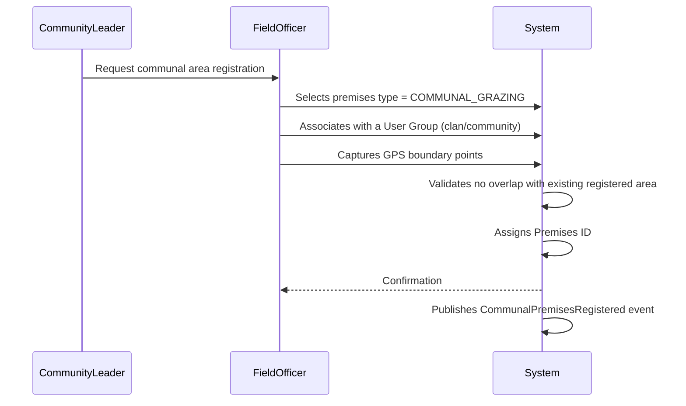
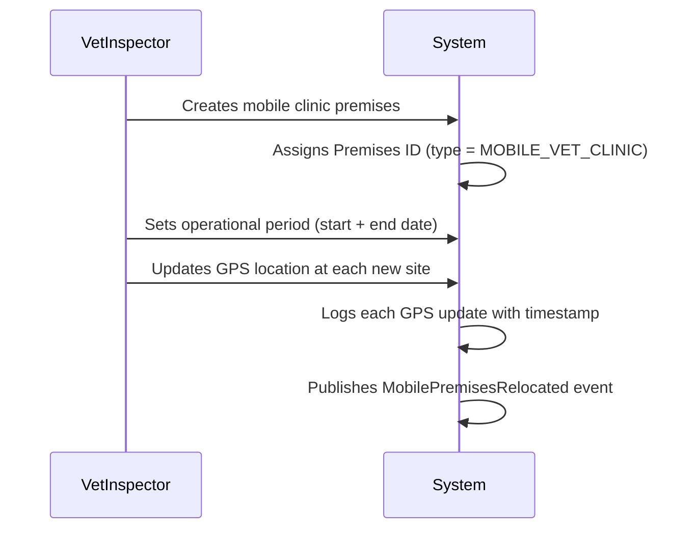
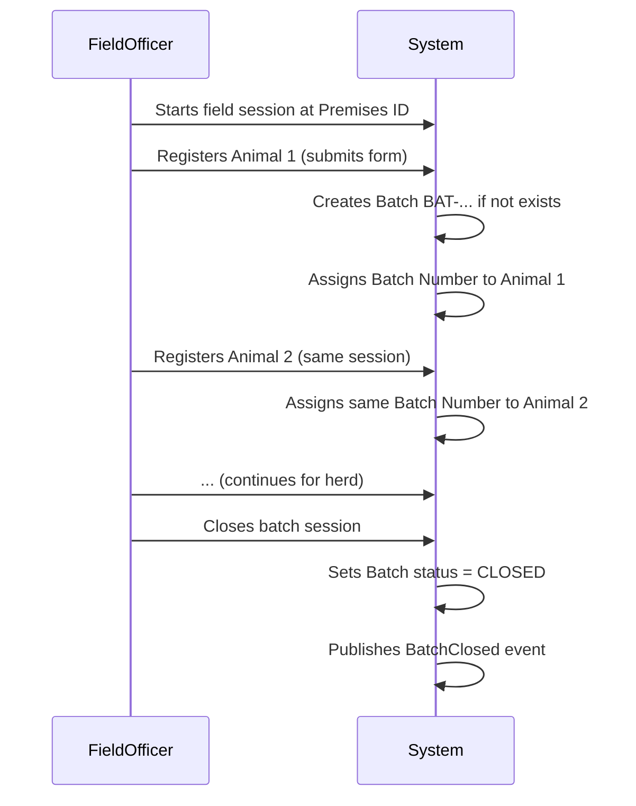
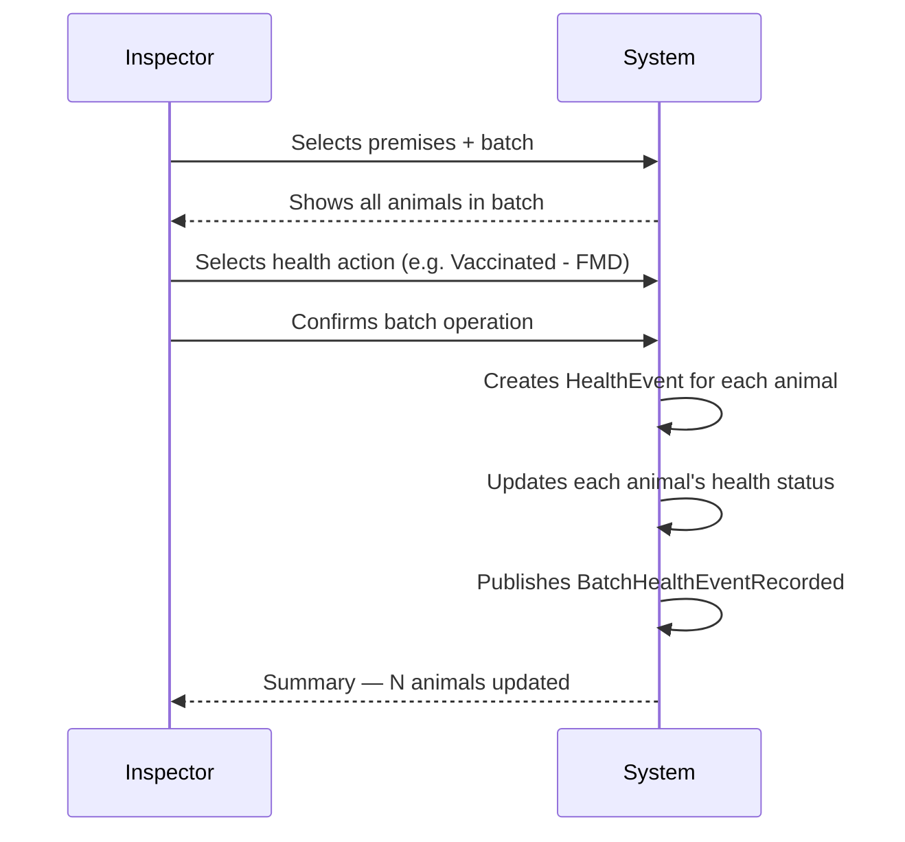
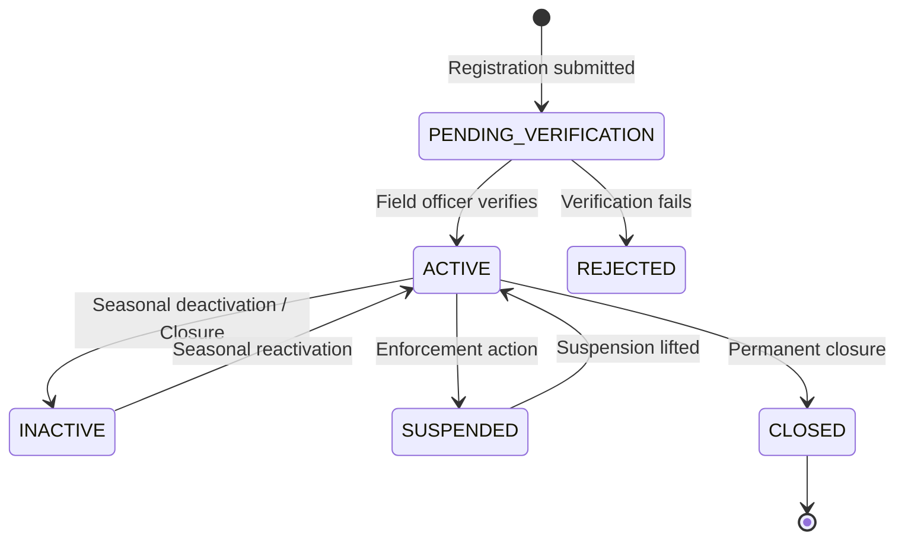
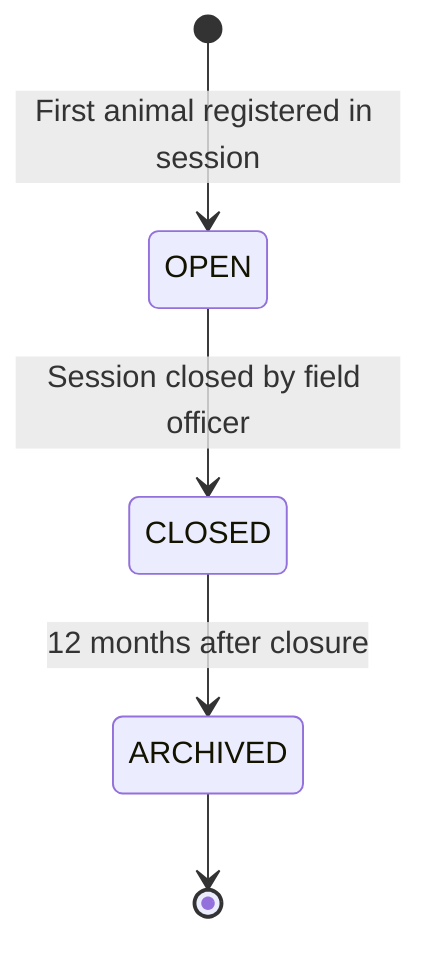
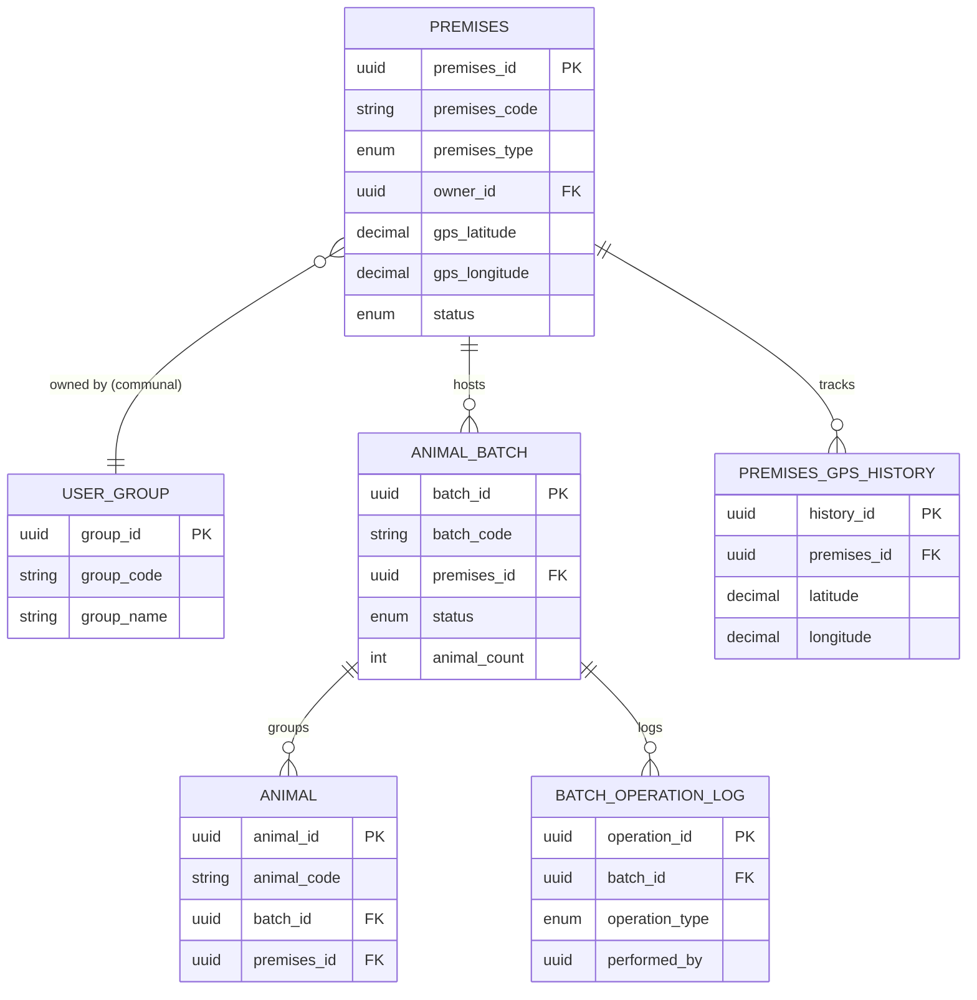

# Premises Module — Module Specification

**Module:** premises-service  
**Version:** 0.1 — Draft for Review  
**Date:** 2026-08-02  
**Phase:** Step 1 — Business Requirements and Workflow Documentation  
**Status:** Pending Review

---

## 1. Objective

The Premises module is the authoritative registry of every physical or operational location
used for livestock management in Somalia. It assigns and maintains unique, permanent
identifiers for farms, communal grazing lands, watering points, markets, quarantine stations,
and mobile veterinary facilities. It captures GPS coordinates, manages seasonal availability,
supports group (communal) ownership structures, and enables geospatial traceability of
livestock across all registered locations.

The module also provides a **batch-level view** of animals present at a premises — allowing
inspectors and veterinarians to act on entire groups of animals rather than processing each
animal individually.

---

## 2. Scope

**In scope:**
- Registration of all premises types (permanent, temporary, communal, mobile)
- Assignment of a unique, persistent Premises ID to each location
- GPS coordinate capture and geospatial mapping
- Communal and user-group ownership structures (clans, communities)
- Seasonal operational periods for temporary and communal premises
- Reactivation and deactivation of premises based on seasonal availability
- Offline-capable mobile registration for remote areas
- Batch registration of animals — grouping animals registered together under a Batch Number
- Batch-level view of animals at a premises, grouped by batch
- Integration with the animal registry, movement, and health modules

**Out of scope:**
- Individual animal identity and tagging — animal-registry-service
- Movement permit issuance — movement-permit-service
- Veterinary health events at animal level — health-service
- Market transaction processing — market-service
- Owner identity and authentication — owner-registration-service

---

## 3. Actors

| Actor | Role Code | Responsibilities |
|---|---|---|
| Livestock Owner | `LIVESTOCK_OWNER` | Register own premises; view own animals batch-wise; update premises GPS |
| Field Officer | `FIELD_OFFICER` | Register and verify premises; capture GPS on-site; register communal areas |
| Veterinarian / Inspector | `VET_INSPECTOR` | View animals at premises by batch; trigger batch-level health updates |
| Community Leader | `COMMUNITY_LEADER` | Register communal grazing areas on behalf of a clan or group |
| Premises Administrator | `PREMISES_ADMIN` | Manage premises status; activate/deactivate seasonal premises |
| System Administrator | `SYSTEM_ADMIN` | Full access; audit log review |
| Ministry Supervisor | `MINISTRY_SUPERVISOR` | Read-only across all premises; generate reports |

---

## 4. Premises Types

| Type Code | Name | Description |
|---|---|---|
| `FARM` | Permanent Farm / Holding | Fixed property registered to an individual or family |
| `COMMUNAL_GRAZING` | Communal Grazing Land | Shared grazing area used by a clan or community |
| `WATERING_POINT` | Watering Point | Fixed or seasonal water source used by pastoralists |
| `MARKET` | Livestock Market | Trading venue for animal sales and transfers |
| `QUARANTINE` | Quarantine Station | Designated holding area for animals under quarantine |
| `MOBILE_VET_CLINIC` | Mobile Veterinary Clinic | Temporary health post that moves with pastoralist groups |
| `TEMPORARY_CAMP` | Temporary Pastoral Camp | Seasonal resting or grazing camp on a migration route |
| `SLAUGHTERHOUSE` | Slaughterhouse / Abattoir | Registered slaughter facility |
| `BORDER_POST` | Border Import/Export Post | Entry/exit point for cross-border animal movements |

---

## 5. Premises ID Format

```
PRM-[REGION_CODE]-[TYPE_CODE]-[YEAR]-[SEQUENCE]

Examples:
  PRM-MOG-FARM-2024-000123    # Permanent farm near Mogadishu
  PRM-BAY-CG-2024-000045      # Communal grazing, Bay region
  PRM-AWD-WP-2025-000012      # Watering point, Awdal region
  PRM-HRS-MVC-2024-000007     # Mobile vet clinic, Hiraan region
```

The Premises ID is assigned at registration and never changes, even if the premises is
deactivated, reactivated, or transferred to a different group.

---

## 6. Batch Registration — Overview

A **Batch** is a group of animals registered or processed together in a single field
operation. Batches allow inspectors and veterinarians to act on many animals at once
without individually selecting each record.

### 6.1 Batch Number Format

```
BAT-[PREMISES_ID_SHORT]-[YEAR]-[SEQUENCE]

Example:
  BAT-PRM0123-2024-0045   # 45th batch at premises 0123 in 2024
```

### 6.2 How Batches Are Created

- A batch is created automatically when a field officer registers **two or more animals**
  in a single session at a premises.
- A single-animal registration may optionally be assigned to an existing batch.
- Animals born, purchased, or imported in the same event at the same premises belong to
  the same batch.

### 6.3 Batch Lifecycle

```
OPEN → CLOSED → ARCHIVED
```

| Status | Meaning |
|---|---|
| `OPEN` | Animals can still be added to this batch |
| `CLOSED` | Batch is finalised; no new animals can be added; batch actions still allowed |
| `ARCHIVED` | Batch is historical; read-only |

### 6.4 Batch-Level Operations (Inspector / Vet)

| Operation | Description |
|---|---|
| Batch health status update | Mark all animals in the batch as Healthy / Sick / Under Observation |
| Batch vaccination record | Record a vaccination event for all animals in the batch |
| Batch deworming record | Record a deworming event for all animals in the batch |
| Batch movement | Initiate a movement permit for all animals in the batch |
| Batch quarantine | Place all animals in the batch under quarantine |
| Batch export declaration | Declare all animals in the batch for export |

Batch operations create individual records for each animal — the batch is the trigger,
not the sole record. Each animal retains its own complete history.

---

## 7. Preconditions

- The registering party (owner, field officer, or community leader) must be an authenticated
  SOMLITS user.
- For communal premises, a registered user group (clan, community) must exist before
  registration.
- GPS capture requires the mobile device to have location services enabled.
- Offline registrations are queued and synchronised when connectivity is restored.

---

## 8. Main Workflows

### 8.1 Register a New Permanent Premises

```mermaid
sequenceDiagram
    participant Owner
    participant FieldOfficer
    participant System

    Owner->>FieldOfficer: Requests premises registration
    FieldOfficer->>System: Opens mobile registration form
    System-->>FieldOfficer: Form with GPS auto-capture
    FieldOfficer->>System: Enters details + captures GPS
    System->>System: Validates data; checks for duplicate GPS
    System->>System: Assigns Premises ID (PRM-...)
    System-->>FieldOfficer: Confirmation + Premises ID
    FieldOfficer-->>Owner: Provides Premises ID certificate
    System->>System: Publishes PremisesRegistered event
```

### 8.2 Register a Communal Grazing Area



### 8.3 Register a Mobile Veterinary Clinic



### 8.4 Batch Registration of Animals at a Premises



### 8.5 Batch Health Update by Inspector



---

## 9. Alternative Workflows

### 9.1 Offline Registration (Remote Area)

- Field officer uses mobile app in offline mode.
- Data is stored locally with a pending status and a local reference number.
- When connectivity is restored, data is automatically synchronised.
- The server assigns the official Premises ID after sync; the local reference is retired.
- Conflict resolution: if the same location was registered twice offline, the system flags
  a duplicate GPS alert for supervisor review.

### 9.2 Seasonal Deactivation and Reactivation

- A premises administrator sets an end date on a temporary premises.
- On the end date, the premises transitions to `INACTIVE`.
- At the start of the next season, the same Premises ID can be reactivated.
- Reactivation records the new operational period; the history of prior periods is preserved.

### 9.3 Premises Boundary Update

- A communal grazing area that expands or contracts can have its GPS boundary updated.
- Each boundary update is recorded with a timestamp and the officer who made the change.
- The original boundary is preserved in history.

---

## 10. Exception Workflows

| Situation | Handling |
|---|---|
| Duplicate GPS coordinates detected | Alert field officer; require confirmation or cancellation |
| GPS signal unavailable | Officer can enter coordinates manually or use last-known location |
| Communal area conflicts with existing registered area | Reject registration; flag to supervisor |
| Batch closed with fewer animals than planned | Officer can reopen batch (within same day) with supervisor approval |
| Animal assigned to wrong batch | Batch reassignment allowed by field officer within 48 hours of registration |

---

## 11. Status Lifecycle

### Premises Status



### Batch Status



---

## 12. Business Rules

| ID | Rule |
|---|---|
| BR-PRM-01 | A Premises ID, once assigned, is permanent and cannot be changed or reused |
| BR-PRM-02 | Every registered premises must have at least one GPS coordinate |
| BR-PRM-03 | Communal premises must be linked to a registered user group, not an individual |
| BR-PRM-04 | A temporary premises must have a defined operational start date |
| BR-PRM-05 | An inactive premises cannot be a destination or origin in a movement permit |
| BR-PRM-06 | A mobile vet clinic premises must have its GPS updated whenever it relocates |
| BR-PRM-07 | A batch number must be unique per premises per registration year |
| BR-PRM-08 | A closed batch cannot receive new animals without supervisor approval |
| BR-PRM-09 | Batch operations apply only to animals currently at the specified premises |
| BR-PRM-10 | GPS coordinates must fall within the geographic boundaries of Somalia |
| BR-PRM-11 | Only animals with status ACTIVE can be included in a batch operation |
| BR-PRM-12 | Offline registrations must be synchronised within 7 days of capture |
| BR-PRM-13 | Premises records cannot be physically deleted; only status transitions are allowed |
| BR-PRM-14 | A quarantine station premises can only be managed by authorised health authorities |

---

## 13. Authorization Matrix

| Action | LIVESTOCK_OWNER | FIELD_OFFICER | VET_INSPECTOR | COMMUNITY_LEADER | PREMISES_ADMIN | SYSTEM_ADMIN |
|---|:---:|:---:|:---:|:---:|:---:|:---:|
| Register own permanent premises | ✓ | ✓ | | | | ✓ |
| Register communal premises | | ✓ | | ✓ | | ✓ |
| Register mobile vet clinic | | | ✓ | | ✓ | ✓ |
| Register market / quarantine | | | | | ✓ | ✓ |
| Update GPS / boundary | | ✓ | ✓ | ✓ | ✓ | ✓ |
| Activate / deactivate premises | | | | | ✓ | ✓ |
| View own premises | ✓ | | | ✓ | | |
| View all premises | | ✓ | ✓ | | ✓ | ✓ |
| Create / close batch | | ✓ | ✓ | | | ✓ |
| Reopen batch | | | | | ✓ | ✓ |
| Batch health update | | | ✓ | | | ✓ |
| Batch movement | | ✓ | | | | ✓ |
| View batch-wise animals at premises | ✓ | ✓ | ✓ | ✓ | ✓ | ✓ |
| Generate premises reports | | ✓ | ✓ | | ✓ | ✓ |
| View audit log | | | | | ✓ | ✓ |

---

## 14. Data Entities

### 14.1 Premises

| Field | Type | Required | Notes |
|---|---|:---:|---|
| `premises_id` | UUID | ✓ | Internal primary key |
| `premises_code` | String | ✓ | Human-readable ID (PRM-...) |
| `premises_type` | Enum | ✓ | FARM, COMMUNAL_GRAZING, etc. |
| `name` | String | ✓ | Descriptive name |
| `region` | String | ✓ | Somali administrative region |
| `district` | String | | District within region |
| `village_area` | String | | Local area name |
| `gps_latitude` | Decimal | ✓ | Primary GPS latitude |
| `gps_longitude` | Decimal | ✓ | Primary GPS longitude |
| `gps_accuracy_meters` | Integer | | Accuracy of GPS capture |
| `boundary_points` | JSON | | Array of lat/lng for area boundary |
| `owner_type` | Enum | ✓ | INDIVIDUAL, GROUP |
| `owner_id` | UUID | ✓ | Links to owner or user group |
| `status` | Enum | ✓ | PENDING_VERIFICATION, ACTIVE, INACTIVE, SUSPENDED, CLOSED |
| `operational_start` | Date | | Required for temporary premises |
| `operational_end` | Date | | Required for temporary premises |
| `is_seasonal` | Boolean | | True for temporary and communal seasonal areas |
| `registered_by` | UUID | ✓ | Field officer who registered |
| `registered_at` | Timestamp | ✓ | UTC timestamp of registration |
| `verified_by` | UUID | | Field officer who verified |
| `verified_at` | Timestamp | | UTC timestamp of verification |
| `notes` | Text | | Free text notes |

### 14.2 Premises GPS History

Tracks every GPS update to a premises (for mobile clinics and seasonal boundary changes).

| Field | Type | Required | Notes |
|---|---|:---:|---|
| `history_id` | UUID | ✓ | |
| `premises_id` | UUID | ✓ | Foreign key to premises |
| `latitude` | Decimal | ✓ | |
| `longitude` | Decimal | ✓ | |
| `updated_by` | UUID | ✓ | |
| `updated_at` | Timestamp | ✓ | UTC |
| `reason` | String | | e.g. "Seasonal relocation" |

### 14.3 Animal Batch

| Field | Type | Required | Notes |
|---|---|:---:|---|
| `batch_id` | UUID | ✓ | Internal primary key |
| `batch_code` | String | ✓ | Human-readable (BAT-...) |
| `premises_id` | UUID | ✓ | Premises where batch was created |
| `registration_year` | Integer | ✓ | Year of batch creation |
| `status` | Enum | ✓ | OPEN, CLOSED, ARCHIVED |
| `animal_count` | Integer | ✓ | Count of animals in batch |
| `species` | Enum | | Primary species in batch (if homogeneous) |
| `created_by` | UUID | ✓ | Field officer |
| `created_at` | Timestamp | ✓ | UTC |
| `closed_by` | UUID | | |
| `closed_at` | Timestamp | | UTC |
| `notes` | String | | Session notes |

### 14.4 Batch Operation Log

Records each batch-level action taken by an inspector or vet.

| Field | Type | Required | Notes |
|---|---|:---:|---|
| `operation_id` | UUID | ✓ | |
| `batch_id` | UUID | ✓ | |
| `operation_type` | Enum | ✓ | HEALTH_UPDATE, VACCINATION, DEWORMING, MOVEMENT, QUARANTINE |
| `performed_by` | UUID | ✓ | Inspector / vet user |
| `performed_at` | Timestamp | ✓ | UTC |
| `details` | JSON | | Operation-specific payload |
| `affected_count` | Integer | ✓ | Number of animals updated |
| `notes` | String | | |

### 14.5 User Group (Communal Ownership)

| Field | Type | Required | Notes |
|---|---|:---:|---|
| `group_id` | UUID | ✓ | |
| `group_code` | String | ✓ | Readable code |
| `group_name` | String | ✓ | Clan or community name |
| `group_type` | Enum | ✓ | CLAN, COMMUNITY, COOPERATIVE |
| `region` | String | ✓ | |
| `leader_user_id` | UUID | | Linked SOMLITS user who represents group |
| `member_count` | Integer | | Approximate number of members |
| `registered_by` | UUID | ✓ | |
| `registered_at` | Timestamp | ✓ | |
| `status` | Enum | ✓ | ACTIVE, SUSPENDED, DISSOLVED |

---

## 15. Relationships



---

## 16. API Contracts (Summary)

| Method | Path | Description | Role |
|---|---|---|---|
| `POST` | `/api/v1/premises` | Register new premises | FIELD_OFFICER, LIVESTOCK_OWNER |
| `GET` | `/api/v1/premises/{code}` | Get premises by code | All authenticated |
| `PATCH` | `/api/v1/premises/{code}/status` | Activate / deactivate / suspend | PREMISES_ADMIN |
| `PATCH` | `/api/v1/premises/{code}/gps` | Update GPS location | FIELD_OFFICER, VET_INSPECTOR |
| `GET` | `/api/v1/premises/{code}/animals` | List animals at premises | All authenticated |
| `GET` | `/api/v1/premises/{code}/batches` | List batches at premises | All authenticated |
| `GET` | `/api/v1/premises/{code}/batches/{batchCode}/animals` | Animals in a specific batch | All authenticated |
| `POST` | `/api/v1/batches` | Create a new batch | FIELD_OFFICER |
| `PATCH` | `/api/v1/batches/{batchCode}/close` | Close a batch | FIELD_OFFICER |
| `POST` | `/api/v1/batches/{batchCode}/operations` | Apply a batch operation | VET_INSPECTOR, FIELD_OFFICER |
| `GET` | `/api/v1/batches/{batchCode}/operations` | View batch operation history | All authenticated |
| `POST` | `/api/v1/user-groups` | Register a user group | PREMISES_ADMIN, FIELD_OFFICER |
| `GET` | `/api/v1/user-groups/{code}` | Get user group | All authenticated |
| `GET` | `/api/v1/premises/map` | Geospatial data for map view | All authenticated |

---

## 17. Domain Events Published

| Event | Trigger | Consumers |
|---|---|---|
| `PremisesRegistered` | New premises approved | animal-registry, movement-service |
| `PremisesStatusChanged` | Status transition | movement-service, health-service |
| `PremisesGpsUpdated` | GPS location updated | map-service, audit |
| `CommunalPremisesRegistered` | Communal area registered | owner-registration-service |
| `BatchCreated` | Batch session opened | animal-registry-service |
| `BatchClosed` | Batch session closed | health-service, movement-service |
| `BatchOperationApplied` | Batch health/movement action | health-service, movement-service, audit |
| `UserGroupRegistered` | New clan/community group registered | owner-registration-service |

---

## 18. Geospatial Requirements

| Requirement | Detail |
|---|---|
| GPS capture | Device GPS via mobile browser / native app |
| Coordinate system | WGS 84 (EPSG:4326) |
| Minimum accuracy | 50 m acceptable; < 10 m preferred |
| Boundary polygons | GeoJSON format; up to 50 points per boundary |
| Map visualisation | Interactive map (OpenStreetMap base) showing all active premises |
| Pastoralist routes | Display historical GPS updates as a route trail for mobile premises |
| Offline GPS | Store coordinates locally; upload on reconnect |
| Duplicate detection | Flag premises within 100 m of an existing registered premises |

---

## 19. Offline and Connectivity Requirements

| Requirement | Detail |
|---|---|
| Offline registration | Full registration form works without internet |
| Local storage | Data stored in device SQLite / IndexedDB |
| Sync trigger | Auto-sync on connectivity restored; manual sync button |
| Sync window | Must sync within 7 days of capture (BR-PRM-12) |
| Conflict handling | Server-side duplicate check on sync; flag conflicts for review |
| GPS in offline | Device GPS works offline; coordinates captured without internet |
| Batch offline | Entire batch session can be conducted offline and synced at once |

---

## 20. Notifications

| Event | Recipient | Channel |
|---|---|---|
| Premises registration approved | Owner / field officer | SMS, in-app |
| Premises suspended | Owner | SMS, in-app |
| Batch closed | Field officer | In-app |
| Batch operation applied | Supervising officer | In-app |
| Seasonal premises approaching end date (7 days) | Premises admin | In-app, email |
| Offline sync completed | Field officer | In-app |
| Duplicate GPS alert | Field officer, supervisor | In-app |

---

## 21. Reporting

| Report | Description | Audience |
|---|---|---|
| Herd Distribution by Premises | Number of animals at each active premises | Ministry, supervisors |
| Batch Summary | Animals per batch, status, species breakdown | Field officers, vets |
| Seasonal Movement Report | Premises GPS trails for mobile and communal premises over a date range | Ministry |
| Vaccination Coverage by Premises | Animals vaccinated vs unvaccinated per premises | Health authorities |
| Disease Surveillance by Area | Health events by GPS cluster | Ministry, health authorities |
| Offline Registration Backlog | Pending syncs older than 3 days | System administrators |

---

## 22. Audit Requirements

All create, update, and status-change operations must be logged with:
- Actor (user ID, role)
- Timestamp (UTC)
- Before state / After state
- IP address / device ID

Audit records are immutable and retained indefinitely.

---

## 23. UI Screens (Farmer / Field App)

| Screen | Description |
|---|---|
| Premises Registration Form | Captures type, GPS, owner/group, seasonal period |
| My Premises List | Owner's registered premises with status and animal count |
| Premises Detail | Full details, GPS map pin, animal list grouped by batch |
| Batch View | All animals in a batch, with filter/sort; batch action button for inspectors |
| Communal Area Map | Interactive map of all communal premises in a region |
| Mobile Registration | Offline-capable mobile form for field officers |
| Batch Operations Panel | Inspector/vet panel: select operation, confirm for entire batch |

---

## 24. Validations

| Field | Validation |
|---|---|
| premises_code | Unique; matches PRM-REGION-TYPE-YYYY-NNNNNN format |
| gps_latitude | Between 0.0 and 12.0 (Somalia bounding box) |
| gps_longitude | Between 40.0 and 52.0 (Somalia bounding box) |
| operational_end | Must be after operational_start |
| batch_code | Unique per premises per year |
| animal assignment to batch | Animal must be ACTIVE and at the same premises |
| batch operation | Batch must be CLOSED or OPEN; not ARCHIVED |
| boundary_points | Minimum 3 points to form a valid polygon |
| group_name | Non-empty; unique within region |

---

## 25. Acceptance Criteria

1. A field officer can register a permanent farm premises with GPS in under 3 minutes on a mobile device.
2. A communal grazing area is registered linked to a user group (clan), not an individual.
3. A temporary premises automatically transitions to INACTIVE on its operational end date.
4. A mobile vet clinic premises records a new GPS location each time it relocates, with full history preserved.
5. A batch is automatically created when a field officer registers the second animal in the same session.
6. An inspector can apply a vaccination record to all animals in a batch in a single action.
7. The premises detail screen shows animals grouped by batch, with batch status and count.
8. A field officer can complete a full premises registration offline and sync when connectivity returns.
9. Duplicate GPS detection prevents two premises from being registered at the same coordinates.
10. All premise status changes are recorded in the audit log.

---

## 26. Changes Required to Animal Registry Module

The following additions to the `animal-registry-spec.md` are required to support batch registration:

| Addition | Detail |
|---|---|
| `batch_id` field on Animal entity | UUID, nullable; links animal to a batch at its premises |
| `batch_code` field on Animal entity | Human-readable batch code; shown on animal registration summary |
| Batch Number displayed in registration form | Field officer sees current batch number during session |
| Batch creation on second animal | Animal registry service calls premises-service to create/join batch |
| Animal list API includes `batch_code` | So premises view can group animals by batch |
| Batch field in search/filter | Allows filtering animals by batch code |

---

## 27. Open Business Questions

| # | Question | Owner |
|---|---|---|
| OBQ-01 | What GPS accuracy is acceptable for communal boundary registration in remote areas? | Ministry of Livestock |
| OBQ-02 | Can a single animal belong to multiple batches over its lifetime (e.g., birth batch, vaccination batch)? | Ministry |
| OBQ-03 | Should a batch be automatically closed after 24 hours, or only on explicit field officer action? | Operations team |
| OBQ-04 | What happens to a batch if the premises is suspended mid-session? | Ministry / Legal |
| OBQ-05 | Is there a maximum number of animals per batch? | Ministry |
| OBQ-06 | Should communal grazing area boundaries be validated against official government land records? | Ministry / GIS team |
| OBQ-07 | Are mobile vet clinics licensed at national level or regional level? | Ministry of Livestock |
| OBQ-08 | What is the data retention policy for archived batch records? | Ministry / Legal |

---

## 28. Definition of Done

- [ ] All business rules documented and reviewed
- [ ] Open business questions resolved by Ministry
- [ ] Database schema reviewed and approved
- [ ] API contracts reviewed and approved
- [ ] Geospatial requirements validated by GIS team
- [ ] Offline strategy validated by field officers
- [ ] Batch workflow validated by a veterinary inspector
- [ ] Animal registry spec updated for batch_id / batch_code fields
- [ ] Backend implementation complete with unit and integration tests
- [ ] Frontend implementation tested on mobile devices in low-connectivity conditions
- [ ] Acceptance criteria passed in UAT with real field officers
