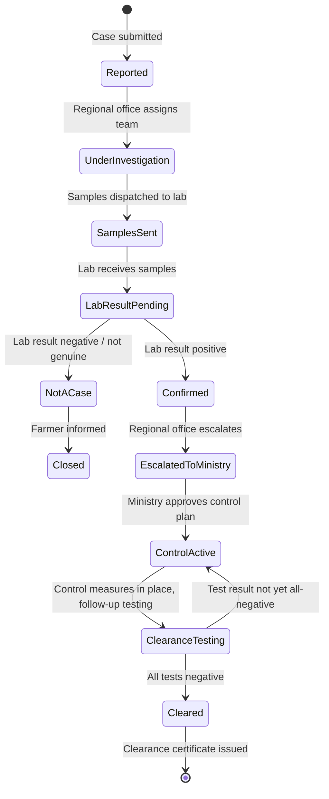

# Module 06 — Disease Prevention & Monitoring

**Version:** 1.0-draft  
**Phase:** 1 — Business Requirements & Workflow Documentation  
**Status:** Awaiting approval

---

## 1. Objective

Provide an end-to-end digital system for detecting, reporting, investigating, escalating, controlling, and clearing livestock disease events across Somalia. The module links farmers, field officers, veterinarians, regional offices, laboratories, and the central Ministry into a single traceable workflow, generating a unique Case ID for every reported event and maintaining full audit history through clearance or closure.

---

## 2. Scope

| In scope | Out of scope |
|---|---|
| Symptom reporting (farmer, field inspector, vet, community, sensors) | Human health reporting |
| Automatic case triage and ticket generation | Laboratory LIMS internals |
| Regional vet team dispatch and on-site investigation | Export certification (separate module) |
| Sample collection and lab result upload | Slaughter compensation payments |
| Ministry review, validation, and national notification | |
| Control actions: movement ban, quarantine, disinfection, vaccination | |
| Regular follow-up testing and clearance certificate | |
| Farmer and public notifications throughout lifecycle | |

---

## 3. Actors

| Actor | Portal | Role |
|---|---|---|
| Farmer / Owner | Farmer Portal | Initiates report; receives notifications; complies with restrictions |
| Field Inspector | Field Portal | Routine surveillance; logs observations; on-site visit; control enforcement |
| Veterinary Officer | Field Portal | Clinical assessment; differential diagnosis; sample collection; treatment advice |
| Social Worker | Field Portal | Community liaison; awareness campaigns; assists farmer reporting |
| Regional Veterinary Office (Duty Officer) | Ministry Portal (Regional) | Receives cases; assigns vet team; manages regional response |
| Laboratory Technician | Ministry Portal | Uploads sample results |
| Ministry Official (Central) | Ministry Portal | Validates confirmed cases; issues national alerts; approves control plans |
| Community / Public | Farmer Portal (public tip form) | Reports unusual animal deaths or disease tips |
| Auto-monitor / Sensors | System (automated) | Submits mortality and abnormal-event alerts |

---

## 4. Preconditions

- Animal is registered in SOMLITS with a valid Tag ID.
- Premises is registered and active.
- Farmer has a SOMLITS account or can reach the hotline/SMS channel.
- Regional veterinary office is assigned to the premises region.
- Accredited laboratory is registered in the system.

---

## 5. Main Workflow

### Stage 1 — Disease Detection & Reporting

Any of the following sources may open a disease case:

| Source | Channel | Action |
|---|---|---|
| Farmer / Owner | App, hotline, SMS | Observes symptoms → submits report with affected animals, symptoms, onset date |
| Field Inspector | Field Portal | Routine visit → logs clinical observation → creates report in system |
| Veterinary Officer | Field Portal | Clinical observation → reports clinical case |
| Laboratory | Ministry Portal | Positive test result on existing sample → links to or creates case |
| Community / Public | Farmer Portal tip form | Tips off unusual animal deaths |
| Auto-monitor / Sensor | System API | Mortality spike or abnormal event → auto-creates case |

On submission the system:
1. Assigns a unique **Case ID** (format: `DIS-YYYY-RRRRR`, e.g. `DIS-2026-00041`).
2. Records reporter, timestamp, location (premises code), affected species, symptom list, and onset date.
3. Assigns initial **Risk Level** (Low / Medium / High) based on species, symptom pattern, and region history.
4. Sends **acknowledgement notification** (Case ID + status) back to the reporter.
5. Notifies the responsible **Regional Veterinary Office**.

---

### Stage 2 — Regional Level Response

```
Case received at Regional Office
  → Duty officer triages: confirm risk level (Low / Med / High)
  → Assign Field Veterinary Team (Vet + Assistant)
       Issue sampling kit and PPE
  → Team travels to location
  → On-site visit:
       Clinical inspection of reported animals
       Check other animals and herd conditions
  → Sample Collection:
       Collect appropriate samples
       Proper labelling
       Maintain cold chain
  → Preliminary On-site Evaluation:
       Clinical assessment
       Differential diagnosis
       Immediate advice to farmer
  → Send samples to accredited lab
  → Lab testing per SOP → result: Positive / Negative / Inconclusive
  → Case Genuine?
       NO  → Inform farmer → Close case → Continue routine surveillance
       YES → Escalate to Ministry (Stage 3)
```

---

### Stage 3 — Escalation & Ministry Response

```
Regional Office compiles:
  - Confirmed case details
  - Lab results
  - Epidemiological information
  - Actions taken so far

→ Report sent to Ministry (Central)
     Immediate notification triggered
     Case file & evidence attached

→ Ministry Reviews & Validates:
     Validate information
     Risk assessment
     Approve control plan

→ National Disease Notification (if required):
     Internal alert to departments
     Inform relevant departments (Livestock, Health, Border, etc.)

→ Activate Emergency Response Plan:
     Form task force
     Allocate resources
     Issue communication plan
```

---

### Stage 4 — Control Actions

All control measures run in parallel after Ministry approval:

| # | Action | Lead Actor |
|---|---|---|
| 4.1 | **Movement Control** — Quarantine affected farm/herd; movement ban within infected area; control entry/exit of animals, people, vehicles; permit required for essential movement | Regional Office + Checkpoint Officers |
| 4.2 | **Quarantine & Isolation** — Isolate sick animals; quarantine exposed herds; provide isolation facilities | Veterinary Officer |
| 4.3 | **Surveillance & Monitoring** — Intensive surveillance in area; daily clinical examination; regular reporting from field teams | Field Inspectors |
| 4.4 | **Sample Testing (Regular Intervals)** — Follow-up sampling schedule; test at Day 0, 7, 14, 21…; continue until 2–3 consecutive negative results | Veterinary Officer + Lab |
| 4.5 | **Disinfection & Biosecurity** — Disinfect barns, equipment, vehicles; footbath/wheel wash at entry points; improve farm biosecurity; enforce PPE usage | Field Inspector + Farmer |
| 4.6 | **Controlled Disposal** — Safe disposal of dead animals; destroy contaminated materials (bedding, feed, etc.); follow environmental guidelines | Field Inspector |
| 4.7 | **Vaccination (if available)** — Ring vaccination inside/outside control zone; emergency vaccination as per policy | Veterinary Officer |
| 4.8 | **Public Awareness & Communication** — Inform stakeholders; awareness to farmers; prevent rumours; provide do's & don'ts | Social Worker + Ministry |

---

### Stage 5 — Regular Testing & Clearance

```
Follow-up visits (as per vet plan):
  - Monitor clinical signs
  - Check compliance

→ Regular sampling:
  - Collect samples per schedule
  - Send to lab, update results

→ Lab testing per protocol → upload results

→ All Test Results Negative?
     NO  → Continue Control Measures → maintain restrictions → re-test at defined interval
     YES → Declare Area / Herd Free:
             Stop restrictions
             Issue Clearance Certificate (PDF, signed by Ministry)
             Resume normal activities
             Notify all affected parties
```

---

## 6. Alternative Workflows

### 6a — Inconclusive Lab Result
- Lab uploads result as "Inconclusive".
- System notifies Regional Office.
- Duty officer decides: collect new samples (re-run Stage 2 from Sample Collection) or escalate to Ministry for guidance.

### 6b — Community / Public Tip
- Tip is received through the public form without a registered animal.
- System creates a **preliminary alert** (not a full case) until a field inspector verifies the location.
- If inspector confirms symptoms, it is upgraded to a full Case ID.

### 6c — Multi-Premises Outbreak
- If the same disease is confirmed on more than one premises in a region, cases are linked under a single **Outbreak ID** (`OBK-YYYY-NNNNN`).
- Ministry activates the national emergency response plan automatically.

### 6d — Sensor / Auto-Monitor Alert
- System evaluates mortality threshold rules daily.
- If threshold exceeded, a **low-priority alert** is created and assigned to the nearest field inspector for verification.

---

## 7. Exception Workflows

| Exception | Handling |
|---|---|
| Farmer cannot access app | Hotline/SMS creates case on farmer's behalf; case linked to their farmer ID |
| Vet team cannot reach location (weather, security) | Duty officer logs delay reason; system escalates to Ministry if delay > 48 hours |
| Lab capacity exceeded | Ministry redirects samples to alternative accredited lab; system records lab transfer |
| Cold chain broken during transport | Sample collection step re-opened; new samples requested |
| Animal dies before on-site visit | Post-mortem sample collection workflow triggered |
| Movement permit requested during ban | Checkpoint officer reviews; Ministry approves or rejects each permit individually |

---

## 8. Status Lifecycle



---

## 9. Business Rules

1. Every report, regardless of source, must receive a Case ID within 5 minutes of submission.
2. A Case ID, once issued, is never deleted — only its status transitions.
3. Risk level (Low / Medium / High) must be assigned by the duty officer within 2 hours of receipt.
4. A confirmed case cannot transition back to "Not a Case" once escalated to the Ministry.
5. Movement bans are system-enforced: any movement request for an animal on a banned premises is automatically blocked and requires an explicit Ministry permit override.
6. A clearance certificate may only be issued after a minimum of 2 consecutive negative lab results taken at least 7 days apart.
7. Lab results must be uploaded by the laboratory — they cannot be manually entered by field staff.
8. Every control action step must be logged with the actor ID, timestamp, and GPS coordinates (where applicable).
9. Dead or disposed animals must be marked in the Animal Registry as "DEAD — disease" and cannot be reactivated.
10. All notifications (farmer, regional, ministry) must be sent within 30 minutes of the triggering event.
11. A vaccination performed as a control action creates a Health Event record linked to the Case ID.
12. Movement permit exceptions during a ban require Ministry-level approval — regional office cannot approve alone.

---

## 10. Authorization Matrix

| Action | Farmer | Field Inspector | Vet Officer | Social Worker | Regional Office | Ministry |
|---|---|---|---|---|---|---|
| Submit disease report | ✅ | ✅ | ✅ | ✅ | ✅ | ✅ |
| View own case status | ✅ | ✅ | ✅ | ✅ | ✅ | ✅ |
| View all regional cases | ❌ | ✅ | ✅ | ❌ | ✅ | ✅ |
| Assign vet team | ❌ | ❌ | ❌ | ❌ | ✅ | ✅ |
| Log on-site visit | ❌ | ✅ | ✅ | ❌ | ❌ | ❌ |
| Log sample collection | ❌ | ✅ | ✅ | ❌ | ❌ | ❌ |
| Upload lab result | ❌ | ❌ | ❌ | ❌ | ❌ (Lab only) | ❌ (Lab only) |
| Escalate to Ministry | ❌ | ❌ | ❌ | ❌ | ✅ | ✅ |
| Validate & approve control plan | ❌ | ❌ | ❌ | ❌ | ❌ | ✅ |
| Issue national notification | ❌ | ❌ | ❌ | ❌ | ❌ | ✅ |
| Approve movement permit during ban | ❌ | ❌ | ❌ | ❌ | ❌ | ✅ |
| Log control actions (4.1–4.8) | ❌ | ✅ | ✅ | ✅ (4.8 only) | ✅ | ✅ |
| Issue clearance certificate | ❌ | ❌ | ❌ | ❌ | ❌ | ✅ |

---

## 11. Data Entities

### DiseaseCase
| Field | Type | Notes |
|---|---|---|
| id | UUID | Internal primary key |
| caseCode | VARCHAR(20) | `DIS-YYYY-NNNNN` |
| outbreakId | UUID (nullable) | Links to Outbreak if multi-premises |
| reportedByType | ENUM | FARMER, FIELD_INSPECTOR, VET_OFFICER, SOCIAL_WORKER, LAB, COMMUNITY, SENSOR |
| reportedByUserId | UUID | |
| premisesId | UUID | |
| regionCode | VARCHAR | |
| speciesAffected | VARCHAR[] | |
| symptomsObserved | VARCHAR[] | |
| onsetDate | DATE | |
| riskLevel | ENUM | LOW, MEDIUM, HIGH |
| status | ENUM | See §8 |
| assignedVetTeamId | UUID (nullable) | |
| labId | UUID (nullable) | |
| controlPlanApprovedAt | TIMESTAMPTZ | |
| controlPlanApprovedBy | UUID | |
| clearanceCertificateUrl | VARCHAR (nullable) | |
| closedAt | TIMESTAMPTZ | |
| closedReason | TEXT | |
| createdAt | TIMESTAMPTZ | UTC |
| updatedAt | TIMESTAMPTZ | UTC |

### DiseaseReport (the initial symptom submission)
| Field | Type | Notes |
|---|---|---|
| id | UUID | |
| caseId | UUID | FK → DiseaseCase |
| affectedAnimalIds | UUID[] | |
| affectedAnimalCount | INT | |
| symptomsDetail | TEXT | |
| attachments | VARCHAR[] | Photo/video URLs |
| reportChannel | ENUM | APP, HOTLINE, SMS, SYSTEM |
| gpsLat | DECIMAL | |
| gpsLon | DECIMAL | |
| createdAt | TIMESTAMPTZ | |

### CaseInvestigation (on-site visit record)
| Field | Type | Notes |
|---|---|---|
| id | UUID | |
| caseId | UUID | |
| visitedBy | UUID | Vet Officer user ID |
| visitedAt | TIMESTAMPTZ | |
| gpsLat / gpsLon | DECIMAL | |
| clinicalFindings | TEXT | |
| differentialDiagnosis | TEXT | |
| adviceGivenToFarmer | TEXT | |
| samplesCollected | BOOLEAN | |
| genuineness | ENUM | GENUINE, NOT_CASE, INCONCLUSIVE |
| createdAt | TIMESTAMPTZ | |

### DiseaseSample
| Field | Type | Notes |
|---|---|---|
| id | UUID | |
| caseId | UUID | |
| sampleCode | VARCHAR | |
| sampleType | ENUM | BLOOD, SWAB, TISSUE, FAECES, OTHER |
| collectedBy | UUID | |
| collectedAt | TIMESTAMPTZ | |
| labId | UUID | |
| dispatchedAt | TIMESTAMPTZ | |
| receivedAt | TIMESTAMPTZ | |
| result | ENUM | POSITIVE, NEGATIVE, INCONCLUSIVE, PENDING |
| resultUploadedAt | TIMESTAMPTZ | |
| resultUploadedBy | UUID | |
| testRound | INT | 1 = initial, 2,3… = follow-up |

### ControlAction
| Field | Type | Notes |
|---|---|---|
| id | UUID | |
| caseId | UUID | |
| actionType | ENUM | MOVEMENT_CONTROL, QUARANTINE, SURVEILLANCE, SAMPLE_TESTING, DISINFECTION, DISPOSAL, VACCINATION, PUBLIC_AWARENESS |
| performedBy | UUID | |
| performedAt | TIMESTAMPTZ | |
| notes | TEXT | |
| gpsLat / gpsLon | DECIMAL | |
| evidenceUrls | VARCHAR[] | |

### MovementPermitException
| Field | Type | Notes |
|---|---|---|
| id | UUID | |
| caseId | UUID | |
| requestedBy | UUID | |
| requestedAt | TIMESTAMPTZ | |
| reason | TEXT | |
| approvedBy | UUID (nullable) | Ministry user ID |
| status | ENUM | PENDING, APPROVED, REJECTED |
| validFrom / validTo | DATE | |

### OutbreakGroup
| Field | Type | Notes |
|---|---|---|
| id | UUID | |
| outbreakCode | VARCHAR | `OBK-YYYY-NNNNN` |
| diseaseType | VARCHAR | |
| regionCodes | VARCHAR[] | |
| activatedAt | TIMESTAMPTZ | |
| status | ENUM | ACTIVE, CONTROLLED, CLEARED |

---

## 12. Relationships

```
DiseaseCase ──< DiseaseReport         (one case, one or more reports)
DiseaseCase ──< CaseInvestigation     (one case, one or more on-site visits)
DiseaseCase ──< DiseaseSample         (one case, many samples across rounds)
DiseaseCase ──< ControlAction         (one case, many control actions)
DiseaseCase ──< MovementPermitException
DiseaseCase >── OutbreakGroup         (many cases in one outbreak)
DiseaseSample >── Laboratory          (existing lab entity)
DiseaseCase >── Premises              (existing premises entity)
DiseaseCase >── Animal (many-to-many via DiseaseReport.affectedAnimalIds)
ControlAction(VACCINATION) ── HealthEvent (existing health module)
ControlAction(MOVEMENT_CONTROL) ── MovementRestriction (existing movement module)
```

---

## 13. API Contracts (Summary — full OpenAPI in Phase 3)

| Method | Path | Actor | Description |
|---|---|---|---|
| POST | `/v1/disease-cases` | All reporters | Submit new disease report |
| GET | `/v1/disease-cases` | Regional, Ministry | List cases with filters |
| GET | `/v1/disease-cases/{caseCode}` | All | Get case details |
| PATCH | `/v1/disease-cases/{caseCode}/risk-level` | Regional | Set/update risk level |
| POST | `/v1/disease-cases/{caseCode}/assign-team` | Regional | Assign vet team |
| POST | `/v1/disease-cases/{caseCode}/investigations` | Vet, Field Inspector | Log on-site visit |
| POST | `/v1/disease-cases/{caseCode}/samples` | Vet, Field Inspector | Register sample |
| PATCH | `/v1/disease-cases/{caseCode}/samples/{id}/result` | Lab | Upload lab result |
| POST | `/v1/disease-cases/{caseCode}/escalate` | Regional | Escalate to Ministry |
| POST | `/v1/disease-cases/{caseCode}/control-plan/approve` | Ministry | Approve control plan |
| POST | `/v1/disease-cases/{caseCode}/control-actions` | Field, Vet, Social Worker | Log control action |
| POST | `/v1/disease-cases/{caseCode}/movement-permits` | Farmer, Regional | Request movement exception |
| PATCH | `/v1/disease-cases/{caseCode}/movement-permits/{id}` | Ministry | Approve / reject permit |
| POST | `/v1/disease-cases/{caseCode}/national-notification` | Ministry | Issue national alert |
| POST | `/v1/disease-cases/{caseCode}/clear` | Ministry | Issue clearance certificate |
| POST | `/v1/disease-cases/{caseCode}/close` | Regional, Ministry | Close as not-a-case |
| GET | `/v1/outbreaks` | Ministry | List outbreaks |
| GET | `/v1/outbreaks/{outbreakCode}` | All | Get outbreak detail |

---

## 14. Domain Events

| Event | Trigger | Consumers |
|---|---|---|
| `DiseaseCase.Reported` | Case created | Notification service, Regional office |
| `DiseaseCase.RiskLevelAssigned` | Duty officer sets risk | Scheduling service |
| `DiseaseCase.TeamAssigned` | Vet team assigned | Team members (push notification) |
| `DiseaseCase.InvestigationLogged` | On-site visit recorded | Regional office |
| `DiseaseCase.SampleDispatched` | Sample sent to lab | Lab notification |
| `DiseaseCase.SampleResultUploaded` | Lab uploads result | Regional office, Ministry |
| `DiseaseCase.Confirmed` | Genuineness = GENUINE | Ministry notification, Movement module |
| `DiseaseCase.EscalatedToMinistry` | Regional escalates | Ministry dashboard |
| `DiseaseCase.ControlPlanApproved` | Ministry approves | All actors on case |
| `DiseaseCase.MovementBanActivated` | Movement control action logged | Movement module, Checkpoint officers |
| `DiseaseCase.MovementPermitRequested` | Permit exception requested | Ministry |
| `DiseaseCase.NationalNotificationIssued` | Ministry issues alert | All stakeholders |
| `DiseaseCase.Cleared` | Clearance certificate issued | Farmer, Regional, Animal Registry |
| `DiseaseCase.Closed` | Not-a-case closure | Farmer |
| `OutbreakGroup.Formed` | Multi-premises link created | Ministry emergency team |

---

## 15. Notifications

| Trigger | Recipient | Channel | Message |
|---|---|---|---|
| Case submitted | Farmer | App + SMS | "Case DIS-2026-XXXXX received. A vet team will visit within 48 hours." |
| Team assigned | Vet + Assistant | Push | "You are assigned to case DIS-2026-XXXXX. Travel to [Premises]." |
| Sample result uploaded | Regional duty officer | App | "Lab result for DIS-2026-XXXXX: [Result]" |
| Case confirmed genuine | Farmer | App + SMS | "Disease confirmed at your premises. Movement restrictions are now active." |
| Escalated to Ministry | Ministry dashboard | System alert | "Confirmed case DIS-2026-XXXXX escalated from [Region]." |
| Control plan approved | Regional + Field team | Push | "Control plan approved for DIS-2026-XXXXX. Begin control actions immediately." |
| National notification issued | All regional offices | System alert | "National alert issued for [Disease] in [Region]." |
| Movement permit approved/rejected | Farmer | App + SMS | "Your movement permit request for [Animal ID] has been [approved/rejected]." |
| Clearance issued | Farmer | App + SMS | "Case DIS-2026-XXXXX cleared. Clearance certificate available. Normal activities may resume." |

---

## 16. Audit Requirements

Every state transition and action must be recorded with:
- Actor (user ID, role)
- Timestamp (UTC)
- Previous state → New state
- Notes / reason
- IP address and device info

Audit records are immutable. They are never deleted.

---

## 17. UI Screens

### Farmer Portal
| Screen | Description |
|---|---|
| Report Disease | Multi-step form: affected animals (tag scan or manual), symptoms checklist, onset date, photos |
| My Disease Cases | List of cases linked to farmer's premises with status badges |
| Case Detail | Timeline of events, current status, active restrictions, movement permit request button |
| Movement Permit Request | Form to request exception movement during active ban |

### Field Portal (Field Inspector / Vet Officer / Social Worker)
| Screen | Description |
|---|---|
| Disease Cases | List of cases in assigned territory with priority indicators |
| Case Detail | Full case view with action buttons per role |
| Log On-site Visit | Form: clinical findings, differential diagnosis, farmer advice, sample collected toggle |
| Log Sample Collection | Form: sample type, code, collection timestamp, cold chain confirmation, lab selection |
| Log Control Action | Form: action type selector (4.1–4.8), notes, GPS, photo evidence upload |
| Case Map | Map view of active cases in region with risk-level colour coding |

### Ministry Portal
| Screen | Description |
|---|---|
| Disease Cases Dashboard | National map + case count by region + risk-level breakdown |
| Case List | Filterable table: by region, status, risk level, disease type, date range |
| Case Detail (Ministry) | Full case view: lab results, investigation logs, control actions, escalation timeline |
| Control Plan Approval | Review regional submission → approve / reject with notes |
| National Notification | Form to draft and publish national disease notification |
| Movement Permit Review | Queue of pending permit exception requests |
| Outbreak Management | Link/unlink cases to outbreak groups; activate emergency response plan |
| Clearance Certificate | Issue and digitally sign clearance certificate; triggers notification |
| Disease Analytics | Charts: case trends, disease types by region, clearance times, control action compliance |

---

## 18. Validations

| Rule | Detail |
|---|---|
| Onset date | Cannot be in the future; cannot be more than 90 days in the past |
| Affected animals | At least 1 animal ID or count must be provided |
| Symptoms | At least 1 symptom must be selected |
| Sample code | Unique across all samples; format validated |
| Lab result | Only the assigned laboratory user can upload results |
| Escalation | Cannot escalate unless investigation is complete and at least 1 sample result is available |
| Control plan approval | Only Ministry-role users may approve |
| Clearance | Requires minimum 2 consecutive NEGATIVE results at least 7 days apart |
| Movement permit | Cannot be submitted if case status is not `ControlActive` |

---

## 19. Acceptance Criteria

1. A farmer can submit a disease report from the app in under 2 minutes.
2. A Case ID is generated and a confirmation SMS/notification sent within 5 minutes of submission.
3. A duty officer can assign a vet team and the team receives a push notification.
4. A vet officer can log an on-site investigation with photos and GPS from the field portal.
5. Lab results uploaded by the laboratory are immediately visible on the case detail.
6. When a case is confirmed genuine, the Movement module automatically blocks movements from the affected premises.
7. A Ministry official can approve a control plan and the system notifies all field actors.
8. Movement permit exception requests are reviewed and responded to within 24 hours (SLA tracked by system).
9. A clearance certificate is generated as a PDF with Ministry signature and sent to the farmer.
10. The Ministry dashboard shows a real-time national map of active cases by risk level.
11. All actions are captured in the audit log with actor, timestamp, and previous/new state.

---

## 20. Unit Tests

- `DiseaseCase` status machine: valid transitions only
- Risk level assignment: LOW / MEDIUM / HIGH rules
- Clearance validation: reject if fewer than 2 consecutive negatives or interval < 7 days
- Movement ban enforcement: movement request blocked when ban active
- Case code generation: format `DIS-YYYY-NNNNN`, globally unique
- Outbreak grouping: multi-premises link logic

---

## 21. Integration Tests

- Submit report → Case ID returned within configured SLA
- Lab uploads result → case status transitions, notification fired
- Regional escalation → Ministry notification sent, case visible in Ministry queue
- Clearance issued → Animal Registry updated, Farmer notified, Movement ban lifted
- Movement permit approved → Movement module allows transit for that animal

---

## 22. API Tests

- POST `/v1/disease-cases` with invalid onset date → 400
- Farmer cannot access another farmer's case → 403
- Lab user can upload result, field inspector cannot → 403 on field inspector attempt
- Escalate without investigation → 422 with validation message
- Clearance with only 1 negative result → 422

---

## 23. UI Tests

- Farmer report form: all steps complete and submits successfully
- Field inspector case list: filter by risk level shows correct subset
- Ministry control plan approval: approves, status badge updates immediately
- Clearance certificate download: PDF is generated and downloadable

---

## 24. Security Tests

- Farmer cannot access another farmer's case via direct URL with case code
- Field inspector from Region A cannot see cases in Region B
- Lab result endpoint rejects non-lab roles
- Movement permit approval endpoint rejects non-Ministry roles
- All endpoints require valid authentication token
- PII fields (farmer name, GPS) are not exposed in list endpoints to lower-trust roles

---

## 25. User Acceptance Tests

| # | Test | Actor | Expected |
|---|---|---|---|
| UAT-01 | Farmer reports disease using the app | Farmer | Case created, SMS received |
| UAT-02 | Field inspector views assigned case and logs on-site visit | Field Inspector | Visit logged, status updates |
| UAT-03 | Vet officer logs sample collection and confirms genuine | Vet Officer | Sample registered, case transitions |
| UAT-04 | Lab uploads positive result | Lab user | Result visible, Ministry notified |
| UAT-05 | Regional office escalates confirmed case | Duty Officer | Ministry receives notification |
| UAT-06 | Ministry approves control plan | Ministry Official | Field team notified |
| UAT-07 | Field inspector logs movement ban and disinfection | Field Inspector | Control actions recorded |
| UAT-08 | Farmer requests movement permit exception | Farmer | Request appears in Ministry queue |
| UAT-09 | Ministry issues clearance certificate | Ministry Official | PDF generated, farmer notified, ban lifted |
| UAT-10 | Ministry views national disease map | Ministry Official | All active cases shown with risk colours |

---

## 26. Test Data

```
Farmer:          Hassan Abdi — premises SOM-BAY-001 — 4 cattle
Disease Report:  DIS-2026-00001 — Foot & Mouth Disease suspected — onset 2026-07-28
Vet Team:        Dr. Amina Yusuf (VETERINARY_OFFICER) + Ali Hassan (FIELD_INSPECTOR)
Lab:             Mogadishu Regional Veterinary Lab
Sample:          SAMP-2026-00001 — Swab — collected 2026-07-30
Result Round 1:  POSITIVE — uploaded 2026-08-01
Control Plan:    Approved 2026-08-02 by Ministry
Sample Round 2:  NEGATIVE — collected 2026-08-09 — uploaded 2026-08-10
Sample Round 3:  NEGATIVE — collected 2026-08-16 — uploaded 2026-08-17
Clearance:       Issued 2026-08-18
```

---

## 27. Definition of Done

- [ ] This document reviewed and approved by Ministry
- [ ] Mermaid workflow diagrams validated by domain expert
- [ ] All open business questions answered (see §28)
- [ ] Phase 2 (Database & API Design) approved before any code is written
- [ ] Phase 5 (Backend) includes Flyway migrations and passing tests
- [ ] Phase 7 (Frontend) includes all 4 portal views and passing tests
- [ ] End-to-end UAT completed with real Ministry and farmer representatives

---

## 28. Open Business Questions

| # | Question | Owner |
|---|---|---|
| OBQ-01 | What is the exact list of notifiable diseases in Somalia that trigger a national notification? | Ministry of Livestock |
| OBQ-02 | What is the maximum acceptable time from report submission to vet team arrival (SLA)? Low/Med/High separately | Ministry |
| OBQ-03 | Which accredited laboratories are registered for animal disease testing in Somalia? | Ministry |
| OBQ-04 | Is the cold-chain break exception a system workflow or a manual phone call today? | Regional Offices |
| OBQ-05 | What compensation process, if any, applies to farmers whose animals are disposed of under 4.6? | Ministry / Finance |
| OBQ-06 | Does the clearance certificate require a wet (paper) signature from the Ministry Director in addition to a digital signature? | Ministry Legal |
| OBQ-07 | How long should movement bans remain active if a clearance certificate is never issued (case abandoned)? | Ministry |
| OBQ-08 | Which international bodies (OIE/WOAH, FAO) need to receive the national notification, and in what format? | Ministry |
| OBQ-09 | Should the public tip form be accessible without a SOMLITS account, or require at minimum a phone number? | Ministry |
| OBQ-10 | Can a Social Worker submit a full disease report, or only a preliminary community tip? | Ministry |
