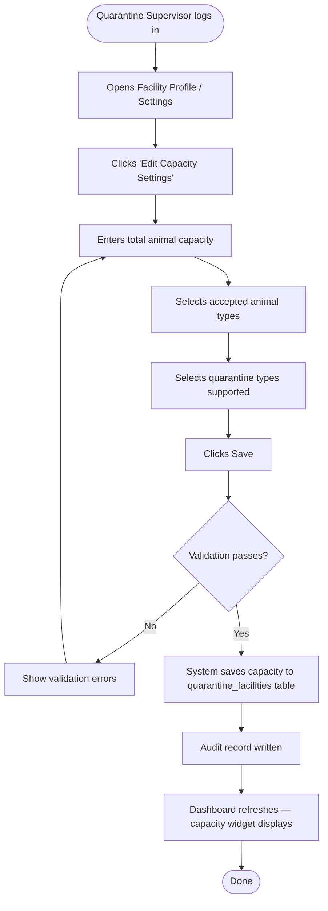
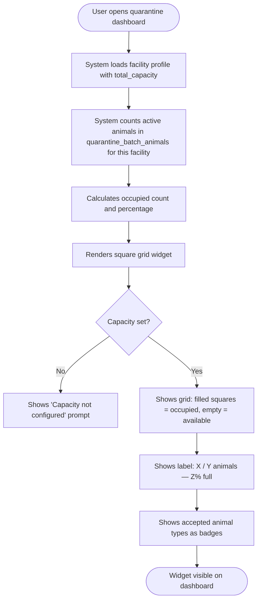
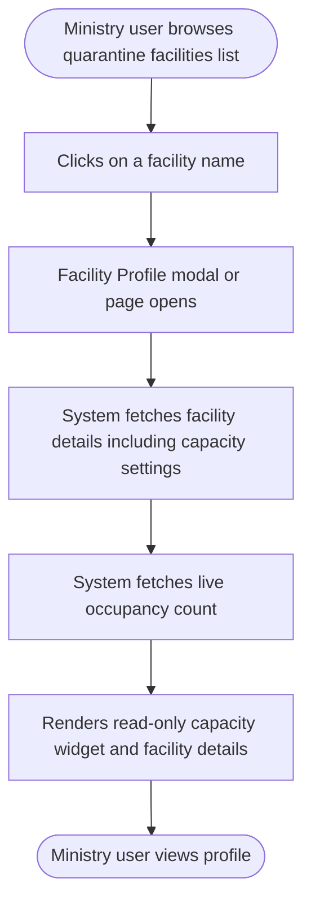
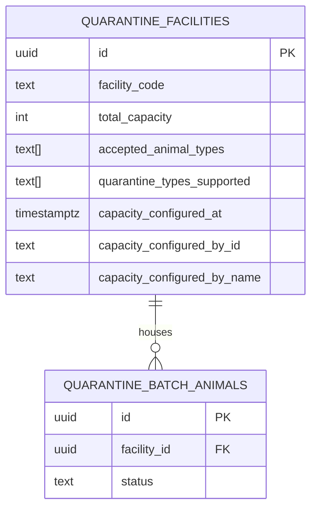

# Quarantine Facility Capacity Profile — Feature Specification

**Module:** quarantine-export-service / export-portal / ministry-portal  
**Feature:** Facility Capacity Setup and Occupancy Display  
**Version:** 0.1 — Draft for Review  
**Date:** 2026-08-31  
**Phase:** Step 1 — Business Requirements and Workflow Documentation  
**Status:** Pending Review

---

## 1. Objective

Allow registered quarantine facilities to declare their animal holding capacity, specify which animal types they can accommodate, and expose a real-time occupancy display — both on the facility's own portal and on the Ministry's facility profile view.

---

## 2. Scope

**In scope:**
- Facility staff (Quarantine Supervisor) sets total capacity and accepted animal types in their facility profile
- Visual occupancy widget (square grid) displayed on the facility's quarantine dashboard
- Ministry staff can click a quarantine facility in their portal and view the same capacity and occupancy details (read-only)
- Occupancy count derived live from active quarantine batch animals

**Out of scope:**
- Per-pen or per-enclosure capacity breakdown (future phase)
- Automatic blocking of new animal arrivals when capacity is full (future phase — requires separate movement-permit integration)
- Capacity for quarantine zones (geographic areas) — those are managed separately

---

## 3. Actors

| Actor | Role Code | Portal | Permissions |
|---|---|---|---|
| Quarantine Supervisor | `QUARANTINE_SUPERVISOR` | Export Portal | Set capacity, set animal types, view occupancy |
| Veterinary Officer | `VETERINARY_OFFICER` | Export Portal | View capacity and occupancy (read-only) |
| Lab Technician | `LAB_TECHNICIAN` | Export Portal | View capacity and occupancy (read-only) |
| Ministry Supervisor | `MINISTRY_SUPERVISOR` | Ministry Portal | View facility profile including capacity (read-only) |
| Ministry Inspector | `MINISTRY_INSPECTOR` | Ministry Portal | View facility profile including capacity (read-only) |
| System Admin | `SYSTEM_ADMIN` | Any | Full access |

---

## 4. Preconditions

- The quarantine facility is registered in the system with a valid `facility_id` and `facility_code`
- The Quarantine Supervisor is authenticated and linked to the facility
- The facility has an active status in the premises registry

---

## 5. Main Workflow — Facility Sets Capacity



---

## 6. Main Workflow — Occupancy Widget Display



---

## 7. Main Workflow — Ministry Views Facility Profile



---

## 8. Alternative Workflows

### 8.1 Capacity Not Yet Set
- Facility dashboard shows a prompt: **"Set your facility capacity to enable the occupancy display"**
- A button links directly to the capacity settings form
- Ministry viewing such a facility sees: **"Capacity not configured by facility"**

### 8.2 Occupancy Exceeds Declared Capacity
- System does not block — it displays over-capacity state
- Grid shows 100% filled squares and an overflow count: **"520 / 500 (104% — over capacity)"**
- Widget border changes to indicate over-capacity state (neutral indicator, no color coding)
- Ministry view reflects the same over-capacity state

### 8.3 Zero Animals Currently in Quarantine
- Grid shows all squares empty
- Label reads: **"0 / 500 animals — facility empty"**

---

## 9. Exception Workflows

| Exception | Handling |
|---|---|
| Facility not found | 404 response; ministry sees "Facility not found" |
| Capacity set to zero | Validation error: minimum capacity is 1 |
| No animal types selected | Validation error: at least one animal type required |
| Database unavailable | Dashboard shows last-known values with a stale-data warning |
| Unauthorized user tries to edit capacity | 403 response; edit button hidden in UI |

---

## 10. Status Lifecycle

Capacity configuration has no lifecycle status — it is always the current declared value. Changes are tracked via audit history only.

| State | Meaning |
|---|---|
| Not configured | Facility has not set a capacity value |
| Configured | Capacity, animal types, and quarantine types are set |
| Over capacity | Live occupancy count exceeds declared total_capacity |

---

## 11. Business Rules

| # | Rule |
|---|---|
| BR-01 | Only `QUARANTINE_SUPERVISOR` may set or edit capacity values for their own facility |
| BR-02 | Total capacity must be between 1 and 50,000 animals |
| BR-03 | At least one accepted animal type must be selected |
| BR-04 | Changing capacity does not affect animals already in quarantine |
| BR-05 | Occupancy count is always derived live from `quarantine_batch_animals` — it is never manually entered |
| BR-06 | Ministry can view any facility's capacity profile but cannot edit it |
| BR-07 | All changes to capacity settings must be written to the audit log with actor, timestamp, old value, and new value |
| BR-08 | Capacity settings are per-facility — a facility with multiple sites under one account sets one combined capacity |

---

## 12. Authorization Matrix

| Action | QUARANTINE_SUPERVISOR | VETERINARY_OFFICER | LAB_TECHNICIAN | MINISTRY_SUPERVISOR | MINISTRY_INSPECTOR |
|---|:---:|:---:|:---:|:---:|:---:|
| View own facility capacity widget | ✓ | ✓ | ✓ | — | — |
| Edit facility capacity settings | ✓ | ✗ | ✗ | ✗ | ✗ |
| View facility profile (Ministry) | — | — | — | ✓ | ✓ |
| View occupancy count (Ministry) | — | — | — | ✓ | ✓ |

---

## 13. Data Entities

### 13.1 quarantine_facilities (new columns added)

| Column | Type | Description |
|---|---|---|
| `total_capacity` | `INTEGER` | Maximum number of animals the facility can hold at one time |
| `accepted_animal_types` | `TEXT[]` | Array of animal type codes accepted by this facility |
| `quarantine_types_supported` | `TEXT[]` | Array of quarantine purpose types this facility handles |
| `capacity_configured_at` | `TIMESTAMPTZ` | When capacity was last set |
| `capacity_configured_by_id` | `TEXT` | User ID who last set capacity |
| `capacity_configured_by_name` | `TEXT` | Display name of user who last set capacity |

### 13.2 Animal Types (accepted_animal_types values)

| Code | Label |
|---|---|
| `CATTLE` | Cattle / Beef |
| `CAMELS` | Camels |
| `SHEEP_GOATS` | Sheep and Goats |
| `DONKEYS` | Donkeys |
| `MIXED` | Mixed (all types) |

### 13.3 Quarantine Types Supported (quarantine_types_supported values)

| Code | Label |
|---|---|
| `EXPORT_HOLD` | Pre-export holding |
| `DISEASE_CONTROL` | Disease outbreak isolation |
| `IMPORT_INSPECTION` | Import health inspection |
| `ROUTINE_HEALTH` | Routine health screening |

### 13.4 Derived: Occupancy

Occupancy is computed at query time:

```sql
SELECT COUNT(*) AS occupied_count
FROM quarantine_batch_animals
WHERE facility_id = :facilityId
  AND status IN ('ACTIVE', 'ON_HOLD');
```

---

## 14. Relationships



---

## 15. API Contracts

### GET /api/v1/facilities/{facilityId}/capacity-profile

Returns the facility's capacity settings and live occupancy.

**Response 200:**
```json
{
  "facilityId": "uuid",
  "facilityCode": "QF-SOM-001",
  "facilityName": "Mogadishu Export Quarantine Station",
  "totalCapacity": 500,
  "occupiedCount": 347,
  "availableCount": 153,
  "occupancyPercent": 69.4,
  "acceptedAnimalTypes": ["CATTLE", "CAMELS", "SHEEP_GOATS"],
  "quarantineTypesSupported": ["EXPORT_HOLD", "ROUTINE_HEALTH"],
  "capacityConfiguredAt": "2026-08-15T10:30:00Z",
  "capacityConfiguredByName": "Hassan Omar"
}
```

**Response 404:** Facility not found  
**Response 403:** Caller not authorized to view this facility

---

### PUT /api/v1/facilities/{facilityId}/capacity-profile

Update the facility's capacity settings. Only `QUARANTINE_SUPERVISOR` for the facility.

**Request body:**
```json
{
  "totalCapacity": 500,
  "acceptedAnimalTypes": ["CATTLE", "CAMELS", "SHEEP_GOATS"],
  "quarantineTypesSupported": ["EXPORT_HOLD", "ROUTINE_HEALTH"]
}
```

**Response 200:** Updated capacity profile (same shape as GET response)  
**Response 400:** Validation errors  
**Response 403:** Not authorized  
**Response 404:** Facility not found

---

## 16. Domain Events

| Event | Trigger | Consumers |
|---|---|---|
| `FacilityCapacityConfigured` | Supervisor saves capacity for the first time | Audit service |
| `FacilityCapacityUpdated` | Supervisor changes an existing capacity setting | Audit service |

**Event payload:**
```json
{
  "eventType": "FacilityCapacityUpdated",
  "facilityId": "uuid",
  "facilityCode": "QF-SOM-001",
  "previousCapacity": 400,
  "newCapacity": 500,
  "acceptedAnimalTypes": ["CATTLE", "CAMELS"],
  "changedByUserId": "uuid",
  "changedByUserName": "Hassan Omar",
  "occurredAt": "2026-08-31T08:00:00Z"
}
```

---

## 17. Notifications

| Trigger | Recipient | Message |
|---|---|---|
| Occupancy reaches 90% | Quarantine Supervisor | "Facility capacity at 90% — 450 of 500 animals" |
| Occupancy exceeds 100% | Quarantine Supervisor + Ministry Inspector | "Facility over capacity — 520 of 500 animals" |

---

## 18. Audit Requirements

| Event | Fields Logged |
|---|---|
| Capacity set (first time) | facility_id, user_id, user_name, total_capacity, accepted_animal_types, quarantine_types_supported, timestamp |
| Capacity updated | facility_id, user_id, user_name, previous_capacity, new_capacity, previous_types, new_types, timestamp |

---

## 19. UI Screens

### 19.1 Export Portal — Capacity Widget on Dashboard

Located at the top of the quarantine dashboard, below the existing stat cards.

```
┌─────────────────────────────────────────────────────────────────────┐
│  FACILITY CAPACITY                                    Edit Settings  │
│                                                                     │
│  ■ ■ ■ ■ ■ ■ ■ ■ ■ ■   ■ ■ ■ ■ ■ ■ ■ ■ ■ ■                       │
│  ■ ■ ■ ■ ■ ■ ■ ■ ■ ■   ■ ■ ■ ■ ■ ■ ■ ■ ■ ■                       │
│  ■ ■ ■ ■ ■ ■ ■ ■ ■ ■   ■ ■ ■ ■ ■ ■ ■ ■ ■ ■    ← filled = occupied│
│  ■ ■ ■ ■ ■ ■ ■ ■ ■ ■   □ □ □ □ □ □ □ □ □ □                       │
│  □ □ □ □ □ □ □ □ □ □   □ □ □ □ □ □ □ □ □ □    ← empty = available │
│                                                                     │
│  347 / 500 animals occupied  (69%)                                  │
│                                                                     │
│  Accepts:  [Cattle]  [Camels]  [Sheep & Goats]                      │
│  Types:    [Export Hold]  [Routine Health]                           │
└─────────────────────────────────────────────────────────────────────┘
```

**Grid logic:**
- Each square represents 1% of total capacity (grid always 10 × 10 = 100 units)
- Filled squares = `floor(occupancyPercent)` squares filled, left to right, top to bottom
- Over-capacity: all squares filled, overflow count shown in text
- If capacity not configured: widget shows a setup prompt instead

---

### 19.2 Export Portal — Capacity Settings Form

Accessible via "Edit Settings" link on the widget. Slide-in panel or dedicated page.

```
┌─────────────────────────────────────────────────────┐
│  Facility Capacity Settings                      [×] │
├─────────────────────────────────────────────────────┤
│  Total Animal Capacity                              │
│  ┌──────────────────────────────────────────────┐  │
│  │  500                                         │  │
│  └──────────────────────────────────────────────┘  │
│  Maximum number of animals this facility can hold   │
│                                                     │
│  Accepted Animal Types  (select all that apply)     │
│  [✓] Cattle     [✓] Camels     [✓] Sheep & Goats   │
│  [ ] Donkeys    [ ] Mixed (all types)               │
│                                                     │
│  Quarantine Types Supported                         │
│  [✓] Pre-export Holding   [✓] Routine Health        │
│  [ ] Disease Control      [ ] Import Inspection     │
│                                                     │
│            [Cancel]          [Save Settings]        │
└─────────────────────────────────────────────────────┘
```

---

### 19.3 Ministry Portal — Facility Profile View

Opened by clicking a facility name in the Ministry quarantine facilities list.

```
┌─────────────────────────────────────────────────────────────┐
│  Quarantine Facility Profile                            [×]  │
├─────────────────────────────────────────────────────────────┤
│  QF-SOM-001 — Mogadishu Export Quarantine Station            │
│  Region: Banadir  ·  Status: Active                          │
│  Registered: 2026-01-15                                      │
├─────────────────────────────────────────────────────────────┤
│  CAPACITY & OCCUPANCY                                        │
│                                                             │
│  ■ ■ ■ ■ ■ ■ ■ ■ ■ ■   ■ ■ ■ ■ ■ ■ ■ ■ ■ ■               │
│  ■ ■ ■ ■ ■ ■ ■ ■ ■ ■   ■ ■ ■ ■ ■ ■ ■ ■ ■ ■               │
│  ■ ■ ■ ■ ■ ■ ■ ■ ■ ■   ■ ■ ■ ■ ■ ■ ■ ■ ■ ■               │
│  ■ ■ ■ ■ ■ ■ ■ ■ ■ ■   □ □ □ □ □ □ □ □ □ □               │
│  □ □ □ □ □ □ □ □ □ □   □ □ □ □ □ □ □ □ □ □               │
│                                                             │
│  347 / 500 animals  (69%)                                    │
│                                                             │
│  Accepts:   [Cattle]  [Camels]  [Sheep & Goats]             │
│  Handles:   [Export Hold]  [Routine Health]                  │
│  Last updated by: Hassan Omar — 2026-08-15                   │
├─────────────────────────────────────────────────────────────┤
│  [View Active Batches]   [View Inspection History]           │
└─────────────────────────────────────────────────────────────┘
```

---

## 20. Validations

| Field | Rule | Error Message |
|---|---|---|
| `totalCapacity` | Required, integer, min 1, max 50,000 | "Capacity must be between 1 and 50,000" |
| `acceptedAnimalTypes` | Required, at least one value | "Select at least one accepted animal type" |
| `quarantineTypesSupported` | Required, at least one value | "Select at least one quarantine type" |

---

## 21. Acceptance Criteria

| # | Criterion |
|---|---|
| AC-01 | A Quarantine Supervisor can open the capacity settings form and save total capacity, animal types, and quarantine types |
| AC-02 | After saving, the capacity widget appears on the dashboard showing the correct grid and occupancy count |
| AC-03 | The occupancy count in the widget matches the live count of active animals in `quarantine_batch_animals` for that facility |
| AC-04 | When occupancy is 0, the widget shows all empty squares and "facility empty" |
| AC-05 | When occupancy exceeds capacity, all squares are filled and an over-capacity label is shown |
| AC-06 | A Veterinary Officer or Lab Technician can see the widget but cannot click "Edit Settings" |
| AC-07 | Ministry Supervisor can open a facility profile and see the capacity widget with live occupancy (read-only) |
| AC-08 | Ministry cannot see an "Edit Settings" option anywhere on the facility profile |
| AC-09 | If capacity has never been set, the dashboard shows a setup prompt and the Ministry profile shows "Capacity not configured" |
| AC-10 | All capacity changes are written to the audit log with old and new values |

---

## 22. Unit Tests

| # | Test |
|---|---|
| UT-01 | `FacilityCapacityService.updateCapacity()` saves fields correctly to DB |
| UT-02 | `FacilityCapacityService.updateCapacity()` throws `BusinessRuleViolationException` if capacity < 1 |
| UT-03 | `FacilityCapacityService.updateCapacity()` throws if no animal types provided |
| UT-04 | `FacilityCapacityService.getCapacityProfile()` returns correct `occupiedCount` by summing active batch animals |
| UT-05 | `FacilityCapacityService.getCapacityProfile()` returns `occupancyPercent` = 0.0 when no animals |
| UT-06 | Occupancy > capacity returns correct `occupancyPercent` > 100 |
| UT-07 | `CapacityWidgetComponent` renders 69 filled squares and 31 empty squares for 69% occupancy |
| UT-08 | `CapacityWidgetComponent` renders all 100 filled squares at 100%+ occupancy |
| UT-09 | `CapacityWidgetComponent` shows setup prompt when `totalCapacity` is null |

---

## 23. Integration Tests

| # | Test |
|---|---|
| IT-01 | `PUT /api/v1/facilities/{id}/capacity-profile` saves and `GET` returns updated values |
| IT-02 | `GET /api/v1/facilities/{id}/capacity-profile` returns live occupancy count matching DB |
| IT-03 | `PUT` by a `VETERINARY_OFFICER` returns 403 |
| IT-04 | Ministry token calling `GET /api/v1/facilities/{id}/capacity-profile` returns 200 with full profile |
| IT-05 | Ministry token calling `PUT` returns 403 |

---

## 24. API Tests

| # | Test |
|---|---|
| AT-01 | `PUT` with `totalCapacity: 0` returns 400 with field error |
| AT-02 | `PUT` with empty `acceptedAnimalTypes` array returns 400 |
| AT-03 | `GET` on unknown facilityId returns 404 |
| AT-04 | Unauthenticated `GET` returns 401 |

---

## 25. UI Tests

| # | Test |
|---|---|
| UI-01 | Supervisor opens settings form — all fields visible and editable |
| UI-02 | Supervisor saves valid data — widget appears with correct squares and count |
| UI-03 | Veterinary Officer dashboard — widget visible, no "Edit Settings" link present |
| UI-04 | Ministry opens facility profile — capacity widget rendered, no edit controls present |
| UI-05 | Dashboard loads with no capacity set — setup prompt shown |

---

## 26. Security Tests

| # | Test |
|---|---|
| ST-01 | `PUT` with a facility supervisor token for a different facility returns 403 |
| ST-02 | Capacity profile endpoint enforces JWT authentication — no anonymous access |
| ST-03 | Ministry token cannot call `PUT` even with correct facility ID |

---

## 27. User Acceptance Tests

| # | Test | Performed By |
|---|---|---|
| UAT-01 | Quarantine supervisor sets facility capacity and sees the grid update correctly | Quarantine Supervisor |
| UAT-02 | Supervisor adds animals to a batch — occupancy grid updates after page refresh | Quarantine Supervisor |
| UAT-03 | Ministry officer opens facility profile and confirms capacity and occupancy display accurately | Ministry Inspector |
| UAT-04 | Ministry officer confirms they cannot modify capacity settings | Ministry Inspector |

---

## 28. Test Data

| Scenario | total_capacity | occupied_count | acceptedAnimalTypes |
|---|---|---|---|
| Empty facility | 500 | 0 | `["CATTLE","CAMELS"]` |
| Partially occupied (69%) | 500 | 347 | `["CATTLE","SHEEP_GOATS"]` |
| Nearly full (95%) | 200 | 190 | `["CAMELS"]` |
| Over capacity | 100 | 115 | `["MIXED"]` |
| Capacity not configured | NULL | 0 | NULL |

---

## 29. Definition of Done

- [ ] Database columns added via Flyway migration
- [ ] Backend API endpoints implemented with authorization
- [ ] Audit log written on every capacity change
- [ ] Domain event published via outbox pattern
- [ ] Capacity widget implemented in Export Portal (facility dashboard)
- [ ] Capacity settings form implemented in Export Portal
- [ ] Facility profile modal/page implemented in Ministry Portal (read-only)
- [ ] Unit tests passing
- [ ] Integration tests passing
- [ ] API tests passing
- [ ] UI tests passing
- [ ] Security tests passing
- [ ] UAT sign-off from Quarantine Supervisor and Ministry Inspector

---

## 30. Open Business Questions

| # | Question | Owner |
|---|---|---|
| OBQ-01 | Should the system block new animal arrivals when the facility is at 100% capacity, or only warn? | Ministry Operations |
| OBQ-02 | Should "Donkeys" be a separate animal type or grouped under a catch-all? | Ministry Veterinary |
| OBQ-03 | Is 50,000 animals a realistic upper limit for capacity, or should it be lower? | Ministry Operations |
| OBQ-04 | Should the Ministry portal list all facilities with their capacity status in a summary table before opening individual profiles? | Ministry IT |
| OBQ-05 | Should email or SMS notifications be sent when a facility hits 90% capacity? | Ministry Operations |
